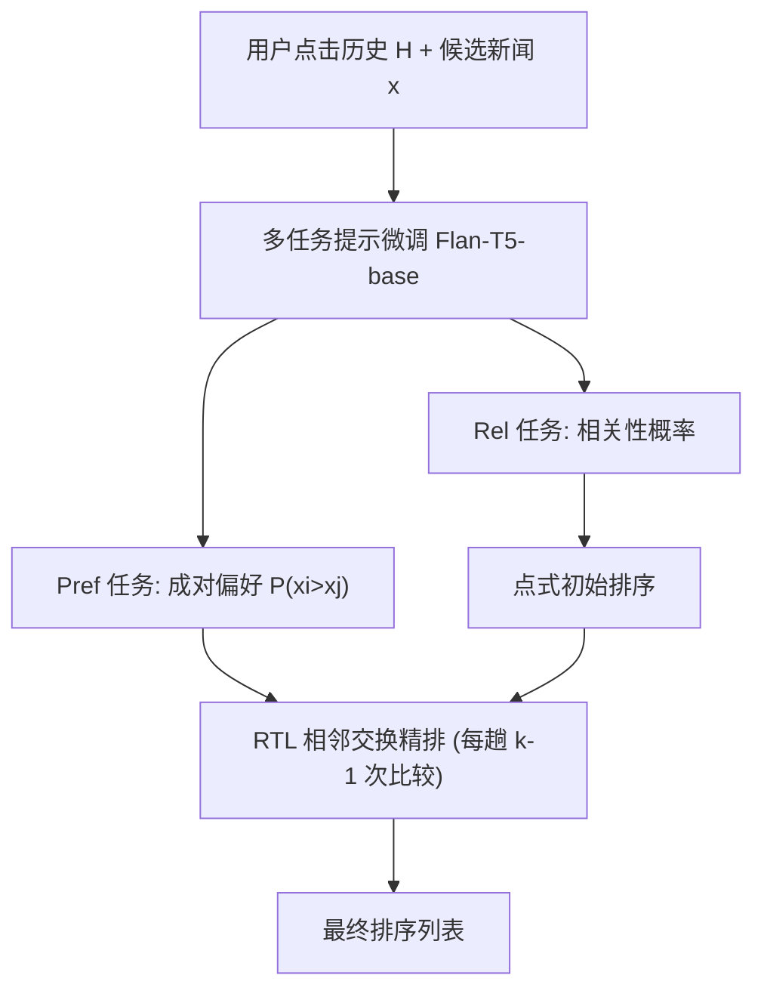
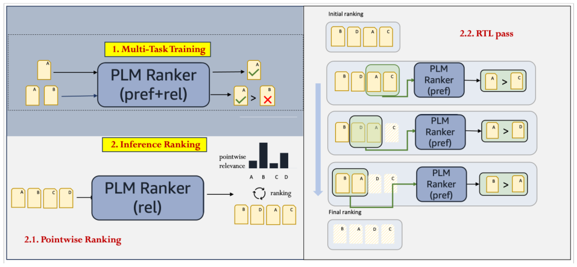
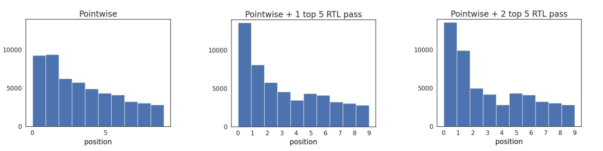

# Efficient Pointwise-Pairwise Learning-to-Rank for News Recommendation (面向新闻推荐的高效点式-成对学习排序)

- **会议/期刊**: ACL 2024
- **作者与机构**: Nithish Kannen, Yao Ma, Gerrit J.J. van den Burg (Amazon), Jean Baptiste Faddoul (Zalando SE)
- **推荐链路定位**: 精排（候选集内重排 / Rank Aggregation）
- **研究方向**: 多任务学习与列表级重排 / LLM4Rec
- **论文原文**: [https://arxiv.org/abs/2409.17711v1](https://arxiv.org/abs/2409.17711v1)
- **开源代码**: 暂未开源

## TL;DR (1分钟核心速览)

新闻推荐中，点式排序推理为 $O(K)$但忽略候选间相对比较，成对/列表式虽能建模比较性却分别受困于$O(K^2)$开销与 PLM 长上下文失效。本文提出 GLIMPSE：一次多任务文本生成式微调（Flan-T5-base）联合优化相关性预测与成对偏好，推理时先点式排序、再做右到左 (RTL) 相邻交换，复杂度仍为$O(K)$。在 MIND-Small/Adressa 全库排序上分别较 UniTRec 提升 AUC 0.80%/7.95%、nDCG@10 0.32%/6.59%，并给出基于马尔可夫链的增益充分条件。

## Background & Motivation (背景与核心矛盾)

- **主流范式**: 用 BERT/T5 类 PLM 对「用户历史 + 候选新闻标题」做编码后打分，按学习到排序 (LTR) 的三种范式——点式、成对、列表式——进行训练与推理。
- **前人局限**: (1) 点式逐条独立打分，丢失候选间比较信息，而推荐本质是相对序的判别；(2) 成对方法（Pairwise Prompting 的 bubble sort、all-pairs Box-filling）需 $O(K^2)$ 次前向，工业上不可行；(3) 列表式把全部候选塞进 512-token 提示，PLM 易产生冲突/无用输出且超长截断，实践中反而最差。
- **核心洞察 (Key Insight)**: 弱化后的成对比较+有限次局部交换，可以在**不引入二次开销**的前提下，稳定地把首个正样本向左推移——且这种增益在理论上可被刻画为马尔可夫链转移矩阵满足的显式不等式。
- **本文切入点**: 用「同一模型、两个生成任务」共享参数，再以 RTL 单向扫描把成对能力转化为一次低成本的重排，理论与工程同源。

## Method (核心方法设计)

### 1. 整体框架 (Overall Architecture)

输入为任务提示 $s_t$、用户点击历史$H_j$与候选新闻标题$x$；同一 Flan-T5-base 被混采样地喂入两类样本：`Rel` 任务回答「该候选是否适合推荐」（单条 + Yes/No 目标词），`Pref` 任务回答「A、B 两条哪条更合适」（正负各一 + Candidate A/B 目标词）。训练完成后，推理先用 `Rel` 概率得到初始点式排序，再在最靠前的$k$条上执行$m$次 RTL 扫描（每次从最右向左比较$k-1$对相邻项，若$P(x_{i+1}\succ x_i)>P(x_i\succ x_{i+1})$则交换），得到最终列表。全过程仅需$O(K)+m(k-1)$ 次 PLM 调用。

<figure class="paper-figure" markdown="span">
  <figcaption>图 1：所提出框架的示意图。GLIMPSE 包含一种多任务训练方法，其中 PLM 通过同时考虑相关性预测和成对偏好任务进行微调。推理时，相关性预测用于获得初始逐点排序，随后通过使用成对比较执行一次或多次从右到左（RTL）遍历来改进该排序。</figcaption>
</figure>

### 2. 关键设计拆解 (Key Designs)

1. **成对偏好的 Bradley-Terry 生成化**：痛点在于生成式模型只吐 token 概率，不天然输出可比较的偏好值。作者不直接比较两个候选，而是对**同一次提示内**的 A/B 位置分别取目标词概率 $\delta_i,\delta_j$，用 BT 模型把 token 概率映射为偏好概率：
$P(x_i \succ x_j \mid H_j)=\frac{e^{\delta_i}}{e^{\delta_i}+e^{\delta_j}}$。
这样偏好强度自带「相对」语义，且与 PLM 的预训练目标（预测目标词）对齐，避免了引入专门的排序回归头。

2. **RTL 单向扫描的秩聚合**：痛点在于 bubble sort 需多轮往返且随机初始化方差大。本文以点式排序为初始化，只做**右到左**单方向扫描；由于正样本在点式分布下更可能落在右侧，单向扫描对每对只触发一次「向上提升」，一趟即完成 $k-1$次比较。当$k=K$时退化为随机化的 bubble sort，是「点式$O(K)$」与「成对$O(K^2)$」之间的可调中间态。

3. **训练目标、负采样与推理开销**：总损失即标准自回归似然
$\mathcal{L}_\theta=-\sum_{d}\sum_{l=1}^{|y|}\log p_\theta(y_l\mid y_{<l};s_t,x,H)$，
$d=(s_t,x,y,H)$ 由两任务样本混采。`Rel` 任务正负样本 1:1 采样；`Pref` 任务从**同一 impression** 内取一条点击+一条未点击，构成 in-batch 难负例。无额外负采样器、无 pairwise margin loss，训练成本≈单任务微调。推理端保存点式分数并复用，额外开销仅为 8 次（MIND）或 1 次（Adressa）pairwise 前向。

### 3. 理论保证（Markov Chain 视角）

把排序 $\kappa$视为状态，点式推断给出初始分布$\pi$，RTL 交换定义转移矩阵$T$，则期望指标增益为$\mathbb{E}_A(\Delta)-\mathbb{E}_\pi(\Delta)=\pi(T-I)\Delta^{\top}$。在单正样本、MRR 指标的设定下，令$\mu$为「正样本被判优于负样本」的正确偏好概率、$\nu$ 为「负样本被判优于正样本」的错误概率，可推出增益为正的充分条件：
$$\mu<\frac{p(z_i)}{p(z_{i+1})}\nu,\quad \forall i=1,\dots,K-1$$
直觉：只有当**成对模型显著强于点式模型相对相邻位次的置信度之比**时，交换才划算——这解释了后文「点式越弱、RTL 增益越大」以及「偏好对比度不足（如 1 正 1110 负）时增益消失」两类现象。

## Experimental Setup & Evaluation Protocol (实验设置与评估协议)

- **数据集与预处理**:

| 数据集 | #Users(train/val/test) | #Impressions(train/val/test) | 稀疏度/密度 | 特征/场景说明 |
| :--- | :---: | :---: | :---: | :--- |
| MIND-Small | 49,123 / 6,981 / 50,000 | 149,116 / 7,849 / 73,152 | 每 impression 候选数少、点击稀疏 | 新闻标题(≤20 token)、历史≤50 条(≤450 token) |
| Adressa | 131,740 / 46,919 / 115,458 | 290,523 / 63,226 / 252,902 | 原始无曝光负例 | 挪威新闻站一周流量，随机采样 20 条构造候选 |
| QuoteRec | – / – / – | 35,633 / 4,454 / 4,454 | 1 正 vs 1110 负，极稀疏 | 对话语境引语推荐，迁移验证 |

- **数据划分与防穿越**: MIND 沿用官方 train/val/test；Adressa 采用**时间切分**——前 5 天作历史点击、第 6 天作 impression 训练集，第 7 天随机 20%/80% 划为验证/测试，严格避免未来信息泄漏。
- **排名评测协议**: 以**每个 impression 内的全部候选排序**计分（impression 级 Full-Ranking，未做随机负采样截断），指标为 AUC、MRR、nDCG@5、nDCG@10；MIND 上按官方测试集评估。
- **对比基线与超参**: 基线含 BERT-NPA / BERT-LSTUR / BERT-NRMS / DIGAT / HDNR / Prompt4NR / UniTRec 七类。模型 Flan-T5-base（200M，与基线规模对齐），4 epoch、lr $10^{-5}$ 线性衰减、early stopping，超参两数据集共用。

## Key Experimental Results (实验关键数据)

### 1. 主实验对比 (Main Results)

| 模型 | MIND AUC | MRR | nDCG@5 | nDCG@10 | Adressa AUC | MRR | nDCG@5 | nDCG@10 |
| :--- | :---: | :---: | :---: | :---: | :---: | :---: | :---: | :---: |
| BERT-NPA | 67.56 | 31.94 | 35.34 | 41.73 | 56.21 | 29.44 | 26.98 | 32.67 |
| BERT-LSTUR | 68.28 | 32.58 | 35.99 | 42.32 | 56.76 | 29.87 | 27.34 | 32.90 |
| BERT-NRMS | 68.60 | 32.97 | 36.55 | 42.78 | 56.95 | 30.08 | 27.89 | 32.92 |
| DIGAT | 68.77 | 33.46 | 37.14 | 43.39 | 57.13 | 30.18 | 27.95 | 32.90 |
| HDNR | 68.23 | 32.61 | 36.10 | 42.29 | 57.43 | 30.09 | 28.34 | 34.11 |
| Prompt4NR | 68.48 | 33.29 | 37.12 | 43.25 | 61.67 | 30.32 | 28.98 | 36.33 |
| UniTRec | 68.59 | 33.76 | 37.63 | 43.74 | 62.29 | **31.90** | 29.43 | 36.90 |
| GLIMPSE (point only) | 68.18 | 33.56 | 37.27 | 43.48 | 57.82 | 30.38 | 26.00 | 33.14 |
| **GLIMPSE (RTL best)** | **69.14** | **33.88** | **37.66** | **43.88** | **67.24** | 31.84 | **30.98** | **39.33** |
| **Improv.% vs UniTRec** | **+0.80%** | **+0.36%** | **+0.08%** | **+0.32%** | **+7.95%** | −0.19% | **+5.27%** | **+6.59%** |

（MIND 最优配置为 2 趟 RTL、top-5；Adressa 最优为 1 趟 RTL、top-2。）

### 2. 消融实验 (Ablation Study)

| 配置 | AUC | MRR | nDCG@5 | nDCG@10 |
| :--- | :---: | :---: | :---: | :---: |
| 弱点式(5% 数据) | 56.99 | 25.71 | 27.48 | 33.60 |
| + 1 趟 RTL (top-5) | 58.68 | 29.03 | 30.12 | 36.24 |
| + 2 趟 RTL (top-5) | 59.04 | 29.50 | 30.52 | 36.63 |
| 弱点式(10% 数据) | 65.61 | 31.02 | 34.05 | 40.38 |
| + 1 趟 RTL (top-5) | 66.73 | 32.58 | 35.90 | 42.62 |
| 单任务点式(无 Pref 辅助) | 68.63 | 33.05 | 36.56 | 42.91 |
| 多任务 GLIMPSE(point) | 68.18 | **33.56** | **37.27** | **43.48** |
| 随机初始化 + RTL | 52.14 | 25.48 | 25.31 | 31.65 |

<figure class="paper-figure" markdown="span">
  <figcaption>图 2：RTL 遍历后分布偏移的比较。图中展示了首个正标签在每个位置上的出现频率。左图显示使用 5% 数据的逐点模型得到的分布（见正文），中图基于相同的弱逐点模型，但在前 5 个条目上使用了一次 RTL 遍历。可以看出，RTL 遍历会逐步将首个正标签移至排序列表前端。</figcaption>
</figure>

### 3. 关键实验发现 (Key Findings)

- **点式越弱，RTL 增益越猛，且完全吻合 Theorem 3.1**：5% 数据训练的点式模型经 1 趟 RTL 后 AUC/MRR/nDCG@5/nDCG@10 相对提升 2.96%/12.91%/9.60%/7.85%，2 趟进一步到 3.59%/14.74%/11.06%/9.01%；而 10% 数据时仅剩 1.70%/5.02%/5.43%/5.54%。这与不等式 $\mu<\frac{p(z_i)}{p(z_{i+1})}\nu$中「$p(z_1)/p(z_2)$ 随点式精度上升而收缩」的推断一致——成对精排本质是**对弱初始化分布的纠偏**，而非对强模型的再提升。
- **$O(K)$的 RTL 反超$O(K^2)$ 的全对策略**：在 MIND 10% 测试集上，1 趟 top-5 RTL 取得 AUC 68.59 / MRR 32.60 / nDCG@10 42.27，优于 Box-filling（67.98/32.05/41.60）与 point-init BubbleSort（68.08/32.13/41.77），而耗时仅 1234.1s，对比全对策略 >20000s（约 16× 加速）。此外 top-5 优于 top-3 与 top-10，说明**精排窗口需与点式模型的首个正样本落点分布匹配**。
- **抽取式多任务正则使排序指标涨、AUC 反降**：去掉 Pref 辅助任务后 AUC 反而从 68.18 升至 68.63，但 MRR/nDCG@5/nDCG@10 分别下降 1.52%/2.17%/1.31%。说明成对目标主要校正**序关系**而非绝对点击判别，是「排序对齐」而非「分类增强」；同时三任务（加入 triple-wise）使点式 AUC 掉至 68.17，验证了小模型处理 >2 候选时的上下文失效。

## Highlights & Limitations (亮点、对比与审稿批判)

- **与代表作对比 (vs. Prior Work)**: 相较 Pairwise Prompting (Qin et al., 2024) 与 all-pairs Box-filling (Jiang et al., 2023)，本文把成对比较从 $O(K^2)$/多轮 sort 降为**单方向单趟$O(K)$** 且给出增益充分条件；相较 Gienapp et al. (2022) 的 N-window/S-window 稀疏成对，本文额外提供了初始化策略（点式先验）与 Markov 链理论刻画，而非仅做聚合策略的经验比拼；相较 Prompt4NR/UniTRec 的纯点式生成式排序，本文补上了「比较性」这一缺失维度。
- **可迁移亮点**: (1) 「点式先验 + 单方向局部交换」这一 rank aggregation 模板可低成本套用到任意已有精排打分器上，几乎零训练改动；(2) 用同一次提示内的 A/B 目标词概率 + BT 变换构造偏好分数，避免了额外打分头与配对编码开销，可直接迁移到 CTR 精排的多任务框架。
- **审稿级局限批判**: (1) 增益依赖条件不等式，作者亦承认在点式模型足够强的大型数据集上收益可能趋零甚至为负，缺少「何时该关闭 RTL」的在线判别准则；(2) top-$k$与趟数$m$ 两个推理超参在 MIND 与 Adressa 上的最优取值完全不同（top-5/2 趟 vs top-2/1 趟），缺乏自适应选择策略；(3) Adressa 的负例是从全库随机采样 20 条构造而来，与真实曝光分布存在偏差，且 MIND 上 RTL 带来的增幅（+0.08% nDCG@5）在统计显著性层面未做检验，说服力弱于 Adressa。

## Rating (四维评分)

- **方法创新性 (Novelty)**: ⭐⭐⭐⭐ （点式-成对双任务的生成式统一 + RTL 秩聚合，机制简洁；Markov 链转移矩阵给出可验证的增益充分条件，是同类 pairwise prompting 工作少有的理论补位）
- **评估协议与实验扎实度 (Protocol & Experiments)**: ⭐⭐⭐⭐ （MIND/Adressa/QuoteRec 三数据集、impression 级 Full-Ranking、7 类基线且 Adressa 全部复现，消融覆盖弱点式/初始化/推理策略/三任务；扣分在缺显著性检验与运行时仅报 10% 子集）
- **写作与数学规范度 (Clarity & Rigor)**: ⭐⭐⭐⭐ （Theorem 3.1 与 Corollary 3.1.1 推导清晰，从 $T-I$的 Hessenberg 结构到分阶多项式分解严谨；Beta 分布近似$p(z_k)$ 的 Eq.11 略跳步，闭式条件最终退化为数值模拟）
- **工业落地与复现价值 (Industrial & Practical Value)**: ⭐⭐⭐⭐ （200M Flan-T5 与基线同规模，8 次额外前向换取 SOTA，$O(K)$ 复杂度契合新闻推荐的毫秒级时延；未开源代码与 prompt 模板是复现主要障碍）

