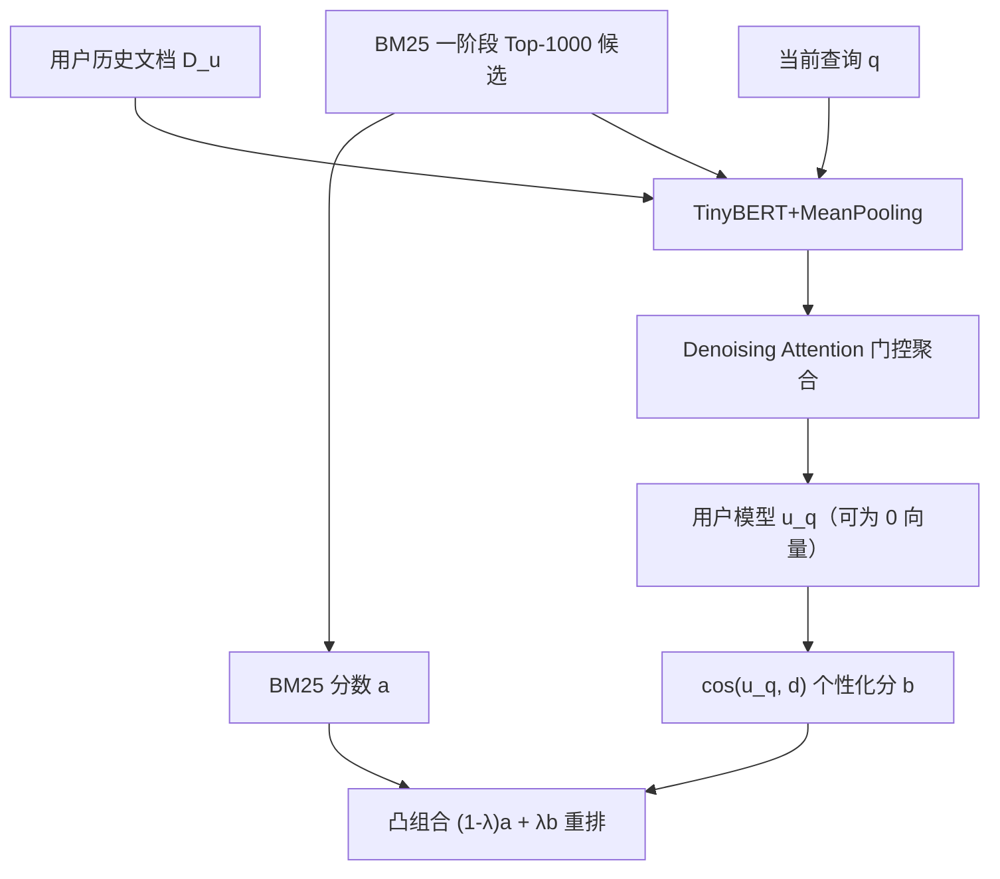
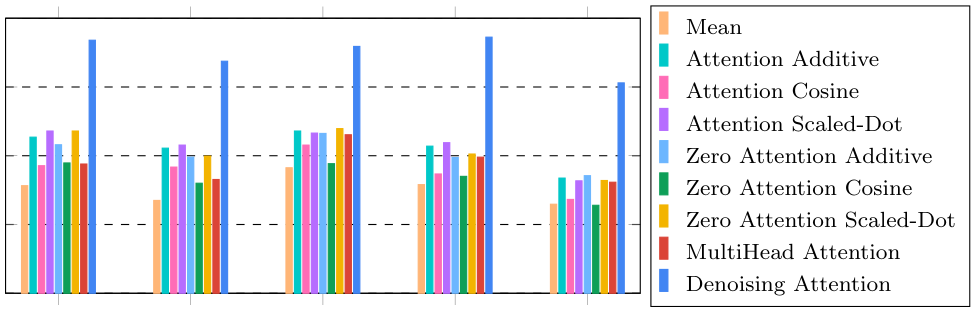

# Denoising Attention for Query-aware User Modeling in Personalized Search (面向个性化搜索中查询感知用户建模的去噪注意力)

- **会议/期刊**: ACL/EMNLP 2024（arXiv:2308.15968v1，2023-08）
- **作者与机构**: Elias Bassani (C2T / University of Milano-Bicocca)、Pranav Kasela、Gabriella Pasi (University of Milano-Bicocca)
- **推荐链路定位**: 重排（Personalized Results Re-Ranking，BM25 Top-1000 列表重排）
- **研究方向**: 自监督对比学习与交互去噪 / 多任务学习与列表级重排
- **论文原文**: [https://arxiv.org/abs/2308.15968v1](https://arxiv.org/abs/2308.15968v1)
- **开源代码**: 暂未开源（论文声明接收后放出；文中检测到的 SymSpell 仅为查询日志拼写纠错预处理工具）

## TL;DR (1分钟核心速览)

个性化搜索普遍用 Attention 在查询时刻聚合用户历史文档构建用户模型，但 Softmax 的指数放大与"权重和恒为 1"使模型要么塌缩到单篇文档、要么把弱相关噪声按非零权重灌入用户向量，且永远无法"放弃个性化"。本文提出 **Denoising Attention**：有界余弦对齐 $+$可学习阈值移位$+$ReLU 硬门控$+$ 用 max-归一化替代 Softmax。在 AOL Web Search 与 ArnetMiner 学术搜索两个场景、BM25 Top-1000 重排协议下，MAP@100 相对最佳注意力基线提升 16.6% / 14.0%，并把"个性化反而伤害检索"的查询比例从 26–31% 压到 19–23%。

## Background & Motivation (背景与核心矛盾)

- **主流范式**: Query-aware user modeling 在查询时刻以 Attention 对用户历史文档（点击网页、历史 query、UGC）加权聚合为用户向量，与候选文档打分后与一阶段分数凸组合重排。
- **前人局限 1（塌缩）**: 指数函数使 Softmax 天然趋向"单选"。对齐分 $[7,3,1,-2]$经 Softmax 得$[0.980,0.018,0.002,0.000]$，用户模型被单篇文档绑架。
- **前人局限 2（过度平滑与噪声反加权）**: 若用余弦把分数压到 0 附近，$[0.7,0.3,0.1,-0.2]$被平滑成$[0.381,0.255,0.209,0.155]$，负相关（明确不相关）文档仍获正权重，噪声直接流入用户模型；Softmax 的平移不变性又使"减去阈值"这类门控完全失效。
- **前人局限 3（无法拒答）**: 权重和为 1 ⇒ 用户向量永不为零，即使全部历史与当前 query 无关也照样个性化，此时个性化只会拉低效果。Zero Attention 正是想解决此点，但因 Softmax 机制在后续工作中被证实效果不稳定甚至低于标准 Attention。
- **核心洞察**: 问题不在"要不要加权"，而在**归一化算子**：Softmax 是为分类"选一个"设计的，与个性化需要的"多兴趣平衡 + 噪声可完全置零"目标冲突。
- **本文切入点**: 换掉归一化 + 显式引入阈值门控，使注意力权重可为零、用户向量可为零向量。

## Method (核心方法设计)

### 1. 整体框架 (Overall Architecture)

BM25（ElasticSearch，$k_1,b$在非测试 query 上调优）先召回 Top-1000；TinyBERT + mean pooling 编码查询、候选文档与用户历史文档；查询感知用户建模模块（本文核心）聚合历史文档为用户向量$u_q$；用余弦相似度计算个性化分$b$，再与 BM25 分$a$做凸组合$s=(1-\lambda)a+\lambda b$ 重排。全链路除用户建模算子外各对比模型完全一致，保证归因干净。

### 2. 关键设计拆解 (Key Designs)

1. **有界对齐 + 阈值移位 + ReLU 硬门控（让噪声权重精确归零）**：Softmax 无法滤除负相关文档，故先把对齐分搬到 $[0,1]$ 便于校准，再减去可学习阈值并整流：
$$\tilde{e}_{q,d}=\mathrm{ReLU}\left(\frac{\cos(q,d)+1}{2}-\sigma(t)\right),\qquad \sigma(t)=\mathrm{Sigmoid}(t)$$
$\sigma(t)$把阈值约束在$[0,1]$ 与对齐分同量纲；低于阈值的弱相关文档直接输出 0，真正实现"逐文档独立"的噪声过滤，而非 Softmax 那种全局再分配。

2. **max-归一化替代 Softmax（保留权重多样性 + 允许全零）**：
$$\alpha(q,d)=\frac{\tilde{e}_{q,d}}{\max\left\{\sum_{d'\in D_u}\tilde{e}_{q,d'},\ \varepsilon\right\}}$$
两个物理直觉：其一，没有指数函数，分数差异不再被放大或压平（同一输入得 $[0.75,0.25,0,0]$而非$[0.381,0.255,0.209,0.155]$），多兴趣得以平衡表达；其二，分母可为零或极小，聚合结果可为**零向量**，等价于"本次查询放弃个性化"——这正是 Zero Attention 想做而因 Softmax 平移不变性做不到的事。注意该过滤机制与 Softmax 数学上不兼容（平移不变性会吞掉移位），二者必须成套使用。

3. **训练目标、负采样与推理效率**：triplet hinge loss（margin 0.1，更大 margin 全面掉点），AdamW，lr $5\times10^{-5}$，batch 32；负采样为 BM25 高分 hard negative + in-batch random negative；训练时仅随机抽 20 篇用户文档（显存限制）、推理用全部；为规避 dying ReLU，训练时将用户模型加回查询表示，保证梯度可回传。推理仅多一次 TinyBERT 前向$+$ 余弦，与基线 Attention 同阶，无额外索引开销。

## Experimental Setup & Evaluation Protocol (实验设置与评估协议)

- **数据集与预处理**:

| 数据集 | #Users | #Docs | #Queries (train/val/test) | 平均用户文档 | 场景说明 |
| :--- | :---: | :---: | :---: | :---: | :--- |
| Web Search (AOL + Wayback) | 30,166 | 1,291,695 | 212,386 / 31,064 / 36,052 | 136.62 ± 134.17 | 开放域，兴趣极分散，含拼写纠错与域名词过滤 |
| Academic Search (ArnetMiner V12 合成) | 63,738 | 4,201,265 | 419,004 / 4,241 / 24,056 | 53.59 ± 50.94 | 论文标题作 query、引文作相关文档，领域集中 |

- **数据划分与防穿越**: Web 为**全局时间戳切分**（前 5 周作背景集，剔除查询数 <20 的用户；随后 6 周训练 / 1 周验证 / 1 周测试），并去重 $\langle q,u,d\rangle$ 三元组首次出现；Academic 为**时间切分 + 比例划分**（2018 年后论文作测试集，训练集按 99:1 随机切验证）。
- **排名评测协议**: 非全库排序，而是 **BM25 Top-1000 列表重排**（每个 query 只保留 BM25 Top-1000 内的相关文档）；指标 MAP@100、MRR@10、NDCG@10；显著性用 Bonferroni 校正 Fisher 随机化检验，$p<0.001$。
- **对比基线与超参**: BM25、Mean（历史向量算术平均）、Attention（Additive / Cosine / Scaled-Dot 三种对齐）、Zero Attention（同三种对齐）、Multi-Head Attention（4 头）；嵌入为 TinyBERT 4L-312D，$\lambda$与阈值$\sigma(t)$均在验证集网格搜索（Web$\lambda{=}0.4,\sigma(t){=}0.7$；Academic$\lambda{=}0.6,\sigma(t){=}0.6$）。

## Key Experimental Results (实验关键数据)

### 1. 主实验对比 (Main Results)

| 模型 | 对齐函数 | Web MAP@100 | Web MRR@10 | Web NDCG@10 | Acad MAP@100 | Acad MRR@10 | Acad NDCG@10 |
| :--- | :---: | :---: | :---: | :---: | :---: | :---: | :---: |
| BM25 | — | 0.245 | 0.238 | 0.280 | 0.119 | 0.294 | 0.171 |
| Mean | — | 0.282 | 0.276 | 0.329 | 0.146 | 0.328 | 0.200 |
| Attention | Additive | 0.281 | 0.276 | 0.328 | 0.156 | 0.340 | 0.213 |
| Attention | Cosine | 0.287 | 0.281 | 0.335 | 0.151 | 0.332 | 0.206 |
| Attention | Scaled-Dot | 0.290 | 0.285 | 0.339 | 0.157 | 0.343 | 0.214 |
| Zero Attention | Scaled-Dot | 0.290 | 0.285 | 0.338 | 0.156 | 0.341 | 0.212 |
| Multi-Head | Scaled-Dot | 0.275 | 0.269 | 0.324 | 0.152 | 0.336 | 0.207 |
| **Denoising Attention** | Cosine-based | **0.338** | **0.336** | **0.393** | **0.179** | **0.378** | **0.241** |
| Improv. vs 最佳基线 | | +16.6% | +17.9% | +15.9% | +14.0% | +10.2% | +12.6% |

（Denoising 相对 Mean：Web +19.9%/+21.7%/+19.5%，Academic +22.6%/+15.2%/+20.5%；相对 BM25：Web +38%/+41%/+40%。）

### 2. 消融实验 (Ablation Study)

| 变体 | Web MAP / MRR / NDCG | Acad MAP / MRR / NDCG |
| :--- | :---: | :---: |
| Attention (Scaled-Dot) | 0.290 / 0.285 / 0.339 | 0.157 / 0.343 / 0.214 |
| Filter Attention（ReLU 过滤 + max-归一化，无移位阈值） | 0.299 / 0.294 / 0.351 | 0.165 / 0.354 / 0.223 |
| Denoising **Softmax**（保留过滤但仍用 Softmax） | 0.285 / 0.280 / 0.334 | 0.151 / 0.332 / 0.206 |
| **Denoising Attention（完整）** | **0.338 / 0.336 / 0.393** | **0.180 / 0.382 / 0.243** |

### 3. 关键实验发现 (Key Findings)

- **归一化替换与门控是互补的两步，缺一即失效**：仅替换归一化（Filter Attention）只把 Web MAP 从 0.290 抬到 0.299（+3.1%）、Academic 从 0.157 抬到 0.165（+5.1%）；而"过滤 + Softmax"（Denoising Softmax）反而跌到 0.285 / 0.151，**低于**标准 Attention 基线——因为 Softmax 的平移不变性把移位阈值彻底抵消，直接证实两者必须捆绑。
- **"可归零"归一化让用户模型首次具备独立判别力**：当 $\lambda=1$ 即完全用用户模型分排序时，所有注意力基线都远逊 BM25（Web MAP 0.152 vs 0.240、Academic 0.091 vs 0.120），唯有 Denoising 达到 0.264 / 0.143，**超过 BM25**；说明它输出的是"与 query 真正相关的偏好"，而非历史噪声的对齐。
- **鲁棒性与稀疏分桶双赢**：个性化伤害 BM25 的 query 占比由 Mean 的 30%/26%、最佳注意力基线的 26%/25% 降至 19%/23%；在按用户文档数分桶（20:49 … 200+；20:29 … 100+）的每一桶 NDCG@10 均领先（图 1）；最优阈值下平均过滤掉 169/181 与 35/61 篇历史文档，Web 场景筛选力度远大于学术场景，与两场景兴趣分散度的差异吻合。

<figure class="paper-figure" markdown="span">
  <figcaption>图 3. 用户模型与 BM25 结合时，对具有不同数量关联用户相关文档的查询的有效性。</figcaption>
</figure>
图 1. 与 BM25 结合后，各用户模型在不同"关联用户文档数"分桶 query 上的 NDCG@10 对比：Denoising Attention 在每个桶、每个数据集上均稳定领先。

## Highlights & Limitations (亮点、对比与审稿批判)

- **与代表作对比 (vs. Prior Work)**: 与 Zero Attention (Ai et al.) 同为"何时不做个性化"，但后者只在 Softmax 前插入可学习零向量 token，权重和恒为 1 的结构使其**不可能真正归零**（本文实验中与标准 Attention 持平甚至略低）；与 Multi-Head Attention 相比，本文反而更轻，Multi-Head 在 TinyBERT 稠密表示上全面垫底，说明该场景的瓶颈是归一化而非表征子空间数。
- **可迁移亮点**: ①「有界对齐 $+$Sigmoid 约束阈值$+$ ReLU 门控」可直接搬到序列推荐/多场景推荐里对噪声历史行为做上下文相关的软删除；②「max-归一化使上下文向量可为 0」是一种优雅的**拒答/退化为非个性化**机制，适用于冷启动或跨域兴趣完全不匹配的场景。
- **审稿级局限批判**: ① 阈值 $t$ 是**全局标量**，两个数据集最优值分别为 0.7/0.6，需逐数据集网格搜索，缺少 query 级自适应（如按候选分布熵动态定阈），超参敏感度偏高；② 实验仅在 BM25 + TinyBERT + 余弦打分这一"轻量重排器"内进行，未与 Transformer 交叉编码重排器、也未与其他 2023 年后的查询感知用户模型直接对撞，且代码接收后才放出，复现性受限。

## Rating (四维评分)

- **方法创新性 (Novelty)**: ⭐⭐⭐⭐ （不造新网络，而是精准解剖 Softmax 在个性化场景的三处结构性缺陷，并给出最小可解释算子替换，动机推导与数值示例很有说服力）
- **评估协议与实验扎实度 (Protocol & Experiments)**: ⭐⭐⭐⭐ （两个结构迥异的真实/合成场景 $+$严格时间切分$+$Bonferroni 校正$p<0.001$ $+$ 覆盖鲁棒性、桶分析、阈值敏感与消融，唯缺全库排序与更大规模验证）
- **写作与数学规范度 (Clarity & Rigor)**: ⭐⭐⭐⭐⭐ （三大缺陷均配具体分数向量举例，公式 4–10 逐项对应动机，符号干净、复杂度分析明晰）
- **工业落地与复现价值 (Industrial & Practical Value)**: ⭐⭐⭐⭐ （仅加一次前向 $+$ 余弦、无额外索引成本，阈值可离线调优；短板是代码尚未开源、阈值需按业务重调）

