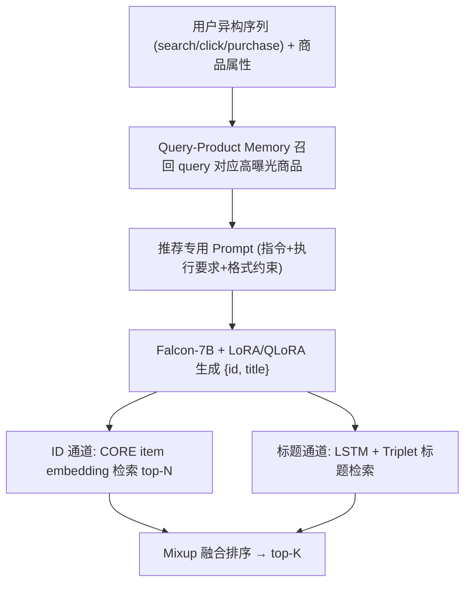
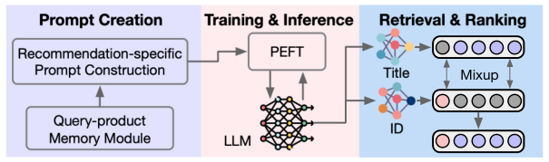
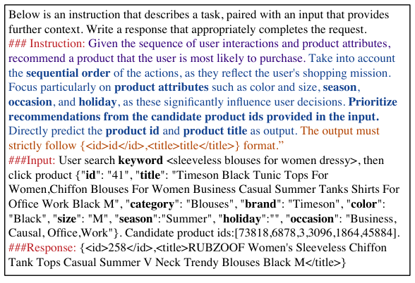

# Sequential LLM Framework for Fashion Recommendation (面向服饰推荐的序列化 LLM 框架)

- **会议/期刊**: EMNLP 2024 (Main Conference)
- **作者与机构**: Han Liu, Xianfeng Tang, Tianlang Chen, Jiapeng Liu 等；Amazon（主导） + Washington University in St. Louis + University of Illinois Chicago
- **推荐链路定位**: 生成式端到端召回 + 检索排序（LLM 生成 → 双通道向量检索）
- **研究方向**: 序列与会话推荐 / 大语言模型推荐 (LLM4Rec)
- **论文原文**: [https://arxiv.org/abs/2410.11327v1](https://arxiv.org/abs/2410.11327v1)
- **开源代码**: 论文未提供独立仓库，训练基于 [HuggingFace PEFT](https://huggingface.co/docs/peft)；Recformer 基线实现见 [Recformer 官方仓库](https://github.com/JiachengLi1995/Recformer)

## TL;DR (1分钟核心速览)

针对服饰电商「新品周转极快、交互矩阵极稀疏、购买决策由属性与搜索意图驱动」的四大痛点，本文把序列推荐重构成 LLM 的指令生成任务：先用推荐专用 Prompt 将 search/click/purchase 异构序列与属性序列化，经 LoRA/QLoRA 微调 Falcon-7B 直接生成目标商品 ID 与标题，最后用 ID 与标题双通道的 Mixup 检索完成排序。在 Amazon Fashion 四个类目上采用 Leave-One-Out 与类目内 **Full-Ranking** 评估，Recall@10 较 CORE 最高提升 **30.4%**（Clothing）、NDCG@10 提升 **64.5%**。

## Background & Motivation (背景与核心矛盾)

- **主流范式**: 服饰推荐长期走「视觉增强」路线（VBPR 把 CNN 视觉特征塞进 MF；视觉兼容性 triplet 网络；审美网络建模款式偏好）；序列侧则以 ID-based 的 SASRec / BERT4Rec / CORE 与文本化的 Recformer 为主。
- **前人局限**: ① 视觉路线依赖大规模图像采集与联合训练，工业部署成本高，且难以刻画随时间演化的交互意图；② ID-based 模型面对每月约 300 万服饰新品完全失效，Clothing 类目交互密度仅 $9.56\times10^{-6}$，冷启动与稀疏双重恶化；③ 现有方法把「搜索 query」当作噪声丢弃，而服饰场景下 query 恰恰是用户显式意图的最强信号。
- **核心洞察 (Key Insight)**: 作者在 Amazon Fashion 真实日志上量化出四条特性——**C1 高周转**（新品量是电子品类的 3.6 倍、玩具的 6.7 倍）；**C2 深度比较**（服饰序列平均长度比电子长 55%、比玩具长 81%，同一裙子有 30 种配色）；**C3 属性驱动**（季节/场合/节日显著改变购买意愿）；**C4 query 高多样**（唯一 query 数分别是电子与玩具的 2.63 / 2.38 倍）。此外用户强烈偏好搜索结果列表中靠前的商品。
- **本文切入点**: 不再为每种场景维护专用模型，而用**单个 LLM** 的常识推理 + 文本泛化能力统一吸收 C1–C4，并把 query 通过记忆模块显式注入。

## Method (核心方法设计)

### 1. 整体框架 (Overall Architecture)

框架分三段闭环：**(i) Prompt 构造**——把用户 $S_i=[(s_1,a_1,t_1),\dots,(s_K,a_K,t_K)]$中的 search / click / purchase 异构动作按时间顺序展开为自然语言，每个商品附带 title、category、brand、color、size、season、holiday、occasion 八类属性；Query-Product Memory (QPM) 依据当前 query 召回其历史搜索结果中的高曝光商品一并注入输入。**(ii) 训练与推理**——Falcon-7B 以 LoRA + QLoRA 量化方式微调，输出严格遵循 `{<id>id</id>,<title>title</title>}` 格式的目标商品。**(iii) 检索排序**——生成的 ID 与标题分别映射到 CORE 的 item embedding 表与 LSTM-triplet 标题编码器，两路各自检索后经 Mixup 融合输出最终 top-$K$。

<figure class="paper-figure" markdown="span">
  <figcaption>图2：我们方法的概述。</figcaption>
</figure>

### 2. 关键设计拆解 (Key Designs)

1. **Query-Product Memory + 推荐专用 Prompt（把搜索意图外显化）**：痛点起因是 query 与推荐目标商品之间缺少显式映射，且 LLM 的通用指令对电商标题（词堆砌、缺句法）不友好。做法是把按 query 分组、按自然位置排序的商品列表存为键值记忆，键用 CLIP 编码，当前 query 取余弦最近邻后回捞其 top-$V$商品：$\mathcal{Q}^{\star}=\mathrm{TopQ}_{q'}\cos(\mathbf{e}_q,\mathbf{e}_{q'}),\ \mathcal{P}(q)=\mathrm{TopV}\{\mathrm{List}(q')\}$，并将$\mathcal{P}(q)$ 拼入 Prompt 输入侧；指令侧显式写明「按序列顺序推理、聚焦 color/size/season/occasion、优先候选 id 列表、强制输出格式」。有效性来自两点：CLIP 语义键让同义改写 query 共享记忆，格式指示符则把解析失败转化为可训练的信号。
<figure class="paper-figure" markdown="span">
  <figcaption>图3：我们的提示示例演示。</figcaption>
</figure>
2. **LoRA/QLoRA 微调 + 困惑度驱动的非均匀训练（低成本对齐 + 修格式）**：全参微调 7B 模型成本不可行，故仅在注意力/FFN 上插入低秩增量 $W'=W_0+\frac{\alpha}{r}\boldsymbol{B}\boldsymbol{A}$（$r=16,\alpha=16$，dropout 0.05），并用 QLoRA 让存储类型与计算类型分离以压低显存；训练目标是响应段的 token 级负对数似然$\mathcal{L}_{\text{SFT}}=-\sum_{t=1}^{|y|}\log p_\theta(y_t\mid y_{<t},x)$。作者发现约 7% 的输出格式不合规，根因是电商标题困惑度高、不似自然语言，于是选出困惑度最高的 20% Prompt 额外多训至 3 epoch（其余 1 epoch）——等价于对「难解析样本」做重要性重采样，代价极小却显著提升可解码率。
3. **Mixup 检索 + 双塔标题编码（兼顾头部精准与长尾泛化）**：单一 ID 检索无法覆盖冷启动新品，单一文本检索又丢失细粒度 item 身份。标题编码器以「同 query 下被购买的商品应相近」为监督，用双硬负样本 triplet 训练 $\mathcal{L}_{\text{tri}}=\max\big(0,\ \|\mathbf{e}_q-\mathbf{e}_{t^+}\|_2^2-\|\mathbf{e}_q-\mathbf{e}_{t^-}\|_2^2+m\big)$，其中$t^-$取「与 query 最近但未被购买」的标题，另有 query 侧的对称硬负样本。最终检索按位置拼接：$\mathcal{R}_K=\mathcal{R}^{\text{ID}}_{1:N}\cup\mathcal{R}^{\text{title}}_{N+1:K}$，实验中统一$N=1$——即**头部 1 个位次完全交给 ID 精确匹配，其余位次由标题语义兜底**。推理侧无需负采样，只是两路 ANN 检索 + 一次生成，主要开销集中在 7B 模型的 64 token 自回归解码上。

## Experimental Setup & Evaluation Protocol (实验设置与评估协议)

- **数据集与预处理**: 取自 Amazon Fashion 真实日志，保留 search / click / purchase 三类动作，并**过滤掉最终未购买商品的 click 交互**（这是一处关键的标签清洗），商品属性以 key-value 数组存储。

| 数据集 | #Users | #Items | #Interactions | 平均序列长 | 密度 | 场景说明 |
| :--- | :---: | :---: | :---: | :---: | :---: | :--- |
| Luggage & Bags | 10,611 | 61,550 | 131,647 | 12.41 | 2.02E-04 | 低频高单价箱包 |
| Footwear | 63,273 | 380,385 | 714,628 | 11.29 | 2.97E-05 | 尺码敏感鞋履 |
| Accessories & Jewelry | 106,104 | 524,433 | 1,376,999 | 12.98 | 2.47E-05 | 配饰珠宝 |
| Clothing | 274,285 | 1,386,910 | 3,635,414 | 13.25 | 9.56E-06 | 最稀疏、周转最快 |

- **数据划分与防穿越**: `Leave-One-Out`，即每个用户序列最后 1 个购买交互作测试目标，之前为训练/验证；无时间戳随机泄露风险说明，但按序列顺序构造样本，天然满足因果约束。
- **排名评测协议**: `Full-Ranking`（全库未交互排序）——将 ground-truth 商品在**同一类目全部商品**中排序（Clothing 候选池达 139 万），报告 Recall@10 / NDCG@10 / MRR@10；未使用采样负例，评估较严格。
- **对比基线与超参**: GRU4Rec、SASRec、BERT4Rec、NextItNet、CORE、Recformer、Recformer w/ query（消融「加入搜索 query」的公平变体）；基线的实现统一走 RecBole 并逐数据集调参。主模型 Falcon-7B，LoRA $r=16$，最大输入 1024 token，AdamW 学习率$2\times10^{-5}$，解码 `max_new_tokens=64`、temperature 0.05、nucleus 0.95，8×V100 训练。**未报告随机种子重复与显著性检验**（$p$ 值缺失），这是评估上最明显的缺口。

## Key Experimental Results (实验关键数据)

### 1. 主实验对比 (Main Results)

| 方法 | Lug.&Bags R@10 | NDCG@10 | MRR | Footwear R@10 | NDCG@10 | MRR | Acc.&Jew. R@10 | NDCG@10 | MRR | Clothing R@10 | NDCG@10 | MRR |
| :--- | :---: | :---: | :---: | :---: | :---: | :---: | :---: | :---: | :---: | :---: | :---: | :---: |
| GRU4Rec | 0.0336 | 0.0221 | 0.0185 | 0.0185 | 0.0124 | 0.0105 | 0.0230 | 0.0155 | 0.0131 | 0.0221 | 0.0155 | 0.0134 |
| SASRec | 0.1015 | 0.0613 | 0.0487 | 0.0857 | 0.0548 | 0.0452 | 0.1440 | 0.0825 | 0.0631 | 0.1485 | 0.0827 | 0.0617 |
| BERT4Rec | 0.0975 | 0.0600 | 0.0485 | 0.1405 | 0.0770 | 0.0568 | 0.0904 | 0.0580 | 0.0479 | 0.0676 | 0.0435 | 0.0361 |
| NextItNet | 0.0176 | 0.0094 | 0.0069 | 0.0123 | 0.0103 | 0.0097 | 0.0185 | 0.0150 | 0.0139 | 0.0111 | 0.0087 | 0.0079 |
| CORE | 0.2612 | 0.1404 | 0.1027 | 0.3075 | 0.1566 | 0.1092 | 0.2493 | 0.1327 | 0.0962 | 0.1989 | 0.1008 | 0.0699 |
| Recformer | 0.2577 | 0.1692 | 0.1455 | 0.2181 | 0.1352 | 0.1161 | 0.1719 | 0.1132 | 0.1004 | 0.1741 | 0.1102 | 0.0972 |
| Recformer w/ query | 0.2642 | 0.1834 | 0.1524 | 0.2325 | 0.1436 | 0.1225 | 0.1990 | 0.1220 | 0.1046 | 0.1888 | 0.1276 | 0.1059 |
| **Ours** | **0.2786** | **0.2037** | **0.1804** | **0.3377** | **0.1791** | **0.1470** | **0.2624** | **0.1676** | **0.1343** | **0.2593** | **0.1658** | **0.1440** |
| **Improv.** (vs 最优基线) | +2.7% | +11.1% | +18.4% | +9.8% | +14.4% | +20.0% | +5.3% | +26.3% | +28.4% | **+37.3%** | **+29.9%** | **+36.0%** |

### 2. 消融实验 (Ablation Study)

在 Luggage & Bags 上逐组件移除（Recall@10 / NDCG@10 / MRR）：

| 变体 | Recall@10 | NDCG@10 | MRR | Recall 变化 |
| :--- | :---: | :---: | :---: | :---: |
| **Ours (全量)** | **0.2786** | **0.2037** | **0.1804** | — |
| w/o product attributes（仅用标题） | 0.2293 | 0.1396 | 0.1117 | −17.7% |
| w/o query-product memory | 0.2595 | 0.1786 | 0.1518 | −6.9% |
| w/o text embedding（仅 ID 检索） | 0.1757 | 0.1569 | 0.1510 | −36.9% |
| w/o ID embedding（仅标题检索） | 0.2412 | 0.1480 | 0.1189 | −13.4% |
| w/ CLIP 替代标题编码器 | 0.2004 | 0.1245 | 0.1039 | −28.1% |
| w/o QPM & ID emb. | 0.2343 | 0.1424 | 0.1139 | −15.9% |
| w/o QPM & ID emb. & 属性 | 0.2184 | 0.1285 | 0.1006 | −21.6% |

### 3. 关键实验发现 (Key Findings)

1. **文本语义而非 ID 身份是稀疏服饰场景的主引擎**：去掉标题 Embedding 使 Recall@10 从 0.2786 崩至 0.1757（−36.9%），跌幅约为去掉 ID Embedding（0.2412，−13.4%）的近 3 倍；同时 **CLIP 直接替换 LSTM-triplet 反而再降到 0.2004（−28.1%）**，说明通用图文对齐空间无法替代「query↔已购标题」这一推荐域专属监督信号，这是对「通用多模态特征即插即用」直觉的一次有力反驳。
2. **属性字段主要提升排序位次而非命中率**：去掉属性后 Recall 仅降 17.7%，但 NDCG@10 从 0.2037 跌至 0.1396（−31.5%）、MRR 跌至 0.1117（−38.1%），是全部消融中排序类指标跌幅最大的一项——颜色/尺码/季节让模型能在近似重复的标题（如同一裙子 30 种配色）中把真正的那一条推到前列，正对应 C2/C3。
3. **Mixup 的互补性被双向验证，且 QPM 的作用通路是 ID 表征**：单路 0.1757（纯文本）与 0.2412（纯 ID）都远低于融合后的 0.2786；而 QPM 单独移除只降 6.9%，与 ID 通道一起移除（0.2412→0.2343，仅 −2.9%）几乎无叠加损失，反证 QPM 是通过把搜索意图灌入生成结果中的 ID 来生效的。此外 Clothing 作为最稀疏类目（$9.56\times10^{-6}$）获得了 30.4%/64.5% 的最大相对增益，冷启动、零样本、低资源（3%–100% 训练比例）三档实验中文本化方法均全面压制 ID-based CORE，且数据越少优势越大。

## Highlights & Limitations (亮点、对比与审稿批判)

- **与代表作对比 (vs. Prior Work)**: 相比 CORE（纯 ID 序列 + 协同信号，稀疏冷启动即失效），本文把「item 身份」退化为检索阶段的兜底通道，主召回交给 LLM 的语义生成；相比 Recformer（双塔式文本编码 + 序列 Transformer），本文用指令微调的生成式范式额外注入了参数化常识与显式格式约束，并首次把 search query 通过 QPM 结构化注入；相比 VBPR 系列视觉路线，本文彻底回避图像采集/联合训练的重工程代价。
- **可迁移亮点**: ① **位置切分的 Mixup 检索**（头部 $N=1$ 交给精确 ID、尾部交给语义通道）是一个几乎零成本、可直接套用到任意「ID 召回 + 语义召回」双路融合场景的排序技巧；② **困惑度驱动的不均匀 epoch 分配**，对所有「结构化输出格式易崩」的 LLM 微调任务（如 semantic ID 生成、JSON 抽取）都是通用的低成本修补手段。
- **审稿级局限批判**: ① **推理经济性未量化**：7B 模型 + 64 token 解码的线上 RT 与 QPS 完全没有报告，论文仅在 Limitation 中用「未来有 LLMLingua/PagedAttention」搪塞，对电商首页推荐这一强时延场景缺乏说服力；② **评估口径偏窄**：主表最优值无显著性检验、无多种子方差、消融只在 Luggage & Bags 单一类目做，且 MRR 与 Recall 的 Full-Ranking 候选池被限制在「同类目」内，跨类目误推未被惩罚；③ 纯文本、忽略视觉信号在服饰场景是明显的信息缺口，作者也自认这一点；④ 与 QPM 强耦合的 CLIP query 编码器与前 20% 高困惑度重训比例（20%、3 epoch）均为经验设定，缺少敏感性分析。

## Rating (四维评分)

- **方法创新性 (Novelty)**: ⭐⭐⭐ （Prompt + LoRA + 双通道检索属于成熟的组合式创新，QPM 与位置式 Mixup 有新意但缺乏理论刻画，生成式序列推荐本身已非首创）
- **评估协议与实验扎实度 (Protocol & Experiments)**: ⭐⭐⭐⭐ （四个真实大规模类目 + 类目内 Full-Ranking + 冷启动/零样本/低资源三档压力测试覆盖充分，但缺显著性检验与多数据集消融）
- **写作与数学规范度 (Clarity & Rigor)**: ⭐⭐⭐⭐ （三段式框架与 C1–C4 动机链条清晰可读，但公式极简、检索超参 $N=1$ 缺推导与复杂度分析）
- **工业落地与复现价值 (Industrial & Practical Value)**: ⭐⭐⭐ （来自 Amazon 真实系统的落地经验与 PEFT 复现路径很有参考价值，但 7B 在线推理成本、视觉缺失与未开源完整代码限制了直接复用）

