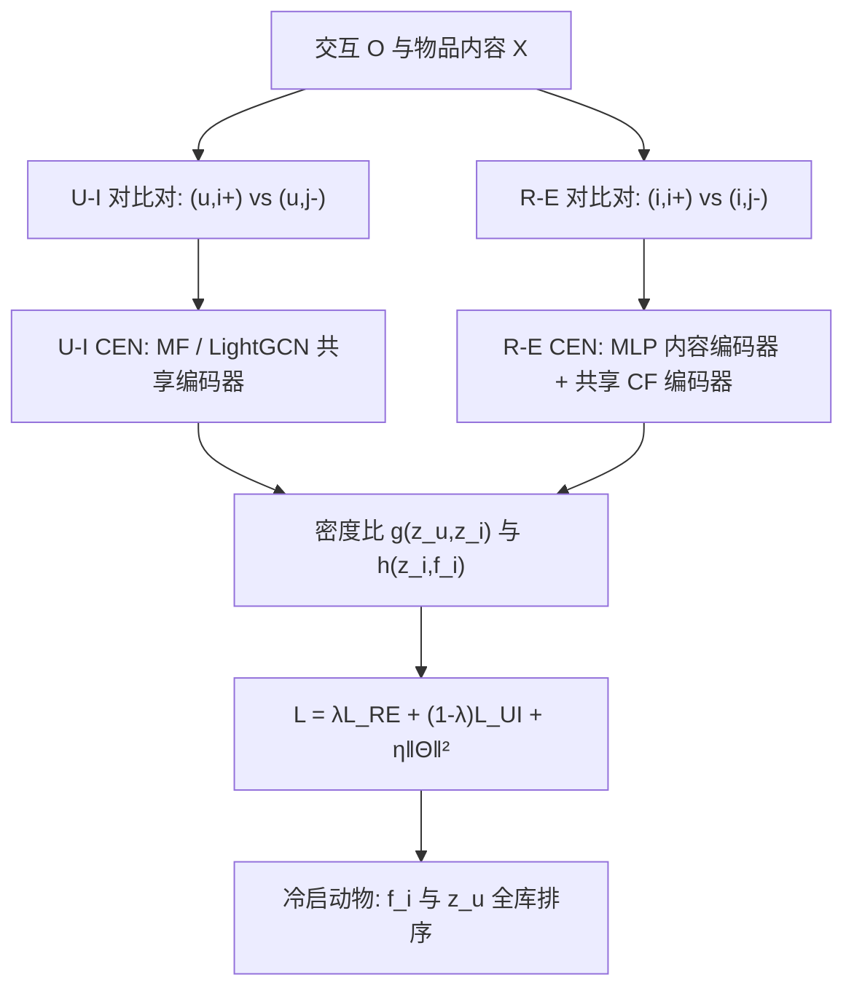
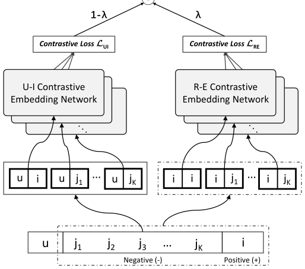

# Contrastive Learning for Cold-Start Recommendation (面向冷启动推荐的对比学习框架)

- **会议/期刊**: ACM Multimedia 2021
- **作者与机构**: Yinwei Wei、Xiang Wang、Tat-Seng Chua (NUS)；Qi Li、Liqiang Nie (山东大学)；Yan Li、Xuanping Li (快手)
- **推荐链路定位**: 召回（冷启动物表征与全库排序）
- **研究方向**: 冷启动与长尾推荐 / 自监督对比学习
- **论文原文**: [https://arxiv.org/abs/2107.05315v3](https://arxiv.org/abs/2107.05315v3)
- **开源代码**: [https://github.com/weiyinwei/CLCRec](https://github.com/weiyinwei/CLCRec)

## TL;DR (1分钟核心速览)

针对**完全无交互的冷启动物**无法学习协同嵌入的痛点，本文把冷启动物表征学习重写为最大化「用户-物品协同嵌入互信息 (U-I)」与「物品内容表征-协同嵌入互信息 (R-E)」之和的后验下界，并用双对比嵌入网络 + 多负样本 InfoNCE 实现。在 4 个数据集、**Full-Ranking 全库排序**、冷/暖/全量三种协议下，Recall@10 冷启动相对最强基线提升 **5.64%–103.95%**，NDCG@10 提升 **2.78%–119.01%**。

## Background & Motivation (背景与核心矛盾)

- **主流范式**: 将物品内容特征（视觉/音频/文本）注入 CF，用内容表征为冷启动物"借用"协同信号，分 robustness-based（DropoutNet、MTPR 随机丢弃协同嵌入）与 constraint-based（CB2CF、Heater 用 MSE/SSE 逐维对齐）两类。
- **前人局限**: ① 鲁棒式方法只做数据扰动，**没有显式刻画内容与协同嵌入之间的依赖关系**，难以蒸馏出有用协同信号；② 约束式方法的逐维正则只追求两表征"逐坐标一致"，会**丢弃异构的、各自独有的信息**，且缺乏"保留多少信息"的理论保证。
- **核心洞察 (Key Insight)**: 从信息论视角看，冷启动物特征编码器的后验 $p(\theta|\mathbf{Z},\mathcal{O},\mathbf{X})$ 可分解并下界为 U-I 与 R-E 两项互信息之和——**要保留的不是逐维数值，而是变量间的互信息**。
- **本文切入点**: 用对比学习作为互信息的变分估计器，把"约束对齐"换成"判别正负对的密度比"，从而在内容表征中保留协同信号。

## Method (核心方法设计)

### 1. 整体框架 (Overall Architecture)

输入为用户-物品交互 $\mathcal{O}$与物品多模态内容$\mathbf{X}$。框架分三步：**对比对组织**（U-I 用观测交互为正、未交互为负；R-E 用物品自身两视图为正、他物为负）→ **双对比嵌入网络**（U-I CEN 由 MF 或 LightGCN 共享编码器产出$z_u,z_i$；R-E CEN 由 MLP 特征编码器产出$f_i$，并复用同一 CF 编码器）→ **对比优化**（密度比 softmax 上的 InfoNCE，按$\lambda$加权）。推理时冷启动物只走内容编码器得到$f_i$，与$z_u$内积后全库排序；训练期以概率$\rho$把$f_i$ 混入 U-I 打分以缓解训练/推理视图落差。

<figure class="paper-figure" markdown="span">
  <figcaption>图1：我们提出框架的示意图。展示了对比对组织、对比嵌入网络和对比优化。</figcaption>
</figure>

### 2. 关键设计拆解 (Key Designs)

1. **互信息下界重写（把"对齐"变成"互信息"）**: 既有约束损失缺乏理论支撑。作者由贝叶斯分解得到 $\ln p(\theta|\mathbf{Z},\mathcal{O},\mathbf{X}) \ge \mathrm{MI}(\mathbf{F},\mathbf{Z}_I) + \mathrm{MI}(\mathbf{Z}_I,\mathbf{Z}_U) + \ln p(\Theta)$，即最大化 R-E 与 U-I 互信息。直觉：互信息只要求"可判别性"，允许两视图保留各自异构信息，比逐维 MSE 更宽容、信息瓶颈更小。
2. **U-I 多负样本对比替代 BPR**: BPR 只采 1 个随机负样本，命中硬负样本概率低、梯度易消失。本文用温度化 softmax 密度比 $g(z_u,z_i)=\exp(z_u^\top z_i/\tau)$，损失为$-\mathbb{E}_{(u,i)\in\mathcal{O}}\ln\frac{\exp(z_u^\top z_i/\tau)}{\exp(z_u^\top z_i/\tau)+\sum_{k=1}^{K}\exp(z_u^\top z_{j_k}/\tau)}$。当$\tau=1,K=1$时退化为 BPR，故可**端到端替换 BPR 而无需额外损失**；$K$ 增大显著提高硬负样本命中率与梯度幅值。
3. **R-E 自判别与混合对比训练**: 对物品 $i$，正对为$(i,i)$，负对为$(i,j_k)$，密度比$h(z_i,f_i)=\exp\!\big(\frac{z_i^\top f_i}{\|z_i\|\|f_i\|}\cdot\frac{1}{\tau}\big)$，采用余弦归一化而非投影到公共空间，以保留内容特征性质。总目标$\mathcal{L}=\lambda\mathcal{L}_{RE}+(1-\lambda)\mathcal{L}_{UI}+\eta\|\Theta\|_2^2$。训练时以概率$\rho$用$f_i$替换$g$中的$z_i$（图4），使 U-I 分支也适配推理期仅有内容视图的情形；负样本为批内/随机采样，无额外难负样本挖掘开销。

## Experimental Setup & Evaluation Protocol (实验设置与评估协议)

- **数据集与预处理**: 各数据集随机抽取物品作冷启动物（训练集中完全无交互），冷验证/测试按 $1{:}1$划分；其余物品按$8{:}1{:}1$ 划分训练/暖验证/暖测试；"All"为暖+冷合并。内容特征由预训练 ResNet / VGGish / Sentence2Vector 提取。

| 数据集 | #Users | #Warm Items | #Cold Items | #Interactions | 特征维度 (V/A/T) |
| :--- | :---: | :---: | :---: | :---: | :--- |
| Movielens | 55,485 | 5,119 | 867 | 922,007 | 2048/128/100 |
| Tiktok | 32,309 | 57,832 | 8,624 | 389,406 | 256/128/128 |
| Kwai | 7,010 | 74,470 | 12,013 | 236,130 | 2048/–/– |
| Amazon | 27,044 | 68,810 | 17,696 | 142,539 | 64/–/– |

- **数据划分与防穿越**: 冷启动物在训练阶段完全不出现，属 **Strict Zero-shot 冷启动划分**；非全局时间戳切分，存在"随机冷启动物"与真实新物分布偏移的风险。
- **排名评测协议**: **Full-Ranking（全库未交互物品排序）**，分别报告 Warm / Cold / All 三套候选集，指标 Recall@10 与 NDCG@10，对全体用户取平均。
- **对比基线与超参设置**: 基线含内容模型 DUIF、鲁棒式 DropoutNet/MTPR、约束式 CB2CF/Heater，以及 BPR 训练的 MF-BPR/LightGCN；所有模型协同嵌入维度 $d=64$，Xavier 初始化 + Adam，学习率$\{10^{-4},10^{-3},10^{-2},10^{-1}\}$、正则$\{10^{-4},10^{-3},10^{-2},10^{-1}\}$ 网格搜索，验证集 Recall@10 连续 10 epoch 不升即早停。

## Key Experimental Results (实验关键数据)

### 1. 主实验对比 (Main Results)

Recall@10（Cold / All），加粗为最优：

| 模型 | Movielens Cold | Movielens All | Tiktok Cold | Tiktok All | Kwai Cold | Kwai All | Amazon Cold | Amazon All |
| :--- | :---: | :---: | :---: | :---: | :---: | :---: | :---: | :---: |
| DUIF | 0.0691 | 0.1907 | 0.0057 | 0.0567 | 0.0068 | 0.0273 | 0.0159 | 0.0043 |
| DropoutNet | 0.0473 | 0.1939 | 0.0034 | 0.0618 | 0.0022 | 0.0349 | 0.0010 | 0.0070 |
| MTPR | 0.0593 | 0.2059 | 0.0045 | 0.0661 | 0.0027 | 0.0401 | 0.0028 | 0.0077 |
| CB2CF | 0.0317 | 0.2134 | 0.0016 | 0.0678 | 0.0023 | 0.0403 | 0.0139 | 0.0110 |
| Heater | 0.0586 | 0.1993 | 0.0032 | 0.0639 | 0.0029 | 0.0400 | 0.0012 | 0.0071 |
| MF-BPR | 0.0190 | 0.2051 | 0.0004 | 0.0662 | 0.0005 | 0.0406 | 0.0008 | 0.0076 |
| LightGCN | 0.0131 | 0.1942 | 0.0022 | 0.0729 | 0.0006 | 0.0370 | 0.0008 | 0.0105 |
| **CLCRec** | **0.0730** | **0.2485** | **0.0113** | **0.1033** | **0.0098** | **0.0522** | **0.0313** | **0.0190** |
| Improv.% | +5.64% | +16.45% | +103.95% | +52.48% | +44.71% | +29.53% | +96.24% | +73.04% |

### 2. 消融实验 (Ablation Study)

| 配置 | 关键指标 (Recall@10) | 结论 |
| :--- | :---: | :--- |
| $\lambda=0$（仅 U-I，无 R-E） | Movielens Cold 0.0463 | R-E 是冷启动主要增益来源 |
| $\lambda=0.8$（完整） | Movielens Cold 0.0730 | 提升 +57.7% |
| R-E 负对数 32 → 256 | Movielens Cold 峰值 0.0810 | 多负样本显著增益 |
| R-E 负对数 > 256 | 性能下降，Amazon 更明显 | 过度负采样致 R-E 互信息过拟合 |
| 混合训练 $\rho=0$→ 0.2 | Warm/Cold 均升 | 小概率混入$f_i$ 即有收益 |
| $K=1$→$K=128$ (U-I) | 多数场景提升 | 多负样本提升硬负样本命中率 |

### 3. 关键实验发现 (Key Findings)

1. **冷启动增益远大于暖启动**: 冷启动 Recall@10 相对提升 5.64%–103.95%，而暖启动仅 17.35%–61.86% 中偏中等；原因是对稀疏数据集（Tiktok/Amazon）而言，内容特征是唯一可用信号，R-E 互信息蒸馏的边际收益最大。
2. **目标函数本身即优于 BPR，而非仅架构差异**: 同为 MF 编码器，$\text{CEN}_{MF}$在 Amazon 冷启动 Recall@10 达 0.0313，而 MF-BPR 仅 0.0008，相差约 39 倍；LightGCN 换成$\text{CEN}_{GCN}$ 后 Tiktok All 从 0.0729 升至 0.1133，证明多负样本 softmax 目标可即插即用地替换 BPR。
3. **梯度幅值与负样本数正相关**: 随 $K$从 16 增至 512，梯度幅值持续高于 BPR 且收敛不退化，说明对比目标通过"概率性硬负样本"缓解了梯度消失；但$K>256$后 R-E 分支过拟合、暖启动性能因无关内容信息回灌而下降，$\lambda$ 需按场景调衡。

## Highlights & Limitations (亮点、对比与审稿批判)

- **与代表作对比 (vs. Prior Work)**: DropoutNet/MTPR 通过随机丢弃协同嵌入做"伪冷启动"增广，本质是鲁棒性正则；CB2CF/Heater 用 MSE/SSE 做逐维强约束，易抹平异构信息；CLCRec 用互信息下界 + 判别式密度比替代逐维对齐，理论上更紧、实验上冷启动全面领先。
- **可迁移亮点**: ① 把 BPR 替换为"$K$负样本 + 温度 softmax"的 InfoNCE，在几乎零额外推理成本下提升召回；② 训练期按概率$\rho$ 混入推理视图表征（hybrid training），是缓解"训练-推理视图不一致"的通用技巧，可迁移到多模态/跨域召回。
- **审稿级局限批判**: ① 冷启动物为随机抽样而非按时间戳新物划分，可能高估真实上新场景收益，且未涉及用户冷启动；② R-E 负采样开销随 $K$线性增长，$K>256$ 明显过拟合，内容编码器仅单隐层 MLP 且依赖预提取特征，多模态端到端微调与线上延迟/吞吐未评估。

## Rating (四维评分)

- **方法创新性 (Novelty)**: ⭐⭐⭐⭐ （首次用 U-I + R-E 互信息下界统一解释冷启动表征学习，理论重写清晰，但对比学习组件本身非全新）
- **评估协议与实验扎实度 (Protocol & Experiments)**: ⭐⭐⭐⭐ （4 数据集 × 暖/冷/全量 × Full-Ranking 较完整，含梯度幅值与超参分析；缺时间切分冷启动与显著性检验）
- **写作与数学规范度 (Clarity & Rigor)**: ⭐⭐⭐⭐ （贝叶斯分解到下界的推导连贯，密度比与 BPR 关系说明到位；部分近似与常数项处理略快）
- **工业落地与复现价值 (Industrial & Practical Value)**: ⭐⭐⭐ （代码开源、目标函数可直接替换 BPR；但多负样本内存开销、内容特征管路与冷启动线上分布偏移仍需工程验证）

