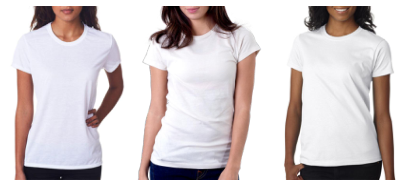
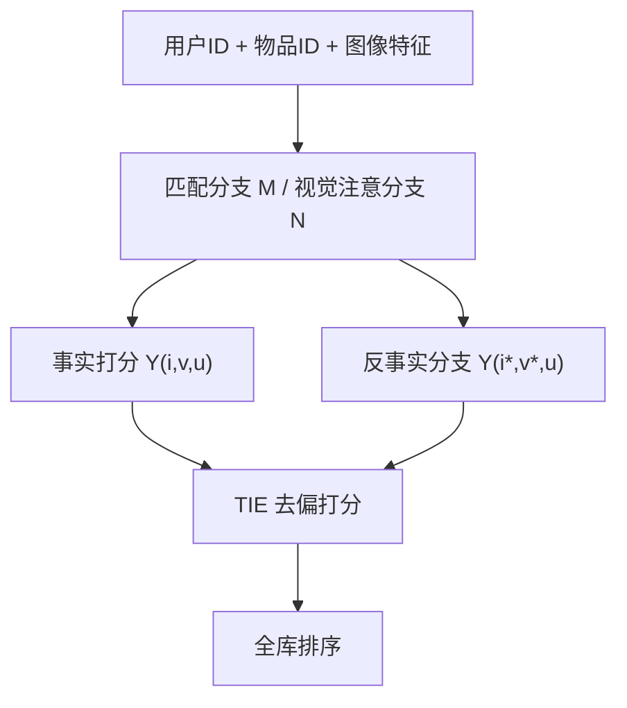
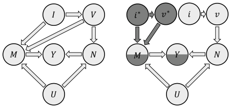

# CausalRec: Causal Inference for Visual Debiasing in Visually-Aware Recommendation (视觉感知推荐中的因果视觉去偏)

- **会议/期刊**: ACM MM 2021
- **作者与机构**: Ruihong Qiu, Sen Wang, Zhi Chen, Hongzhi Yin, Zi Huang（The University of Queensland）
- **推荐链路定位**: 精排
- **研究方向**: 去偏公平、可信隐私与工业架构 / 多模态推荐
- **论文原文**: [https://arxiv.org/abs/2107.02390v3](https://arxiv.org/abs/2107.02390v3)
- **开源代码**: 暂未开源

## TL;DR (1分钟核心速览)

针对电商视觉推荐中“看图点击≠真实购买”的视觉偏置，本文将物品视觉特征视为因果中介，提出干预与反事实推断框架，以总间接效应 TIE 在测试阶段减去视觉直接效应；CausalRec 进一步以乘法融合保留有益视觉信息。全库排序下，8 个 Amazon 数据集均达最优，NDCG@50 相对最佳基线提升 14.73%–53.57%。

## Background & Motivation (背景与核心矛盾)

- **主流范式**：VBPR/AMR 等将图像特征作为额外协同信号，直接建模 $P(Y|I,V,U)$，与 ID 信息拼接或相加后预测交互。
- **前人局限**：视觉相似会诱导点击，但品牌、材质、价格等不匹配会抑制购买；隐式反馈无法区分“真实偏好”与纯视觉虚假关系。位置/流行度去偏也无法处理物品自身视觉诱因。
- **核心洞察 (Key Insight)**：视觉特征位于后门路径 $M\leftarrow I\rightarrow V\rightarrow N\rightarrow Y$，其中$N$是用户纯视觉注意，$V$ 成为产生虚假关系的中介；若“看过其他同视觉物品”，仍会交互吗？这可用反事实检验。
- **本文切入点**：在因果图上干预中介变量，用 TIE=TE−NDE 扣除视觉直接效应，同时用 CausalRec 保留视觉对真实匹配的有益贡献。

<figure class="paper-figure" markdown="span">
  <figcaption>图1：购买白色T恤时视觉偏差的示例。用户正在寻找由合适材质制成的白色T恤。由于这些不同材质的白色T恤看起来与目标完全一样，用户会点击它们。然而，用户的真实偏好也取决于材质。在隐式反馈下，很难判断一次交互代表真实偏好，还是纯粹存在于视觉特征与交互之间的虚假关系。</figcaption>
</figure>

## Method (核心方法设计)

### 1. 整体框架 (Overall Architecture)

模型将用户 $U$、物品$I$、视觉$V$、真实匹配$M$、视觉注意$N$、交互$Y$纳入因果图。先按常规视觉推荐训练，得到含偏预测；测试时对物品与视觉做 no-treatment 反事实替换$i^*,v^*$，比较事实与反事实分支，以 TIE 去除$N$ 的虚假直接效应。CausalRec 将视觉同时注入匹配分支与注意分支，再用乘法融合并减去受控反事实项，实现“去偏但不弃视觉”。

<figure class="paper-figure" markdown="span">
  <figcaption>图4：CausalRec 的因果图及用于视觉去偏的相应干预。(a) 视觉特征同时用于 𝑀 和 𝑁。(b) 在干预中，𝐼 和 𝑉 均被设为对 𝑀 的无处理。</figcaption>
</figure>

### 2. 关键设计拆解 (Key Designs)

1. **因果中介识别与 TIE 去偏**：前人把 $V$直接当预测信号，忽略$V\rightarrow N\rightarrow Y$的虚假路径。本文令$Y_{i,v,u}=Y_{M_{i,u},N_{v,u}}$，定义$\operatorname{TIE}=Y_{i,v,u}-Y_{i^*,v,u}=Y_{M_{i,u},N_{v,u}}-Y_{M_{i^*,u},N_{v,u}}$。直觉是保留同一视觉注意$N$，只替换反事实物品，从而扣掉纯视觉捷径。对 VBPR 可化为$\hat{y}_{i,v,u}=\beta_i-\beta_{i^*}+\boldsymbol{\gamma}_u^\top(\boldsymbol{\gamma}_i-\boldsymbol{\gamma}_{i^*})$。
2. **CausalRec 的视觉保留融合**：若完全去视觉会损失有用信息，故设 $M_{i,u}=\sigma(\boldsymbol{\gamma}_u^\top\boldsymbol{\gamma}_i)$、$M_{i,v,u}=\sigma(\boldsymbol{\gamma}_u^\top(\boldsymbol{\gamma}_i\circ E\phi(V_i)))$、$N_{v,u}=\sigma(\boldsymbol{\theta}_u^\top E\phi(V_i))$，并令$Y=M_{i,u}\cdot M_{i,v,u}\cdot N_{v,u}$。视觉经匹配分支参与真实偏好，经注意分支被反事实扣除，形成“保留+去偏”解耦。
3. **训练目标、负采样与推理**：总损失 $\mathcal{L}=\ell_{\text{BPR}}(Y)+\ell_{\text{BPR}}(N)+\ell_{\text{BPR}}(M_{i,u}M_{i,v,u})+\lambda_1\|\Theta\|_2^2$，采用 BPR 成对负样本；具体负采样分布原文未细化。推理分数$\hat{y}=M_{i,u}M_{i,v,u}N_{v,u}-\lambda_2 M_{i^*,u}M_{i^*,v^*,u}N_{v,u}$，需额外算一次反事实分支，开销约为常规双分支模型的 2 倍打分，但仍属内积级。

## Experimental Setup & Evaluation Protocol (实验设置与评估协议)

- **数据集与预处理**：Amazon 8 类，过滤交互少于 5 次用户/物品及无图物品，即 5-core 风格。

| 数据集 | #Users | #Items | #Interactions | 稀疏度 |
| :--- | ---: | ---: | ---: | ---: |
| Baby | 19,822 | 7,776 | 163,856 | 99.89% |
| Beauty | 25,837 | 16,893 | 227,920 | 99.95% |
| Clothing | 58,197 | 44,310 | 422,474 | 99.98% |
| Grocery | 16,318 | 11,581 | 165,893 | 99.91% |
| Office | 6,913 | 4,775 | 68,306 | 99.79% |
| Sports | 40,358 | 24,766 | 334,238 | 99.97% |
| Tools | 20,134 | 14,774 | 163,451 | 99.95% |
| Toys | 24,314 | 18,906 | 209,281 | 99.95% |

- **数据划分与防穿越 (Splitting Strategy)**：原文未明示显式切分方式；仅明确 5-core 过滤与全库排序评测，复现时应补做时间切分/防穿越审计。
- **排名评测协议 (Ranking Protocol)**：无偏 **Full-Ranking**，对全物品集排序，报告 MRR、NDCG@50、HR@50；训练为 BPR pairwise，负样本策略未完全披露。
- **对比基线与超参设置**：BPR（仅 ID）、VBPR（视觉加性融合）、AMR（去偏置项+对抗噪声；DeepStyle 近似故略）。嵌入维 $d=32$，Adam，batch=100，学习率$\{0.01,0.001,0.0001\}$，$\lambda_1\in\{0.1,0.05,0.01,0.005\}$，$\lambda_2\in\{0,0.2,\ldots,1.2\}$；未报告显著性检验。

## Key Experimental Results (实验关键数据)

### 1. 主实验对比 (Main Results)

下表为 NDCG@50 / HR@50，**粗体**为各数据集最优；`Improv.` 为 CausalRec 相对最佳基线的 NDCG 提升。

| 数据集 | BPR | VBPR | AMR | CausalRec | Improv. |
| :--- | :---: | :---: | :---: | :---: | :---: |
| Baby | 0.0271/0.0983 | 0.0215/0.0726 | 0.0135/0.0462 | **0.0320/0.1047** | **+18.08%** |
| Beauty | 0.0137/0.0476 | 0.0315/0.1048 | 0.0201/0.0690 | **0.0384/0.1254** | **+21.90%** |
| Clothing | 0.0065/0.0216 | 0.0125/0.0417 | 0.0068/0.0235 | **0.0172/0.0528** | **+37.60%** |
| Grocery | 0.0281/0.0981 | 0.0414/0.1376 | 0.0307/0.1068 | **0.0475/0.1541** | **+14.73%** |
| Office | 0.0296/0.1040 | 0.0340/0.1222 | 0.0291/0.1021 | **0.0445/0.1537** | **+30.88%** |
| Sports | 0.0140/0.0460 | 0.0168/0.0563 | 0.0087/0.0291 | **0.0258/0.0792** | **+53.57%** |
| Tools | 0.0181/0.0537 | 0.0162/0.0556 | 0.0089/0.0324 | **0.0244/0.0775** | **+34.81%** |
| Toys | 0.0106/0.0370 | 0.0200/0.0663 | 0.0141/0.0478 | **0.0305/0.1024** | **+52.50%** |

MRR 同样全面最优，最高相对提升 70.93%（Sports）。

### 2. 消融实验 (Ablation Study)

| 变体/组件 | 原文观察 | 结论 |
| :--- | :--- | :--- |
| VBPR w/o CI → w/ CI | Baby/Sports MRR 上升 | 去偏模块可插拔有效 |
| AMR w/o CI → w/ CI | 两数据集 MRR 上升 | 不依赖特定主干 |
| CausalRec w/o CI → full | MRR 明显上升 | TIE 是核心增益源 |
| Add vs. Multiply 融合 | NDCG/HR 接近 | 融合算子非关键 |
| 单任务 vs. 多任务 | MML/AML 更优 | 分支监督增强后减法更有效 |
| $\lambda_2$: 0→1 | 性能上升，$\lambda_2\approx1$ 较好 | 适度去偏收益最大 |
| $\lambda_2>1$ | 性能下降 | 过度去视觉有害 |

### 3. 关键实验发现 (Key Findings)

- CausalRec 在 8/8 数据集、3 指标上全面最优，NDCG@50 相对最佳基线提升 14.73%–53.57%；Clothing 提升 37.60%，说明视觉强相关类目受益最大。
- 视觉并非总有益：Baby 上 VBPR 的 NDCG 0.0215 低于 BPR 0.0271，Tools 上 0.0162 低于 0.0181；CausalRec 分别升至 0.0320/0.0244，说明其纠正了视觉虚假关系而非简单增强视觉。
- 模块具模型无关性：VBPR/AMR 加入 CI 后 MRR 均上升；多任务变体优于单任务，表明让被减分支充分学习后，TIE 扣偏更精确。

## Highlights & Limitations (亮点、对比与审稿批判)

- **与代表作对比**：VBPR 将视觉作为直接协同信号，AMR 用对抗噪声增强鲁棒性但仍直接拟合含偏交互；本文首次把视觉视为中介并做反事实扣除，且 CausalRec 不丢弃视觉，而是分离“匹配贡献”与“注意捷径”。
- **可迁移亮点**：TIE 测试时去偏可套在 VBPR/AMR 等任意视觉主干；乘法反事实分支可作为“保留有益模态+扣除捷径”的通用范式。
- **审稿级局限批判**：①未明确数据划分与显著性检验，且无真正去偏测试集，全库排序仍建立在含偏隐式反馈上；②$\lambda_2$ 对效果敏感，推理需额外反事实分支，图像主干与双分支打分带来工程开销；③仅 3 个直接基线，未与更现代多模态去偏方法比较。

## Rating (四维评分)

- **方法创新性 (Novelty)**: ⭐⭐⭐⭐⭐ （首次将视觉偏置形式化为中介虚假路径，并用干预+TIE 做模型无关去偏，因果建模清晰。）
- **评估协议与实验扎实度 (Protocol & Experiments)**: ⭐⭐⭐⭐ （8 个数据集+全库排序较扎实，但仅 3 个基线、未报告显著性且划分未明示。）
- **写作与数学规范度 (Clarity & Rigor)**: ⭐⭐⭐⭐ （因果图、TE/NDE/TIE 推导连贯，公式到模型映射明确；负采样与切分细节略缺。）
- **工业落地与复现价值 (Industrial & Practical Value)**: ⭐⭐⭐⭐ （模块可插拔、内积级推理易部署；但无开源代码，反事实双分支与图像特征增加线上开销。）

