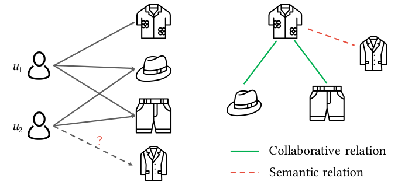
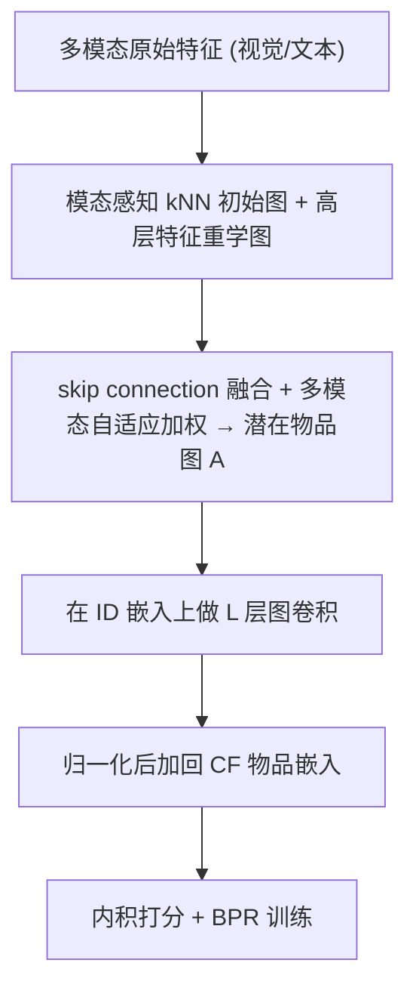
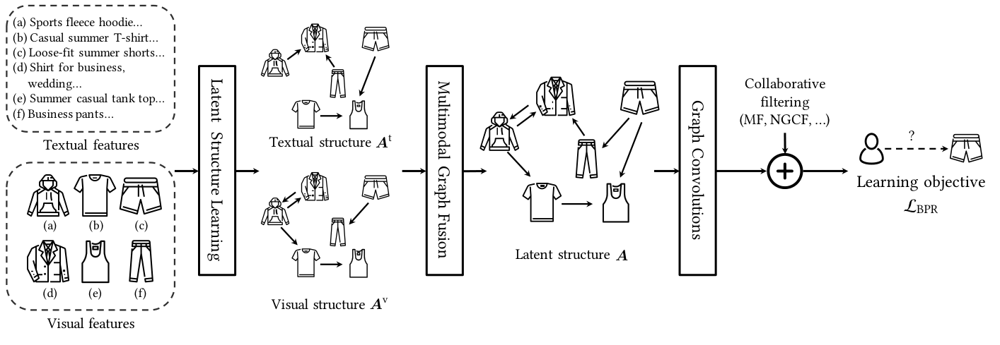

# Mining Latent Structures for Multimedia Recommendation (为多媒体推荐挖掘潜在结构)

- **会议/期刊**: ACM Multimedia 2021
- **作者与机构**: Jinghao Zhang, Yanqiao Zhu, Qiang Liu, Shu Wu, Shuhui Wang, Liang Wang（中科院自动化所 CRIPAC / 中科院计算所）
- **推荐链路定位**: 召回（物品表征增强，可插拔模块）
- **研究方向**: 多模态推荐 / 图神经网络与知识图谱推荐
- **论文原文**: [https://arxiv.org/abs/2104.09036v2](https://arxiv.org/abs/2104.09036v2)
- **开源代码**: [https://github.com/CRIPAC-DIG/LATTICE](https://github.com/CRIPAC-DIG/LATTICE)

## TL;DR (1分钟核心速览)

现有工作把多模态特征当作 side information 拼进用户-物品交互建模，物品-物品关系只能靠高阶 item-user-item 共现**隐式**涌现，语义相近但协同稀疏的物品（如"衬衫"与"大衣"）永远召回不到。LATTICE 提出模态感知图结构学习：从原始多模态特征构建 kNN 图，再用可学习的高层特征动态重估边权，多模态图自适应加权融合后对**物品 ID 嵌入**做 LightGCN 式传播，作为即插即用模块接入 MF/NGCF/LightGCN。在 Amazon 三个类目（采样排序协议）上 Recall@20 相对最强基线 GRCN 提升 12.5%/9.8%/9.9%。

## Background & Motivation (背景与核心矛盾)

- **主流范式**: VBPR/ACF 把视觉、文本特征与 ID 嵌入拼接送入 MF；MMGCN 为每个模态建独立的模态专属二部图；GRCN 进一步用多模态特征识别并剪枝交互图中的假阳性边。
- **前人局限**: ① 所有方法都在**用户-物品二部图**上做文章，物品间语义关系从未被显式建模；② 多模态特征直接被当作物品表征，效果强依赖特征的"代表性"——在 Clothing 上有效，在 Sports/Baby 上 VBPR/MMGCN 甚至打不过纯协同的 LightGCN。
- **核心洞察 (Key Insight)**: 多模态内容本身就是一张物品相似度图的"天然说明书"；把特征用于**构图**而非**表征**，可以让尾部/冷启动物品通过语义邻居获得协同信号，而交互图中它们是孤立节点。
- **本文切入点**: 用图结构学习 (Graph Structure Learning) 从多模态特征挖掘潜在物品图，只在图上传播 ID 嵌入，与下游 CF 解耦。

<figure class="paper-figure" markdown="span">
  <figcaption>图1：具有两类物品关系的推荐玩具示例。本文认为，从多模态特征中挖掘的语义结构有助于全面发现补充传统工作中协同信号的候选物品。</figcaption>
</figure>

## Method (核心方法设计)

### 1. 整体框架 (Overall Architecture)

输入为物品的视觉 (4096-d) 与文本 (1024-d) 特征及 ID 嵌入。首先对每个模态用余弦相似度建 kNN 图，得到初始模态图；同时用线性变换把原始特征映射为高层特征并**重新学一张图**，两者按 $\lambda$做 skip connection 融合成该模态的潜在图；多个模态的邻接矩阵再经 softmax 权重$\alpha_m$自适应加权得到统一物品图$A$。在$A$上对 ID 嵌入做$L$层无变换、无激活的 LightGCN 式消息传递，得到的高阶物品表征归一化后加回下游 CF 的物品嵌入，最后以内积打分并用 BPR 训练。训练完成后只需保存稀疏图$A$，推理与普通 CF 内积检索完全一致。

<figure class="paper-figure" markdown="span">
  <figcaption>图2：我们提出的LATTICE模型的整体框架。我们首先学习模态感知的物品图，并以自适应方式聚合多种模态。基于挖掘出的潜在图，我们进行图卷积，将高阶物品关系注入物品嵌入，随后将其与下游CF方法结合以进行推荐。</figcaption>
</figure>

### 2. 关键设计拆解 (Key Designs)

1. **潜在图学习与 skip connection（解决"原始特征有噪、纯学习图又不稳定"）**：先由原始特征得 $\tilde{S}^m$（余弦相似度 → 负值截零 → top-$k$稀疏化 → 对称归一化），再由变换后特征$\tilde{\boldsymbol{e}}^m_i=\boldsymbol{W}^m\boldsymbol{e}^m_i+\boldsymbol{b}^m$重复同一流程得$\tilde{A}^m$，最终
$$A^m=\lambda\tilde{S}^m+(1-\lambda)\tilde{A}^m .$$
直觉：$\lambda=0$时邻接矩阵每步全变，训练剧烈震荡；$\lambda=1$时保留原始特征的噪声。中间值既稳定又保留原始语义先验，实验中$\lambda$在整个$(0,1)$ 区间都优于基线，鲁棒性好。

2. **ID 嵌入上的图卷积（特征只构图、不表征）**：$h^{(l)}_i=\sum_{j\in\mathcal{N}(i)}A_{ij}h^{(l-1)}_j$，$h^{(0)}_i=\boldsymbol{x}_i$（ID 嵌入），最终$\hat{\boldsymbol{x}}_i=\tilde{\boldsymbol{x}}_i+\frac{h^{(L)}_i}{\lVert h^{(L)}_i\rVert_2}$，$\hat{y}_{ui}=\tilde{\boldsymbol{x}}_u^\top\hat{\boldsymbol{x}}_i$。这与 MMGCN/GRCN"用特征当节点表征"形成本质对立：语义边负责**找邻居**，协同 ID 负责**承载偏好**，避免了特征代表性不足对结果的直接污染（消融中 LATTICE/feats 全面劣于 LATTICE）。

3. **训练目标与开销**：仅用 BPR 损失 $\mathcal{L}_{BPR}=-\sum_{u}\sum_{i\in I_u}\sum_{j\notin I_u}\ln\sigma(\hat{y}_{ui}-\hat{y}_{uj})$，负样本为**均匀采样 1 个未交互物品**，无额外对比/重构正则。构图是离线一次性开销（$N\times N$相似度矩阵 + top-$k$稀疏化），在线阶段只增加$\lvert\mathcal{E}\rvert$ 规模的邻接查表，与 ID 嵌入内积检索同阶。

## Experimental Setup & Evaluation Protocol (实验设置与评估协议)

- **数据集与预处理**（Amazon 三类目，无 5-core 过滤说明）：

| 数据集 | #Users | #Items | #Interactions | 密度 | 特征/场景说明 |
| :--- | :---: | :---: | :---: | :---: | :--- |
| Clothing | 39,387 | 23,033 | 237,488 | 0.026% | 服饰，视觉特征主导 |
| Sports | 35,598 | 18,357 | 256,308 | 0.039% | 户外运动，文本更关键 |
| Baby | 19,445 | 7,050 | 139,110 | 0.101% | 母婴，最稠密 |

- **数据划分与防穿越**: 每用户交互按 **8:1:1 比例划分**（train/valid/test）；冷启动实验额外随机抽 20% 物品，将其全部交互从训练集移除，其中 10% 作验证、10% 作测试，保证这些物品在训练中完全不可见。
- **排名评测协议**: 采用 **Sampled Ranking**——每个测试正样本只配 **1 个负样本**（1:1）计算 Recall/Precision/NDCG@20，**并非 Full-Ranking 全库排序**，因此绝对数值偏低且与全库排序工作不可直接横比。
- **对比基线**: CF 类（MF、NGCF、LightGCN）与内容感知类（VBPR、MMGCN、GRCN）；统一嵌入维度 $d=64$，Adam，batch=1024，Xavier 初始化，学习率/$\ell_2$/dropout 网格搜索，验证集 Recall@20 早停（patience=10），所有提升在$p\le 0.05$ 下显著。

## Key Experimental Results (实验关键数据)

### 1. 主实验对比 (Main Results)

以 LightGCN 为下游 CF 的 LATTICE：

| 模型 | Clothing R@20 | P@20 | N@20 | Sports R@20 | P@20 | N@20 | Baby R@20 | P@20 | N@20 |
| :--- | :---: | :---: | :---: | :---: | :---: | :---: | :---: | :---: | :---: |
| MF | 0.0191 | 0.0010 | 0.0088 | 0.0430 | 0.0023 | 0.0202 | 0.0440 | 0.0024 | 0.0200 |
| NGCF | 0.0387 | 0.0020 | 0.0168 | 0.0695 | 0.0037 | 0.0318 | 0.0591 | 0.0032 | 0.0261 |
| LightGCN | 0.0470 | 0.0024 | 0.0215 | 0.0782 | 0.0042 | 0.0369 | 0.0698 | 0.0037 | 0.0319 |
| VBPR | 0.0481 | 0.0024 | 0.0205 | 0.0582 | 0.0031 | 0.0265 | 0.0486 | 0.0026 | 0.0213 |
| MMGCN | 0.0501 | 0.0024 | 0.0221 | 0.0638 | 0.0034 | 0.0279 | 0.0640 | 0.0032 | 0.0284 |
| GRCN | 0.0631 | 0.0032 | 0.0276 | 0.0833 | 0.0044 | 0.0377 | 0.0754 | 0.0040 | 0.0336 |
| **LATTICE** | **0.0710** | **0.0036** | **0.0316** | **0.0915** | **0.0048** | **0.0424** | **0.0829** | **0.0044** | **0.0368** |
| Improv. | +12.5% | +12.2% | +14.6% | +9.8% | +8.7% | +12.5% | +9.9% | +9.2% | +9.5% |

冷启动设置（原图 3）中 LATTICE–LightGCN 在三个数据集上均全面领先，而 GRCN 因冷启动物品在交互图中成为孤立节点而明显退化为与 LightGCN 同级。

### 2. 消融实验 (Ablation Study)

| 下游 CF | 变体 | Clothing R@20 / N@20 | Sports R@20 / N@20 | Baby R@20 / N@20 |
| :--- | :--- | :---: | :---: | :---: |
| MF | 原始 CF | 0.0191 / 0.0088 | 0.0430 / 0.0202 | 0.0440 / 0.0200 |
| MF | +feats（拼特征） | 0.0456 / 0.0197 | 0.0674 / 0.0304 | 0.0701 / 0.0306 |
| MF | LATTICE/feats（特征上卷积） | 0.0519 / 0.0224 | 0.0708 / 0.0319 | 0.0729 / 0.0326 |
| MF | **LATTICE（ID 上卷积）** | **0.0577 / 0.0246** | **0.0753 / 0.0336** | **0.0767 / 0.0339** |
| LightGCN | 原始 CF | 0.0470 / 0.0215 | 0.0782 / 0.0369 | 0.0698 / 0.0319 |
| LightGCN | +feats | 0.0477 / 0.0208 | 0.0754 / 0.0350 | 0.0793 / 0.0344 |
| LightGCN | LATTICE/feats | 0.0643 / 0.0288 | 0.0832 / 0.0386 | 0.0756 / 0.0335 |
| LightGCN | **LATTICE** | **0.0710 / 0.0316** | **0.0915 / 0.0424** | 0.0836 / 0.0373 |
| — | Improv. vs CF+feats | +48.8% / +52.0% | +21.3% / +21.3% | +5.4% / +8.3% |

（注：Baby 列取自原文表 3，与表 2 报告的 0.0829/0.0368 存在约 0.8% 的重复实验波动，原文未说明。）

### 3. 关键实验发现 (Key Findings)

1. **"特征构图 + ID 卷积"是增益主因**：同样学到图 $A$ 后，把卷积作用在 ID 嵌入（0.0710）比作用在多模态特征（0.0643）在 Clothing 上 Recall@20 高 10.4%，说明多模态特征的真正价值在于**定义邻居**，而非充当节点表征。
2. **side-info 拼接极不稳定，图注入稳定**：LightGCN+feats 在 Sports 上从 0.0782 掉到 0.0754，而 LATTICE 在三个基线上无例外全部提升（LightGCN 上 +48.8%/+21.3%/+5.4%），验证了 plug-in 范式对下游 CF 的普适性。
3. **稀疏化与先验融合缺一不可**：$k$从 0 增至 10 即捕获主要增益，继续增大$k$性能下降（噪声邻居涌入）；$\lambda=0$（仅用变换特征图）最差，$\lambda$ 中间值最优但全区间均超基线，说明初始 raw-feature 图既是有效先验、也是训练稳定器。

## Highlights & Limitations (亮点、对比与审稿批判)

- **与代表作对比 (vs. Prior Work)**: 与 VBPR（特征拼进 MF）、MMGCN（模态专属二部图）相比，LATTICE 首次把"物品-物品"关系显式化为可学习图；与 GRCN（用特征剪枝交互图边）相比，本文不修改交互图而是在**新增的语义图上**传播，因此在冷启动物品成为孤立节点时依然有效。
- **可迁移亮点**: ① "raw-feature 图 + learnable 图 + $\lambda$ skip connection" 的两阶段图精修模板可直接迁移到跨域/时序相似度构图；② "特征只用于构图、不进入表征"的解耦思路可复用于 LLM embedding 增强召回。
- **审稿级局限批判**: ① 评测仅用 1:1 采样排序，Recall@20 数值（0.07 级）严重依赖候选集规模，缺乏 Full-Ranking 结果，无法评估真实全库召回能力；② 构图需 $O(N^2)$ 余弦相似度与每 epoch 重算的可学习图，在千万级物品工业场景不可行，且论文未给复杂度/训练时长分析与图增量更新方案。

## Rating (四维评分)

- **方法创新性 (Novelty)**: ⭐⭐⭐⭐ （首次把多模态内容转化为显式物品语义图，"特征构图 / ID 表征"的解耦在当时颇具启发性，但图结构学习与 skip connection 组件本身源自 IDGL 等通用 GSL）
- **评估协议与实验扎实度 (Protocol & Experiments)**: ⭐⭐⭐ （三数据集 + 冷启动 + 三组下游 CF 的消融覆盖面好，但采样排序 1:1 削弱说服力，且正文与消融表数值存在轻微不一致）
- **写作与数学规范度 (Clarity & Rigor)**: ⭐⭐⭐⭐ （公式链条从相似度、稀疏化、归一化到融合、传播、BPR 一气呵成且无冗余符号，缺少复杂度分析与收敛性讨论）
- **工业落地与复现价值 (Industrial & Practical Value)**: ⭐⭐⭐⭐ （代码开源、模块即插即用、在线只增邻接查表；但 $N^2$ 构图与静态图更新是规模化部署的主要障碍）

