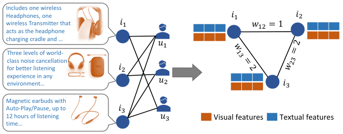
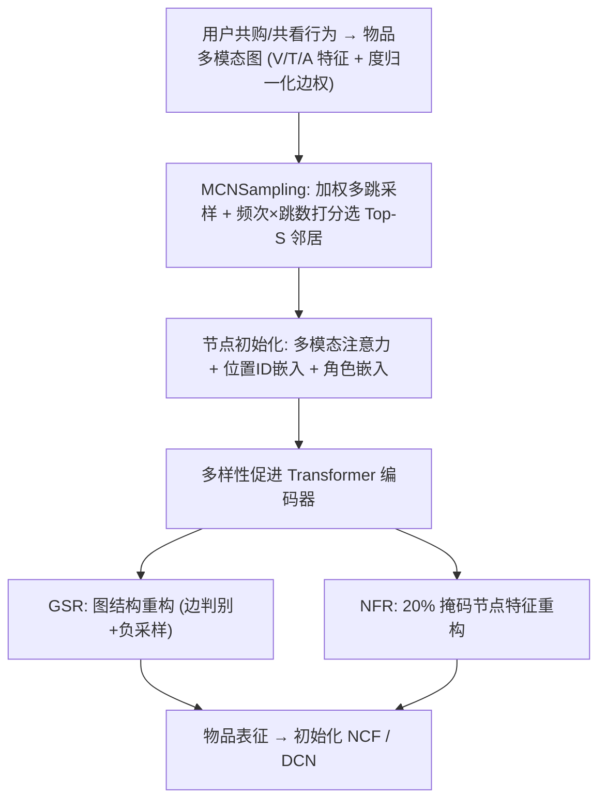

# Pre-training Graph Transformer with Multimodal Side Information for Recommendation (融合多模态边信息的多模态图 Transformer 预训练推荐)

- **会议/期刊**: ACM MM 2021
- **作者与机构**: Yong Liu, Susen Yang, Chenyi Lei, Guoxin Wang, Haihong Tang, Juyong Zhang, Aixin Sun, Chunyan Miao（NTU / 中科大 / 阿里集团 / 浙大）
- **推荐链路定位**: 召回（物品表征预训练，供下游 NCF 召回与 DCN 精排初始化）
- **研究方向**: 多模态推荐 / 自监督与图预训练
- **论文原文**: [https://arxiv.org/abs/2010.12284v2](https://arxiv.org/abs/2010.12284v2)
- **开源代码**: 暂未开源

## TL;DR (1分钟核心速览)

针对“物品多模态边信息”与“物品间关系”长期被分头建模、且多数方法只用单一模态的痛点，本文构建以共购/共看为边的**同质物品多模态图**，提出 PMGT：先用 MCNSampling 采出有序上下文邻居，再以多模态注意力+位置/角色嵌入初始化，送入**多样性促进 Transformer**，用「图结构重构 + 掩码节点特征重构」双目标自监督预训练。在 VG/TG/THI/ML 四组 5-core Amazon & MovieLens 数据上，预训练表征初始化 NCF/DCN 后，Recall@10 相对最强基线提升 4.2%–15.4%，CTR-AUC 提升 0.5%–1.9%；淘宝线上 60 万用户新播放 +6.80%。

## Background & Motivation (背景与核心矛盾)

- **主流范式**: 物品侧信息（图像/文本/音频）通常经手工特征工程 + FM/GBM，或深度模型单模态编码后直接拼进 MF / NCF 的物品嵌入；图侧则独立用 GraphSAGE / Graph-BERT 做节点表征。
- **前人局限**: ① 现有方案只吃**单一模态**（如只取图像或只取标题），多模态互补性被浪费；② 侧信息（内容相似）与物品关系（协同相似）被**割裂建模**，而 ItemKNN 系列早已证明后者对推荐同样关键；③ 图预训练方法（Graph-BERT）的**属性重构不设掩码**，模型缺乏跨邻居聚合特征的能力。
- **核心洞察 (Key Insight)**: 若把物品关系当成“骨架”、多模态特征当成“血肉”，统一到一张图上做掩码式自监督，就能迫使节点表征同时编码协同结构与多模态语义；且用户行为关系不像内容相似那样可由特征直接导出，因此**必须从图里学**。
- **本文切入点**: 一张图 + 双重构目标 + 一个面向大图的邻居采样算子，把“表征预训练”做成与下游任务解耦的通用底座。

<figure class="paper-figure" markdown="span">
  <figcaption>图 1：(a) 物品侧信息与用户购买历史；(b) 基于共同购买关系构建的物品多模态图。该图中，每个节点表示一个物品，其视觉和文本特征分别从图像和文本描述中提取。两个物品之间的边以共同购买次数为权重。</figcaption>
</figure>

## Method (核心方法设计)

### 1. 整体框架 (Overall Architecture)

输入侧先用用户共购（Amazon）或共看（淘宝视频）行为连边、并做度归一化加权得到物品多模态图，节点特征是视觉（Inception-v4, 1536 维）、文本（BERT, 768 维）乃至声学（VGGish, 128 维）的离线抽取向量。训练时每个 batch 的目标节点经 MCNSampling 采出 $S$个有序上下文邻居，构成序列$I_h=[h,h_1,\dots,h_S]$；每个节点由多模态注意力融合向量叠加位置 ID 嵌入与角色标签嵌入后送入$L$ 层 Transformer；最后一层输出既用于边存在性判别，也用于还原被掩码邻居的多模态特征。下游只需取出物品表征初始化 NCF/DCN 的 item embedding（可微调），无需改网络结构。

### 2. 关键设计拆解 (Key Designs)

1. **MCNSampling：把“邻居爆炸 + 度数偏置”一次解决**：逐跳按边权采样（第 $k$跳采$n_k$个，本文$n=(16,8,4)$），再对候选节点打重要性分$s_t=\sum_{k=1}^{K} f_t^{k}\cdot(K-k+1)$，即**出现越频繁、跳数越近越重要**，取 Top-$S$作为上下文邻居。边权本身做了度归一化$\omega_{ht}=\frac{\log(r_{ht})+1}{\log(\sqrt{d_h d_t})+1}$，本质是对热门物品做**结构侧降权**，抑制网红节点在采样中被反复命中造成的表征同质化。

2. **多样性促进注意力（Diversity-Promoting Attention）**：Graph-BERT 式自注意力会让与目标节点高度相似的邻居占据几乎全部权重，导致“邻居白选”。本文在标准注意力之外并联一路**相似度惩罚**注意力并与原注意力凸组合：
$\mathbf{U}_1=\mathrm{softmax}\!\left(\frac{\mathbf{E}-\mathbf{S}\mathbf{S}^{\top}}{\|\mathbf{S}\|_2\|\mathbf{S}\|_2^{\top}}+\mathbf{I}\right),\ \mathbf{H}^{\ell}=\mathrm{FFN}\big[(\beta\mathbf{U}_1+(1-\beta)\mathbf{U}_2)\mathbf{V}\big]$其中$\mathbf{E}$为全 1 矩阵、$\mathbf{I}$保留自信息、$\beta$ 平衡两路。直觉是：越相似的邻居权重越低，迫使模型从**相关但不雷同**的邻居处补充增量信息，从而扩大表征覆盖面。

3. **双目标预训练与推理开销**：结构重构用带负采样的边判别损失
$\mathcal{L}_{edge}=-\log\sigma\!\left(\frac{\mathbf{h}^{\top}\mathbf{t}}{\|\mathbf{h}\|_2\|\mathbf{t}\|_2}\right)-Q\,\mathbb{E}_{t_n\sim P_n}\log\sigma\!\left(-\frac{\mathbf{h}^{\top}\mathbf{t}_n}{\|\mathbf{h}\|_2\|\mathbf{t}_n\|_2}\right)$掩码特征重构对$I_h\setminus h$中 20% 节点按 BERT 的 80/10/10 策略替换，再用$\mathcal{L}_{feature}=\sum_{i}\|\mathbf{H}^{L}_t\mathbf{W}^{i}_{r}-\mathbf{x}^{i}_t\|_2^2$ 回归各模态原始特征，总损失为二者之和。目标节点永不被掩码（因需用于边判别）。训练为 mini-batch + Adam，**免负采样**仅存在于特征重构分支；在线推理只需一次前向拿物品向量，邻居采样开销仅发生在预训练阶段。

## Experimental Setup & Evaluation Protocol (实验设置与评估协议)

- **数据集与预处理**: Amazon 5-core 子集 VG/TG/THI 与 MovieLens-20M(ML)；物品图节点数大于交互物品数（含只有关系无下游交互的物品）。

| 数据集 | #Users | #Items | #Interactions | 图 #Nodes / #Edges | 特征/场景说明 |
| :--- | :---: | :---: | :---: | :---: | :--- |
| VG | 4,525 | 3,921 | 27,780 | 5,032 / 83,981 | 图像+文本，稀疏 |
| TG | 31,109 | 13,870 | 182,744 | 17,388 / 232,720 | 图像+文本 |
| THI | 20,082 | 11,170 | 109,717 | 15,619 / 178,834 | 图像+文本 |
| ML | 27,715 | 4,253 | 2,179,386 | 4,271 / 249,498 | 图像+文本+声学，稠密 |

- **数据划分与防穿越**: 建图用 **2015-01-01 之前** 的评分，下游任务只用该时间点**之后**的数据（ML 用 2008-01-01 后），属**时间戳切分**，从机制上避免用未来交互构图造成穿越；预训练阶段随机留 90% 节点训练、10% 节点做验证（正例取一跳邻居，负例取非邻居）。下游 NCF/DCN 为 **80/20 随机划分 + 10% 验证集调参**，分类任务为 **10% 训练 / 90% 测试**的少标签设定。
- **排名评测协议**: **Sampled Ranking**——推荐任务对每个测试用户随机采 1000 个未交互物品与正例混排算 Recall/NDCG@10/20；CTR 每条正例配 5 个负例算 AUC。**注意：未做 Full-Ranking 全库排序**，绝对指标偏乐观。
- **对比基线与超参设置**: Random / DeepWalk / LINE（浅层嵌入）、TransAE（多模态 TransE）、GraphSAGE / Graph-BERT / GPT-GNN（图预训练）；所有基线共享同一套 Eq.(3) 多模态输入以保证公平。$d_0=128$，$K=3$，$n_k=\{16,8,4\}$，$S\in\{5,10,20,30,40\}$，$L\in\{1..5\}$，$\beta\in\{0,0.2,0.5,0.8,1.0\}$，学习率$\{10^{-4},10^{-3},10^{-2}\}$。

## Key Experimental Results (实验关键数据)

### 1. 主实验对比 (Main Results)

| 数据集-指标 | Random | DeepWalk | LINE | TransAE | GraphSAGE | GRAPH-BERT | GPT-GNN | **PMGT** | Improv. |
| :--- | :---: | :---: | :---: | :---: | :---: | :---: | :---: | :---: | :---: |
| VG R@10 | 0.1994 | 0.2236 | 0.2234 | 0.1989 | 0.2052 | 0.2380 | 0.2251 | **0.2480** | +4.20% |
| VG N@10 | 0.1278 | 0.1441 | 0.1420 | 0.1217 | 0.1301 | 0.1491 | 0.1343 | **0.1625** | +8.99% |
| TG R@10 | 0.2147 | 0.2787 | 0.2805 | 0.2137 | 0.2391 | 0.2858 | 0.2598 | **0.3032** | +6.09% |
| TG N@10 | 0.1380 | 0.1847 | 0.1857 | 0.1358 | 0.1514 | 0.1942 | 0.1671 | **0.2056** | +5.87% |
| THI R@10 | 0.1957 | 0.2043 | 0.1626 | 0.1425 | 0.1921 | 0.2023 | 0.1680 | **0.2358** | +15.42% |
| THI N@10 | 0.1360 | 0.1399 | 0.0996 | 0.0861 | 0.1320 | 0.1462 | 0.1047 | **0.1707** | +16.76% |
| ML R@10 | 0.3104 | 0.3144 | 0.3112 | 0.3096 | 0.3139 | 0.3136 | **0.3162** | 0.3161 | −0.03% |
| VG AUC | 0.7311 | 0.7680 | 0.7762 | 0.7675 | 0.7674 | 0.7746 | 0.7839 | **0.7990** | +1.93% |
| TG AUC | 0.8047 | 0.8289 | 0.8326 | 0.8214 | 0.8266 | 0.8322 | 0.8328 | **0.8370** | +0.50% |
| THI AUC | 0.7652 | 0.7850 | 0.7896 | 0.7815 | 0.7643 | 0.7878 | 0.7817 | **0.7933** | +0.47% |
| ML AUC | 0.9109 | **0.9218** | 0.9200 | 0.9194 | 0.9145 | 0.9184 | 0.9191 | 0.9205 | −0.14% |

### 2. 消融实验 (Ablation Study)

| 变体 | MI R@5 | MI N@5 | IS R@5 | IS N@5 | ML R@5 | ML N@5 |
| :--- | :---: | :---: | :---: | :---: | :---: | :---: |
| PMGT-NP（去掉两项预训练，直接训分类） | 0.8108 | 0.7143 | 0.8370 | 0.7158 | 0.6313 | 0.5542 |
| **PMGT（完整预训练）** | **0.9193** | **0.8217** | **0.8936** | **0.7790** | **0.8436** | **0.7727** |

原文图 3/图 4 另给出两组消融（视觉 V / 文本 T / 声学 A 单模态 vs. 全模态；仅 GSR / 仅 NFR vs. 双任务），结论一致：去掉任一模态或任一重构任务，REC-R@20 与 CTR-AUC 均单调下降。

### 3. 关键实验发现 (Key Findings)

1. **收益与交互密度强负相关**：THI（2 万用户、10.9 万交互）上 R@10 从 0.2043 升至 0.2358（+15.4%），而 ML（217 万交互）几乎零增益（0.3161 vs. 0.3162），CTR-AUC 甚至不敌 DeepWalk（0.9205 vs. 0.9218）——稠密数据下随机初始化已能学到足够好的 item 表征，**预训练只在稀疏/冷启场景是刚需**。
2. **预训练表征在少标签下价值被放大**：分类任务仅用 10% 标签微调，ML 上 R@5 从 PMGT-NP 的 0.6313 跃至 0.8436（+33.6%），MI 上 AUC 从 0.8947→0.9552，说明自监督信号真正弥补了监督信号不足，而非单纯“多训了参数”。
3. **多样性与小邻域都够用**：$\beta=0.5/0.8/1.0$均优于$\beta=0$（纯标准注意力），验证相似度惩罚有效；$S=5\sim10$即可达峰，继续增大$S$反而引入噪声并拖慢训练，$L=3$（推荐）/$L=2$（CTR）最佳，说明**并非越深越宽越好**。线上淘宝视频 4M 节点/500M 边图上，60 万用户新播放 +6.80% vs. UNITER 表征。

## Highlights & Limitations (亮点、对比与审稿批判)

- **与代表作对比 (vs. Prior Work)**: 相较 **Graph-BERT**，本文补上了掩码机制（原版属性重构无掩码，缺乏跨节点聚合压力）并引入多模态融合与多样性注意力；相较 **GPT-GNN** 的属性/边生成式预训练，本文用“边判别 + 掩码特征回归”更轻量、且物品图节点带真实多模态特征而非仅结构；相较 **TransAE** 这类多模态知识图谱嵌入，本文把协同关系与内容特征放进同一张图统一预训练，而非在 KG 三元组上做翻译约束。
- **可迁移亮点**: ① **度归一化边权** $\log(r)+1$除以$\log\sqrt{d_hd_t}$ 是通用且零成本的流行度去偏采样技巧，可直接移植到任何物品共现图；② “相似度惩罚注意力”只需一次矩阵乘法即可并联进已有 Transformer 块，适合作为邻居聚合阶段的通用正则。
- **审稿级局限批判**: ① **评测协议偏弱**——1000 负例的 Sampled Ranking 缺乏 Full-Ranking 与显著性检验，且 ML 上预训练方法全面打平/落后，说明方法适用边界未充分刻画；② **表征上限受冻结编码器约束**：视觉/文本/音频均为离线抽取的定长均值向量，掩码重构的 L2 回归目标只是重建这些“二手特征”，无法端到端对齐模态；③ 仅支持**同质物品图**，异构（用户-物品-品类）关系与跨域迁移未验证；淘宝场景为 4M 节点/500M 边，MCNSampling 与 $S$ 邻居前向的实际预训练吞吐、以及图需按域重建的工程成本均未报告。

## Rating (四维评分)

- **方法创新性 (Novelty)**: ⭐⭐⭐⭐ （把“多模态特征 + 协同关系”统一进一张图做双目标自监督，首次系统化；多样性促进注意力与度归一化加权采样为两个可复用的小而美算子）
- **评估协议与实验扎实度 (Protocol & Experiments)**: ⭐⭐⭐ （三下游任务 + 线上 A/B 难得，但仅 1:1000 采样排序、无 Full-Ranking/显著性检验，ML 上增益塌陷未深挖）
- **写作与数学规范度 (Clarity & Rigor)**: ⭐⭐⭐⭐ （四个模块与公式推导清晰、算法伪代码完整，符号统一；但注意力与掩码重构的复杂度/收敛性分析缺失）
- **工业落地与复现价值 (Industrial & Practical Value)**: ⭐⭐⭐⭐ （预训练与下游解耦、初始化即插即用并加速收敛，淘宝大图线上 +6.80% 验证可行性；扣分于未开源与图构建人工阈值 $r_{ht}\ge3$ 的敏感性未讨论）

