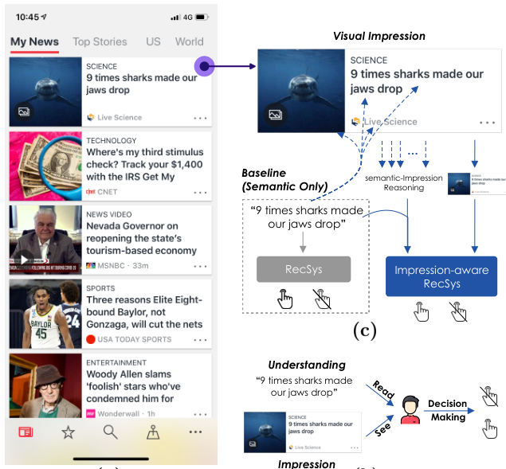
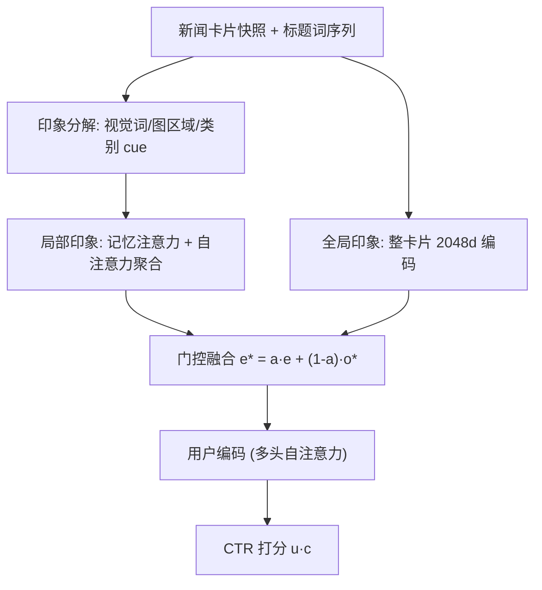
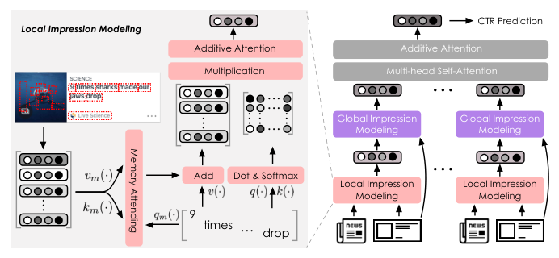

# Why Do We Click: Visual Impression-aware News Recommendation (我们为何点击：视觉印象感知的新闻推荐)

- **会议/期刊**: ACM Multimedia 2021
- **作者与机构**: Jiahao Xun, Shengyu Zhang, Zhou Zhao 等（浙江大学、华为诺亚方舟实验室、新加坡国立大学）
- **推荐链路定位**: 精排（新闻 CTR 预估）
- **研究方向**: 多模态推荐 / 序列推荐
- **论文原文**: [https://arxiv.org/abs/2109.12651v1](https://arxiv.org/abs/2109.12651v1)
- **开源代码**: [https://github.com/JiahaoXun/IMRec](https://github.com/JiahaoXun/IMRec)

## TL;DR (1分钟核心速览)

新闻推荐长期只吃标题文本，而通用多模态推荐又无差别堆叠点击后才有意义的模态（正文、音轨），既昂贵又引入伪相关。本文提出“视觉印象”——用户决策前真正看到的新闻卡片渲染图（封面图+标题+类别的版式快照），用**局部印象记忆注意力**对齐标题词与图像/视觉词区域，再用**全局印象门控**注入版式结构。在自建的 IM-MIND-Large（87.7 万用户）上以 K=4 负采样的 Sampled Ranking 协议评测，插入 NRMS/FIM 后 AUC 提升 0.98%–1.12%、NDCG@5 提升 1.17%–2.98%。

## Background & Motivation (背景与核心矛盾)

- **主流范式**: NRMS/FIM 等强基线仅用标题词序列建模新闻与用户；MMGCN、GRCN 一类多模态推荐在用户-物品二部图上逐模态传播融合。
- **前人局限**: ① 多模态推荐“模态越多越好”的假设在新闻场景失效——正文、视频在用户点击前根本不可见，强行关联会学到点击后的伪因果；② 通用融合架构忽略新闻卡片特有的**版式结构**（字段排布、词的空间位置），丢掉了与阅读行为强相关的信息。
- **核心洞察 (Key Insight)**: 用户点击由“内在兴趣 + 视觉印象”共同决定，而印象本身是一张可直接渲染/离线模拟的结构化图像；因此无需 3D 场景目标检测，用边缘切分即可把印象拆成语义可对齐的 cue。
- **本文切入点**: 把“新闻卡片渲染图”当作一等公民输入，用“局部细粒度对齐 + 全局结构门控”替代通用多模态融合。

<figure class="paper-figure" markdown="span">
  <figcaption>图 1：印象感知新闻推荐示意图。(a) 用户正在浏览的界面。(b) 用户在做出点击决策前，通常已在脑中形成对新闻标题的语义理解和视觉印象。(c) 印象感知推荐同时考虑细粒度视觉线索和全局结构。</figcaption>
</figure>

## Method (核心方法设计)

### 1. 整体框架 (Overall Architecture)

输入侧，每条候选新闻被离线渲染成 615×195px 的卡片快照（封面图 200×165px 置于左上、标题 ≤3 行每行 ≤27 字符、类别置于下方），再由 ResNet101 分别抽取三层特征：去掉后两层的标题区域特征图（512×28×28，按行/字切分并池化得到**视觉词**向量）、封面图等分 9 个区域池化得到**图像区域**向量、整卡片去最后一层的 2048 维**全局印象**向量。局部模块以记忆网络让每个标题词去检索全部印象 cue，得到印象增强词表示后再做自注意力与加性注意力汇聚成新闻向量 $\mathbf{e}$；全局模块用门控把$\mathbf{e}$与$\mathbf{o}^{*}$融合成$\mathbf{e}^{*}$；用户编码沿用 NRMS 的多头自注意力+加性注意力聚合历史点击序列，最终$\hat{y}_{u,c}=\sigma(\mathbf{c}^{\top}\mathbf{u})$。训练用交叉熵+负采样，推理时逐条新闻独立打分，候选按分数排序展示。

<figure class="paper-figure" markdown="span">
  <figcaption>图 2：应用于 NRMS 的印象感知新闻推荐框架示意图。我们用局部印象建模和全局印象建模表示每条新闻：局部印象建模显式捕获视觉印象中的多模态视觉线索，并据此增强对新闻标题的语义理解；全局印象建模进一步考虑不同字段的排列和标题词的相对位置，将视觉印象作为整体建模。</figcaption>
</figure>

### 2. 关键设计拆解 (Key Designs)

1. **局部印象-语义推理（Local Impression Modeling）**：痛点是把图像区域与标题词硬拼会丢失“词-区域”对应关系；本文把所有 cue 统一放入记忆 $\mathcal{O}=\{\mathbf{o}_j\}$（同一特征提取器保证同处一个嵌入超球面），令每个标题词作为 query 去检索：
$\alpha^{v}_{ij}=\mathrm{softmax}_{j}\big(q_m(\mathbf{w}_i)^{\top}k_m(\mathbf{o}_j)\big),\ \hat{\mathbf{w}}_i=\sum_{j}\alpha^{v}_{ij}v_m(\mathbf{o}_j)+v(\mathbf{w}_i)$再以$\hat{\mathbf{w}}_i$为输入做词间自注意力与加性注意力得到$\mathbf{e}=\sum_i\alpha^{a}_i\mathbf{w}^{*}_i$。直觉上这模拟了“读词的同时瞥见旁边图像/视觉字形”的浏览过程，且 cue 之间的注意力是可解释的细粒度对应。
2. **全局印象门控（Global Impression Modeling）**：逐 cue 融合会丢版式（字段排布、词的相对位置）。本文直接编码整张卡片得 $\mathbf{o}^{*}$，并用样本自适应门控融合：
$a=\sigma\big(g(\mathbf{o}^{*},\mathbf{e})\big),\quad \mathbf{e}^{*}=a\odot\mathbf{e}+(1-a)\odot\mathbf{o}^{*}$
门控的物理含义是“该用户此刻更信文本语义还是更信整体视觉冲击”，避免固定权重在图文冲突时被单模态主导。
3. **训练目标、负采样与推理效率**：损失为带 $K=4$ 负采样的交叉熵
$\mathcal{L}=-\sum_{i=1}^{P}\log\frac{\exp(\hat{y}^{+}_{u_i,c_i})}{\exp(\hat{y}^{+}_{u_i,c_i})+\sum_{k=1}^{K}\exp(\hat{y}^{-}_{u_i,c_i,k})}$模块与主干解耦：迁移到非序列模型 FIM 时，仅保留记忆注意力作用于初始词嵌入，全局印象经$Q_1,Q_2$线性层与匹配向量拼接$\hat{y}=Q_2^{\top}(\mathbf{s}_{u,c}\oplus(Q_1^{\top}\mathbf{o}^{*}_c+b_1))+b_2$，即可即插即用。视觉特征全部离线预抽取，在线只多一次 2048d 门控，开销近似可忽略。

## Experimental Setup & Evaluation Protocol (实验设置与评估协议)

- **数据集与预处理**: 基于 MIND 自动渲染两类基准数据集（5-core 未额外施加，沿用 MIND 原始过滤）；新闻卡片样式按微软新闻 HTML 复刻：

| 数据集 | #Users | #Items(新闻) | 带封面图新闻 | 人均点击数 | 说明 |
| :--- | :---: | :---: | :---: | :---: | :--- |
| IM-MIND-Small | 94,057 | 65,238 | 27,244 | 21.66 | 平均标题 2.76 行、每行 4.12 词 |
| IM-MIND-Large | 876,956 | 130,379 | 54,421 | 17.03 | 人均带图点击数 6.35 |

- **数据划分与防穿越 (Splitting Strategy)**: 沿用 MIND/NRMS 的 **Leave-One-Out** 式按用户点击时间切分（最后一条测试、倒数第二条验证、其余训练），标题长度截断 15（NRMS-IM）/30（FIM-IM 词），历史序列取最近 60/50 条。
- **排名评测协议 (Ranking Protocol)**: **Sampled Ranking**——测试正样本配 4 条日志内未点击负样本（正负比 1:4），指标为 AUC、NDCG@5、NDCG@10、MRR；未做 Full-Ranking 全库排序。
- **对比基线与超参设置**: DeepFM、DKN、NPA、LSTUR、NRMS、FIM 六类基线；词向量 100 维 GloVe 初始化，ResNet101 冻结抽特征，Adam、batch=32、lr=1e-4，负采样 $K=4$；NRMS-IM 自注意力 3 头、每头 50 维、加性注意力 query 200 维。

## Key Experimental Results (实验关键数据)

### 1. 主实验对比 (Main Results)

| 数据集 | 模型 | AUC | NDCG@5 | NDCG@10 | MRR |
| :--- | :--- | :---: | :---: | :---: | :---: |
| Small | DeepFM | 0.6542 | 0.3378 | 0.4025 | 0.3084 |
| Small | DKN | 0.6290 | 0.3099 | 0.3741 | 0.2837 |
| Small | NPA | 0.6465 | 0.3314 | 0.3947 | 0.3001 |
| Small | LSTUR | 0.6587 | 0.3395 | 0.4015 | 0.3078 |
| Small | NRMS | 0.6585 | 0.3414 | 0.4051 | 0.3097 |
| Small | FIM | 0.6572 | 0.3424 | 0.4044 | 0.3091 |
| Small | NRMS-IM | 0.6619 | 0.3465 | 0.4097 | 0.3132 |
| Small | **FIM-IM** | **0.6661** | **0.3526** | **0.4146** | **0.3199** |
| Small | *Improv.* | +1.12% | +2.98% | +2.35% | +3.29% |
| Large | NRMS | 0.6762 | 0.3575 | 0.4224 | 0.3227 |
| Large | FIM | 0.6845 | 0.3682 | 0.4313 | 0.3313 |
| Large | NRMS-IM | 0.6866 | 0.3688 | 0.4317 | 0.3305 |
| Large | **FIM-IM** | **0.6912** | **0.3725** | **0.4364** | **0.3364** |
| Large | *Improv.* | +0.98% | +1.17% | +1.18% | +1.54% |

### 2. 消融实验 (Ablation Study)

| 变体 | Small AUC | Small N@5 | Small MRR | Large AUC | Large N@5 | Large MRR |
| :--- | :---: | :---: | :---: | :---: | :---: | :---: |
| NRMS-IM (full) | 0.6619 | 0.3465 | 0.3132 | 0.6866 | 0.3688 | 0.3305 |
| – L_IM | 0.6612 | 0.3440 | 0.3108 | 0.6837 | 0.3674 | 0.3295 |
| – G_IM | 0.6591 | 0.3427 | 0.3124 | 0.6809 | 0.3616 | 0.3257 |
| NRMS (base) | 0.6585 | 0.3414 | 0.3097 | 0.6762 | 0.3575 | 0.3227 |
| FIM-IM (full) | 0.6661 | 0.3526 | 0.3199 | 0.6912 | 0.3725 | 0.3364 |
| – L_IM | 0.6640 | 0.3479 | 0.3144 | 0.6909 | 0.3704 | 0.3349 |
| – G_IM | 0.6629 | 0.3512 | 0.3183 | 0.6902 | 0.3689 | 0.3323 |
| FIM (base) | 0.6572 | 0.3424 | 0.3091 | 0.6845 | 0.3682 | 0.3313 |

**印象比例实验**（IM-MIND-Large, NRMS-IM）：带图新闻占比 100%/75%/50%/25%/0% 对应 AUC 0.6866/0.6846/0.6832/0.6815/0.6762、NDCG@5 0.3688→0.3575，指标随印象覆盖率单调上升。

### 3. 关键实验发现 (Key Findings)

- **全局结构比局部细节更“抗震”**：去掉 G_IM 在 Large 上掉 AUC 0.0057、NDCG@5 0.0072，远大于去掉 L_IM 的 0.0029/0.0014，说明版式结构（字段排布、词位置）是印象信息的主干，细粒度视觉 cue 只是增益项。
- **冷启动用户受益更大**：在 Unseen User 组上 NRMS-IM 的 NDCG@5 相对提升 4.36%，约为 Seen User 组（2.99%）的 1.5 倍；说明图文印象承担了“内容侧先验”的角色，可部分替代行为历史的缺失。
- **无封面图新闻反而提升最猛**：News blank 组上 FIM-IM 较 FIM 的 NDCG@5 提升 0.0089–0.0102，高于带图组的 0.0004–0.0016；原因是纯文本新闻的语义稀疏、易被误点，视觉词/版式 cue 提供了额外的注意力锚点。此外对 DKN（同样引入外部知识）FIM-IM 在 Small 上 AUC 相对提升 5.9%，表明“引入决策时可见的视觉印象”优于“继续加强语义侧知识”。

## Highlights & Limitations (亮点、对比与审稿批判)

- **与代表作对比 (vs. Prior Work)**: 相较 MMGCN/GRCN 在二部图上逐模态传播，本文显式做**模态筛选**（只保留点击前可见的标题/封面/类别）并用版式引导融合，避免伪相关与算力浪费；相较 NRMS/FIM，本文不改主干，仅以即插即用模块把标题语义与视觉印象桥接，NRMS 与 FIM 上双双稳定增益即为证据。
- **可迁移亮点**: ①“渲染快照”作为多模态输入，可在电商卡片、短视频封面、广告创意的 A/B 版式建模中复用——一份渲染模板即可离线批量生成训练图；②用记忆注意力把结构化区域 cue 与词序列对齐，是低成本实现“文本-版面”跨模态对齐的范式。
- **审稿级局限批判**: ① 印象图像由固定模板合成（615×195px、固定字体字号），与真实 App 的多端自适应版式存在 gap，模型对版式扰动（字号、暗色模式、插入广告位）的鲁棒性未验证；② 评测仅用 1:4 日志负采样的 Sampled Ranking，未做 Full-Ranking 与显著性检验，且 AUC 绝对提升量级仅 0.007 左右，需线上 CTR 证据；③ 每条新闻假设独立建模印象，未考虑列表中相邻卡片的上下文与位置偏置。

## Rating (四维评分)

- **方法创新性 (Novelty)**: ⭐⭐⭐⭐ （“视觉印象=渲染快照”的问题重定义很巧，局部记忆对齐+全局门控融合均属轻量但切题的增量设计，理论深度有限）
- **评估协议与实验扎实度 (Protocol & Experiments)**: ⭐⭐⭐ （双数据集+模型无关性验证+用户/新闻分组与印象覆盖率分析较完整，但仅 Sampled Ranking、缺显著性检验与线上验证）
- **写作与数学规范度 (Clarity & Rigor)**: ⭐⭐⭐⭐ （符号统一、模块与主干解耦说明清楚，公式推导直白；部分注意力符号重复使用 $\alpha$ 略影响可读性）
- **工业落地与复现价值 (Industrial & Practical Value)**: ⭐⭐⭐⭐ （代码与 IM-MIND 数据集开源，视觉特征全离线，在线仅增一次门控计算，即插即用特性对工业新闻/内容流推荐落地友好）

