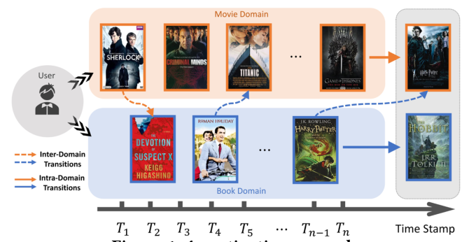
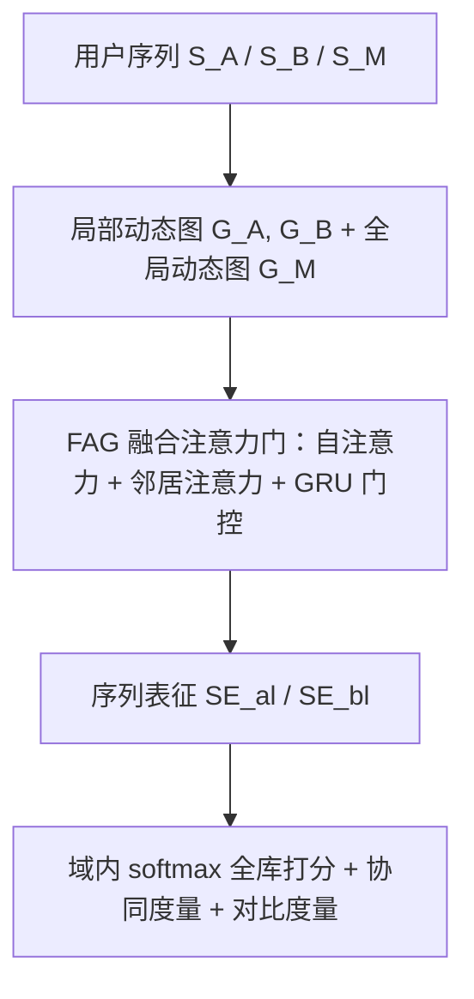
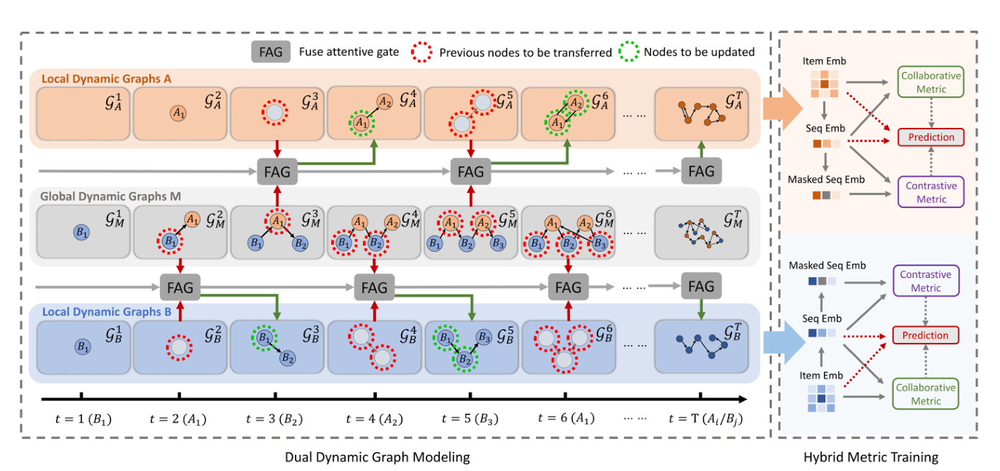

# DDGHM: Dual Dynamic Graph with Hybrid Metric Training for Cross-Domain Sequential Recommendation (双动态图 + 混合度量训练的跨域序列推荐)

- **会议/期刊**: ACM MM 2022
- **作者与机构**: Xiaolin Zheng, Jiajie Su, Weiming Liu, Chaochao Chen（浙江大学）
- **推荐链路定位**: 召回（跨域 Next-Item 序列召回）
- **研究方向**: 跨域与多场景推荐 / 序列与会话推荐
- **论文原文**: [https://arxiv.org/abs/2209.10163v1](https://arxiv.org/abs/2209.10163v1)
- **开源代码**: 暂未开源

## TL;DR (1分钟核心速览)

针对跨域序列推荐（CDSR）中「域内/域间转移混杂难融合」与「合并序列后数据依然稀疏」两大痛点，本文提出 DDGHM：并行构建局部（单域）与全局（跨域合并）两张动态有向图，用融合注意力门（FAG）把全局图的自特征与邻居上下文有选择地注入局部图；再以协同度量（WARP 大间隔，保对齐）+ 对比度量（掩码增广 InfoNCE，保均匀）联合训练。在 Amazon Movie&Book / Food&Kitchen 的重叠用户序列划分、全库 softmax 排序协议下，Movie 域 HR@20 相对最强基线 DA-GCN 提升 8.97%，Kitchen 域 HR@20 提升 4.0%。

## Background & Motivation (背景与核心矛盾)

- **主流范式**: 单域 SR 用 GRU4Rec/BERT4Rec/SRGNN 建模转移；CDR 用 Conet/DDTCDR/DARec 迁移用户表征；CDSR 用 π-Net/PSJNet/DASL/DA-GCN 做双向注意力或域感知图卷积。
- **前人局限**: ① RNN/注意力类 CDSR（π-Net、DASL）只建模序列依赖，丢失物品级结构化转移；② DA-GCN 虽建图，但在**共享隐空间**中编码跨域转移，忽略两个域的分布偏置，且无法在时间戳上同步、动态地融合域内与域间信号；③ 合并序列仍然短，稀疏问题未被真正解决。
- **核心洞察 (Key Insight)**: 用户对下一部《哈利·波特》电影的兴趣同时来自域内的悬疑/奇幻偏好与域外读过原著的行为——域内转移与域间转移应**分图建模、逐步（每时间戳）融合**，而非在单一空间里混算。
- **本文切入点**: 两层动态图（local/global）+ 注意力门控迁移，再把稀疏问题交给「对齐 + 均匀」双度量正则。

<figure class="paper-figure" markdown="span">
  <figcaption>图1：一个动机示例。两个领域中的若干物品在历史序列中从未出现或很少出现。因此，如何有效表示和聚合域内与域间序列偏好，并进一步缓解数据稀疏问题，仍是一个关键问题。</figcaption>
</figure>

## Method (核心方法设计)

### 1. 整体框架 (Overall Architecture)

输入用户三个序列 $S_A$、$S_B$与按时间戳归并的$S_M$。每个时间戳$t$：局部图$\mathcal{G}^t_A,\mathcal{G}^t_B$与全局图$\mathcal{G}^t_M$ 依当前交互动态加边，用 SRGNN（有向邻接矩阵 + GRU 更新）做消息传播，并以注意力聚合得到序列表征；随后 FAG 把全局图中「同时出现在两图里的迁移节点集」的自特征与一阶邻居上下文注入局部图表征，经 GRU 门控更新后重新传播图。最后序列表征与两域物品矩阵内积做 softmax 打分，训练时叠加协同度量与对比度量。

<figure class="paper-figure" markdown="span">
  <figcaption>图2：DDGHM 概览。域 𝐴 的局部动态图以橙色显示，域 𝐵 以蓝色显示，全局动态图以灰色显示。3.2 节包含该模型的逐步说明。</figcaption>
</figure>

### 2. 关键设计拆解 (Key Designs)

1. **双层动态图与融合注意力门（FAG）**：痛点是跨域信息「全量灌入」会淹没域内偏好。FAG 先用序列级注意力权重 $\mathbf{W}^t_{att}=\mathbf{W}_{gen}[\mathrm{SE}^{t-1}_{bg},\mathrm{SE}^{t-1}_{bl}]+\mathbf{b}_{gen}$做序列感知融合，再分别算自注意力（保留自身一致性）与一阶邻居注意力$\alpha^{neig}_i \propto \exp((\mathbf{h}^{t-1}_{bg,i})^\top \mathbf{W}_{nei}\mathbf{h}^{t-1}_{bl,x})$，两路结果经 GRU 门控$\mathbf{h}^t_{bl,x}=(1-z)\odot\tilde{\mathbf{h}}+z\odot\hat{\mathbf{h}}$ 合成。直觉：门控让模型只在跨域邻居确有解释力时才迁移，避免负迁移。
2. **混合度量训练（对齐 + 均匀）**：softmax 交叉熵只在物品维拉开竞争，稀疏物品仍欠拟合。协同度量以 WARP 加权大间隔拉近正例、推远负例：
$\mathcal{L}_{col}=\sum_{(i,j)\in\mathcal{T}}\sum_{(i,k)\notin\mathcal{T}}W^{rank}_{ij}\max(m+D(i,j)^2-D(i,k)^2,0)$，$m=1.5$；
对比度量对序列做随机 Item Mask 增广，$\mathcal{L}_{con}$ 为 InfoNCE，令同一用户两视图靠近、不同用户视图远离，从而保持表征分布均匀性、提升长尾可判别性。
3. **训练目标与开销**：$\mathcal{L}=\mathcal{L}_A+\mathcal{L}_B+\lambda_{col}\mathcal{L}_{col}+\lambda_{con}\mathcal{L}_{con}$，负例来自批内其他用户的增广序列（免额外采样器，批大小$N=100$）；召回阶段对域内全物品矩阵做 softmax，无需负采样近似，但每时间戳都要更新两张图，训练成本随序列长度线性增长。

## Experimental Setup & Evaluation Protocol (实验设置与评估协议)

- **数据集与预处理**: Amazon 双域对，仅保留**双域重叠用户**，过滤交互数 $<10$ 的用户/物品，序列按时间窗切分（Movie&Book 3 个月、Food&Kitchen 2 年）并丢弃单域不足 5 条的序列。

| 数据集 | #Items (A/B) | #Overlapped Users | #Interactions(序列数) | #Test | 平均序列长 | 说明 |
| :--- | :---: | :---: | :---: | :---: | :---: | :--- |
| Movie & Book | 58,371 / 104,895 | 12,746 | 158,373 | 15,838 | 32.1 | 影视-图书互补域 |
| Food & Kitchen | 47,520 / 53,361 | 8,575 | 67,793 | 6,779 | 18.7 | 厨房日用互补域 |

- **数据划分与防穿越**: 序列级 **比例划分 75% / 15% / 10%**（train/valid/test），每条序列取最后交互物品为标签，严格按时间戳顺序建图，无未来信息泄漏。
- **排名评测协议**: 域内 **Full-Ranking（对全部物品 softmax 排序）**，指标 HR / NDCG / MRR @5、@10、@20，五次重复取均值。
- **对比基线与超参**: 基线覆盖 SR（GRU4REC、BERT4Rec、CL4SRec）、CDR（Conet、DDTCDR、DARec）、CDSR（π-Net、PSJNet、DASL、DA-GCN）；Embedding 维度 $D=256$，$\lambda_{col}=1.0$且$\lambda_{con}=0.7$（Movie&Book）/$0.5$（Food&Kitchen），Adam，批大小 100。

## Key Experimental Results (实验关键数据)

### 1. 主实验对比 (Main Results)

| 模型 | Movie HR@5 | Movie NDCG@20 | Book HR@5 | Book NDCG@20 | Food HR@20 | Kitchen HR@20 |
| :--- | :---: | :---: | :---: | :---: | :---: | :---: |
| GRU4REC | .2232 | .2078 | .2012 | .1672 | .2076 | .2149 |
| BERT4Rec | .2425 | .2372 | .2203 | .1834 | .2247 | .2432 |
| CL4SRec | .2547 | .2418 | .2325 | .1987 | .2350 | .2582 |
| Conet | .1247 | .0818 | .1130 | .0649 | .1138 | .1244 |
| DARec | .1564 | .1283 | .1475 | .1122 | .1304 | .1445 |
| π-Net | .2665 | .2565 | .2385 | .2134 | .2469 | .2644 |
| DASL | .2835 | .2682 | .2479 | .2382 | .2689 | .2869 |
| DA-GCN | .2821 | .2719 | .2392 | .2430 | .2664 | .2926 |
| **DDGHM** | **.3083** | **.2892** | **.2615** | **.2592** | **.2789** | **.3043** |
| Improv. | +8.75% | +6.36% | +5.49% | +6.67% | +3.72% | +4.00% |

### 2. 消融实验 (Ablation Study)

| 变体 | Movie HR@20 | Movie NDCG@20 | Book HR@20 | Book NDCG@20 | Food HR@20 | Kitchen HR@20 |
| :--- | :---: | :---: | :---: | :---: | :---: | :---: |
| DDGHM-cc（去双度量） | .3045 | .2786 | .2704 | .2489 | .2712 | .2958 |
| DDGHM-col（仅协同） | .3159 | .2812 | .2786 | .2521 | .2740 | .2959 |
| DDGHM-con（仅对比） | .3205 | .2848 | .2835 | .2554 | .2764 | .2998 |
| **DDGHM（完整）** | **.3257** | **.2892** | **.2890** | **.2592** | **.2789** | **.3043** |
| DDGHM-L（仅局部图） | .2905 | .2627 | .2526 | .2414 | .2522 | .2714 |
| DDGHM-G（仅全局图） | .2542 | .2175 | .2192 | .1709 | .2282 | .2569 |
| DDGHM-GA（FAG→普通 GRU） | .3068 | .2716 | .2673 | .2414 | .2677 | .2816 |

### 3. 关键实验发现 (Key Findings)

1. **双图缺一不可且域内为主**：仅局部图（.2905）与仅全局图（.2542）在 Movie 域较完整模型分别掉 10.8% 与 21.9%，且局部图显著强于全局图，印证「域内协同仍是主信号，跨域只是增益」；把 FAG 换成普通跨域迁移单元 DDGHM-GA 掉 5.8%，说明注意力门控的过滤作用而非仅仅「加了跨域信息」带来收益。
2. **两个度量互补而非冗余**：去掉双度量（DDGHM-cc）Movie HR@20 从 .3257 降至 .3045（-6.5%），单独保留对比度量（.3205）优于单独保留协同度量（.3159），二者联合再增益，验证「对齐 + 均匀」分别解决相似物品耦合与表征塌缩。
3. **越稀疏收益越大**：序列平均长度从 32.1 降至 10.7 时，Movie 域 HR@20 相对最强基线由 +8.13% 升至 +11.5%（Book 域 7.28%→11.3%），定量证明混合度量训练对短序列冷启场景的补偿效应。

## Highlights & Limitations (亮点、对比与审稿批判)

- **与代表作对比 (vs. Prior Work)**: 相比 π-Net/PSJNet 只做 RNN 级隐状态共享，DDGHM 在物品级有向图上显式建模跨域转移；相比 DA-GCN 的域感知卷积在共享空间硬迁移，本文用 FAG 按序列上下文与邻居结构软选择；相比 DASL 的双注意力，额外补上了对合并后仍稀疏问题的度量学习正则。
- **可迁移亮点**: ① 「迁移节点集 = 两图交集」的构造方式可低成本移植到任何多场景/多业务建图融合；② 用 WARP 大间隔 + Item-Mask InfoNCE 作为双正则，可插拔地加在任意序列召回模型上。
- **审稿级局限批判**: ① 每时间戳需重建/更新局部与全局两张图并做多步传播，训练与在线增量更新开销较大，论文未给复杂度或时延分析；② 仅在 Amazon 两个重叠用户双域对、单一 Full-Ranking 协议下验证，未涉及非重叠用户、三域以上或采样排序场景，泛化性证据偏薄。

## Rating (四维评分)

- **方法创新性 (Novelty)**: ⭐⭐⭐⭐ （双层动态图 + 门控式自/邻居双注意力迁移的组合较新颖，但各组件多为已有模块的重新编排）
- **评估协议与实验扎实度 (Protocol & Experiments)**: ⭐⭐⭐⭐ （两域对 + 全库排序 + SR/CDR/CDSR 三类基线齐全，消融与序列长度分桶充分，缺显著性检验）
- **写作与数学规范度 (Clarity & Rigor)**: ⭐⭐⭐ （FAG 四步流程图文清晰，但符号较多、部分公式排版含排版噪声，复杂度分析缺失）
- **工业落地与复现价值 (Industrial & Practical Value)**: ⭐⭐⭐ （思路易复用，但代码未开源且动态图逐时间戳更新带来工程时延压力）

