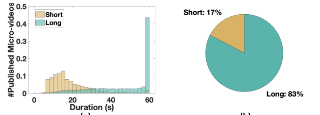
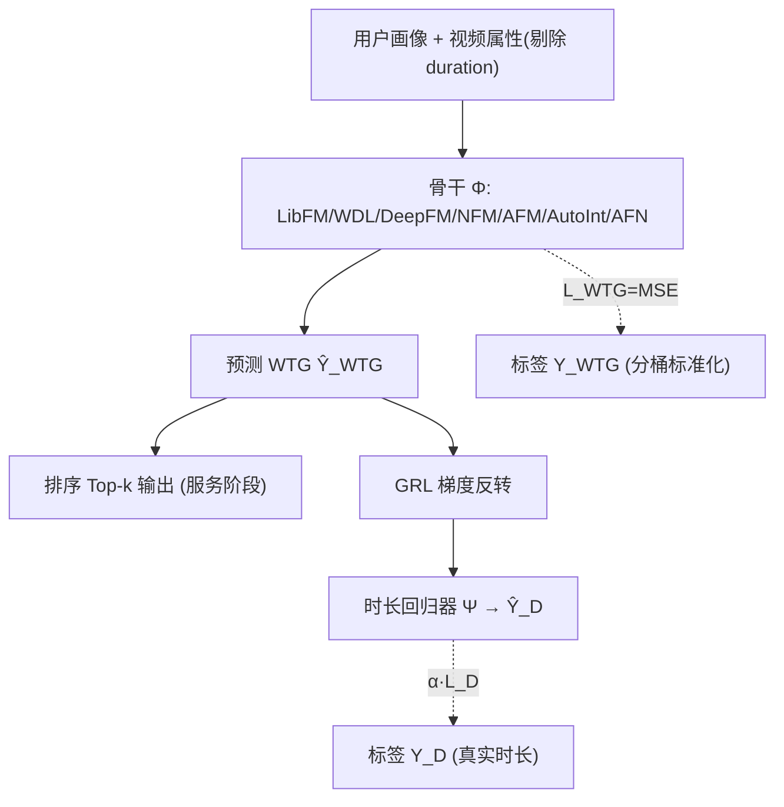
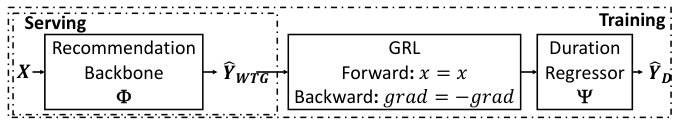

# DVR: Micro-Video Recommendation Optimizing Watch-Time-Gain under Duration Bias (时长偏差下优化观看时长增益的微视频推荐)

- **会议/期刊**: ACM Multimedia (MM) 2022
- **作者与机构**: Yu Zheng, Chen Gao, Jingtao Ding, Depeng Jin, Yong Li (清华大学电子工程系), Lingling Yi (腾讯微信技术架构部), Meng Wang (合肥工业大学)
- **推荐链路定位**: 精排（时长/观看时长回归打分与重排序）
- **研究方向**: 去偏公平、可信隐私与工业架构 / CTR 预估与特征交叉
- **论文原文**: [https://arxiv.org/abs/2208.05190v1](https://arxiv.org/abs/2208.05190v1)
- **开源代码**: [https://github.com/tsinghua-fib-lab/WTG-DVR](https://github.com/tsinghua-fib-lab/WTG-DVR)

## TL;DR (1分钟核心速览)

微视频推荐以"观看时长"为唯一优化目标，而长视频天然观看更久，模型被时长偏差（duration bias）误导，既推荐不准（大量 2 秒跳出坏例），又对短视频生产者极不公平（流量占比 <20%）。本文先提出按"时长分桶标准化"的无偏指标 WTG 及其折扣版 DCWTG，再提出骨干无关的 DVR：剔除时长特征、以 WTG 为回归目标，并用梯度反转层做对抗去偏。在微信 Channels、快手两数据集上，7 种骨干的 WTG@10 分别平均提升约 484% 与 237%。

## Background & Motivation (背景与核心矛盾)

- **主流范式**: 微视频推荐把用户画像与视频属性喂入 DNN 回归观看时长，按预测观看时长排序取 top-k。
- **前人局限一（评测失真）**: WatchTime@k 与 WatchPercentage@k 双双受时长支配——前者偏长、后者偏短（二者互为按 x 轴归一化，本质同一现象），至今无中立指标。
- **前人局限二（偏差被放大）**: 图 1/图 3(a) 显示，模型预测曲线斜率显著陡于真值曲线，即模型**放大**而非继承偏差；top-k 几乎全为 60s 长视频，坏例数仅略优于 RandomRec（3560 vs. 3850），与朴素 LongRec 的 WatchTime@k 相当，说明千参数模型"只学到了时长捷径"。
- **核心洞察 (Key Insight)**: 观看时长只有在**同时长条件内**比较才反映真实偏好——若两用户都看满 60s 视频的 50s 与 5s，偏好强弱立判；跨时长桶比较则毫无意义。

<figure class="paper-figure" markdown="span">
  <figcaption>图 2：(a) 两组用户上传微视频的分布；(b) 两组用户获得的推荐流量。图 2(b) 中，尽管两组用户数相同，“长”组获得超过 80% 的推荐机会，而“短”组获得不足 20%，表明基于观看时长的推荐会为短视频发布者带来不公平。</figcaption>
</figure>

- **本文切入点**: 先构造条件标准化指标消除比较尺度，再把它当作回归标签，并额外用对抗学习"挤掉"隐式残留在其它特征（类别、封面等）中的时长信息。

## Method (核心方法设计)

### 1. 整体框架 (Overall Architecture)

DVR 是"指标 + 模型"的双层设计。离线先按时长以 1s 宽度分桶 $B=[b_1,\dots,b_m]$，由$B(v)=f_b(d_v)$映射并统计每桶观看时长均值$\mu_{B(v)}$与标准差$\sigma_{B(v)}$，把原始日志转成 WTG 标签。训练时输入特征中**删除 duration 字段**，前向经任意骨干$\Phi$输出$\hat{Y}_{WTG}$，再经梯度反转层（GRL）送入时长回归器$\Psi$；$\Psi$试图从预测值反推时长，$\Phi$则在反转梯度下极力隐藏时长信息，形成极小极大博弈。在线服务仅保留$\Phi$，按预测 WTG 排序，无额外推理开销。

<figure class="paper-figure" markdown="span">
  <figcaption>图 6：所提出的 DVR 框架示意图。</figcaption>
</figure>

### 2. 关键设计拆解 (Key Designs)

1. **WTG：分桶条件标准化的无偏度量**：痛点是原始观看时长混杂 $\mu_{B(v)}$的量纲差异。做法是把同一时长桶内的观看时长做 z-score：$\mathrm{WTG}=\frac{\mathrm{WT}-\mu_{B(v)}}{\sigma_{B(v)}}$。因同桶内时长近似恒定，标准化后 WTG 与时长解耦：WTG=0 即"与同类视频表现持平"，短视频 1.0 严格优于长视频 0.5，尽管后者原始时长更长。图 5(b) 验证其分布在各时长桶上近似均匀。

2. **DCWTG：位置敏感的列表级评测**：WTG@k 对顺序不敏感（同样 k 个物品任意排列得分相同），而头部位置价值更高。借鉴 NDCG 引入对数折扣：$\mathrm{DCWTG}@k=\sum_{i=1}^{k}\frac{\mathrm{WTG}(l_i)}{\log_2(1+i)}$，$l_i$为预测 WTG 第$i$ 高的视频。

3. **对抗去偏与训练目标**：仅去掉时长特征不够——时长仍通过类别等特征隐式泄漏。故加时长回归头 $\hat{Y}_D=\Psi(\hat{Y}_{WTG})$（$\hat{Y}_{WTG}=\Phi(X)$），损失为$\mathcal{L}_{WTG}=\mathrm{MSE}(\hat{Y}_{WTG},Y_{WTG})$、$\mathcal{L}_D=\mathrm{MSE}(\hat{Y}_D,Y_D)$，交替优化：$\Psi$最小化$\alpha\mathcal{L}_D$，$\Phi$最小化$\mathcal{L}_{WTG}-\alpha\mathcal{L}_D$，$\alpha$控制去偏强度。任务为回归，无需负采样；推理时$\Psi$ 被丢弃。

## Experimental Setup & Evaluation Protocol (实验设置与评估协议)

- **数据集与预处理**: 两个中国头部微视频平台真实日志（微信 Channels、快手），统计细节在原文附录 A.2：

| 数据集 | #Users | #Items | #Interactions | 稀疏度/密度 | 特征/场景说明 |
| :--- | :---: | :---: | :---: | :---: | :--- |
| Wechat Channels | 原文未列 | 原文未列 | 原文未列 | — | 时长 ≤60s，长尾短视频极多 |
| Kuaishou | 原文未列 | 原文未列 | 原文未列 | — | 时长跨度大，时长偏差明显 |

- **数据划分与防穿越 (Splitting Strategy)**: 划分训练/验证/测试集（以验证集回归收敛为早停），属**按交互记录的比例划分**；原文未显式声明时间戳切分，存在轻度信息穿越风险（见局限）。
- **排名评测协议 (Ranking Protocol)**: 非全库排序。对每个用户在其**测试集候选视频**上按预测值排序取 top-$k$（$k=10$），报告 WTG@10、DCWTG@10 与坏例数 #BC@10（真值观看时长 <2s 的推荐条数）。**排行榜数值不能直接等同 Full-Ranking 结论**。
- **对比基线与超参设置**: 7 个骨干：LibFM、Wide&Deep、DeepFM、NFM、AFM、AutoInt、AFN；另设两个平凡基线 LongRec（按时长排序）与 RandomRec。每骨干对比三档：None（原样）、DVR-（用观看时长训练、仅把预测值转 WTG 排序）、DVR（完整版）。

## Key Experimental Results (实验关键数据)

### 1. 主实验对比 (Main Results)

| 骨干 | Wechat WTG@10 | Wechat DCWTG@10 | Wechat #BC@10↓ | Kuaishou WTG@10 | Kuaishou DCWTG@10 | Kuaishou #BC@10↓ |
| :--- | :---: | :---: | :---: | :---: | :---: | :---: |
| LibFM (None → DVR) | 0.0209 → 0.1332 | 0.2985 → 1.5100 | 6381 → 5947 | 0.0571 → **0.2094** | 0.4178 → **1.6137** | 5854 → 5240 |
| Wide&Deep | 0.0265 → 0.1468 | 0.3880 → 1.6539 | 6326 → 5881 | 0.0532 → 0.2087 | 0.4031 → 1.5833 | 5851 → 5226 |
| DeepFM | 0.0236 → **0.1469** | 0.3648 → **1.6551** | 6345 → **5866** | 0.0550 → 0.2066 | 0.4161 → 1.5902 | 5843 → 5261 |
| NFM | 0.0234 → 0.1444 | 0.3334 → 1.6226 | 6345 → 5899 | 0.0561 → 0.2081 | 0.4478 → 1.6050 | 5826 → 5230 |
| AFM | 0.0335 → 0.1391 | 0.4028 → 1.5656 | 6349 → 5930 | 0.1052 → 0.2082 | 0.7237 → 1.6068 | 6337 → **5209** |
| AutoInt | 0.0272 → 0.1458 | 0.3862 → 1.6420 | 6330 → 5874 | 0.0504 → 0.2086 | 0.3823 → 1.5905 | 5868 → 5237 |
| AFN | 0.0157 → 0.1408 | 0.2599 → 1.5858 | 6358 → 5917 | 0.0536 → 0.2015 | 0.4037 → 1.5551 | 5832 → 5229 |

### 2. 消融实验 (Ablation Study)

| 变体 | Wechat WTG@10 | Wechat DCWTG@10 | Kuaishou WTG@10 | Kuaishou DCWTG@10 |
| :--- | :---: | :---: | :---: | :---: |
| LibFM (None，原始观看时长目标) | 0.0209 | 0.2985 | 0.0571 | 0.4178 |
| + DVR-（仅换标签/排序，无对抗） | 0.1249 | 1.3813 | 0.1662 | 1.1318 |
| + DVR（去掉时长特征 + WTG 目标 + 对抗） | **0.1332** | **1.5100** | **0.2094** | **1.6137** |
| 7 骨干平均（None → DVR） | 0.0244 → **0.1424** | — | 0.0615 → **0.2073** | — |

### 3. 关键实验发现 (Key Findings)

1. **主要增益来自"换标签"而非复杂网络**：仅把训练目标从观看时长换成 WTG（DVR-）就把 LibFM 的 WTG@10 从 0.0209 抬到 0.1249（+497%），对抗头再贡献 +6.6%（0.1332）、DCWTG 再 +9.3%；快手 FM 上对抗增益更大（0.1662→0.2094，+26%），说明数据越偏、隐式泄漏越重，对抗越关键。
2. **公平性被显著修复**：以观看时长为目标时，60s 视频在 LibFM/AutoInt 中占据 52.3%/55.6% 的推荐流量，<20s 短视频不足 1.46%；改用 WTG 后 60s 降至 18.47%/18.95%，短视频升至约 8.59%，推荐时长直方图明显平坦化。
3. **坏例数下降印证"准确率"提升**：快手 AFM 的 #BC@10 由 6337 降至 5209（−17.8%，原文称相对 AFM 减少 21.65%），且 #BC 与 WTG@10 呈一致负相关；AFN 上 WTG@10 提升超过 500%，说明 DVR 与骨干容量无关，属通用增益。

## Highlights & Limitations (亮点、对比与审稿批判)

- **与代表作对比 (vs. Prior Work)**: 相比 Wu et al. 的聚合级观看时长偏差分析（把同一视频所有样本合并为一个点，衡量视频质量），本文是**个性化**的：同一视频对不同用户有不同 WTG，可直接嵌入在线排序。相比常规点击/评分去偏，本文处理的是连续型 engagement 目标与"物品内在属性即偏差源"这一特殊结构。
- **可迁移亮点**: (1) 用"属性分桶内 z-score"构造与属性解耦的连续标签，可直接迁移到电商（按价格/品类分桶的转化率增益）与本地生活（按配送距离分桶）；(2) GRL 头插在**预测值**而非表征上，实现极低侵入性的模型无关去偏。
- **审稿级局限批判**: (1) 评测为"测试集候选内排序"，并非全库 Full-Ranking，且未给时间戳切分与数据统计，WTG@10 量级（0.14 左右）难以与他文横比，存在乐观偏差；(2) 分桶宽度 1s、$\alpha$与桶统计量均为离线全局估计，长尾桶$\sigma$ 估计不稳会直接污染标签；论文亦无线上 A/B 与推理延迟实测，仅声明"服务阶段无额外开销"。

## Rating (四维评分)

- **方法创新性 (Novelty)**: ⭐⭐⭐⭐ （把"公平度量"与"训练标签"合一的思路巧妙，对抗头虽属经典 GRL 但用在预测值层面恰到好处）
- **评估协议与实验扎实度 (Protocol & Experiments)**: ⭐⭐⭐ （7 骨干 × 2 数据集 + 两平凡基线较扎实，但缺全库排序、数据统计与显著性检验）
- **写作与数学规范度 (Clarity & Rigor)**: ⭐⭐⭐⭐ （WTG/DCWTG 定义清晰、动机图与坏例分析有说服力，桶统计量与复杂度推导主要放在附录）
- **工业落地与复现价值 (Industrial & Practical Value)**: ⭐⭐⭐⭐⭐ （代码与数据集已开源，DROP 掉时长特征 + 换标签即可上线，服务阶段零额外推理成本）

