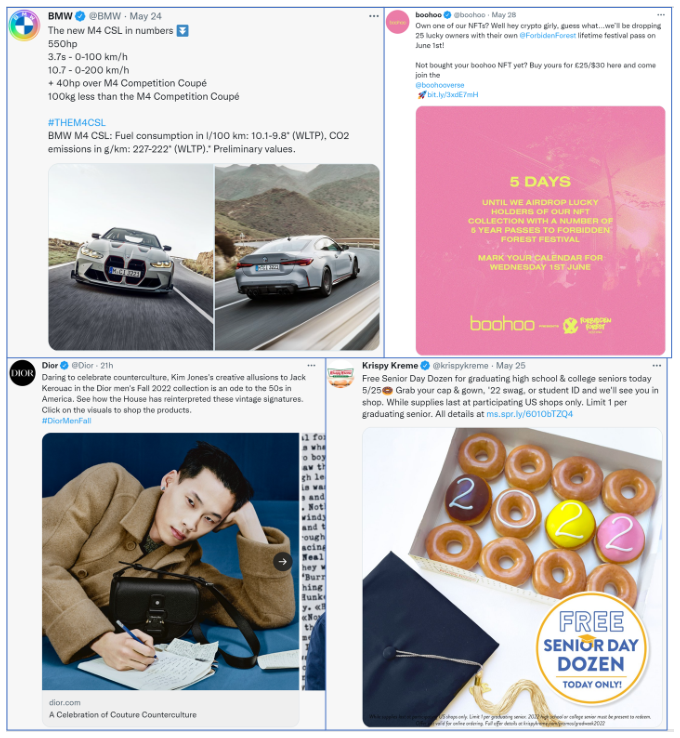
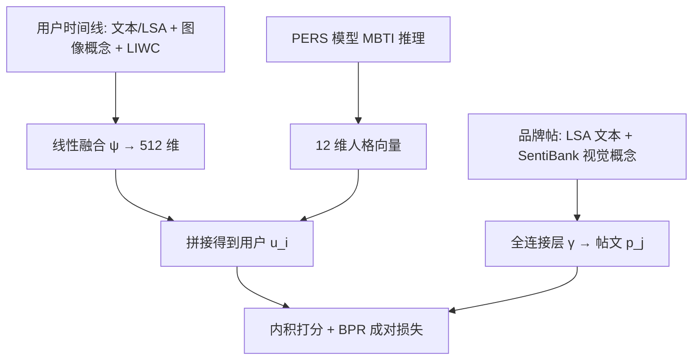
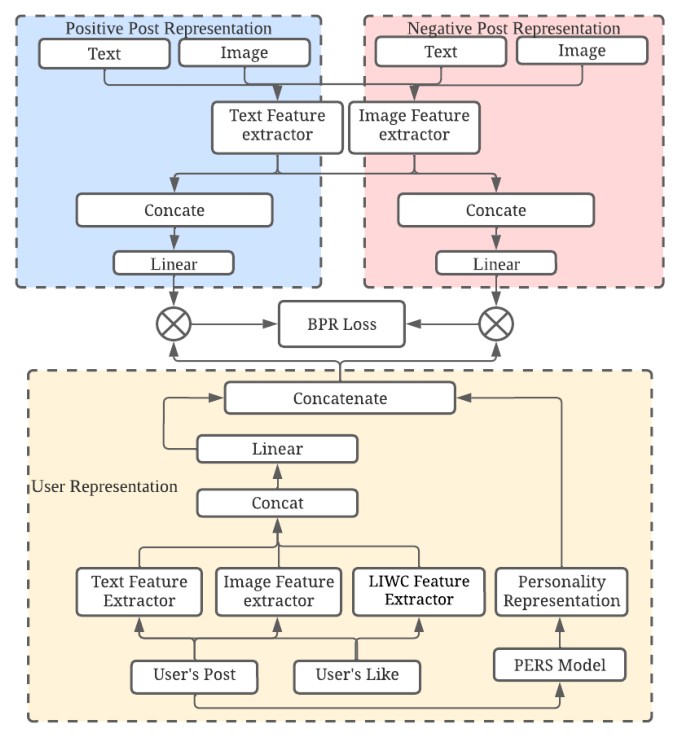

# Personality-Driven Social Multimedia Content Recommendation (人格驱动的社交媒体多媒体内容推荐)

- **会议/期刊**: ACM MM 2022
- **作者与机构**: Qi Yang, Sergey Nikolenko, Alfred Huang, Aleksandr Farseev（ITMO University / Steklov Institute / SoMin.ai）
- **推荐链路定位**: 召回（品牌内容召回，社交广告投放的场景筛选）
- **研究方向**: 多模态推荐 / 社交与群组推荐
- **论文原文**: [https://arxiv.org/abs/2207.12236v1](https://arxiv.org/abs/2207.12236v1)
- **开源代码**: 暂未开源（附数据集公开声明）

## TL;DR (1分钟核心速览)

品牌自然触达率持续下滑，广告平台必须靠"懂受众"来投放，但大规模人工做受众画像不现实。本文提出 PersiC：用多模态时间线数据（文本 TF-IDF/LSA、SentiBank 2089 维视觉情感概念、LIWC 词典）拟合用户表征，并拼接 PERS 模型自动预测的 MBTI 12 维人格特征，与品牌帖文的多模态表征做点积打分，BPR + 20 负采样训练。在自建 Twitter 品牌数据集（41,901 用户 / 330,545 交互 / 99.835% 稀疏）上按 8:2 分层划分，AUC 0.905、nDCG@10 0.092，相对最强基线 PCD 提升 nDCG@10 约 12%；线上 A/B 使单结果成本下降 4.2 倍、安装量提升 6.11 倍。

## Background & Motivation (背景与核心矛盾)

- **主流范式**: 内容营销推荐主要靠 CF（MF/NeuCF/BiVAE-CF）或内容侧多视角表征（PCD），后者把品牌/帖子映射到共享隐空间做排序。
- **前人局限**: 一是 PCD 只用 one-hot 用户 ID 映射到固定隐向量，同一人格/兴趣相近的用户被压缩到几乎同一点，无法做细粒度区分；二是纯 CF 在 99.8% 稀疏度下几乎失效（文中 MF 的 nDCG@10 仅 0.011），冷启用户也毫无抓手。
- **核心洞察 (Key Insight)**: 心理学中的 MBTI 四对二元特质（E/I、S/N、T/F、J/P）能在大规模上统一刻画受众的内容偏好，而 PERS 模型可从用户时间线多模态数据自动推断这些特质——即"人格"是比 ID 更强、且可在成熟度零样本场景下获取的用户侧信号。
- **本文切入点**: 把"预测出的人格向量"当作用户表征的附加语义槽位，与多视角历史行为特征串联融合，形成人格增强的多模态召回器。

<figure class="paper-figure" markdown="span">
  <figcaption>图1：BMW、BOOHOO、Dior 和 KrispyCreme 在 Twitter 上的四条品牌帖子示例；注意各品牌用于推广其产品或活动的不同内容风格。</figcaption>
</figure>

## Method (核心方法设计)

### 1. 整体框架 (Overall Architecture)

框架分两支：**用户支**将用户时间线文本、时间线图像概念分布、历史点赞帖文/图像、LIWC 情感特征共 6 组特征拼接，经单层线性+ReLU 融合为 $\psi(d_i)$，再与 PERS 输出的 12 维 MBTI 特征拼接得$u_i\in\mathbb{R}^{512}$；**帖文支**将品牌帖的 LSA 文本向量与 SentiBank 视觉概念分布拼接，经全连接层$\gamma$映射到同一隐空间得$p_j$。两支做内积打分，BPR 成对损失端到端训练，推理时对候选帖文全量打分取 Top-K。

<figure class="paper-figure" markdown="span">
  <figcaption>图2：PersiC 框架示意图。</figcaption>
</figure>

### 2. 关键设计拆解 (Key Designs)

1. **人格特征注入的用户表征**：针对"多模态行为特征仍不足以区分细粒度偏好、且历史点赞含大量平台算法噪声"的问题，本文将 PERS 四个特质分类器倒数第二层各取 3 维，拼成 $\mathrm{pers}_i\in\mathbb{R}^{12}$，与多视角行为向量拼接：$u_i=\mathrm{Concat}\big(\mathrm{ReLU}(W^{\top}\mathrm{Concat}(d_i)+b),\ \mathrm{pers}_i\big)$。直觉是人格提供了与"看过什么"正交的稳定心理先验，可在点赞序列被推荐算法污染时提供纠偏信号。
2. **对称的多视角帖文表征**：帖文侧不引入 ID，而用 $\mathrm{Concat}(T_{b_j},I_{b_j})$经一层 ReLU 全连接映射：$p_j=\gamma(\mathrm{Concat}(e_j))$。与用户侧共享同一隐空间，使"视觉情感概念"这一可解释中间层成为跨模态对齐的桥梁，从而在稀疏场景下用内容语义替代共现统计。
3. **训练目标、负采样与推理开销**：采用 BPR 成对损失，每个正样本均匀采样 20 个未交互负例：
$$\mathcal{L}=\sum_{(u,p_{\text{pos}},p_{\text{neg}})}-\log\sigma\big(\hat{y}(u,p_{\text{pos}})-\hat{y}(u,p_{\text{neg}})\big)+\lambda\|\Theta\|^{2}$$
（原文写作 $\log\sigma(\cdot)-\lambda\|\Theta\|^2$ 并求最小化，符号约定有误，应按上式的最大化/最小化对偶理解。）Adam、30 epoch、batch 64、dropout 0.3。免负采样推理，打分仅一次内积，线上开销与双塔结构等同。

## Experimental Setup & Evaluation Protocol (实验设置与评估协议)

- **数据集与预处理**: 自建 Twitter 品牌数据集，过滤规则为剔除帖文数 <100 的品牌、每品牌仅保留最近 100 条帖、剔除与品牌仅 1 次交互的用户。

| 数据集 | #Users | #Items(Posts) | #Interactions | 稀疏度 | 特征/场景说明 |
| :--- | :---: | :---: | :---: | :---: | :--- |
| Twitter Brand (PersiC) | 41,901 | 4,800 (48 brands) | 330,545 | 99.835% | 用户帖 6,547,342 条、用户图 1,407,775 张；文本 TF-IDF+LSA(100维)、SentiBank 2089 维视觉概念、LIWC |

- **数据划分与防穿越 (Splitting Strategy)**: `比例划分` 8:2，按每个用户的帖文数量做分层抽样；**未采用全局时间戳切分**，存在轻微未来信息泄漏风险。
- **排名评测协议 (Ranking Protocol)**: 论文报告 AUC 与 nDCG@10/50、F1@10/50，但**未明确声明是 Full-Ranking 还是 Sampled Ranking**；从 AUC/F1 二分类指标推断实为"每用户候选集打分"的采样排序，正负比与候选池构造未交代，nDCG@50 仅 0.125 也侧面说明候选池极小或相关度极稀疏，跨论文可比性受限。
- **对比基线与超参设置**: 基线含 MF（隐式 FM 退化形式）、NeuCF、BiVAE-CF、PCD（最贴近同场景的多视角模型，将品牌替换为用户适配）；用户隐向量 $d=512$、文本特征$d=100$，负采样 20，未报告显著性检验。

## Key Experimental Results (实验关键数据)

### 1. 主实验对比 (Main Results)

| 模型 | AUC | nDCG@10 | nDCG@50 | F1@10 | F1@50 |
| :--- | :---: | :---: | :---: | :---: | :---: |
| MF | 0.801 | 0.011 | 0.027 | 0.000 | 0.006 |
| NeuCF | 0.807 | 0.061 | 0.105 | 0.039 | 0.065 |
| BiVAE-CF | 0.852 | 0.075 | 0.115 | 0.045 | 0.048 |
| PCD | 0.881 | 0.082 | 0.121 | 0.048 | 0.091 |
| **PersiC (Ours)** | **0.905** | **0.092** | **0.125** | **0.052** | **0.095** |
| Improv.% (vs. PCD) | +2.7% | +12.2% | +3.3% | +8.3% | +4.4% |

### 2. 消融实验 (Ablation Study)

| 用户表征配置 | AUC | nDCG@10 | nDCG@50 | F1@10 | F1@50 |
| :--- | :---: | :---: | :---: | :---: | :---: |
| One-hot（纯 ID） | 0.765 | 0.042 | 0.079 | 0.013 | 0.023 |
| Likes only | 0.791 | 0.077 | 0.095 | 0.031 | 0.076 |
| Posts only | 0.889 | 0.087 | 0.113 | 0.045 | 0.089 |
| Posts + Likes | 0.891 | 0.087 | 0.113 | 0.045 | 0.091 |
| Posts + Personality | 0.897 | 0.089 | 0.123 | 0.047 | 0.091 |
| **Posts + Likes + Pers** | **0.905** | **0.092** | **0.125** | **0.052** | **0.095** |

### 3. 关键实验发现 (Key Findings)

- **多视角历史远胜过 ID 表征**：One-hot 的 AUC 仅 0.765，仅用用户自发帖文即升至 0.889（AUC +16.2%、nDCG@50 +43%），说明 99.8% 稀疏度下内容侧信号是唯一可行抓手。
- **人格特征带来稳定且互补的增益**：在 Posts+Likes 基础上加入 12 维 MBTI 特征，AUC 0.891→0.905、nDCG@50 0.113→0.125（+10.6%）、F1@10 +15.6%，证明自动推断的人格（非问卷）即为有效增量，是本文对 RQ1/RQ2 的正面回答。
- **历史点赞是噪声源而非信息源**：Likes-only 的 AUC 0.791 仅略高于 One-hot，且 Posts+Likes 相对 Posts-only 几乎无提升（nDCG@10 持平 0.087），归因于平台推荐算法对用户点赞行为的过滤气泡污染——作者亦在结论中承认这是未解难题。

## Highlights & Limitations (亮点、对比与审稿批判)

- **与代表作对比 (vs. Prior Work)**: 相较 PCD（仅 one-hot 用户/品牌 + 多模态帖文，余弦打分 + hinge 损失），PersiC 用真实多模态时间线做细粒度用户表征，并以人格语义补充正交先验；相较把人格特制为隐式向量的深度学习工作（另自行推断人格向量），本文直接采用心理学标准 MBTI 类别，可解释、可复用；相较 CF 系（MF/NeuCF/BiVAE-CF），在极端稀疏下 AUC 领先 5–10 个点。
- **可迁移亮点**: ①用"可解释中间概念层"（SentiBank 2089 视觉情感概念）做跨模态对齐，比端到端 CLIP 特征更适合做归因和创意指导；②把外部静态画像（人格/人口属性）与行为序列特征拼接的轻量融合范式，可直接嵌入双塔召回。
- **审稿级局限批判**: ①评测协议含糊——未声明 Full-Ranking、候选池构造与负例比例，nDCG@50 绝对值仅 0.125，且无显著性检验与方差报告，结论强度存疑；②人格标签实为 PERS 模型"预测值"而非真值，存在自我循环偏差，且 8:2 随机划分未按时间切分，用户时间线与品牌帖可能时间重叠造成泄漏；此外线上 4.2×/6.11× 结论缺少实验设计与归因分析，仅为单品牌案例。

## Rating (四维评分)

- **方法创新性 (Novelty)**: ⭐⭐⭐ （MBTI 预测值注入多模态用户塔的思路在工业上实用，但模型结构本身仅为线性融合 + 点积双塔，缺乏理论或谱分析支撑）
- **评估协议与实验扎实度 (Protocol & Experiments)**: ⭐⭐ （仅 4 个基线、无显著性检验、排序协议与候选池未声明，消融完整但统计严谨度不足）
- **写作与数学规范度 (Clarity & Rigor)**: ⭐⭐⭐ （特征定义与损失写法清晰，但 BPR 损失符号约定错误、打分函数未显式给出、部分符号前后不一致）
- **工业落地与复现价值 (Industrial & Practical Value)**: ⭐⭐⭐⭐ （免负采样双塔推理开销极低，配套大规模多模态数据集与真实广告投放 ROI 数据，对内容营销场景落地价值高）

