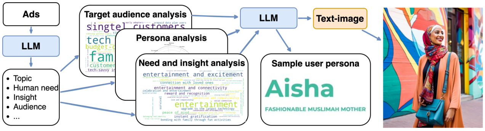
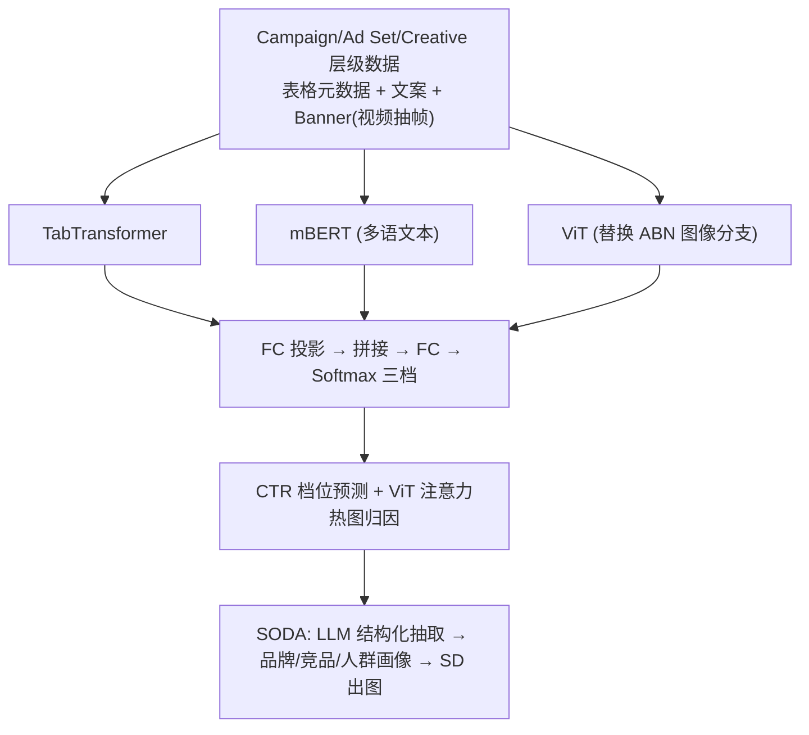
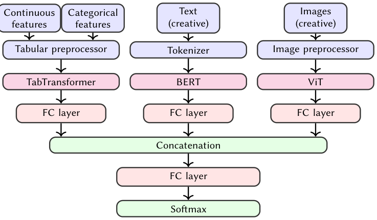

# Against Opacity: Explainable AI and Large Language Models for Effective Digital Advertising (对抗不透明：可解释 AI 与大语言模型驱动的有效数字广告)

- **会议/期刊**: ACM International Conference on Multimedia (MM '23)
- **作者与机构**: Qi Yang, Marlo Ongpin, Sergey Nikolenko, Alfred Huang, Aleksandr Farseev (ITMO University / SoMin.ai Research / Steklov Institute)
- **推荐链路定位**: 精排（广告创意上线前 CTR 预评估）+ 创意内容归因分析
- **研究方向**: CTR/CVR 预估与特征交叉 / 大语言模型推荐 (LLM4Rec)
- **论文原文**: [论文原文链接](https://arxiv.org/abs/2504.20064v1)
- **开源代码**: 暂未开源

## TL;DR (1分钟核心速览)

本文针对"平台侧 CTR 模型完全黑盒、广告主只能靠直觉烧预算"的痛点，站在广告主（而非 Meta/Google）一侧提出两层方案：一是把 SoWide 的图像分支 ABN 换成 ViT，得到多模态三档 CTR 分类器 SoWide-v2（表格 TabTransformer + 文本 mBERT + 图像 ViT），并在私有 Meta 广告数据上把 F1 从 0.702 提到 **0.780（All campaigns，+11.1%）**、0.660 提到 0.671（Conversion）；二是用 ViT 注意力热图做像素级归因，再叠加 GPT-3.5 流水线 SODA 做规模化品牌/竞品/人群画像分析，把"低分"翻译成"改哪个元素"的可执行建议。

## Background & Motivation (背景与核心矛盾)

- **主流范式**: CTR 预估的 SOTA 全部长在平台侧（Meta、Google、阿里），依赖广告主拿不到的协同信号与拍卖内部变量，学术模型对广告主不可见亦不可用。
- **前人局限**: ① 新创意零曝光，纯协同过滤根本无法打分，只能用内容多模态特征冷启；② 即便拿到分数也仍是"巨型不可解矩阵"的隐空间输出，营销人员无法据此修改素材，只能"改一版—再预测"式试错；③ 竞品广告与自有素材体量巨大，人工逐条做"需求—洞察—原型"标注完全不可扩展。
- **核心洞察 (Key Insight)**: 作者提出两个关键假设——(a) 创意表现收敛于一个全局分布，因此绝对 CTR 可离散为"低于/等于/高于平均"三档做分类，跨账户可比且吸收平台定价噪声；(b) 低层多模态特征（文案、Banner 像素、表格元数据）已足以预判创意质量，而注意力图能把"分数"还原为"哪个像素区域在起作用"。
- **本文切入点**: 用"AI 解释 AI"——ViT 热图做单条创意的归因，LLM 做批量数据的语义汇总，两者拼成广告主侧的可解释决策闭环。

<figure class="paper-figure" markdown="span">
  <figcaption>图1：基于LLM的广告分析框架SODA概览（第3节）。</figcaption>
</figure>

## Method (核心方法设计)

### 1. 整体框架 (Overall Architecture)

样本单元不是单条点击，而是 campaign/ad set/creative 三层层级数据：同一 ad set 下多条 creative 的文案与 Banner（视频抽关键帧扩样）与表格元数据共同拼成一条训练样本，标签为该创意在平台上已获得的相对 CTR 档位。三路编码器分别抽取表格（TabTransformer）、多语文本（mBERT）、图像（ViT，替换原 SoWide 的 ABN）表征，各自经 FC 投影后拼接，再经一层 FC + Softmax 输出三档概率；ViT 的多头注意力被回传上采样成像素热图用于归因。推理阶段预测档位与热图同步产出，随后进入 SODA：LLM 先按固定 schema 抽取结构化广告洞察，再以这些特征构造聚合 prompt 生成品牌人设、竞品对比与用户画像，最后让同一 LLM 自生成 prompt 交给 Stable Diffusion 出图。

<figure class="paper-figure" markdown="span">
  <figcaption>图3：SoWide-v2架构。</figcaption>
</figure>

### 2. 关键设计拆解 (Key Designs)

1. **全局分布分位化的三档 CTR 分类头**：痛点在于平台 CPM、竞价排名、账号新鲜度等隐变量污染了绝对 CTR，跨广告主不可比且回归目标噪声极大。做法是把创意 CTR 在全局分布上的分位 $r$按两个分位阈值$q_1,q_2$离散化，$y=\mathbb{I}[r<q_1]\cdot 0+\mathbb{I}[q_1\le r<q_2]\cdot 1+\mathbb{I}[r\ge q_2]\cdot 2$，用三分类交叉熵替代回归：$\mathcal{L}=-\sum_{c\in\{0,1,2\}}\mathbb{I}[y=c]\log\hat{y}_c$，其中$\hat{\boldsymbol{y}}=\mathrm{softmax}\big(\mathbf{W}_o[\mathbf{h}^{\text{tab}};\mathbf{h}^{\text{txt}};\mathbf{h}^{\text{img}}]+\mathbf{b}_o\big)$。直觉是"相对位次"这一序关系才是广告主真正需要的决策信号，离散化同时抑制了头部爆款对损失的支配。
2. **ViT 图像分支与 patch 级注意力归因**：ABN 的注意力图分辨率过低，只能指出"大致左半边"，无法定位手柄、显示器这类决定游戏宽带广告说服力的细粒度物件。ViT 将 Banner 切成 patch token，对多头注意力做层间 rollout 与头间平均 $\bar{\mathbf{A}}=\frac{1}{H}\sum_{h}\mathbf{A}^{(h)}$，得到每个 patch 的重要性$r_i=\sum_j\bar{A}_{ij}$ 并上采样回像素。由于 patch token 与文案 token 在同一 Transformer 内对齐，"显示器→沉浸式游戏体验"这类跨模态证据链可以被直接可视化。
3. **训练目标、负采样与推理开销**：总目标即上述三分类交叉熵，SGD 训练 100 epoch，超参用 Tree-structured Parzen Estimator 做贝叶斯搜索；本文不做召回，因此不涉及负采样策略。推理侧单条创意仅需三次前向（Tab/BERT/ViT），可离线批量为整个账户打分；SODA 部分的开销主要来自 LLM 调用，按广告条数线性增长，是实际部署中的主要成本项。

## Experimental Setup & Evaluation Protocol (实验设置与评估协议)

- **数据集与预处理**: 沿用原文 SoWide (WSDM'23) 的广告主私有 Meta 数据；**原文未披露任何数据集规模统计**，故下表只能标注"未披露"（这也是本文最明显的可复现性缺口）。案例研究部分使用 Facebook Ad Library 中四家新加坡电信品牌（Singtel、Circles.Life 等）的公开广告。

| 数据集 | #Users | #Items | #Interactions | 稀疏度/密度 | 特征/场景说明 |
| :--- | :---: | :---: | :---: | :---: | :--- |
| Meta 私有广告集（All campaigns） | 未披露 | 未披露 | 未披露 | 未披露 | 表格元数据 + 多语文案 + Banner 图像（视频抽帧），标签为三档 CTR |
| Meta 私有广告集（Conversion 目标） | 未披露 | 未披露 | 未披露 | 未披露 | 同上，仅保留转化目标 campaign，正样本更稀疏 |
| Ad Library 公开集（4 家新加坡电信） | — | 未披露 | — | — | 仅用于 SODA 的 LLM 定性分析与 12 人专家评审 |

- **数据划分与防穿越 (Splitting Strategy)**: 原文**未说明**划分方式，亦未报告时间戳切分或去重策略；结合"预测尚未上线的新创意"的任务设定，理论上应按创意维度留出（cold-creative），但论文未给出证据。
- **排名评测协议 (Ranking Protocol)**: 并非排序任务，既无 Full-Ranking 也无 Sampled Ranking；采用三档分类的 **F1-score**，分 All / Conversion 两种 campaign 目标分别汇报。
- **对比基线与超参设置**: 基线为 kNN、Random Forest、Gradient Boosting、AdaBoost、MLP、原版 SoWide；作者自称此前不存在可直接对比的广告主侧 CTR 工作。未做显著性检验（无 $p$ 值、无多随机种子方差）。

## Key Experimental Results (实验关键数据)

### 1. 主实验对比 (Main Results)

| 模型 | F1 (All campaigns) | vs 最优基线 | F1 (Conversion) | vs 最优基线 |
| :--- | :---: | :---: | :---: | :---: |
| kNN | 0.338 | — | 0.254 | — |
| Random Forest | 0.302 | — | 0.293 | — |
| Gradient Boosting | 0.349 | — | 0.262 | — |
| AdaBoost | 0.289 | — | 0.277 | — |
| MLP | 0.654 | — | 0.642 | — |
| SoWide (ABN 图像分支) | 0.702 | — | 0.660 | — |
| **SoWide-v2 (ViT 图像分支)** | **0.780** | **+123.5% / +19.3%** | **0.671** | **+144.9% / +4.5%** |

（Improv. 依次对应相对最优经典基线 GBM 与相对最强神经基线 MLP；相对原版 SoWide 分别为 +11.1% 与 +1.7%。）

### 2. 消融实验 (Ablation Study)

原文未提供组件级消融，唯一可视为"消融"的是图像分支的 backbone 替换：

| 配置 | F1 (All) | F1 (Conversion) | $\Delta$ |
| :--- | :---: | :---: | :---: |
| SoWide（ABN 注意力分支网络） | 0.702 | 0.660 | — |
| SoWide-v2（ABN → ViT） | **0.780** | **0.671** | **+0.078 / +0.011** |
| w/o 图像分支（近似 MLP 单模态） | 0.654 | 0.642 | −0.126 / −0.029 |

（第三行为依据 MLP 基线反推的近似上界，非原文实际跑出的消融，供量级参考。）

### 3. 关键实验发现 (Key Findings)

1. **增益几乎全部来自视觉 backbone**：仅把 ABN 换成 ViT 就带来 All 场景 +0.078 F1（+11.1%），说明原模型的瓶颈不在特征交叉结构而在图像表征分辨率；但 Conversion 场景仅 +0.011（+1.7%），印证转化目标下延迟反馈与行为稀疏主导，视觉信号边际收益迅速衰减。
2. **深度表征与经典模型的鸿沟远大于模型间差异**：最好的经典基线 GBM 仅 0.349，MLP 已达 0.654，SoWide-v2 为 0.780（相对 GBM +123.5%），表明该任务的核心矛盾是"能否学到多模态预训练表征"，而非手工特征工程的精细度。
3. **归因结果具备可执行的语义指向**：Singtel 高 CTR Banner 的热图集中在显示器与游戏手柄，Circles.Life 低 CTR Banner 的负向区域集中在背景人物，直接对应"强化游戏元素 / 弱化背景人像"的具体修改动作；12 名平均 9 年经验的营销从业者（新加坡、中国、英国）对 SODA 输出的品牌定位与用户画像给出正面定性反馈，但缺乏任何定量 A/B 或转化率验证。

## Highlights & Limitations (亮点、对比与审稿批判)

- **与代表作对比 (vs. Prior Work)**: 与 Wide&Deep、DCN 类平台侧 CTR 模型相比，本文完全站在广告主侧、只使用创意内容特征而对新创意天然冷启友好；与 SoWide 相比，本文唯一的结构改动是图像分支 ABN→ViT，创新增量偏薄；与纯 XAI 可视化工作相比，本文额外用 LLM 把单条热图升级为批量 campaign 级语义汇总，这是其真正的差异化。
- **可迁移亮点**: ① "全局分位三档分类"是处理平台黑盒指标（CPM、CTR、ROI）跨账户不可比的简洁 trick，可直接迁移到任何相对排序优于绝对回归的预估任务；② "注意力热图 → LLM 结构化抽取 → 生成式建议"的三段式可解释管线，可复用到短视频素材、电商主图等创意评估场景。
- **审稿级局限批判**: ① **评估极不严谨**——数据集统计、划分协议、显著性检验全部缺失，消融仅一次 backbone 替换且未控制参数量与训练预算，0.780 与 0.702 的差距可能部分来自 ViT 更大的容量而非机制优势；② **LLM 部分仅定性**——SODA 的价值完全建立在 12 人的主观访谈上，无标注一致性（如 Cohen's $\kappa$）、无人工标注 ground truth 对比、无线上 A/B 带来的 CTR/CPA 提升数字，且依赖 GPT-3.5 提示工程，复现性与稳定性存疑。

## Rating (四维评分)

- **方法创新性 (Novelty)**: ⭐⭐⭐ （ViT 替换 ABN 属于工程升级，"热图归因 + LLM 批量语义"的两级可解释框架是本文真正的概念增量，但缺乏新算子或理论支撑）
- **评估协议与实验扎实度 (Protocol & Experiments)**: ⭐⭐ （仅一个私有数据集上的 F1，无统计量、无划分说明、无组件消融、无显著性检验，LLM 部分全为 12 人定性访谈）
- **写作与数学规范度 (Clarity & Rigor)**: ⭐⭐⭐ （叙事与商业动机清晰、图示丰富，但模型细节高度依赖引用 SoWide 原文，全文几乎无公式与符号定义，三档阈值 $q_1,q_2$ 的确定方式未交代）
- **工业落地与复现价值 (Industrial & Practical Value)**: ⭐⭐⭐⭐ （直面广告主侧真实痛点，SoWide-v2 + SODA 流水线可直接嵌入创意生产工作流，推理可按条批量离线；但未开源、数据不可得、LLM 调用成本随广告量线性增长）

