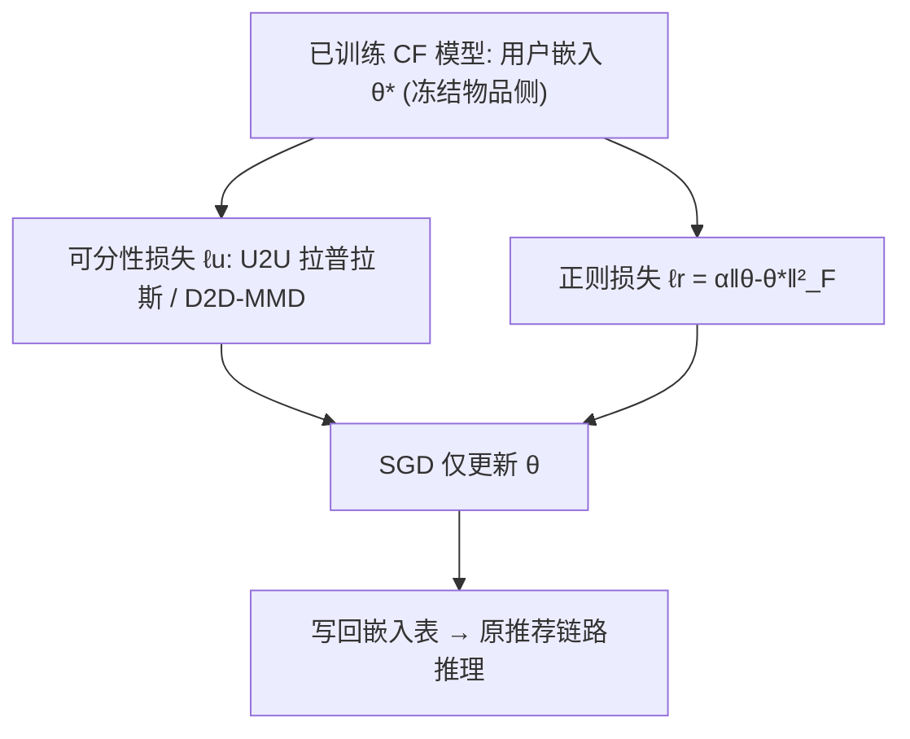

# Making Users Indistinguishable: Attribute-wise Unlearning in Recommender Systems (令用户不可区分：推荐系统中的属性级遗忘)

- **会议/期刊**: ACM MM 2023（ACM International Conference on Multimedia）
- **作者与机构**: Yuyuan Li, Chaochao Chen, Xiaolin Zheng, Yizhao Zhang, Zhongxuan Han（浙江大学）；Dan Meng, Jun Wang（OPPO 研究院）
- **推荐链路定位**: 后处理（已训练模型的用户表征修正，不触碰召回/排序结构）
- **研究方向**: 去偏公平、可信隐私与工业架构 / 协同过滤
- **论文原文**: [https://arxiv.org/abs/2310.05847v1](https://arxiv.org/abs/2310.05847v1)
- **开源代码**: 暂未开源（论文中出现的 `xgboost` 链接为攻击者基线依赖，非本文实现）

## TL;DR (1分钟核心速览)

推荐模型的用户嵌入会泄露从未参与训练的敏感属性（性别/年龄/种族），而现有"推荐遗忘"只针对输入数据，重训也无法抹除属性痕迹。本文提出**训练后属性遗忘 PoT-AU**：在模型训练完成后，仅以"可分性损失 + 参数正则"微调用户嵌入表，使攻击者无法区分属性。在 ML-100K/ML-1M/LFM-2B 三数据集、双攻击者（MLP/XGB）协议下，D2D-MMD 变体将攻击 AUC 从 0.68 均值压到 0.51（近随机），同时 NDCG@10 与原始模型持平（0.4285 vs 0.4298），遗忘耗时仅需重训类方法的 1/23。

## Background & Motivation (背景与核心矛盾)

- **主流范式**: 推荐遗忘（RecEraser、LASER 等）以训练输入（用户/物品/单条交互）为遗忘目标，靠分区重训或影响函数近似删除其影响。
- **前人局限 ①**: 敏感属性**从未作为训练输入**，因此"从头重训"这一遗忘的黄金标准对属性完全无效，所有 Input Unlearning 方法在此失效（论文表 1 明确指出该差异）。
- **前人局限 ②**: 少数 In-Training AU 方案依赖加网络块或对抗训练，需在训练期介入并访问数据/梯度；而合规场景下模型上线后数据已被销毁或受保护，平台也不愿干扰原训练流程。
- **核心洞察 (Key Insight)**: 攻击者仅凭用户嵌入即可达 **0.68 平均准确率**推断性别，说明属性以"类间分布可分离"的形式潜伏在嵌入空间，而非某条具体样本中——因此可通过**压缩属性条件分布的差异**来消除，而非删除数据。
- **本文切入点**: 把 PoT-AU 建模为仅关于用户嵌入 $\boldsymbol{\theta}\in\mathbb{R}^{N\times K}$ 的无数据优化问题，双目标（不可区分 / 保推荐）各配一项损失。

## Method (核心方法设计)

### 1. 整体框架 (Overall Architecture)

训练阶段完全不动：原 CF 模型（NMF / LightGCN）产出用户嵌入与物品嵌入。后处理阶段只加载用户嵌入表 $\boldsymbol{\theta}^{*}$与其属性标签，用"可分性损失$\ell_u$拉平不同属性用户的表征 + Frobenius 正则$\ell_r$锚住原始嵌入"联合优化，得到$\boldsymbol{\theta}$ 后写回模型；物品嵌入与其余参数全部冻结，因此推理路径与线上服务零改动、零额外延迟。

### 2. 关键设计拆解 (Key Designs)

1. **U2U 用户级加权拉近（张量化为图拉普拉斯）**：属性可分性无法直接最小化，作者将其转写为约束 $Div(\boldsymbol{\theta}_i,\boldsymbol{\theta}_j)\cdot Div(v_i,v_j)\le\delta$——异属性对权重为正、同属性对权重为 0，只惩罚跨性别用户对：

$$\ell_{u,U}=\sum_{i\in S_1}\sum_{j\in S_2}\lVert\boldsymbol{\theta}_i-\boldsymbol{\theta}_j\rVert_F^2\cdot Div(v_i,v_j)=2\,\mathrm{Tr}(\boldsymbol{\theta}^{\top}\mathbf{L}_D\boldsymbol{\theta})$$

其中 $Div(v_i,v_j)=1-\mathbf{A}(S_i,S_j)$，$\mathbf{L}_D$ 为其拉普拉斯矩阵。直觉上这等价于在"属性邻接图"上做一次强制平滑，把异类用户拉成邻居；张量形式让全对计算变成一次矩阵乘，GPU 友好。

2. **D2D 分布级 MMD 对齐（保形状的关键）**：以域适应中的风险界（Theorem 1：两域风险差被 $\mathcal{H}$-散度界定）为动机，把同属性用户视为一个分布$\mathcal{P}_{\theta_1},\mathcal{P}_{\theta_2}$，直接最小化分布距离：

$$\ell_{u,D}=\mathrm{MMD}^2(\mathcal{P}_{\theta_1},\mathcal{P}_{\theta_2})=\Big\lVert\tfrac{1}{|S_1|}\sum_{i\in S_1}\phi(\boldsymbol{\theta}_i)-\tfrac{1}{|S_2|}\sum_{j\in S_2}\phi(\boldsymbol{\theta}_j)\Big\rVert_{\mathcal{H}}^2$$

（RBF 核）它只移动分布重心、增大重叠区而不改变分布形状与方差，因此不破坏协同过滤所依赖的局部邻域结构——这正是它在保推荐上碾压 U2U 的物理原因。

3. **训练目标、负采样与推理开销**：总损失 $\mathcal{L}(\boldsymbol{\theta})=\ell_u+\alpha\lVert\boldsymbol{\theta}-\boldsymbol{\theta}^{*}\rVert_F^2$，**不使用任何交互数据、不使用任何负采样**，SGD 数十步收敛；U2U 复杂度$O(N^2K)$（可用稀疏$\mathbf{L}_D$加速），D2D 为$O(NK)$，推理阶段开销为 0。

## Experimental Setup & Evaluation Protocol (实验设置与评估协议)

- **数据集与预处理**（均过滤交互数 $<5$ 的用户与物品，即 `5-core`）：

| 数据集 | #Users | #Items | #Interactions | 稀疏度 | 场景 / 属性 |
| :--- | :---: | :---: | :---: | :---: | :--- |
| ML-100K | 943 | 1,682 | 100,000 | 93.695% | 电影评分，性别（女 273/男 670） |
| ML-1M | 6,040 | 3,950 | 1,000,209 | 95.814% | 电影评分，性别（女 1079/男 4331） |
| LFM-2B | 19,972 | 99,639 | 2,829,503 | 99.858% | 音乐收听，性别（女 4415/男 15557） |

- **数据划分与防穿越**: 比例划分 `80% / 10% / 10%`（训练/验证/测试）；遗忘阶段只允许访问**嵌入与属性标签**，禁止访问训练集，天然无穿越风险。
- **排名评测协议**: 推荐侧使用 `Full-Ranking` 全库未交互物品排序（论文未声明采样负例），指标 NDCG@{5,10}、HR@{5,10}；遗忘侧为**灰盒攻击协议**——仅随机暴露 10% 用户嵌入与标签作 shadow 训练集，其余作测试，报告 Acc/Precision/Recall/AUC（越低越好）。
- **对比基线与超参**: 攻击者 MLP（3 层）与 XGBoost；遗忘基线 Original、Retrain（把 D2D 损失并入原推荐损失后重训）、Adv-InT（对抗训练版 InT-AU）；在 NMF 与 LightGCN 两种骨干上验证，每设置跑 10 次取均值，$\alpha$ 为权衡超参（论文未报告显著性检验）。

## Key Experimental Results (实验关键数据)

### 1. 主实验对比 (Main Results)

下表为三数据集平均（NMF / LightGCN 分别聚合，AUC 越低越好，推荐指标越高越好）：

| 方法 | NMF AUC(MLP) | NMF AUC(XGB) | NMF NDCG@10 | LightGCN AUC(MLP) | LightGCN AUC(XGB) | LightGCN NDCG@10 |
| :--- | :---: | :---: | :---: | :---: | :---: | :---: |
| Original | 0.7040 | 0.6805 | **0.4335** | 0.6845 | 0.6622 | **0.4298** |
| U2U-R | **0.5064** | 0.9915 | 0.3590 | **0.5057** | 0.9870 | 0.4141 |
| **D2D-R (本文)** | 0.5245 | **0.5052** | 0.4309 | 0.5187 | **0.5098** | 0.4285 |
| Retrain (InT) | 0.5139 | 0.5497 | 0.4255 | 0.5392 | 0.5120 | 0.4251 |
| Adv-InT (InT) | 0.5150 | 0.5960 | 0.3893 | 0.5351 | 0.5878 | 0.4234 |

相对原始嵌入，D2D-R 使 XGB 攻击 AUC 平均下降 **24.4%**、MLP 下降 **23.1%**，而 NDCG@10 仅变化 0.6% 与 0.3%（ML-100K+NMF 上 NDCG@5 甚至由 0.4308 升至 0.4320）。U2U-R 虽在 MLP 上更强，却把 XGB 的 AUC 推到 0.99（比原始更易被攻破）。

### 2. 消融实验 (Ablation Study)

以 ML-1M + LightGCN 为例，拆解"可分性度量方式"与"是否需重训"两个变量：

| 变体 | 可分性度量 | 是否重训 | AUC(MLP) | AUC(XGB) | NDCG@10 |
| :--- | :--- | :---: | :---: | :---: | :---: |
| Original（$\alpha=\infty$，不遗忘） | — | 否 | 0.7069 | 0.6748 | 0.4674 |
| U2U-R | 用户对拉普拉斯 | 否 | 0.5090 | 0.9889 | 0.4445 |
| **D2D-R** | MMD 分布距离 | 否 | 0.5232 | 0.5146 | 0.4657 |
| Retrain | MMD 分布距离 | 是 | 0.5269 | **0.5027** | 0.4666 |
| Adv-InT | 对抗训练 | 是 | 0.5272 | 0.6037 | 0.4625 |
| D2D-R（$\alpha\to 0$，去正则） | MMD | 否 | ↓逼近 0.5 | ↓逼近 0.5 | 明显下滑 |

运行时间（ML-1M + LightGCN）：D2D-R **60.99s** vs U2U-R 159.22s vs Retrain 1402.22s vs Adv-InT 2103.57s。

### 3. 关键实验发现 (Key Findings)

1. **"拉平用户"不等于"消除属性"，反而可能制造假遗忘**：U2U-R 的强约束把所有用户拉向原始嵌入均值，方差塌缩成"针状分布"（图 4 直方图可见）——MLP 因此失效（AUC 0.50），但拟合力更强的 XGB 能过拟合该均值并精确切开针状分布，AUC 反升至 **0.99**。这说明只看单一弱攻击者会严重高估遗忘效果。
2. **D2D 只平移不形变，达成隐私-效用双赢**：MMD 仅缩小两分布重心距离、保留方差，故在攻击 AUC 降到随机水平（0.505–0.510）的同时 NDCG@10 保持 0.4285/0.4309；作者将小幅上涨归因于顺带削弱了性别相关的负向偏差。
3. **后处理范式在效率上是数量级优势**：与同等隐私保护强度的 Retrain（AUC 0.5392/0.5120）相比，D2D-R 精度相当但耗时仅为 **1/23**；且隐私-效用曲线对 $\alpha$单调可控（$\alpha$ 减小 → AUC 更低、NDCG 略降），便于平台按合规等级调节。

## Highlights & Limitations (亮点、对比与审稿批判)

- **与代表作对比**: 相比 RecEraser/LASER 等**输入遗忘**（以重训/分区为单位删除样本影响），本文首次指出"未参与训练的属性"无法通过重训删除，必须改写表征分布；相比 Adv-InT 的**对抗训练**，本文无需训练期介入与数据访问，且对 XGB 攻击者的抑制强 8 个百分点以上（0.5098 vs 0.5878）。
- **可迁移亮点 ①**: "只微调嵌入表 + 分布距离约束"这一后处理范式可直接移植到跨域推荐、多场景模型的敏感属性脱敏，或作为公平性约束的轻量插件。
- **可迁移亮点 ②**: U2U 损失的拉普拉斯张量化（$\mathrm{Tr}(\boldsymbol{\theta}^{\top}\mathbf{L}_D\boldsymbol{\theta})$）是把"成对约束"变成 GPU 高效矩阵运算的通用技巧，可用于任何成对正则场景。
- **审稿级局限 ①**: 仅验证二分类单一属性与 MF/LightGCN 两骨干，未覆盖序列模型、多模态、多属性联合遗忘；多值属性的 U2U 泛化只在结论中口头承诺。
- **审稿级局限 ②**: 攻击者假设偏弱（灰盒、仅暴露 10% shadow、不利用物品嵌入），未评估嵌入反演或联合侧信息攻击；同时缺少显著性检验，且 U2U 的 $O(N^2K)$ 在千万级用户上需近似采样。

## Rating (四维评分)

- **方法创新性 (Novelty)**: ⭐⭐⭐⭐ （首次形式化 PoT-AU 并区分"输入遗忘 vs 属性遗忘"，U2U 拉普拉斯化与 D2D-MMD 两种度量有清晰的理论动机与几何解释）
- **评估协议与实验扎实度 (Protocol & Experiments)**: ⭐⭐⭐⭐ （三数据集 × 两骨干 × 两攻击者 × 10 次平均，含运行时间与嵌入分布剖析；但缺显著性检验，推荐侧未声明采样协议）
- **写作与数学规范度 (Clarity & Rigor)**: ⭐⭐⭐⭐ （双目标损失推导自约束式自然导出，Theorem 1 的使用交代了近似条件；$\delta$与$\alpha$ 的关系、U2U 收敛性未严格说明）
- **工业落地与复现价值 (Industrial & Practical Value)**: ⭐⭐⭐⭐ （零推理开销、分钟级后处理、可调 $\alpha$ 隐私旋钮，非常契合合规响应；扣分在于未开源且仅验证中小规模数据集）

