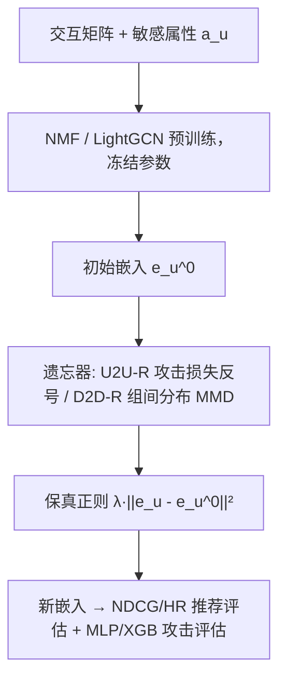

# Reproducibility Companion Paper: Making Users Indistinguishable: Attribute-wise Unlearning in Recommender Systems（让用户不可区分：推荐系统中的属性遗忘）

- **会议/期刊**: ACM Multimedia (ACM MM)，原论文 ACM MM 2023，本复现伴侣论文 arXiv 2025
- **作者与机构**: Yuyuan Li、Junjie Fang（杭州电子科技大学），Chaochao Chen、Xiaolin Zheng、Yizhao Zhang、Zhongxuan Han（浙江大学）
- **推荐链路定位**: 召回（训练后嵌入级遗忘后处理，Post-Training）
- **研究方向**: 去偏公平、可信隐私与工业架构 / 协同过滤双塔召回
- **论文原文**: [论文原文链接](https://arxiv.org/abs/2503.23032v1)
- **开源代码**: [Attribute-wise-Unlearning](https://github.com/oktton/Attribute-wise-Unlearning)

## TL;DR (1分钟核心速览)

本文针对 **Post-Training Attribute Unlearning (PoT-AU)** 这一严格设定：推荐模型已训练完毕，仅允许在嵌入层做遗忘，使攻击者无法从用户表征推断性别等敏感属性。作者复现并提出两类可区分性度量驱动的正则化遗忘法 **U2U-R**（样本级攻击损失反向最大化）与 **D2D-R**（属性组嵌入分布 MMD 对齐）。在 ML-100K/ML-1M/LFM-2B 上以 `Leave-One-Out + 1:99 采样排序` 评估：D2D-R 将 NDCG@10 损失压至 <3%（如 ML-100K NMF 0.3630 vs 0.3687），耗时比全量重训快 20–2900 倍。

## Background & Motivation (背景与核心矛盾)

- **主流范式**: 推荐系统依赖用户嵌入建模偏好，但嵌入会“泄漏”性别、年龄等敏感属性；合规要求（GDPR 删除权）催生机器遗忘（Machine Unlearning）。
- **前人局限**: ① 精确遗忘需全量重训（Retrain）或对抗式再训练（Adv-InT），在 LFM-2B+LightGCN 上分别耗 142472s / 191366s，工业不可承受；② 只删除特定用户交互的“数据级遗忘”无法处理“属性级不可区分”这一更弱但更实用的保护诉求。
- **核心洞察 (Key Insight)**: 属性泄漏的载体是**嵌入空间的分布差异**——同属性组用户的嵌入在子空间上可被线性/浅层分类器分离；只要抹平这种组间分布差异，攻击者即退化为随机猜测。
- **本文切入点**: 不改动推荐模型结构与协同信号，只在训练后对嵌入加一个“可区分性抑制项 + 保真正则项”的联合目标。

## Method (核心方法设计)

### 1. 整体框架 (Overall Architecture)

先用 NMF 或 LightGCN 在原始交互图上完成常规训练，冻结全部参数并保存初始嵌入 $\boldsymbol{e}_u^{0}$；随后进入遗忘阶段，仅优化用户嵌入$\{\boldsymbol{e}_u\}$：U2U-R 走“样本级”路线，把代理攻击者$f$（MLP/XGB）的预测损失取负以最大化属性不可分辨性；D2D-R 走“分布级”路线，直接最小化两个属性组嵌入分布的距离。两者都叠加$\lambda$ 加权的偏移惩罚以锁住推荐精度。遗忘收敛后导出新嵌入，下游用 NDCG/HR 检验推荐保真度，同时用独立训练的 MLP/XGB 攻击者检验 Acc/Precision/Recall/AUC 是否降到随机水平。

### 2. 关键设计拆解 (Key Designs)

1. **U2U-R：样本级不可区分（User-to-User）**：痛点是直接删除属性相关维度会误伤协同信号且难以定位。做法是让嵌入“骗过”代理攻击者，即对攻击损失做梯度上升，同时用 L2 锚定原始嵌入：

$$\min_{\{\boldsymbol{e}_u\}} \; -\frac{1}{|\mathcal{U}|}\sum_{u\in\mathcal{U}} \ell\big(f(\boldsymbol{e}_u),\, a_u\big) + \lambda\sum_{u\in\mathcal{U}}\big\|\boldsymbol{e}_u-\boldsymbol{e}_u^{0}\big\|_2^2$$

直觉：单点扰动幅度受限，攻击者被迫在“高置信度样本”与“已被偏移样本”间折中，判决边界被推向随机；但逐样本拉扯易破坏嵌入的局部邻域结构，故推荐精度掉得最多。

2. **D2D-R：分布级不可区分（Distribution-to-Distribution）**：痛点是 U2U 只约束单点、组间整体偏移仍可被攻击者用统计量捕获。做法是直接对齐两组经验分布的核均值差：

$$\min_{\{\boldsymbol{e}_u\}} \; \mathrm{MMD}^2\big(\{\boldsymbol{e}_u\}_{a_u=0},\,\{\boldsymbol{e}_u\}_{a_u=1}\big) + \lambda\sum_{u}\big\|\boldsymbol{e}_u-\boldsymbol{e}_u^{0}\big\|_2^2$$

由于 MMD 是组级统计量，梯度方向对所有用户共享，形成“整体平移/收缩”而非逐点发散，天然保留嵌入的相对几何关系，因此推荐性能几乎无损。

3. **训练目标、负采样与推理效率**：总目标即上式（$\lambda$对应配置项 `au_trade_off`，默认$10^{-6}$；Retrain 基线用 `retrain_trade_off`=1）。训练负采样沿用基座模型的均匀负采样，遗忘阶段**免负采样**、只做嵌入优化；推理阶段零额外开销（遗忘后的嵌入可直接灌入原 ANN 索引）。

## Experimental Setup & Evaluation Protocol (实验设置与评估协议)

- **数据集与预处理**: 最小交互阈值分别为 ML-100K/ML-1M 取 `5-core`、LFM-2B 取 **120**（该数据集受版权限制不公开，作者随仓库提供原始与预处理文件）。

| 数据集 | #Users | #Items | #Interactions | 稀疏度/密度 | 特征/场景说明 |
| :--- | :---: | :---: | :---: | :---: | :--- |
| ML-100K | 943 | 1,682 | 100K | ≈6.3% | 电影评分，含 `user_gender.npy` 敏感属性 |
| ML-1M | 6,040 | 3,706 | 1M | ≈4.5% | 同上，规模更大、密度更低 |
| LFM-2B | 原文未列 | 原文未列 | 原文未列 | — | Last.fm 听歌日志，阈值 120 过滤后高密度子集 |

- **数据划分与防穿越 (Splitting Strategy)**: `Leave-One-Out`——每用户最近一次交互作测试正例，其余全部作训练集，严格时间序无穿越。
- **排名评测协议 (Ranking Protocol)**: **Sampled Ranking**，每用户 1 正例 + **99 个随机采样负例**（1:99），报告 NDCG@5/10 与 HR@5/10。
- **对比基线与超参设置**: 基座模型 NMF 与 LightGCN；遗忘方法对比 Original（零遗忘下界）、Retrain（全量重训上界）、Adv-InT（对抗式再训练）。攻击者为 MLP 与 XGBoost，指标 Acc/Precision/Recall/AUC（越低越安全）。环境为 RTX 4080、CUDA 12.4、PyTorch 2.6.0，入口 `main.py` / `attack.py`，全部超参已在 `exp_config.json` 固化。

## Key Experimental Results (实验关键数据)

### 1. 主实验对比 (Main Results)

推荐性能（Table 1，取 NDCG@10 与 HR@10，最优值加粗；括号内为相对 Original 的保持率）：

| Dataset | Method | NMF NDCG@10 | NMF HR@10 | LGCN NDCG@10 | LGCN HR@10 |
| :--- | :--- | :---: | :---: | :---: | :---: |
| ML-100K | Original | 0.3687 | 0.6353 | 0.3590 | 0.6158 |
| ML-100K | U2U-R | 0.2900 (78.7%) | 0.4989 | 0.3025 (84.3%) | 0.5104 |
| ML-100K | **D2D-R** | **0.3630 (98.5%)** | **0.6330** | **0.3438 (95.8%)** | **0.5870** |
| ML-100K | Retrain | 0.3767 | 0.6374 | 0.3607 | 0.6216 |
| ML-100K | Adv-InT | 0.3650 | 0.6246 | 0.3615 | 0.6132 |
| ML-1M | Original | 0.4236 | 0.6991 | 0.4032 | 0.6735 |
| ML-1M | U2U-R | 0.3670 (86.6%) | 0.6217 | 0.3190 (79.1%) | 0.5391 |
| ML-1M | **D2D-R** | **0.4114 (97.1%)** | **0.6810** | **0.3973 (98.5%)** | **0.6607** |
| ML-1M | Retrain | 0.4251 | 0.6980 | 0.3937 | 0.6689 |
| ML-1M | Adv-InT | 0.4250 | 0.6984 | 0.4045 | 0.6722 |
| LFM-2B | Original | 0.6809 | 0.8580 | 0.4953 | 0.7298 |
| LFM-2B | U2U-R | 0.6771 (99.4%) | 0.8531 | 0.4227 (85.3%) | 0.6483 |
| LFM-2B | **D2D-R** | **0.6794 (99.8%)** | **0.8556** | **0.4922 (99.4%)** | **0.7240** |
| LFM-2B | Retrain | 0.6811 | 0.8549 | 0.5001 | 0.7244 |
| LFM-2B | Adv-InT | 0.6752 | 0.8546 | 0.5040 | 0.7210 |

> 说明：抗攻击指标（Acc/Precision/Recall/AUC，原文 Table 3）在本复现论文摘录中仅给出结论性表述（U2U-R/D2D-R 相较 Original、Retrain、Adv-InT 显著降低攻击者判别力），未列出逐项数值，故此处不臆造数据。

### 2. 消融实验 (Ablation Study)

复现论文未设独立消融表，组件贡献由“零遗忘 / 单法 / 全量重训”三方对照 + 效率对照体现：

| 配置（ML-1M） | NDCG@10 保持率 | 相对 Original 降幅 | 耗时 (s) |
| :--- | :---: | :---: | :---: |
| Original（w/o 遗忘项） | 100% | 0 | 0 |
| U2U-R（仅样本级抑制） | 86.6% (NMF) / 79.1% (LGCN) | −13.4% / −20.9% | 257 / 303 |
| D2D-R（分布级抑制） | 97.1% (NMF) / 98.5% (LGCN) | −2.9% / −1.5% | **27 / 32** |
| Retrain（重训上界） | 100.3% / 97.6% | +0.4% / −2.4% | 3692 / 10463 |
| Adv-InT（对抗重训） | 100.3% / 100.3% | +0.3% / +0.3% | 6599 / 14702 |

### 3. 关键实验发现 (Key Findings)

1. **分布级对齐显著优于样本级扰动**：ML-1M+LightGCN 上 D2D-R 的 NDCG@10 保持率 98.5%，而 U2U-R 仅 79.1%（0.3190 vs 0.4032）——逐点反向优化会撕裂嵌入邻域几何，组级 MMD 共享梯度方向则天然保结构。
2. **遗忘代价随嵌入信息密度上升而下降**：LFM-2B 上 D2D-R 几乎无损（NDCG@10 0.6794 vs 0.6809，仅 −0.2%），而 ML-100K 同法掉 1.5%——高密度交互给出的协同约束更强，抵消了遗忘扰动。
3. **效率是压倒性优势**：D2D-R 仅为 Retrain 耗时的 1/137（ML-1M+NMF：27s vs 3692s）、1/2907（LFM-2B+LightGCN：49s vs 142472s），且推荐保真度基本持平甚至反超 Original，是唯一同时满足“合规可执行 + 线上可用”的方案。

## Highlights & Limitations (亮点、对比与审稿批判)

- **与代表作对比 (vs. Prior Work)**: 相较 Retrain（精确但需全量重训，成本 $O(\text{全模型})$）与 Adv-InT（对抗再训练，需反复触发攻击者，成本更高且推荐端反而不稳），本文仅在嵌入层做$O(|\mathcal{U}|d)$ 的单阶段优化；相较数据级遗忘（只删指定交互），本文处理的是更弱也更贴近合规要求的“属性不可区分”目标。
- **可迁移亮点**: ① “组级统计量对齐 + 锚定正则”可平移到任何需要擦除嵌入中敏感方向的任务（如跨域迁移中的域标签泄漏、位置去偏）；② 冻结主干、只解嵌入的训练范式，天然适配线上热更新与 ANN 索引本地重建。
- **审稿级局限批判**: ① 评测为 **1:99 Sampled Ranking**，负例仅 99 个，NDCG/HR 的绝对可比性与 Full-Ranking 存在偏差，且未报告多次采样方差与显著性检验；② 抗攻击表格（Acc/AUC）在复现论文中缺失逐项数值，安全性的定量结论不可独立核验；③ D2D-R 依赖敏感属性标注与二值分组，多值/连续属性下的 MMD 核带宽与 $\lambda$ 敏感性未做扫描分析。

## Rating (四维评分)

- **方法创新性 (Novelty)**: ⭐⭐⭐⭐ （将属性遗忘重构为组间分布对齐问题，D2D 视角简洁且具几何直觉，但属对既有 MMD 去偏思路的迁移改良）
- **评估协议与实验扎实度 (Protocol & Experiments)**: ⭐⭐⭐ （三数据集 × 双基座 × 双攻击者覆盖充分，但 1:99 采样排序、无显著性检验、抗攻击数值表缺失削弱说服力）
- **写作与数学规范度 (Clarity & Rigor)**: ⭐⭐⭐⭐ （目标函数与配置项一一对应、复现步骤与环境清单完备，唯缺 $\lambda$ 与核宽的复杂度/敏感性推导）
- **工业落地与复现价值 (Industrial & Practical Value)**: ⭐⭐⭐⭐⭐ （代码与预处理数据双网盘全开源、一键脚本可跑，遗忘成本较重训低 2–3 个数量级，具备直接上线价值）

