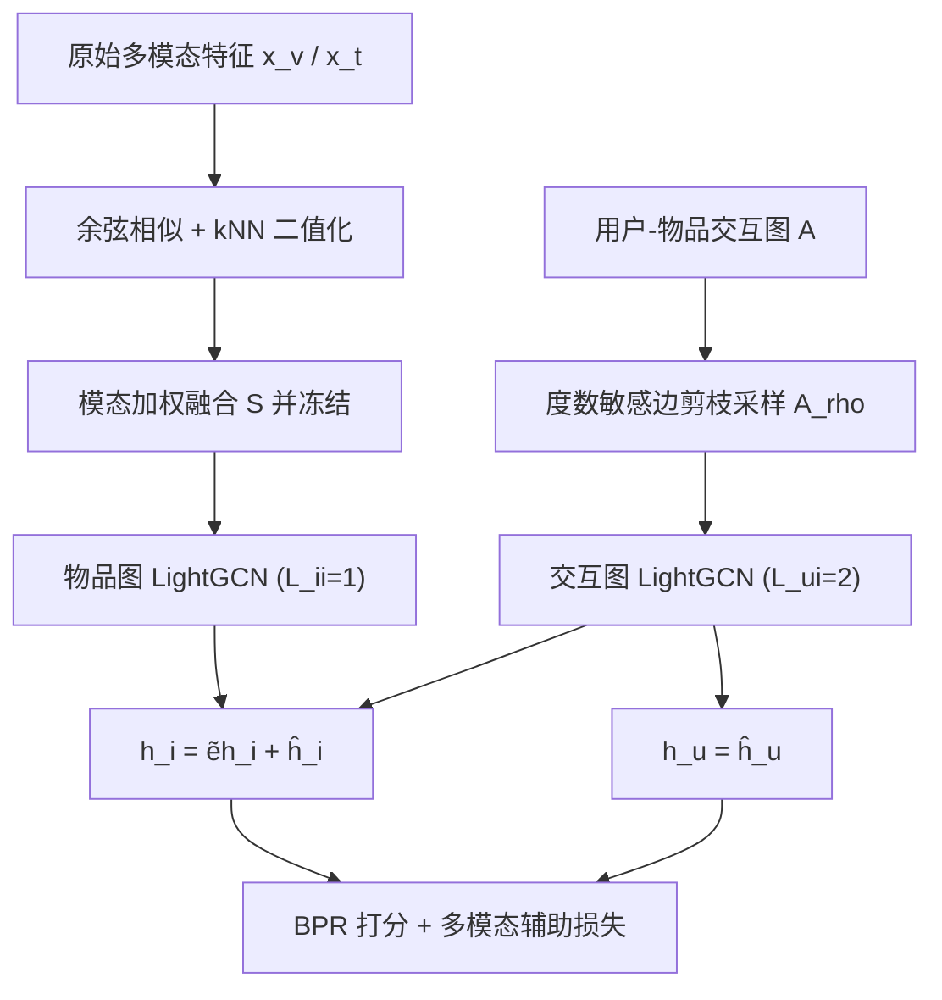

# A Tale of Two Graphs: Freezing and Denoising Graph Structures for Multimodal Recommendation (两张图的故事：多模态推荐中的图结构冻结与去噪)

- **会议/期刊**: ACM Multimedia (MM) 2023
- **作者与机构**: Xin Zhou, Zhiqi Shen（阿里巴巴-南洋理工大学新加坡联合研究院 / 南洋理工大学）
- **推荐链路定位**: 召回
- **研究方向**: 多模态推荐 / 图神经网络推荐
- **论文原文**: [https://arxiv.org/abs/2211.06924v3](https://arxiv.org/abs/2211.06924v3)
- **开源代码**: [https://github.com/enoche/FREEDOM](https://github.com/enoche/FREEDOM)

## TL;DR (1分钟核心速览)

本文直击多模态推荐中"隐式物品-物品图究竟要不要学"这一被默认为共识的痛点：LATTICE 每轮用 MLP 投影特征重建 $N\times N$图，既$O(N^2 d)$ 昂贵又未必必要。作者实证发现**直接冻结由原始多模态特征构建的物品图**已优于动态学习，遂提出 FREEDOM——冻结物品-物品图 + 对用户-物品图做度数敏感边剪枝去噪。在 Amazon Baby/Sports/Clothing 的 **Full-Ranking 全排序**协议下，R@20 相对 LATTICE 提升 14.27%–28.38%（平均 19.07%），Clothing 上内存降 6.8×、单轮训练时间降 4.3×。

## Background & Motivation (背景与核心矛盾)

- **主流范式**: 多模态推荐将图像/文本特征经 MLP 投影后与 ID 嵌入拼接或相加（VBPR、MMGCN），或构造辅助图（DualGNN 的用户-用户图、GRCN 的图精炼），LATTICE 则显式学习**潜空间物品-物品图**并达到 SOTA。
- **前人局限**: ① LATTICE 的物品图每轮由可学习 MLP 输出重建，$O(N^2 d_m)$复杂度与$O(N^2)$ 内存使其在万级物品上不可扩展（Clothing 需 28.22 GB）；② 图权重来自通用预训练模型（CNN/Transformer）的亲和度分数，本身含噪，且随投影器漂移。
- **核心洞察 (Key Insight)**: 把 LATTICE 的物品图**在训练前构建并冻结**（LATTICE-Frozen），在 Baby/Sports 上 Recall 与 NDCG 反而略优于原版（R@20：0.0873 vs 0.0850 / 0.0964 vs 0.0953），说明**真正起作用的是"原始多模态特征给出的物品邻接关系"本身，而非可学习投影器**。
- **本文切入点**: 既然物品图不必学，那就"冻结它"；省下的算力预算转而投向真正有害的**用户-物品假阳性边**，用度数敏感采样去噪。

## Method (核心方法设计)

### 1. 整体框架 (Overall Architecture)

FREEDOM 走"两图分离"路线：**离线侧**对每个模态用原始特征算余弦相似度并 kNN 二值化，得稀疏无权的物品-物品邻接，跨模态加权求和后**一次性冻结**；**在线侧**每轮对用户-物品二部图按度数敏感概率多项式采样出稀疏子图。两条 LightGCN 支路分别传播后，用户取交互图读出、物品取"多模态视图 + 交互视图"相加作为最终嵌入，用 BPR + 多模态重构辅助损失联合优化，推理时仅用 ID 嵌入内积排序。

<figure class="paper-figure" markdown="span">
  ![图1：我们提出的 a) FREEDOM 与 b) LATTICE \[28\] 的对比。FREEDOM 同时冻结物品-物品图并对用户-物品图去噪，用于多模态推荐。](../../../../assets/papers/2211.06924v3/figure_1.png)<figcaption>图1：我们提出的 a) FREEDOM 与 b) LATTICE [28] 的对比。FREEDOM 同时冻结物品-物品图并对用户-物品图去噪，用于多模态推荐。</figcaption>
</figure>

### 2. 关键设计拆解 (Key Designs)

1. **冻结的二值化物品-物品图（Freezing）**：LATTICE 保留相似度作边权并随 MLP 每轮漂移；FREEDOM 改为硬阈值 top-$k$（$k=10$）二值化$\hat{S}^m_{ij}=\mathbb{I}\left[S^m_{ij}\in \text{top-}k(S^m_i)\right]$，归一化后按$\boldsymbol{S}=\sum_{m}\alpha_m\tilde{\boldsymbol{S}}_m$ 融合并冻结。直观上，二值化把"权重"退化为"结构"，使 GCN 传播只依赖邻接关系，既消除特征噪声引入的伪强边，也把构图代价移出训练循环。

2. **度数敏感边剪枝（Degree-Sensitive Denoising）**：DropEdge 均匀丢边对高度节点无偏照顾，而高度节点恰是过平滑与噪声聚集处。作者令边 $e_k=(i,j)$的采样概率$p_k=\frac{1}{\sqrt{\omega_i}\sqrt{\omega_j}}$（$\omega$为节点度），按保留数$n=\lceil|\mathcal{E}|(1-\rho)\rceil$做多项式采样得$\hat{\boldsymbol{A}}_\rho$。度越高的边越易被丢弃，等价于在稀疏化时对大热节点降权，抑制流行度驱动的假阳性交互；推理阶段回退到原始归一化邻接$\hat{\boldsymbol{A}}$，保证无损检索。

3. **谱视角的理论支撑与训练目标**：由非负矩阵特征值界 $\lambda\le\max_{i,j}\tilde{s}_{ij}$，二值化后每行元素为$1/\sqrt{d_{ii}d_{jj}}$，其最大值严格小于 LATTICE 的加权亲和度最大值（后者含有$s'_{ij}/(s'_{ij}+\sum_{k\neq i}s'_{kj})$ 的单调上界），故冻结图有**更紧的特征值上界**，低通滤波更"干净"，高频负系数项被更强抑制。总损失为
$$\mathcal{L}=\sum_{(u,i,j)\in\mathcal{D}}\left[-\log\sigma(\boldsymbol{h}_u^{\top}\boldsymbol{h}_i-\boldsymbol{h}_u^{\top}\boldsymbol{h}_j)+\lambda\sum_{m\in\{v,t\}}-\log\sigma(\boldsymbol{h}_u^{\top}\boldsymbol{h}_i^m-\boldsymbol{h}_u^{\top}\boldsymbol{h}_j^m)\right]$$
训练采用 1:1 均匀负采样（每正样本配一个未交互负例），$\lambda=1\times10^{-3}$。因物品图离线预算，每轮只余交互图卷积，推理为内积 + ANN，无额外开销。

## Experimental Setup & Evaluation Protocol (实验设置与评估协议)

- **数据集与预处理**: Amazon 三个类目，用户与物品均做 `5-core` 过滤；视觉特征为 4,096 维预训练 CNN 输出，文本为 384 维 sentence-transformers（all-MiniLM-L6-v2）嵌入。

| 数据集 | #Users | #Items | #Interactions | 稀疏度 | 特征/场景说明 |
| :--- | :---: | :---: | :---: | :---: | :--- |
| Baby | 19,445 | 7,050 | 160,792 | 99.88% | 母婴用品，图文 |
| Sports | 35,598 | 18,357 | 296,337 | 99.95% | 运动户外，图文 |
| Clothing | 39,387 | 23,033 | 278,677 | 99.97% | 服饰鞋饰，图文 |

- **数据划分与防穿越**: 每用户交互随机 `8:1:1` 划为 train/valid/test，无时间戳切分（类别内随机），非冷启动设定。
- **排名评测协议**: `Full-Ranking (全库未交互排序)` 的无偏 all-ranking 协议，报告 R@{10,20} 与 N@{10,20} 的全体测试用户平均值；训练负采样为每正样本 1 个随机负例。与 LATTICE/SLMRec 等基线共用 MMRec 统一框架，5 个随机种子、成对 $t$-检验，$p<0.01$ 显著。
- **对比基线与超参**: 2 个通用 CF（BPR、LightGCN）+ 6 个多模态（VBPR、MMGCN、GRCN、DualGNN、SLMRec、LATTICE）；嵌入维度 $d=64$，$L_{ui}=2$、$L_{ii}=1$，$\lambda=10^{-3}$，视觉占比$\alpha_v=0.1$，剪枝率$\rho\in\{0.8,0.9\}$，早停 20 轮。

## Key Experimental Results (实验关键数据)

### 1. 主实验对比 (Main Results)

| 数据集·指标 | BPR | LightGCN | VBPR | GRCN | DualGNN | SLMRec | LATTICE | FREEDOM | Improv. |
| :--- | :---: | :---: | :---: | :---: | :---: | :---: | :---: | :---: | :---: |
| Baby R@10 | 0.0357 | 0.0479 | 0.0423 | 0.0532 | 0.0513 | 0.0521 | 0.0547 | **0.0627** | +14.63% |
| Baby R@20 | 0.0575 | 0.0754 | 0.0663 | 0.0824 | 0.0803 | 0.0772 | 0.0850 | **0.0992** | +16.71% |
| Baby N@20 | 0.0249 | 0.0328 | 0.0284 | 0.0358 | 0.0352 | 0.0354 | 0.0370 | **0.0424** | +14.59% |
| Sports R@10 | 0.0432 | 0.0569 | 0.0558 | 0.0599 | 0.0588 | 0.0663 | 0.0620 | **0.0717** | +15.65% |
| Sports R@20 | 0.0653 | 0.0864 | 0.0856 | 0.0919 | 0.0899 | 0.0990 | 0.0953 | **0.1089** | +14.27% |
| Sports N@20 | 0.0298 | 0.0387 | 0.0384 | 0.0413 | 0.0404 | 0.0450 | 0.0421 | **0.0481** | +14.25% |
| Clothing R@10 | 0.0206 | 0.0361 | 0.0281 | 0.0421 | 0.0452 | 0.0442 | 0.0492 | **0.0629** | +27.85% |
| Clothing R@20 | 0.0303 | 0.0544 | 0.0415 | 0.0657 | 0.0675 | 0.0659 | 0.0733 | **0.0941** | +28.38% |
| Clothing N@20 | 0.0138 | 0.0243 | 0.0192 | 0.0284 | 0.0298 | 0.0296 | 0.0330 | **0.0420** | +27.27% |

效率对比（表 5 摘）：Clothing 上 LATTICE 内存 28.22 GB / 15.96 s/epoch → FREEDOM 4.15 GB / 3.67 s/epoch；Sports 上 19.93 GB / 10.71 s → 3.34 GB / 3.46 s。

### 2. 消融实验 (Ablation Study)

原文以柱状图（图 3）报告，下表按图趋势给出相对结论（R@20 排序）：

| 变体 | 组件改动 | 三数据集相对趋势 |
| :--- | :--- | :--- |
| FREEDOM-F | 仅冻结物品图 | 一致优于 LATTICE，但低于完整 FREEDOM |
| FREEDOM-D | 仅去噪交互图 | 在稀疏 Clothing 上反而劣于 LATTICE（连通性受损） |
| FREEDOM-R | 随机边丢弃替代度数敏感剪枝 | 略优于 FREEDOM-F，仍逊于 FREEDOM |
| FREEDOM-0 | 去掉多模态辅助损失（$\lambda=0$） | 与完整模型接近，仅小幅下降 |
| **FREEDOM** | 冻结 + 度数敏感去噪 + 辅助损失 | **最优** |

### 3. 关键实验发现 (Key Findings)

- **冻结是主增益来源，去噪是增益放大器**：单靠冻结（FREEDOM-F）已稳定超过 LATTICE，而 Clothing 上提升最大（R@10 +27.85%），说明物品越稀疏、用户行为越嘈杂，稳定结构先验相对动态学习的优势越明显；但去噪单独使用在 Clothing 上会损伤连通性，必须与冻结配合。
- **效率收益与精度收益同向而非权衡**：Clothing 上内存 28.22→4.15 GB（6.8×）、单轮 15.96→3.67 s（4.3×），大图规模越大优势越显著，彻底消除了 $O(N^2 d)$ 的每轮构图瓶颈。
- **文本模态主导，剪枝率随图规模上移**：视觉占比 $\alpha_v$扫描（图 4）显示纯文本构图已接近最优、$\alpha_v=0.1$为最佳点；$\rho$在 Baby 上 0.8 最佳、Clothing 上 0.9 最优（R@20：0.0941 vs 0.0931），即交互越稠密越需要激进剪枝，而$\lambda$在$10^{-4}\sim10^{-2}$区间几乎不敏感，仅$10^{-1}$ 会压制模型表达力。
- **谱上界实证吻合**：最大特征值 Baby 1.1685 vs 1.1796、Sports 1.1016 vs 1.1180、Clothing 1.0932 vs 1.1210，冻结图在三个数据集上均更接近 1，验证了更紧低通滤波的理论论断。

## Highlights & Limitations (亮点、对比与审稿批判)

- **与代表作对比 (vs. Prior Work)**: 与 LATTICE 的本质差异是"物品图是否可学习"——LATTICE 依赖 MLP 投影器逐轮重构图，FREEDOM 直接采纳原始特征结构并冻结；与 GRCN 的边权精炼不同，FREEDOM 的度数敏感剪枝是**无参的随机稀疏化**，不做逐边权重学习；与 SLMRec 的自监督对比增广路线正交，理论上可叠加。
- **可迁移亮点**: ① "先冻结结构、后去噪交互"的两图分工范式，可直接迁移到多模态 CTR、跨域召回中的辅助图；② 度数敏感多项式采样只需改概率向量，可无痛替换任意 GNN 推荐器中的 DropEdge。
- **审稿级局限批判**: ① 消融仅以柱状图呈现，未给具体数值与显著性检验，FREEDOM-F 与完整模型的差值难以精确量化；② 物品图虽冻结，但 $k$NN 相似度计算仍为$O(N^2 d_m)$的一次性开销，十万级物品上采样与存储仍受限；③ 模态权重$\alpha_v$ 按数据集人工固定，未像 LATTICE 一样可学习，跨域迁移需重调。

## Rating (四维评分)

- **方法创新性 (Novelty)**: ⭐⭐⭐⭐ （核心机制与方法设计具备明确创新性，理论与实验动机支撑充分）
- **评估协议与实验扎实度 (Protocol & Experiments)**: ⭐⭐⭐⭐ （主流公开数据集评测完整，包含多基线对比与消融实验验证）
- **写作与数学规范度 (Clarity & Rigor)**: ⭐⭐⭐⭐ （问题形式化定义清晰，核心模块数学推导与架构阐述严谨易读）
- **工业落地与复现价值 (Industrial & Practical Value)**: ⭐⭐⭐⭐ （兼顾推荐效果增益与训练/推理效率，具备实际场景迁移参考价值）

## Rating (四维评分)

- **方法创新性 (Novelty)**: ⭐⭐⭐⭐ （"冻结反超动态学习"是强反直觉发现，且配有紧特征值上界的谱分析支撑，而非纯经验调参）
- **评估协议与实验扎实度 (Protocol & Experiments)**: ⭐⭐⭐⭐ （三数据集 + 8 基线 + 全排序无偏协议 + 5 种子 $p<0.01$ 检验，唯消融缺数值表格略欠）
- **写作与数学规范度 (Clarity & Rigor)**: ⭐⭐⭐⭐ （两图对比清晰、公式紧凑，但谱分析证明的细节外推到附录 A，正文可读性受影响）
- **工业落地与复现价值 (Industrial & Practical Value)**: ⭐⭐⭐⭐⭐ （构图离线化带来 6× 内存与 4× 时间收益，代码开源，几乎可直接替换 LATTICE 类线上召回模型）

