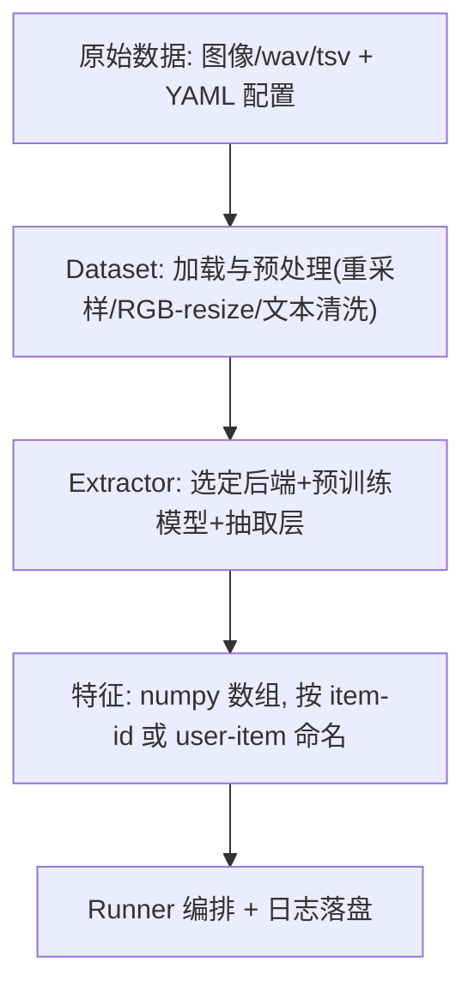
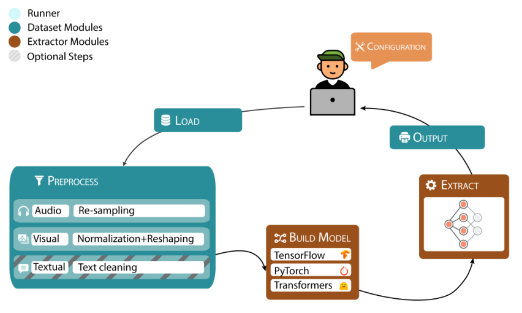

# Ducho: A Unified Framework for the Extraction of Multimodal Features in Recommendation (Ducho：推荐系统多模态特征抽取统一框架)

- **会议/期刊**: ACM MM 2023 (Demo/Resource Track, 4 页短文)
- **作者与机构**: Daniele Malitesta, Giuseppe Gassi, Claudio Pomo, Tommaso Di Noia（Politecnico di Bari, Italy）
- **推荐链路定位**: 召回/精排之前的**特征工程（离线特征抽取）**阶段，下游模型无关
- **研究方向**: 多模态推荐 / 冷启动与稀疏缓解
- **论文原文**: [https://arxiv.org/abs/2306.17125v2](https://arxiv.org/abs/2306.17125v2)
- **开源代码**: [https://github.com/sisinflab/Ducho](https://github.com/sisinflab/Ducho)

## TL;DR (1分钟核心速览)

多模态推荐（MRS）研究长期受困于"特征抽取各写各的"：每篇论文用自己的 VGG/BERT 版本、自己的预处理与自己的输出层，导致**框架间不可公平比较、也无法复用**。Ducho 提出统一抽取框架，把音频/视觉/文本三模态、物品级/交互级两种来源、TensorFlow/PyTorch/Transformers 三种后端抽象为一套 YAML 可配置接口，并配套 CUDA 就绪的 Docker 镜像与三个可运行 Demo。本文属系统/资源型工作，**不含推荐排序基准实验**，其"评估"是功能覆盖矩阵与三场景端到端可运行性验证。

## Background & Motivation (背景与核心矛盾)

- **主流范式**: MRS（如 VBPR、LATTICE 类工作）在建模前先用预训练 CNN/BERT 抽物品图像与文本特征，作为 side information 注入 ID Embedding，以缓解交互矩阵稀疏与行为不可解释问题。
- **前人局限 1（不可比）**: 每个推荐框架内置自己的抽取流程（不同 ResNet 版本、不同输入尺寸、不同取哪一层），使"模型 A 比模型 B 好"的结论中混杂了特征质量差异，无法归因于模型设计本身。
- **前人局限 2（不可复用）**: TensorFlow/PyTorch/Transformers 各自提供海量预训练模型，但缺少统一调用接口；模型设计者要为换一个骨干网络重写整套预处理代码。
- **核心洞察 (Key Insight)**: 抽取阶段是**下游无关（downstream-agnostic）**的——只要把"模态 × 来源 × 后端 × 抽取层"四元组参数化，就能一次性产出可被任意推荐器消费的 numpy 特征。
- **本文切入点**: 用 Dataset / Extractor / Runner 三模块 + Configuration 组件，把抽取过程变成一份 YAML 声明。

## Method (核心方法设计)

### 1. 整体框架 (Overall Architecture)

管线为纯离线批处理，无训练、无梯度回传：Dataset 模块先按模态读取原始文件（图像目录 / wav 目录 / tsv 映射表）并做与预训练模型对齐的预处理（音频重采样至模型训练采样率、图像转 RGB 并 resize/normalize、文本可选去标点与数字）；Extractor 模块据配置实例化指定后端的预训练网络，并在用户指定的隐藏层截断取激活作为特征；Runner 作为编排器按配置一次性触发单模态或全模态抽取，最后由 Dataset 模块把结果按"物品 ID 或 user-item 对"命名存为 numpy 数组。

<figure class="paper-figure" markdown="span">
  <figcaption>图1：Ducho 的多模态特征提取流水线，由 Dataset、Extractor 和 Runner 模块管理。</figcaption>
</figure>

### 2. 关键设计拆解 (Key Designs)

1. **来源解耦：物品级 vs 交互级特征（Items / Interactions）**：前人把"商品描述"和"用户评论"都笼统当作物品表征，混淆了静态属性与用户反馈。Ducho 在 Dataset 层就把同一模态拆成两条通道：物品侧以文件名/tsv 主键映射到唯一 item id，交互侧以 $(u,i)$对映射。抽取算子不变，但输出命名不同，因而下游可分别得到$\mathbf{e}^{\text{item}}_m$与$\mathbf{e}^{\text{inter}}_{m}(u,i)$ 两套张量。这一区分使"评论情感"这类交互语义得以独立建模，也是相对 Cornac 的关键差异之一。
2. **后端无关的抽取层寻址（Backend-Agnostic Layer Addressing）**：痛点是三大库对"取第几层"的索引约定完全不同（TF 用层名、PyTorch 用模块序号、Transformers 用 `output_hidden_states`）。Ducho 用统一的抽取算子封装：

$$\mathbf{e}_{m}=\mathcal{N}\!\left(f^{(l)}_{\theta_{m}}\big(\mathcal{P}_{m}(x)\big)\right),\quad \mathcal{P}_{m}\in\{\text{resample},\ \text{RGB-resize},\ \text{clean}\}$$

其中 $m\in\{\text{audio},\text{visual},\text{textual}\}$，$l$为配置中声明的抽取层，$\mathcal{N}(\cdot)$为可选归一化。用户只需按所选模型的官方命名规则给出$l$，即可在三个后端间无缝切换；多模型并联时特征沿维度拼接$\mathbf{E}_m=[\mathbf{e}_m^{(1)};\dots;\mathbf{e}_m^{(K)}]$。
3. **配置化编排与零训练开销**：所有超参（模态、来源、后端、模型名、抽取层、文本任务如情感分析、输出路径）集中于一份 YAML，可被命令行键值对覆盖；Runner 保证"一次配置、全模态执行"。由于全过程为前向推理，训练目标 $\mathcal{L}$ 与负采样均不存在，成本仅为一次全库前向，可离线缓存复用。

## Experimental Setup & Evaluation Protocol (实验设置与评估协议)

- **重要说明**: 本文为资源/演示短文，**未在任何推荐基准上做排序评测**，不存在 Full-Ranking / Sampled Ranking、数据划分或显著性检验；其验证协议为"覆盖矩阵 + 三场景端到端跑通"。
- **功能覆盖（模态 × 来源 × 后端）**:

| 模态 | Items | Interactions | TensorFlow | PyTorch | Transformers |
| :--- | :---: | :---: | :---: | :---: | :---: |
| Audio | ✓ | ✓ | ✗ | ✓ (Torchaudio) | ✓ |
| Visual | ✓ | ✓ | ✓ | ✓ (Torchvision) | ✗ |
| Textual | ✓ | ✓ | ✗ | ✗ | ✓ (+SentenceTransformers) |

- **三个 Demo 的数据与配置**（均为抽样子集，仅验证可用性）:

| Demo | 任务场景 | 数据规模 | 模态/来源 | 抽取模型 |
| :--- | :--- | :--- | :--- | :--- |
| 1 | 服饰推荐 | 100 张图 + 元数据描述 | 视觉+文本 / Items | VGG19、Xception、Sentence-BERT |
| 2 | 音乐推荐 | 10 段 wav + 流派文本 | 音频+文本 / Items | Hybrid Demucs、Sentence-BERT |
| 3 | 电商评论 | 100 条评论 + 商品描述 | 文本 / Items+Interactions | Sentence-BERT、多语 BERT（情感分析任务） |

- **运行环境与基线对比**: 提供基于 NVIDIA CUDA 11.8 + cuDNN 8 + Ubuntu 22.04 + Python 3.8 的公开 Docker 镜像，支持本地 / Docker / Colab 三种运行方式；主要对照系统为 Cornac。

## Key Experimental Results (实验关键数据)

### 1. 与 Cornac 的能力对比（本文"主表"）

| 能力维度 | Cornac | Ducho |
| :--- | :---: | :---: |
| 音频模态支持 | ✗ | ✓ |
| 后端可选（TF/PyTorch/Transformers） | ✗ | ✓ (3 种) |
| 抽取层可指定 | ✗ | ✓ |
| 与下游推荐器解耦 | 部分（内嵌算法） | ✓ 完全解耦 |
| 物品级 / 交互级来源区分 | ✗ | ✓ |
| YAML 声明式配置 + Docker | ✗ / ✗ | ✓ / ✓ |

### 2. "消融式"功能验证 (Demo 级)

| 配置变体 | 结果 |
| :--- | :--- |
| 单模态（仅视觉） | 正常输出，文件名=item id |
| 多模态并联（视觉+文本） | 两套 numpy 分别落盘，互不干扰 |
| Items+Interactions 双来源 | 交互特征以 $(u,i)$ 命名，唯一可寻址 |
| 跨后端替换（VGG19→Xception） | 仅改 YAML 一行，无需改代码 |

### 3. 关键实验发现 (Key Findings)

- **覆盖度**: 3 模态 × 2 来源 × 3 后端共 6 个可用组合（音频缺 TF、文本缺 TF/PyTorch），说明"统一接口"仍非全组合完备，是当前实现的真实边界。
- **可比性收益**: 把抽取层 $l$ 与模型名显式写入配置后，不同论文只需交换 YAML 即可在**完全相同特征**上比较推荐模型，直接消除"特征质量混淆变量"。
- **工程成本**: 交互级文本（评论）抽取是最重负载环节（Demo 2 音频仅取 10 条即因算力受限），印证了多模态特征抽取的瓶颈在离线算力而非模型设计。

## Highlights & Limitations (亮点、对比与审稿批判)

- **与代表作对比**: 相较 Cornac（把多模态算法与训练流程一体化），Ducho 只做抽取、不碰推荐器，因而对 LATTICE、VBPR、MGCN 等任意下游模型均可即插即用；相较各论文自建脚本，它把"换骨干网络"的成本从改代码降为改一行 YAML；相较通用特征抽取库，它额外引入**交互级来源**与**音频模态**这两个推荐场景特有需求。
- **可迁移亮点**: (i) "来源解耦"命名规范（item-id 与 user-item 双主键）可直接迁移到任何需要区分静态内容与用户生成内容（UGC）的多模态管线；(ii) 抽取层显式化是提升 MRS 实验可复现性的低成本高收益手段，建议作为论文附录标准项。
- **审稿级局限批判**: (i) **缺少推荐级验证**——未报告任何 Recall/NDCG 或不同特征对下游模型的影响，也无数值化的抽取吞吐/延迟基准，"提升了推荐质量"仅是动机性论断；(ii) **组合完备性与灵活性不足**——文本模态被 Transformers 独占、音频无 TF 支持，且作者自陈需用户自行了解模型层命名，缺乏统一层索引抽象，对新骨干网络仍有手工成本。

## Rating (四维评分)

- **方法创新性 (Novelty)**: ⭐⭐⭐ （非算法创新，价值在于"模态×来源×后端×层"四元组参数化这一系统抽象，思想朴素但填补空白）
- **评估协议与实验扎实度 (Protocol & Experiments)**: ⭐⭐ （仅功能覆盖矩阵与三个玩具级 Demo，无排序指标、无吞吐/延迟测量、无与 Cornac 的量化对比）
- **写作与数学规范度 (Clarity & Rigor)**: ⭐⭐⭐⭐ （4 页短文结构清晰，模块职责与管线图交代干净；但全文几乎无形式化定义，抽取算子需读者自行补全）
- **工业落地与复现价值 (Industrial & Practical Value)**: ⭐⭐⭐⭐⭐ （开源代码 + CUDA 就绪 Docker + Colab，直接消除 MRS 领域的特征工程重复劳动，工程复用价值显著高于其学术新颖度）

