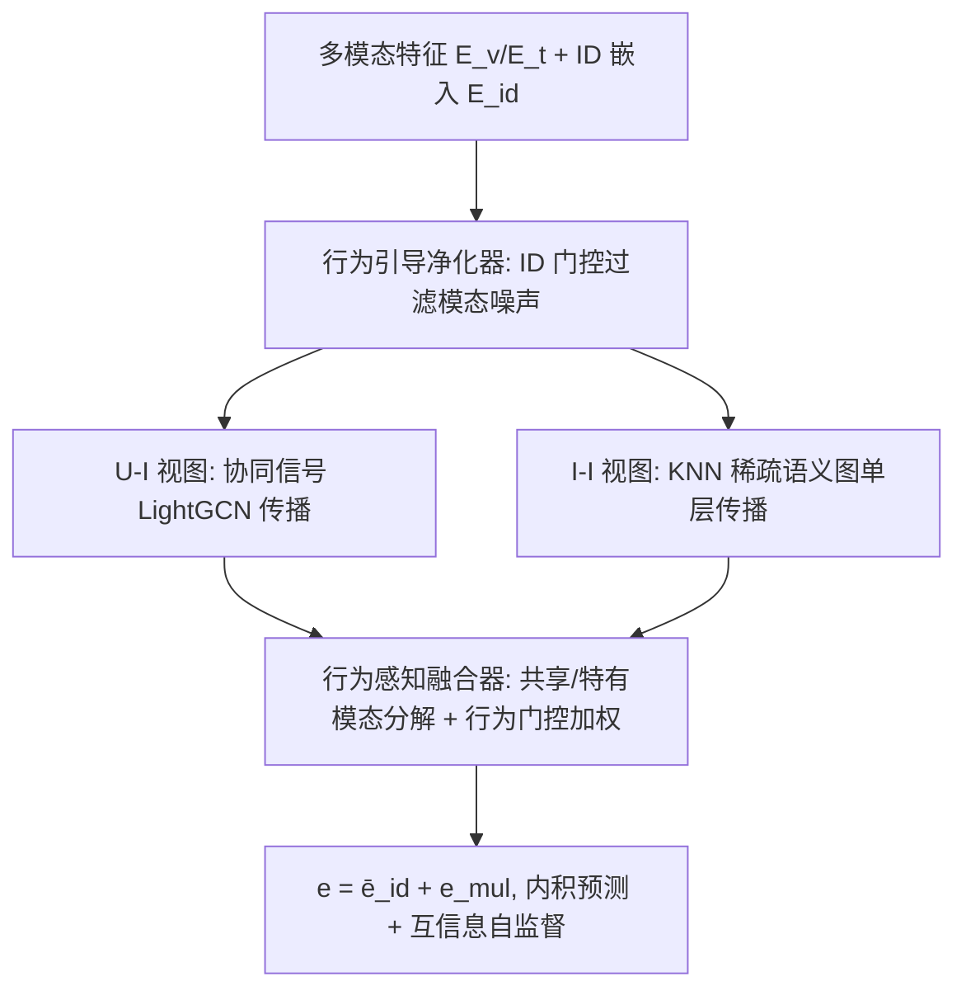
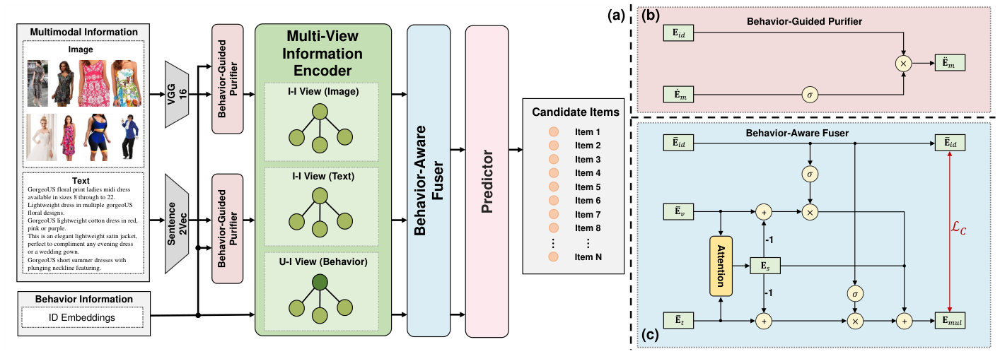

# Multi-View Graph Convolutional Network for Multimedia Recommendation (多视图图卷积网络的多媒体推荐)

- **会议/期刊**: ACM MM 2023
- **作者与机构**: Penghang Yu, Zhiyi Tan, Guanming Lu, Bing-Kun Bao（南京邮电大学、鹏城实验室）
- **推荐链路定位**: 召回（多模态表征学习 + 图协同过滤）
- **研究方向**: 多模态推荐 / 自监督与交互去噪
- **论文原文**: [https://arxiv.org/abs/2308.03588v1](https://arxiv.org/abs/2308.03588v1)
- **开源代码**: [https://github.com/demonph10/MGCN](https://github.com/demonph10/MGCN)

## TL;DR (1分钟核心速览)

现有多模态 GCN 直接把 VGG/Sentence2Vec 预提取特征与 ID 嵌入混在同一 U-I 视图里传播，模态噪声（背景、冗余文案、亮度）被逐层放大并与行为信号耦合；同时对各模态做等权拼接，忽略了用户购买不同商品时的模态偏好差异。MGCN 先用物品 ID 嵌入作门控净化模态特征，再分 U-I 视图（协同信号）与 KNN 稀疏 I-I 视图（语义相关信号）独立传播，最后用行为导出的模态偏好权重自适应融合并施加互信息自监督。Amazon 三集 8:1:1 随机划分 + Full-Ranking 协议下，Clothing 上 Recall@20 相对最强基线 MICRO 提升 22.4%。

## Background & Motivation (背景与核心矛盾)

- **主流范式**: VBPR/CKE 把视觉特征拼进 MF；MMGCN 为每个模态单独建 U-I 图并拼接；GRCN/MICRO 用模态特征去"修剪"或"重建"交互图结构。
- **前人局限一**: 模态特征中的偏好无关信息（图像背景、亮度、冗余文本描述）经 GCN 消息传播会在全网扩散，使**噪声与行为特征耦合**，节点表征判别性下降。MMGCN 甚至劣于纯协同的 LightGCN 即是明证。
- **前人局限二**: 简单拼接或线性加权对每个模态**等权处理**，无法刻画"看短视频重封面、买书重简介"这种随物品而变的用户模态偏好。
- **核心洞察**: 图 1 显示两件完全不同的女装因背景与描述污染，余弦相似度高达 64.8%——模态特征的"原始相似度"不可信，必须用行为信号做筛子。

<figure class="paper-figure" markdown="span">
  ![图1：模态噪声污染示意图。左图展示用户想要购买的商品，右图则不是。红色框/文字表示可能被关注的部分。由于图像背景、亮度等造成的污染，这两件衣服的余弦相似度\[15\]达到64.8%。](../../../../assets/papers/2308.03588v1/figure_1.png)<figcaption>图1：模态噪声污染示意图。左图展示用户想要购买的商品，右图则不是。红色框/文字表示可能被关注的部分。由于图像背景、亮度等造成的污染，这两件衣服的余弦相似度[15]达到64.8%。</figcaption>
</figure>

- **本文切入点**: 与其在图上"修补"，不如**先净化再分视图注入**：行为信息既当去噪门控，又当融合权重来源。

## Method (核心方法设计)

### 1. 整体框架 (Overall Architecture)

输入为物品的视觉/文本预提取特征 $\mathbf{E}_{i,m}\in\mathbb{R}^{d_m\times|\mathcal{I}|}$与用户-物品 ID 嵌入$\mathbf{E}_{id}$。先经行为引导净化器以 ID 嵌入门控过滤模态噪声，输出净化特征$\check{\mathbf{E}}_{i,m}$；再由多视图编码器在 U-I 交互图上传播 ID 嵌入（捕获高阶协同信号），在 KNN 稀疏化的 I-I 亲和图上单层传播模态特征（捕获语义相关信号）；随后行为感知融合器先把模态分解为共享/特有成分，再用行为导出的偏好门控$\mathbf{P}_m$加权特有成分；最终用户/物品表示为$\mathbf{e}=\bar{\mathbf{e}}_{id}+\mathbf{e}_{mul}$，内积打分，BPR + 自监督对比联合训练。

<figure class="paper-figure" markdown="span">
  <figcaption>图2：(a) 整体框架。(b) 行为引导净化器借助行为信息过滤模态噪声。(c) 行为感知融合器根据用户模态偏好自适应融合模态特征。</figcaption>
</figure>

### 2. 关键设计拆解 (Key Designs)

**① 行为引导净化器（Behavior-Guided Purifier）**：模态特征的每一维并非都与偏好相关，而 ID 嵌入天然编码了"该物品为何被点击"。做法是先线性升维 $\check{\mathbf{E}}_{i,m}=\mathbf{W}_1\mathbf{E}_{i,m}+\mathbf{b}_1$，再用 ID 嵌入生成逐元素门控：

$$\check{\mathbf{E}}_{i,m}=\mathbf{E}_{i,id}\odot\sigma(\mathbf{W}_2\check{\mathbf{E}}_{i,m}+\mathbf{b}_2)$$

直觉上这是一个由协同信号监督的特征选择器：与交互行为一致的方向被保留，背景/亮度等与"谁买它"无关的方向被 sigmoid 压低，从而在**进入图传播前**切断噪声源。

**② 多视图信息编码器（Multi-View Encoder）**：U-I 视图沿用 LightGCN 式对称归一化传播捕获协同信号；I-I 视图先用余弦相似度建全连接模态亲和图 $s^m_{a,b}=\frac{(\mathbf{e}^m_a)^\top\mathbf{e}^m_b}{\|\mathbf{e}^m_a\|\|\mathbf{e}^m_b\|}$，再做 top-$K$稀疏化与度归一化$\hat{\mathbf{S}}_m=\mathbf{D}_m^{-1/2}\dot{\mathbf{S}}_m\mathbf{D}_m^{-1/2}$。关键取舍是 **I-I 视图只堆 1 层**：语义相似度随传播路径指数衰减，多层既过平滑又引入无关邻居噪声，因此浅层 GCN 反而最优（$K\approx15$）。

**③ 行为感知融合器（Behavior-Aware Fuser）与互信息自监督**：用户在不同物品上的模态偏好应从行为中蒸馏，故令 $\mathbf{P}_m=\sigma(\mathbf{W}_3\bar{\mathbf{E}}_{id}+\mathbf{b}_3)$。融合前先用注意力分离模态共享成分$\mathbf{E}_s=\sum_m\alpha_m\bar{\mathbf{E}}_m$与特有成分$\tilde{\mathbf{E}}_m=\bar{\mathbf{E}}_m-\mathbf{E}_s$，再仅对特有成分施加门控：

$$\mathbf{E}_{mul}=\mathbf{E}_s+\frac{1}{|\mathcal{M}|}\sum_{m\in\mathcal{M}}\tilde{\mathbf{E}}_m\odot\mathbf{P}_m$$

这样"所有模态共有"的信息不被重复计权，差异化的部分才按用户偏好调制。配合 InfoNCE 形式的互信息最大化 $\mathcal{L}_C$（同一节点的融合多模态表征与行为表征互为正对，批内其余为负），迫使融合表征既补充又互补于行为表征，避免模型从单一模态"抄近路"。

**④ 训练目标与开销**：总损失 $\mathcal{L}=\mathcal{L}_{BPR}+\lambda_C\mathcal{L}_C+\lambda_E\|\mathbf{E}\|_2^2$，负采样沿用 BPR 的均匀单负样本，$d=64$，$\tau=0.2$，$\lambda_C\approx0.01$。推理阶段退化为纯内积 ANN 检索，无额外在线开销；离线主要成本在于 I-I 亲和图的 KNN 构图。

## Experimental Setup & Evaluation Protocol (实验设置与评估协议)

- **数据集与预处理**: 采用 MMRec 框架发布的 Amazon 三分类子集，沿用官方预处理与预提取特征（视觉 4096 维 VGG16、文本 384 维 Sentence2Vec）。

| 数据集 | #Users | #Items | #Interactions | 密度 | 说明 |
| :--- | :---: | :---: | :---: | :---: | :--- |
| Baby | 19,445 | 7,050 | 160,792 | 0.117% | 母婴，最稠密 |
| Sports | 35,598 | 18,357 | 296,337 | 0.045% | 运动户外 |
| Clothing | 39,387 | 23,033 | 278,677 | 0.031% | 服饰，最稀疏 |

- **数据划分与防穿越**: 对每个用户交互历史按 **8:1:1 随机划分**训练/验证/测试（非全局时间戳切分，存在轻度未来信息泄漏风险）。
- **排名评测协议**: **Full-Ranking 全库未交互排序**（all-ranking），报告 Recall@{10,20} 与 NDCG@{10,20}，以验证集 Recall@20 早停。
- **对比基线与超参**: 通用模型 MF、LightGCN；多模态模型 VBPR、MMGCN、GRCN、SLMRec、BM3、MICRO。嵌入维度 $d=64$，batch 2048，$\lambda_E=10^{-4}$，$\tau=0.2$，Adam 优化。

## Key Experimental Results (实验关键数据)

### 1. 主实验对比 (Main Results)

| 方法 | Baby R@20 | Baby N@20 | Sports R@20 | Sports N@20 | Clothing R@20 | Clothing N@20 |
| :--- | :---: | :---: | :---: | :---: | :---: | :---: |
| MF (UAI'09) | 0.0575 | 0.0249 | 0.0653 | 0.0298 | 0.0279 | 0.0126 |
| LightGCN (SIGIR'20) | 0.0754 | 0.0328 | 0.0864 | 0.0387 | 0.0526 | 0.0236 |
| VBPR (AAAI'16) | 0.0663 | 0.0284 | 0.0856 | 0.0384 | 0.0414 | 0.0193 |
| MMGCN (MM'19) | 0.0615 | 0.0261 | 0.0605 | 0.0254 | 0.0328 | 0.0135 |
| GRCN (MM'20) | 0.0824 | 0.0358 | 0.0877 | 0.0389 | 0.0650 | 0.0283 |
| BM3 (WWW'23) | 0.0883 | 0.0383 | 0.0980 | 0.0438 | 0.0625 | 0.0280 |
| MICRO (TKDE'22) | 0.0929 | 0.0407 | 0.1050 | 0.0463 | 0.0772 | 0.0347 |
| **MGCN (Ours)** | **0.0964** | **0.0427** | **0.1106** | **0.0496** | **0.0945** | **0.0428** |
| Improv.% (vs 最强基线) | +3.8% | +4.9% | +5.3% | +7.1% | **+22.4%** | **+23.3%** |

### 2. 消融实验 (Ablation Study)

| 变体 | Baby R@20 | Sports R@20 | Clothing R@20 | 说明 |
| :--- | :---: | :---: | :---: | :--- |
| w/o BG（去净化器） | ≈0.083 | ≈0.095 | ≈0.078 | 原始模态特征直入编码器 |
| w/o MV（去多视图） | ≈0.088 | ≈0.100 | ≈0.083 | 模态与行为混在 U-I 视图传播 |
| w/o BA（去行为感知融合） | ≈0.092 | ≈0.105 | ≈0.088 | 各模态简单平均融合 |
| Text only | 0.0857 | 0.1017 | 0.0902 | 文本 + 行为 |
| Visual only | 0.0939 | 0.1055 | 0.0919 | 视觉 + 行为 |
| **MGCN 全量** | **0.0964** | **0.1106** | **0.0945** | 双模态 + 全模块 |

（w/o 变体数值读自原文图 3 柱状图，为近似值；Text/Visual 行为原文表 3 精确值。）

### 3. 关键实验发现 (Key Findings)

1. **稀疏度越高，净化收益越大**：Clothing 密度仅 0.031%，MGCN 相对 MICRO 的 NDCG@20 提升 23.3%，而稠密的 Baby 仅 4.9%——说明模态噪声污染在交互稀疏时是主导瓶颈，仅靠行为信号无法自纠，必须显式去噪。
2. **去净化器代价最重，去多视图次之**：w/o BG 在三集上掉点最多，验证"噪声在传播前切断"比"在传播中修补"更本质；w/o MV 的下降说明 I-I 语义视图对缓解数据稀疏具有独立贡献，而非冗余。
3. **视觉强于文本、双模态互补**：Visual only（Baby 0.0939）显著优于 Text only（0.0857），All 再涨至 0.0964；图 5/6 的 t-SNE + KDE 显示原始文本表征呈多簇且密度峰更不均匀，净化后分布趋于均匀，从表征均匀性角度解释了文本模态为何更"脏"、增益更小。

## Highlights & Limitations (亮点、对比与审稿批判)

- **与代表作对比**: MMGCN 为每模态建图后直接拼接，噪声沿图放大；GRCN/MICRO 用模态特征改图结构，规避了污染但需频繁重建图且模态信息未进入表征；MGCN 的差异在于**"净化—分离视图—门控融合"三段式**，既保留模态信息进入表征，又阻断噪声传播路径。
- **可迁移亮点**: (a) 用 ID 嵌入做逐元素门控来过滤任何辅助特征（画像、上下文、LLM 语义向量）是极低成本、即插即用的去噪范式；(b) 共享/特有模态分解 + 仅对特有成分加权，可迁移到多行为、多场景融合。
- **审稿级局限批判**: (a) I-I 亲和图需 $O(|\mathcal{I}|^2)$余弦相似度计算与 top-$K$ 维护，物品库上百万时构图成本与内存不可忽视，论文未给出复杂度或耗时实测；(b) 净化器完全以 ID 嵌入为门控，对交互极少的冷启动物品门控信号本身不可靠，可能在冷启动场景失效，而论文未做冷启动分桶实验；(c) 仅三个 Amazon 品类、8:1:1 随机划分（非时间切分），泛化性与防穿越严谨度有限。

## Rating (四维评分)

- **方法创新性 (Novelty)**: ⭐⭐⭐⭐ （"先净化再分视图"的拆解思路清晰，行为门控去噪与共享/特有模态分解组合有巧思，但各组件均为已有算子的重排）
- **评估协议与实验扎实度 (Protocol & Experiments)**: ⭐⭐⭐⭐ （三数据集 + Full-Ranking + 8 个基线 + 模块/模态/超参三层消融完整，缺显著性检验与冷启动分桶）
- **写作与数学规范度 (Clarity & Rigor)**: ⭐⭐⭐⭐ （公式链条干净、变量定义明确，但 I-I 图复杂度与 $K$ 的选取缺乏理论分析）
- **工业落地与复现价值 (Industrial & Practical Value)**: ⭐⭐⭐⭐ （代码开源且基于 MMRec 框架，推理侧零额外开销，主要顾虑在 KNN 构图的大规模工程成本）

