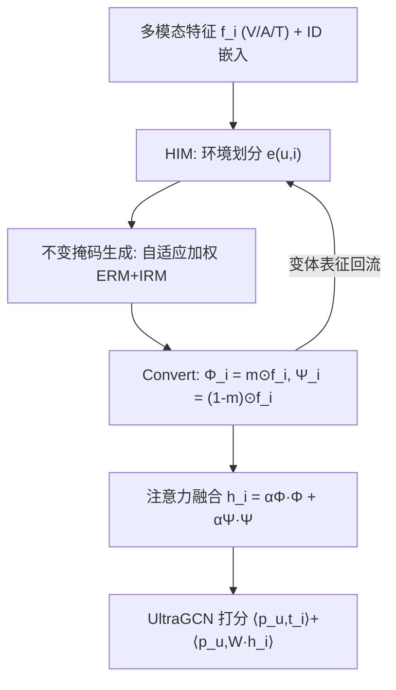
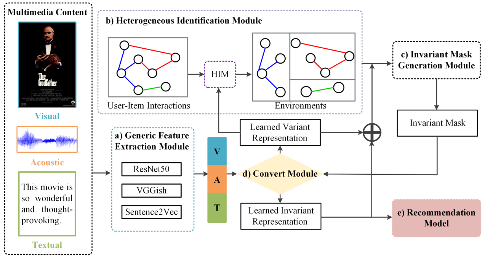

# Pareto Invariant Representation Learning for Multimedia Recommendation (面向多模态推荐的帕累托不变表征学习)

- **会议/期刊**: ACM MM 2023 (Full Paper)
- **作者与机构**: Shanshan Huang, Haoxuan Li, Qingsong Li, Chunyuan Zheng, Li Liu（重庆大学、北京大学、UCSD）
- **推荐链路定位**: 召回/精排共用的多模态表征层（以 UltraGCN 为打分骨干）
- **研究方向**: 多模态推荐 / 去偏与可信推荐（分布偏移）
- **论文原文**: [https://arxiv.org/abs/2308.04706v2](https://arxiv.org/abs/2308.04706v2)
- **开源代码**: 暂未开源

## TL;DR (1分钟核心速览)

多模态推荐普遍用通用预训练编码器（ResNet50/VGGish/Sentence2Vec）抽取视觉、声学、文本特征，其中混杂大量与用户真实偏好无关的虚假相关；InvRL 引入 IRM 学不变表征，却把 IID 任务（同分布）精度牺牲掉了。本文把 IID-OOD 显式写成双目标优化问题，用梯度解析解自适应加权 ERM 与 IRM 损失来训练软掩码 $\mathbf{m}$，并通过注意力融合不变/变体表征。在三数据集 OOD 任务上 Recall@10 相对最优基线提升 1.5%–9.2%，同时 IID 任务也取得最优或次优（Kwai 上 N@10 提升 8.96%）。

## Background & Motivation (背景与核心矛盾)

- **主流范式**: MMGCN / DualGNN / LATTICE / MMSSL 等把模态特征作为侧信息注入 GCN 消息传递，隐式假设"多模态特征即用户偏好"。
- **前人局限**: ①通用编码器输出含虚假相关（如视频画质、背景色），对推荐无因果作用却主导打分；②InvRL 虽用 IRM 剥离虚假相关以提升 OOD 泛化，但作者实测发现其在 IID 任务上甚至弱于 MMGCN——IRM 与 ERM 存在结构性冲突。
- **核心洞察 (Key Insight)**: IID 与 OOD 并非"二选一"的调参问题（InvRL 用固定超参加权两个损失），而是存在**帕累托前沿**；只要找到非支配解，就能在两任务上同时不劣于任一单目标解。
- **本文切入点**: 用梯度内积解析求解 ERM/IRM 的最优加权系数，驱动掩码更新方向为"同时下降"方向。

## Method (核心方法设计)

### 1. 整体框架 (Overall Architecture)

框架以 UltraGCN 为打分骨干，四个模块迭代执行：HIM 先以初始掩码 $\mathbf{m}=0.5$划出的变体表征训练$|\mathcal{E}|$个环境专属推荐器，再把每条交互按最大似然分配到异质环境；不变掩码生成模块在环境划分固定的条件下，用自适应加权的$\mathcal{L}_{ERM}+\mathcal{L}_{IRM}$反传更新软掩码$\mathbf{m}$；Convert 模块按$\mathbf{m}$把原始多模态表征切分为不变部分$\Phi_i$与变体部分$\Psi_i$，变体部分回流强化 HIM 的环境判别；三者循环$T$ 轮收敛后，仅用不变表征训练最终推荐模型并做全库打分。

<figure class="paper-figure" markdown="span">
  <figcaption>图 1：PaInvRL 的框架，其中 V、A 和 T 分别表示提取的视觉表示、声学表示和文本表示。符号 ⊕ 表示加权求和操作。</figcaption>
</figure>

### 2. 关键设计拆解 (Key Designs)

1. **帕累托不变掩码（核心增量，取代 InvRL 的固定超参）**：掩码训练目标为 $\mathcal{L}_{mask}=w_{ERM}\mathcal{L}_{ERM}+w_{IRM}\mathrm{Var}_{e\in\mathcal{E}}\big(\nabla_{\Theta_{mask}}\mathcal{L}_e\odot\boldsymbol{\mu}\big)+\frac{\lambda}{2}\|\mathbf{m}\|^2$，其中第二项即 IRM 惩罚（跨环境梯度方差）。关键是把$\min_{w}\|w_{ERM}\nabla_\mathbf{m}\mathcal{L}_{ERM}+w_{IRM}\nabla_\mathbf{m}\mathcal{L}_{IRM}\|_2^2$ 视作多目标下降方向的最小范数问题，其解析解为
$$w^*_{ERM}=\frac{(\nabla_\mathbf{m}\mathcal{L}_{IRM}-\nabla_\mathbf{m}\mathcal{L}_{ERM})^{\top}\nabla_\mathbf{m}\mathcal{L}_{IRM}}{\|\nabla_\mathbf{m}\mathcal{L}_{ERM}-\nabla_\mathbf{m}\mathcal{L}_{IRM}\|_2^2},$$
再裁剪至 $[0,1]$、令$w^*_{IRM}=1-w^*_{ERM}$，按$\mathbf{m}\leftarrow\mathbf{m}-s(w^*_{ERM}\nabla_\mathbf{m}\mathcal{L}_{ERM}+w^*_{IRM}\nabla_\mathbf{m}\mathcal{L}_{IRM}+\lambda\mathbf{m})$更新。直觉：当两梯度夹角为锐角时线性组合必为共同下降方向；当已处帕累托驻点（KKT 满足）时步长为 0，自动停止——避免了人工调$\lambda_{IRM}$ 的盲目性与单任务坍缩。
2. **变体表征注意力复用**：InvRL 丢弃 $\Psi_i$，本文认为虚假相关在 IID 下仍有信息量，故令$\mathbf{h}_i=\alpha^\Phi_i\cdot\Phi_i+\alpha^\Psi_i\cdot\Psi_i$，两个权重由$\mathrm{MLP}_{1/2}([\mathbf{p}^{(t)}_u,\mathbf{p}^{(f)}_u,\mathbf{t}_i,\mathbf{f}_i])$生成，打分变为$\Gamma=\langle\mathbf{p}^{(t)}_u,\mathbf{t}_i\rangle+\langle\mathbf{p}^{(f)}_u,\mathbf{W}\mathbf{h}_i\rangle$。这让模型按用户-物品上下文动态决定"信多少不变、信多少变体"，缓解掩码过硬导致的信息损失。
3. **训练目标、负采样与推理开销**：环境内推荐器采用 UltraGCN 三项损失 $\mathcal{L}=\mathcal{L}_O+\eta\mathcal{L}_U+\kappa\mathcal{L}_I$，$\mathcal{L}_O$为 BPR 式 BCE（均匀负采样），$\mathcal{L}_U$以度归一化权重$\nu_{u,i}=\frac{1}{d_u}\sqrt{\frac{d_u+1}{d_i+1}}$约束用户-物品图，$\mathcal{L}_I$从物品共现图取$K$个相似正样本$s_{i,j}$做物品-物品约束，**免显式消息传递**。掩码维度为$d$，梯度开销与一次前向同阶；推理时只需$\mathbf{m}\odot\mathbf{f}_i$ 与内积，无额外近邻检索成本。

## Experimental Setup & Evaluation Protocol (实验设置与评估协议)

| 数据集 | #Users | #Items | #Interactions | 稀疏度 | 模态维度 (V/A/T) |
| :--- | :---: | :---: | :---: | :---: | :--- |
| Movielens | 55,485 | 5,986 | 1,239,508 | 99.63% | 2048/128/100 |
| Tiktok | 36,656 | 76,085 | 726,065 | 99.99% | 128/128/128 |
| Kwai | 7,010 | 86,483 | 298,492 | 99.98% | 2048/–/–（仅视觉）|

- **数据划分与防穿越**: 沿用 InvRL 协议。先用 HIM 划分出两个环境，**OOD 任务**在数据较多的环境训练、较少的环境测试；**IID 任务**将训练集按 9:1 再切分训练/测试，二者分布一致——即 OOD 是显式的"跨环境分布偏移"划分而非时间切分。
- **排名评测协议**: 采用 **Full-Ranking**（对全部未交互物品打分排序），报告 P@10 / R@10 / N@10，$K=10$。
- **对比基线与超参**: 7 个基线覆盖单模态图模型（NGCF、UltraGCN、LightGCN）与多模态模型（VBPR、MMGCN、InvRL、MMSSL）；嵌入维度统一 $d=64$，批大小 512，环境数$|\mathcal{E}|=10$，$\lambda=1$，$\eta=10^{-4}$，$\kappa=0.01$，三模块分别训练 20/40/500 epoch，Adam 优化。

## Key Experimental Results (实验关键数据)

### 1. 主实验对比 (Main Results)

| 任务 | 方法 | Movielens R@10 | Movielens N@10 | Tiktok R@10 | Tiktok N@10 | Kwai R@10 | Kwai N@10 |
| :--- | :--- | :---: | :---: | :---: | :---: | :---: | :---: |
| IID | NGCF | 0.1355 | 0.0383 | 0.0409 | 0.0513 | 0.0487 | 0.0697 |
| IID | UltraGCN | 0.1060 | 0.0418 | 0.0437 | 0.0543 | 0.0509 | 0.0729 |
| IID | LightGCN | 0.1643 | 0.0554 | 0.0444 | **0.0584** | 0.0435 | 0.0688 |
| IID | VBPR | 0.1290 | 0.0400 | 0.0409 | 0.0469 | 0.0476 | 0.0682 |
| IID | MMGCN | 0.1613 | 0.0641 | 0.0444 | **0.0584** | 0.0535 | 0.0738 |
| IID | InvRL | **0.1681** | 0.0617 | 0.0440 | 0.0576 | 0.0549 | 0.0729 |
| IID | MMSSL | 0.1587 | 0.0572 | 0.0443 | 0.0555 | 0.0518 | 0.0748 |
| IID | **PaInvRL** | 0.1660 | **0.0650** | **0.0463** | 0.0578 | **0.0595** | **0.0815** |
| OOD | UltraGCN | 0.0708 | 0.0508 | 0.0061 | 0.0174 | 0.0784 | 0.1464 |
| OOD | MMGCN | 0.0732 | 0.0463 | 0.0058 | 0.0161 | 0.0831 | 0.1503 |
| OOD | InvRL | 0.0791 | 0.0543 | 0.0097 | 0.0226 | 0.0862 | 0.1894 |
| OOD | MMSSL | 0.0813 | 0.0537 | 0.0098 | 0.0234 | 0.1036 | 0.1682 |
| OOD | **PaInvRL** | **0.0825** | **0.0584** | **0.0107** | **0.0252** | **0.1113** | **0.2061** |
| OOD | Improv. | +1.5% | +7.6% | +9.2% | +7.7% | +7.4% | +8.8% |

### 2. 消融实验 (Ablation Study)

| 损失配置 | Movielens IID R@10 | Movielens OOD R@10 | Tiktok IID R@10 | Tiktok OOD R@10 | Kwai IID R@10 | Kwai OOD R@10 |
| :--- | :---: | :---: | :---: | :---: | :---: | :---: |
| 仅 $\mathcal{L}_{ERM}$ | **0.1068** | 0.0583 | **0.0537** | 0.0097 | **0.0619** | 0.1026 |
| 仅 $\mathcal{L}_{IRM}$ | 0.1027 | 0.1009 | 0.0385 | 0.0103 | 0.0612 | **0.1504** |
| 自适应加权 (本文) | 0.1660 | 0.0825 | 0.0463 | **0.0107** | 0.0595 | 0.1113 |

### 3. 关键实验发现 (Key Findings)

1. **帕累托解确实"双赢但不双冠"**：Movielens 上自适应解在 IID（0.1660）与 OOD（0.0825）同时优于对方的单目标解（IRM-only 的 IID 仅 0.1027，ERM-only 的 OOD 仅 0.0583），验证非支配性；但它并未超过纯 IRM 的 OOD 峰值 0.1009，说明解更偏向 IID 一侧。
2. **单目标优化严重偏科**：仅 IRM 时 Tiktok IID R@10 从 0.0537 崩到 0.0385（−28%），仅 ERM 时 Kwai OOD N@10 只有 0.1983 而 IRM-only 达 0.2522——两类损失的冲突在稀疏度 99.99% 的短视频数据上被显著放大，这正是本文动机的定量证据。
3. **掩码与模型规模稳定性**：图 3 可视化显示 PaInvRL 生成的掩码在视觉/声学/文本三模态上分布比 InvRL 更均匀（InvRL 易被单一模态主导），而图 4 显示环境数在中等规模（约 10）时 IID 与 OOD 同时最优——环境太少无法分离虚假相关，太多则每个环境样本不足以致 IRM 方差估计失真。

## Highlights & Limitations (亮点、对比与审稿批判)

- **与代表作对比 (vs. Prior Work)**: 相比 InvRL（固定超参加权 IRM/ERM 且只用不变表征），本文把权重交给梯度解析解、并保留变体表征做注意力融合；相比 MMSSL（两阶段自监督对齐多模态），本文不改编码器与图结构，仅改"表征切分方式"，属于即插即用的训练范式。
- **可迁移亮点**: ①"梯度解析解定权重 + KKT 自动停机"可直接搬去多任务精排的损失加权（替代人工调参的 uncertainty weighting）；②用环境专属推荐器做 argmax 硬分配来构造伪环境，为无环境标签的场景（如跨域/多场景）提供了低成本实现。
- **审稿级局限批判**: ①IID/OOD 划分依赖先训一个 UltraGCN 做环境聚类，环境划分质量与最终效果强耦合，且 $|\mathcal{E}|=10$ 未给出选择准则，敏感度较高；②帕累托解在 Movielens/Kwai 的 OOD 上明显弱于纯 IRM 峰值，实际部署若只关心抗偏移场景，本文的"平均解"未必划算；③实验仅在 UltraGCN 上实例化、且 Kwai 仅用单模态，多模态增益结论的可推广性证据不足；另表 1 与 4.2 节对 Kwai 视觉维度（2048 vs 4096）表述不一致，复现需注意。

## Rating (四维评分)

- **方法创新性 (Novelty)**: ⭐⭐⭐⭐ （把 IID-OOD 冲突重构为多目标优化并给出带 KKT 证明的梯度解析解，掩码层面的增量清晰，但 IRM + 软掩码骨架沿用 InvRL）
- **评估协议与实验扎实度 (Protocol & Experiments)**: ⭐⭐⭐⭐ （三数据集 Full-Ranking、IID/OOD 双任务 + 损失消融 + 环境数敏感度较完整，但缺少显著性检验与多骨干验证）
- **写作与数学规范度 (Clarity & Rigor)**: ⭐⭐⭐⭐ （帕累托推导与对偶问题证明完整，符号统一；部分超参与环境构造细节散落在正文）
- **工业落地与复现价值 (Industrial & Practical Value)**: ⭐⭐⭐⭐ （仅改表征切分、无额外推理开销，易插到现有 GCN 召回/精排；但未开源、环境划分训练成本与超参敏感度抬高落地门槛）

