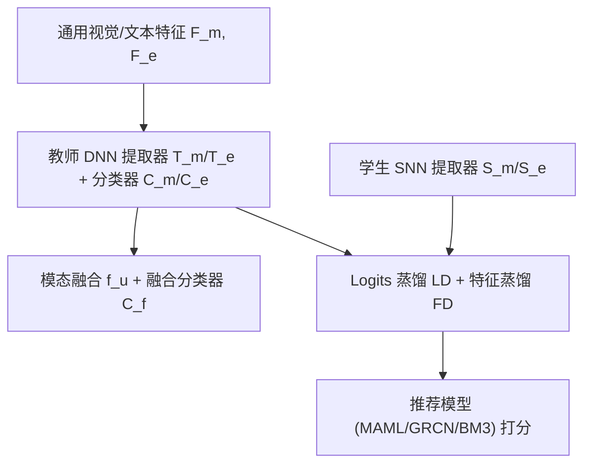
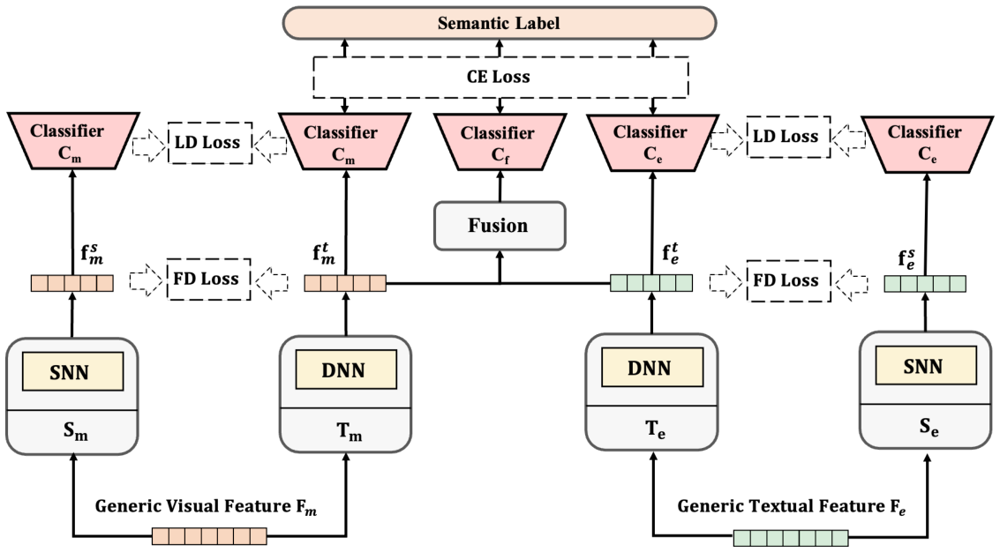

# Semantic-Guided Feature Distillation for Multimodal Recommendation (语义引导的多模态推荐特征蒸馏)

- **会议/期刊**: ACM Multimedia 2023 (MM '23)
- **作者与机构**: Fan Liu, Huilin Chen, Zhiyong Cheng, Liqiang Nie, Mohan Kankanhalli（新加坡国立大学、合肥工业大学、齐鲁工业大学、哈工大深圳）
- **推荐链路定位**: 召回（物品多模态表征学习前端，模型无关插件）
- **研究方向**: 多模态推荐 / 冷启动与长尾推荐
- **论文原文**: [https://arxiv.org/abs/2308.03113v1](https://arxiv.org/abs/2308.03113v1)
- **开源代码**: [https://github.com/HuilinChenJN/SGFD](https://github.com/HuilinChenJN/SGFD)

## TL;DR (1分钟核心速览)

多模态推荐普遍把"通用特征 $\to$推荐特征"的提取器与推荐模型端到端联合训练：浅层 MLP 无法从 4096 维 VGG/BERT 通用特征中提炼有效信息，深层 DNN 又在 99.98% 稀疏的交互上训不动。本文提出模型无关的 SGFD，先离线训练一个由类别标签语义监督、并融合图文互补信息的 DNN 教师，再用 Logits 蒸馏 (LD) + 特征蒸馏 (FD) 把知识压进浅层学生提取器，替换原模型提取器。在 Amazon 三个类别、三种骨干 (MAML/GRCN/BM3) 上，Recall@20/NDCG@20 全面显著提升 2.62%–8.56%（$p<0.05$）。

## Background & Motivation (背景与核心矛盾)

- **主流范式**: 先用预训练模型（VGG16 取 4096 维、BERT 取评论特征）抽通用模态特征，再接一个 MLP/GNN 提取器 tailor 成推荐特征，提取器与 CF 目标端到端联合优化（MMGCN、MAML、GRCN、BM3 皆如此）。
- **前人局限 1（容量—稀疏两难）**: 浅层 SNN 对高维复杂通用特征表达力不足；换 DNN 又因交互稀疏而欠拟合。图 3 直接证实这一点——把 GRCN 的提取器换成 DNN（GRCN$_m$）后，稀疏的 Clothing 上 Recall@20 反而低于浅层版 GRCN$_1$。
- **前人局限 2（语义缺位）**: 现有提取器只依靠协同信号塑造特征，完全忽略类别这类抽象、精炼的语义标签，导致同类物品在特征空间并不聚拢。
- **核心洞察 (Key Insight)**: 通用特征与推荐特征之间的"桥"不必由推荐损失独自学习——可以用标签语义作为额外监督，把它学在一个不怕稀疏的独立教师里。
- **本文切入点**: 解耦"特征提取"与"推荐训练"：教师离线学语义感知特征，学生（浅层）在推荐模型内做在线推理，靠蒸馏继承教师能力。

## Method (核心方法设计)

### 1. 整体框架 (Overall Architecture)

SGFD 是两段式 teacher-student 插件。**教师端**（离线、不接推荐损失）：视觉/文本通用特征 $F_m, F_e$分别经 DNN 提取器$T_m, T_e$得$f^t_m, f^t_e$，各自过分类器$C_m, C_e$做类别分类；同时两模态特征拼接融合得$f_u$，再经$C_f$分类以吸收互补信息。**学生端**（在线、嵌入推荐模型）：以浅层 SNN$S_m, S_e$ 替换 GRCN/MAML/BM3 的原提取器，复用教师分类器输出 logits 与中间特征作为监督信号。训练时学生与推荐模型端到端联合优化，教师参数冻结；推理阶段只需学生，开销与原浅层提取器同量级。

<figure class="paper-figure" markdown="span">
  <figcaption>图2：所提出的语义引导特征蒸馏（SGFD）方法概览。以视觉特征提取为例，教师模型中的视觉特征提取器在同时考虑语义信息和互补信息的情况下，从通用视觉特征中提取特征。采用基于 Logits 的蒸馏（LD）损失和基于特征的蒸馏（FD）损失将知识迁移到学生模型。</figcaption>
</figure>

### 2. 关键设计拆解 (Key Designs)

1. **语义引导的教师监督（Semantic-Guided Teacher）**：痛点是提取器无标签语义约束。教师对每个模态特征做 $C$类分类，$\mathcal{L}_{CE}^{T}=\tfrac{1}{2}\big(\mathrm{CE}(P^t_m,y)+\mathrm{CE}(P^t_e,y)\big)$，其中$P^t_m=\mathrm{softmax}((\mathbf{W}_mf^t_m+\mathbf{b}_m)/\tau)$。类别标签比协同信号更抽象、抗稀疏，故教师能在交互极少时仍学到"同类相聚"的特征几何（图 4 t-SNE 验证）。
2. **互补信息融合分支**：单模态提取易冗余失真，故 $f_u=\sigma(\mathbf{W}_u[f^t_m;f^t_e]+\mathbf{b}_u)$后接$C_f$，损失$\mathcal{L}_{CE}^{F}=\mathrm{CE}(P_u,y)$。融合分类器迫使两模态各自贡献互不重复的判别线索，等价于一种标签级的跨模态对齐正则。
3. **双路蒸馏与训练目标**：LD 对齐软标签分布 $\mathcal{L}_{LD}=\|P^t_m-P^s_m\|_2^2+\|P^t_e-P^s_e\|_2^2$（温度$\tau$软化携带类间相似性"暗知识"），FD 对齐中间表征$\mathcal{L}_{FD}=\|f^t_m-f^s_m\|_2^2+\|f^t_e-f^s_e\|_2^2$。总目标$\mathcal{L}_{SGFD}=\mathcal{L}_{REC}+\lambda_1(\mathcal{L}_{LD}+\mathcal{L}_{FD})+\lambda_2(\mathcal{L}_{CE}^{T}+\mathcal{L}_{CE}^{F})$。负采样沿用各骨干原有策略（如 BM3 的多模态自监督目标），SGFD 本身不引入额外负采样；教师离线训练一次即可复用，无在线延迟增量。

## Experimental Setup & Evaluation Protocol (实验设置与评估协议)

- **数据集与预处理**（Amazon Review，三类目，`5-core` 过滤，评分即正交互）：

| 数据集 | #Users | #Items | #Interactions | 稀疏度 | #Label(类别) |
| :--- | :---: | :---: | :---: | :---: | :---: |
| Office | 4,874 | 7,279 | 52,957 | 99.85% | 54 |
| Clothing | 18,209 | 17,318 | 150,889 | 99.98% | 26 |
| Toys & Games | 18,748 | 11,672 | 161,653 | 99.97% | 19 |

- **数据划分与防穿越**: 每用户随机抽 80% 交互作训练、20% 作测试（比例划分，非时间切分，存在轻度未来信息泄漏风险）。
- **排名评测协议**: Top-20 排序，指标 Recall@20 / NDCG@20；论文将用户未交互物品全部视为负样本，即 `Full-Ranking` 全库未交互排序（未采用采样式评测），结果取全测试用户均值。
- **对比基线与超参**: 纯 CF 基线 NeuMF/CML/NGCF/DGCF + 多模态基线 MAML/GRCN/BM3 + 三个 SGFD 增强版；嵌入维度 $d=128$，batch 1024，$\tau\in\{5,10,20,50,100\}$用于蒸馏、分类时$\tau=1$，教师层数由$k=\log_\delta(D_m/d_m)$决定且$\delta\in\{2,4,6,8\}$，$\lambda_1,\lambda_2\in[10^{-3},10]$，早停（Recall@20 连续 20 轮不升）；显著性用双尾配对 t 检验$p<0.05$。

## Key Experimental Results (实验关键数据)

### 1. 主实验对比 (Main Results)

| Model | Office R@20 | Office N@20 | Clothing R@20 | Clothing N@20 | Toys R@20 | Toys N@20 |
| :--- | :---: | :---: | :---: | :---: | :---: | :---: |
| CML | 12.29 | 13.95 | 4.09 | 2.24 | 12.27 | 11.60 |
| NGCF | 8.14 | 4.79 | 4.66 | 2.16 | 9.70 | 5.87 |
| DGCF | 12.06 | 11.05 | 7.45 | 4.05 | 12.62 | 10.85 |
| MAML | 13.33 | 14.12 | 6.89 | 3.70 | 12.84 | 12.09 |
| GRCN | 13.20 | 15.33 | 7.63 | 4.12 | 11.85 | 11.23 |
| BM3 | 13.67 | 15.36 | 7.43 | 4.21 | 12.22 | 11.92 |
| SGFD$_{MAML}$ | **14.22** | 14.87 | 7.18 | 3.89 | **13.23** | 12.60 |
| SGFD$_{GRCN}$ | 13.88 | **16.26** | **8.16** | 4.35 | 12.59 | 11.93 |
| SGFD$_{BM3}$ | 14.07 | 15.86 | 7.84 | **4.57** | 12.54 | **12.94** |
| **Improv. 区间** | +5.15% | +6.07% | +6.95% | +8.56% | +3.04% | +8.56% |

（单位 %，`*` 表示 $p<0.05$ 显著；Improv. 为各 SGFD 版相对其骨干的提升区间。）

### 2. 消融实验 (Ablation Study)

以 SGFD$_{GRCN}$ 为基准（单位 %，最优加粗）：

| 变体 | Office R | Office N | Clothing R | Clothing N | Toys R | Toys N |
| :--- | :---: | :---: | :---: | :---: | :---: | :---: |
| SGFD$_l$ (仅 LD) | 13.30 | 15.80 | 7.69 | 4.06 | 12.01 | 11.31 |
| SGFD$_f$ (仅 FD) | 13.53 | 15.71 | 7.86 | 4.18 | 11.55 | 10.92 |
| SGFD$_e$ (去互补融合) | 13.71 | 15.73 | 7.97 | 4.28 | 12.08 | 11.36 |
| SGFD$_s$ (教师也浅层) | 13.76 | 16.07 | 8.02 | 4.30 | 12.22 | 11.50 |
| **SGFD (完整)** | **13.88** | **16.26** | **8.16** | **4.35** | **12.59** | **11.93** |

### 3. 关键实验发现 (Key Findings)

1. **蒸馏收益随稀疏度单调放大**：最稀疏的 Clothing（99.98%）上 SGFD$_{GRCN}$的 Recall@20 达 8.16（+6.95%）、SGFD$_{BM3}$ 的 NDCG@20 提升 +8.56%；而相对最稠密的 Office（99.85%）Recall 仅 +5.15%——正与"瓶颈是稀疏导致的提取器欠训"这一动机吻合。
2. **LD 与 FD 互补而非冗余**：单用 LD（SGFD$_l$）在 Office 得 13.30、Clothing NDCG 仅 4.06；单用 FD（SGFD$_f$）Recall 更高但 Toys 的 NDCG 崩到 10.92（低于原始 GRCN 的 11.23），说明 logits 软标签对类别稀疏的小数据集（19 类）更稳健，缺一不可。
3. **语义监督是主增益、DNN 容量是次增益**：教师降级为浅层（SGFD$_s$，13.76/16.07）仍全面超过去掉互补融合的 SGFD$_e$（13.71/15.73），说明语义标签引导贡献最大；但完整版再到 13.88/16.26，说明 DNN 教师 + 模态融合的额外容量仍有稳定正收益。

## Highlights & Limitations (亮点、对比与审稿批判)

- **与代表作对比 (vs. Prior Work)**: 对比 MAML（度量学习建模多偏好）、GRCN（用多模态特征剪枝假阳性边）、BM3（多模态自监督去噪）——三者都在改推荐侧损失，特征提取器始终被动跟着协同目标走；SGFD 反过来把提取器拎出来单独监督，再蒸馏回去，且与三者正交（可同时叠加，实验中三个骨干均涨）。相比传统 RD/CD 蒸馏（蒸馏排序分数），本文蒸馏的是"模态特征提取能力"，监督源是标签语义而非教师排序列表。
- **可迁移亮点**: ①"离线重监督教师 + 在线浅层学生 + 推理只留学生"是低成本给现有模型免费加语义先验的范式，可直接移植到短视频/A/B 场景的视觉塔；②用类别分类器充当跨模态对齐正则（融合分支）比对比学习更省负样本。
- **审稿级局限批判**: ①依赖 item 类别标签，类别粒度粗（Office 54 类、Toys 19 类）或标签噪声大时教师监督质量会塌缩，论文未做标签比例/噪声鲁棒性实验；②评测仅用 80/20 随机划分且未报告 per-user 全排序的候选规模细节，缺少时间切分与冷启动物品分桶，无法直接证明"缓解冷启"的宣称；③两阶段流程引入教师训练与 $\delta,\tau,\lambda_1,\lambda_2$ 多个敏感超参，工程调参成本上升，论文亦未给出教师训练耗时对比。

## Rating (四维评分)

- **方法创新性 (Novelty)**: ⭐⭐⭐ （把 KD 从"蒸馏排序分数"移到"蒸馏模态特征提取器"，配合标签语义监督与模态互补融合，思路干净但组件均为成熟技术组合，无理论分析）
- **评估协议与实验扎实度 (Protocol & Experiments)**: ⭐⭐⭐ （三数据集×三骨干+显著性检验+消融+可视化较完整，但划分方式单一、缺时间切分/冷启动分桶与负采样协议澄清）
- **写作与数学规范度 (Clarity & Rigor)**: ⭐⭐⭐⭐ （公式简洁、符号一致、教师层数 $k=\log_\delta(D_m/d_m)$ 等细节交代清楚，复杂度与推理开销分析略简）
- **工业落地与复现价值 (Industrial & Practical Value)**: ⭐⭐⭐⭐ （模型无关、推理零额外开销、代码已开源，仅需一次性离线教师训练即可上线，迁移门槛低）

