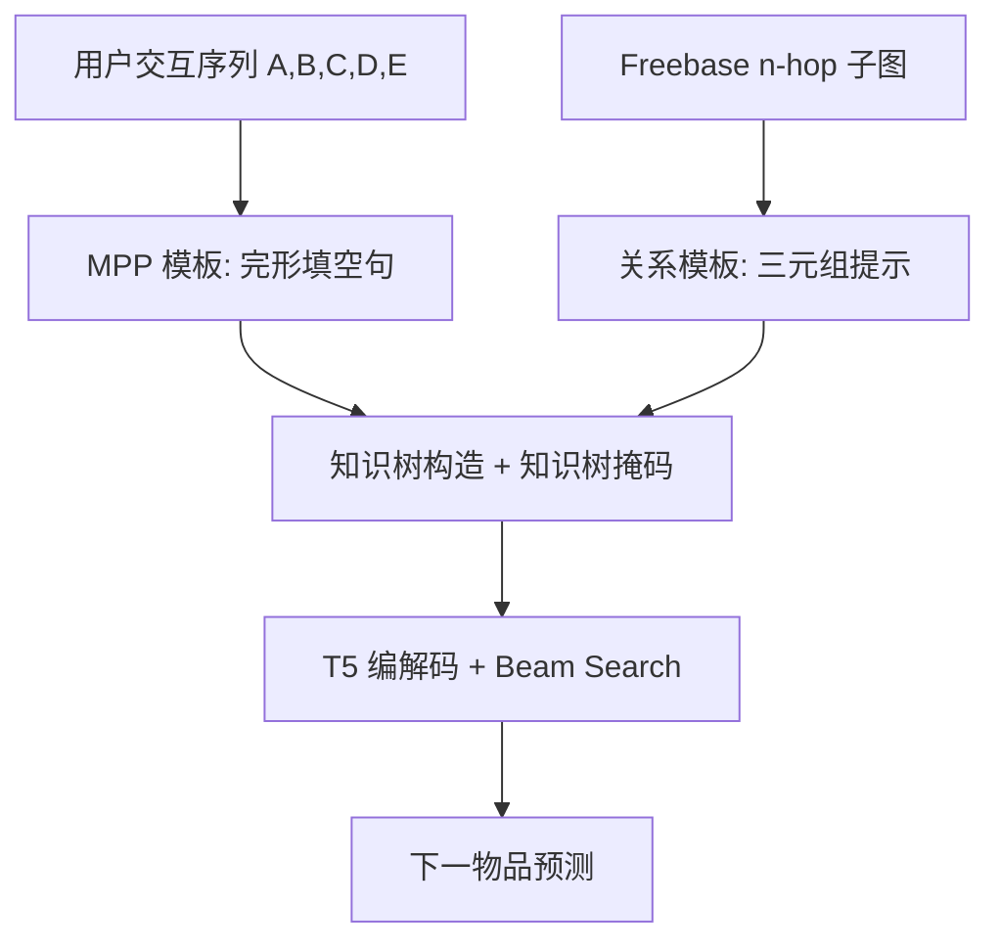
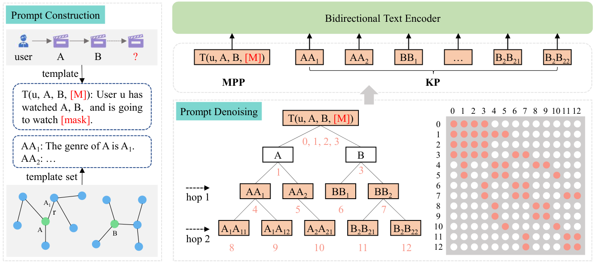

# Knowledge Prompt-tuning for Sequential Recommendation (知识提示微调的序列推荐)

- **会议/期刊**: ACM MM 2023
- **作者与机构**: Jianyang Zhai（中山大学/鹏城实验室）、Xiawu Zheng（鹏城实验室）、Chang-Dong Wang（中山大学）、Hui Li（厦门大学）、Yonghong Tian（北京大学/鹏城实验室）
- **推荐链路定位**: 召回（PLM 生成式下一物品预测，Beam Search 解码）
- **研究方向**: 序列与会话推荐 / 大语言模型推荐
- **论文原文**: [论文原文链接](https://arxiv.org/abs/2308.08459v1)
- **开源代码**: [KP4SR](https://github.com/zhaijianyang/KP4SR)

## TL;DR (1分钟核心速览)

现有 PLM 序列推荐（如 P5）只靠语料中的通用知识，缺乏物品/用户领域知识，且把 KG 当作结构化嵌入做早期融合会丢失信息。KP4SR 用关系模板把 KG 三元组翻译成自然语言"知识提示"，与掩码个性化提示（MPP）拼接送入 T5；再用知识树掩码恢复被文本化打散的图结构以抑制噪声。在 books/music/movies 三个数据集、Leave-One-Out + Full-Ranking 协议下，NDCG@5 相对 P5 分别提升 40.65%、11.17%、22.17%。

## Background & Motivation (背景与核心矛盾)

- **主流范式**: 序列推荐主流是 ID-only 自注意力（SASRec/BERT4Rec）或引入 side info 的融合模型（FDSA、S3Rec、DIF-SR），近年 P5 把推荐统一改写成 NLP 问答任务，用 T5 注入通用语义知识。
- **前人局限**: ① 基于 ID 或早期特征拼接的方法存在**信息损失**，KG 嵌入（TransE 类）的优化目标是边补全而非推荐，与下游目标错位；② P5 缺少用户/物品的**领域知识**，难以刻画细粒度偏好，且其"个性化提示"本质是预训练-微调范式而非预训练任务本身，数据效率低。
- **核心洞察 (Key Insight)**: 若把结构化 KG 直接写成自然语言句子，就能让 PLM 在同一文本空间里同时享用通用知识（语料）与领域知识（KG），并天然支持多跳高阶信息；代价是文本化破坏了图的拓扑结构，产生大量无关三元组噪声。
- **本文切入点**: 用"关系模板 → 知识提示"弥合结构化数据与文本的语义鸿沟，再用"知识树 + 掩码矩阵"在注意力层面把图结构还回去。

<figure class="paper-figure" markdown="span">
  ![图1：P5 \[9\]（上）与引入领域知识的KP4SR（下）的对比。我们引入外部知识图谱并将其转化为知识提示，以弥合文本数据与结构化数据之间的语义鸿沟，从而丰富物品的语义特征，并提高推荐结果的准确性和可解释性。](../../../../assets/papers/2308.08459v1/figure_1.png)<figcaption>图1：P5 [9]（上）与引入领域知识的KP4SR（下）的对比。我们引入外部知识图谱并将其转化为知识提示，以弥合文本数据与结构化数据之间的语义鸿沟，从而丰富物品的语义特征，并提高推荐结果的准确性和可解释性。</figcaption>
</figure>

## Method (核心方法设计)

### 1. 整体框架 (Overall Architecture)

输入是用户交互序列 $\{A,B,C,D,E\}$与每个物品在 Freebase 中的$n$跳子图。先由 MPP 模板把序列填充为完形填空句（`User u has watched ..., and is going to watch [mask] next.`），再由关系模板把子图内每个三元组$(h,r,t)$渲染成一句三元组提示（如 `The genre of Cast Away is Adventure.`），按知识树层级遍历拼接成知识提示 KP。二者以特殊 token 拼接为$X_{prompt}=[\text{SPE}]X_d[\text{SPE}]X_k[\text{SPE}]$ 送入 T5 编码器-解码器；编码端叠加知识树掩码限制 token 可见性，解码端生成目标物品 ID 序列。推理时用 Beam Search 生成候选列表。

<figure class="paper-figure" markdown="span">
  <figcaption>图2：KP4SR的总体框架。首先，我们使用掩码个性化提示（MPP）模板将用户-物品交互序列转化为MPP（左上）。然后，我们使用关系模板将知识图谱转化为知识提示（KP）（左下）。最后，我们构建知识树并提出知识树掩码，以缓解知识噪声问题（右）。</figcaption>
</figure>

### 2. 关键设计拆解 (Key Designs)

1. **掩码个性化提示 MPP（把 SR 变成预训练任务）**：P5 的提示是问答式，与 T5 的 span-corruption 预训练目标不一致，需要大量微调轮次。MPP 直接把序列写成含 `[mask]` 的完形句，使下游任务与预训练任务同构，从而复用 PLM 的掩码预测能力；效果是收敛轮次下降 42%–70%（books 300→90）。
2. **知识提示 KP（结构化 KG → 文本）**：为每个关系 $r\in\mathcal{R}$手工设计一个关系模板$T_r$，三元组$(h,r,t)$渲染为$T_r(h,t)$；对实体$h$递归展开 1-hop、2-hop 集合$S_1,S_2$，把多跳三元组提示顺序拼接。这样 PLM 无需任何图网络即可消费高阶知识，且关系语义由模板文字直接承载，避免了 KGE 与推荐目标错位。
3. **知识树掩码 PD（在注意力层复原图结构）**：文本化后任意两个三元组提示会互相注意，无共同实体的句子互相干扰形成噪声。作者以 MPP 为根、实体为中间节点、三元组提示为叶节点构造知识树，并改写注意力掩码：

$$M_{ij}=\begin{cases}0 & x_i,x_j\in N_o \\ 0 & x_i\in N_1, x_j\in N_2 \\ 0 & x_i\in N_p, x_j\in N_c \text{ 或反之} \\ -\infty & \text{otherwise}\end{cases}$$

即节点仅可见自身、同父兄弟、父子节点；由于这些可见节点必共享同一实体，等价于"同一实体的知识才允许交互"，从而在不改输入序列的前提下抑制跨实体噪声。

4. **训练目标、负采样与推理开销**：T5 自回归交叉熵 $\mathcal{L}_\theta=-\sum_{j=1}^{|y|}\log P_\theta(y_j\mid y_{<j},X_{prompt})$，无显式负采样（生成式全库解码）；T5 为 6 层编码+6 层解码、$d=512$、8 头，输入上限 512 token，因此只展开 ≤3 跳知识、交互序列截断至 5。推理需 Beam Search 逐 token 生成，开销显著高于双塔内积检索。

## Experimental Setup & Evaluation Protocol (实验设置与评估协议)

- **数据集与预处理**: 三个公开数据集均按 P5 方式做 `5-core` 过滤（LFM-1b 额外过滤播放 <10 次的曲目），实体 ID 经 Freebase 转为文本，物品仍用 ID 输入输出。

| 数据集 | #Users | #Items | #Interactions | 密度 | KG 关系/实体/三元组 |
| :--- | :---: | :---: | :---: | :---: | :--- |
| books (Amazon) | 70,463 | 24,921 | 845,321 | 4.8e-4 | 16 / 103,695 / 402,543 |
| music (LFM-1b) | 70,774 | 335,619 | 8,768,434 | 3.7e-4 | 6 / 1,434,216 / 2,724,800 |
| movies (ML-10M) | 69,878 | 10,130 | 9,991,477 | 1.4e-2 | 44 / 123,306 / 954,004 |

- **数据划分与防穿越**: `Leave-One-Out`——每条序列最后两件作验证/测试，其余训练，严格按时间戳顺序，无未来交互泄漏。
- **排名评测协议**: 无偏 `Full-Ranking`（在**全物品集**上排序，而非采样候选），指标 HR@5/10、NDCG@5/10。
- **对比基线与超参**: 基线含 ID-only（Caser、GRU4Rec、BERT4Rec、SASRec）、side-info（GRU4RecF/KG、SASRecF、FDSA、S3Rec、DIF-SR、KSR）与 PLM（P5）。AdamW，峰值学习率 1e-3，batch 64，4×Ascend 910，混合精度；所有方法序列长度统一设为 5 以保证公平。

## Key Experimental Results (实验关键数据)

### 1. 主实验对比 (Main Results)

| 方法 | books NDCG@5 | books HR@5 | music NDCG@5 | music HR@5 | movies NDCG@5 | movies HR@5 |
| :--- | :---: | :---: | :---: | :---: | :---: | :---: |
| Caser | 0.0220 | 0.0356 | 0.0165 | 0.0271 | 0.0309 | 0.0520 |
| GRU4Rec | 0.0235 | 0.0380 | 0.0222 | 0.0374 | 0.0378 | 0.0643 |
| BERT4Rec | 0.0204 | 0.0323 | 0.0242 | 0.0426 | 0.0328 | 0.0560 |
| SASRec | 0.0254 | 0.0466 | 0.0327 | 0.0634 | 0.0312 | 0.0538 |
| KSR | 0.0240 | 0.0383 | 0.0330 | 0.0504 | 0.0394 | 0.0679 |
| S3Rec | 0.0249 | 0.0452 | 0.0301 | 0.0524 | 0.0306 | 0.0536 |
| DIF-SR | 0.0298 | 0.0584 | 0.0573 | 0.1110 | 0.0492 | 0.0875 |
| P5 (T5) | 0.0433 | 0.0604 | 0.0815 | 0.0994 | 0.0618 | 0.0888 |
| **KP4SR** | **0.0609** | **0.0824** | **0.0906** | **0.1108** | **0.0755** | **0.1058** |
| Improv. vs P5 | +40.65% | +36.42% | +11.17% | +11.47% | +22.17% | +19.14% |

### 2. 消融实验 (Ablation Study)

| 设置 | books NDCG@5 | books HR@5 | music NDCG@5 | music HR@5 | movies NDCG@5 | movies HR@5 |
| :--- | :---: | :---: | :---: | :---: | :---: | :---: |
| P5（原始提示） | 0.0433 | 0.0604 | 0.0815 | 0.0994 | 0.0618 | 0.0888 |
| MPP only（0-hop KP） | 0.0505 | 0.0658 | 0.0839 | 0.1018 | 0.0645 | 0.0906 |
| + KP 3-hop，w/o PD | 0.0543 | 0.0753 | 0.0891 | 0.1093 | 0.0623 | 0.0892 |
| + KP 1-hop + PD | 0.0542 | 0.0734 | 0.0894 | 0.1091 | 0.0729 | 0.1012 |
| + KP 2-hop + PD | **0.0575** | **0.0787** | 0.0886 | 0.1086 | 0.0677 | 0.0959 |
| + KP 3-hop + PD | 0.0523 | 0.0737 | **0.0899** | **0.1102** | 0.0702 | 0.0980 |

### 3. 关键实验发现 (Key Findings)

1. **"任务同构"比"更多参数"更值钱**：仅把 P5 的问答提示换成完形填空式 MPP（不引入任何 KG），books 的 NDCG@5 即从 0.0433 升至 0.0505（+16.63%），且训练轮次 300→90（-70%），说明与预训练目标对齐的提示形式是主要增益来源之一。
2. **知识量与噪声存在数据集相关的甜点**：books 上 KP 3-hop+PD 已达 0.0523、无 PD 时单调递增（0.0503→0.0543），而 movies 在 1-hop+PD 时最优（0.0729，超 3-hop+PD 的 0.0702），music 需 3-hop+PD 才到 0.0899——稠密小物品集（movies 密度 1.4e-2）对噪声更敏感，说明"多跳知识"并非普适增益。
3. **PD 与知识树度数需联合调参**：books 上度数 5 最优（0.0609/0.0824），music 与 movies 度数 4 最优（0.0906/0.1108、0.0755/0.1058），度数过大反而掉点；同时 PD 在 1-hop（movies +8.6% NDCG@5）收益最大、3-hop 时甚至有害，印证掩码只能约束显式实体共现、无法恢复被模板省略的隐式语义关联。

## Highlights & Limitations (亮点、对比与审稿批判)

- **与代表作对比 (vs. Prior Work)**: 与 P5 的本质差异在于"知识来源 + 任务形式"——P5 是预训练-微调的问答式提示，KP4SR 是与预训练同构的完形提示并叠加领域 KG；与 KSR/DHIMN 等 KG 增强方法相比，本文不训练 KGE 或图传播层，而是让 PLM 在文本空间直接推理多跳知识，规避了 KGE 目标错位；与 DIF-SR 相比，后者在注意力层解耦 side-info 融合，本文则在注意力掩码层做"结构复原"，思路更轻量。
- **可迁移亮点**: ① "结构 → 模板文本 + 掩码复原拓扑"这一范式可迁移到任何把图/树结构喂给 PLM 的场景（如 KG 增强对话、可解释推荐理由生成）；② 用注意力掩码替代额外 GNN 编码器，工程上可直接复用现成 T5 代码栈。
- **审稿级局限批判**: ① 关系模板需对每个数据集**手工设计**（books/movies 分别 16/44 种关系），跨域迁移成本高，且模板措辞对结果敏感（图 6 显示 T-1 与 T-2 存在可见差距）；② 序列截断至 5、输入上限 512 token、仅 3 跳，长序列场景未验证（music 上序列变长反而掉点）；③ Beam Search 生成式全库解码的在线延迟远高于 SASRec 类内积检索，文中未给出推理时延或吞吐对比；④ 仅用 HR/NDCG，缺少 MRR、覆盖度与冷启动物品分桶分析。

## Rating (四维评分)

- **方法创新性 (Novelty)**: ⭐⭐⭐⭐ （首次把 KG 三元组系统性地"提示化"并配知识树掩码复原拓扑，思路简洁新颖，但模板设计与掩码规则仍属人工先验）
- **评估协议与实验扎实度 (Protocol & Experiments)**: ⭐⭐⭐⭐ （三数据集 + Full-Ranking 无偏评测 + 9 个强基线 + 消融/跳数/度数/模板泛化四组分析齐全，缺显著性检验与效率对比）
- **写作与数学规范度 (Clarity & Rigor)**: ⭐⭐⭐⭐ （掩码定义与知识树构造表述清晰，公式简洁；但模板设计原则与掩码的语义完备性缺少形式化论证）
- **工业落地与复现价值 (Industrial & Practical Value)**: ⭐⭐⭐ （代码已开源、可直接复用 T5 栈，但生成式解码延迟与手工模板维护成本限制了大规模在线部署）

