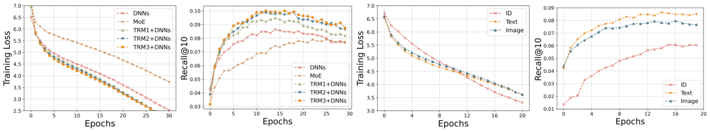
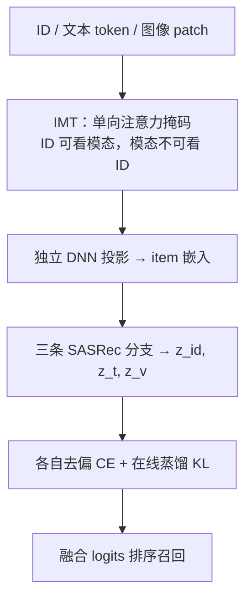
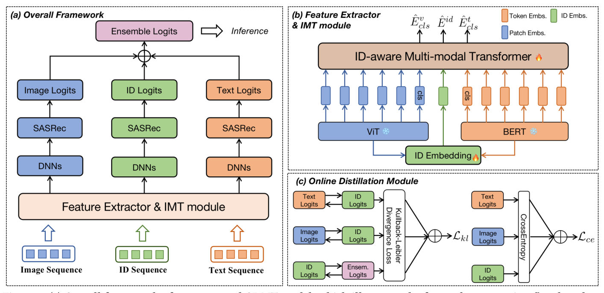

# Online Distillation-enhanced Multi-modal Transformer for Sequential Recommendation (在线蒸馏增强的多模态 Transformer 序列推荐)

- **会议/期刊**: ACM MM 2023
- **作者与机构**: Wei Ji, Xiangyan Liu, An Zhang, Yinwei Wei, Yongxin Ni, Xiang Wang（新加坡国立大学、Monash、中科大）
- **推荐链路定位**: 召回（Next-Item 序列召回）
- **研究方向**: 序列与会话推荐 / 多模态推荐
- **论文原文**: [https://arxiv.org/abs/2308.04067v2](https://arxiv.org/abs/2308.04067v2)
- **开源代码**: [https://github.com/xyliugo/ODMT](https://github.com/xyliugo/ODMT)

## TL;DR (1分钟核心速览)

多模态序列推荐直接沿用 Late Fusion 融合 ID/文本/图像时，ID 嵌入因优化无约束而主导梯度、快速压低训练损失，却与 Recall 提升方向背离，模态先验被"淹没"。本文提出 ODMT：用 ID-aware 多模态 Transformer（IMT）在注意力掩码层面单向隔离 ID 对模态的污染，并把三条分支当作三个学生网络做在线蒸馏互学。在 Stream/Arts/Office/H&M 四数据集、全库排序协议下，Recall@10 相对最优基线 SASRec+LF 提升 7.4%–13.6%。

## Background & Motivation (背景与核心矛盾)

- **主流范式**: 多模态序列推荐 = 用 BERT/ViT 抽特征 → 轻量 FST 模块（DNN/MoE）做语义转换 → Early/Late Fusion 融合后送入 SASRec 类序列骨干。
- **前人局限**: ①单模态输入时 Transformer 作为 FST 显著优于 DNN/MoE（图 1），但一旦改为 ID+文本+图像多源输入，Transformer 层数越深优势越弱，Arts 上甚至被单模态反超；②简单 Early/Late Fusion 下训练损失与测试 Recall 脱钩（图 2c/2d），模态越强反噬越明显。
- **核心洞察 (Key Insight)**: ID 优化是"无约束问题"（每个 item 独立 embedding，拟合训练集极快、损失更低），模态优化是"有约束问题"（内容相似性构成先验正则），二者联合训练时损失下降方向 ≠ 指标提升方向，形成优化冲突。
- **本文切入点**: 不在损失前融合、而在表征与优化两个阶段"分工"——表征阶段让 ID 单向读取模态，优化阶段让各分支独立算损失再用蒸馏互传软标签。

<figure class="paper-figure" markdown="span">
  <figcaption>图 2：使用文本输入的 FST 模块训练曲线，评估 (a) 训练损失和 (b) 测试 Recall@10；以及在 Arts 数据集上以 DNNs 作为 FST 模块的不同单输入训练曲线，评估 (c) 训练损失和 (d) 测试 Recall@10。</figcaption>
</figure>

## Method (核心方法设计)

### 1. 整体框架 (Overall Architecture)

输入侧对 item 分别取 ViT patch 序列 $\tilde{E}_v\in\mathbb{R}^{d\times(n_v+1)}$、BERT token 序列$\tilde{E}_t\in\mathbb{R}^{d\times(n_t+1)}$与 ID 向量$\tilde{E}_{id}\in\mathbb{R}^{d}$，拼接为$\tilde{E}=[\tilde{E}_v;\tilde{E}_{id};\tilde{E}_t]$送入两层 IMT 做细粒度交互；IMT 输出的 CLS/ID 表征各经独立两层 DNN（LeakyReLU）投影成 item 嵌入，再由三条并行 SASRec 分支编码用户序列，得到三组 logits$z_v,z_t,z_{id}$。训练时三支各自计算去偏交叉熵，并叠加以 ID 分支为主教师的在线蒸馏损失；推理时仅用融合 logits$z_e=(z_v+z_t+z_{id})/3$ 排序。

<figure class="paper-figure" markdown="span">
  <figcaption>图 3：(a) 我们提出的 ODMT 模型的总体框架，展示了基于对 Late Fusion 方法进行修改的前向计算流程。(b) 展示我们提出的 IMT 模块，(c) 表示我们提出的 Online Distillation 模块。不同颜色表示不同特征（ID、图像和文本）的信息流。</figcaption>
</figure>

### 2. 关键设计拆解 (Key Designs)

1. **ID-aware 单向注意力掩码（IMT）**：动机是 ID 会误导模态表征。做法是在标准注意力掩码上改两个元素：$\tilde{M}[:n_v+1,\,n_v+1]=1,\ \tilde{M}[n_t+2:,\,n_v+1]=1$，即仅放开"ID 作 query 看模态"与"模态作 query 看 ID 的反向通路被切断"。直觉：ID 吸收内容先验做冷启动泛化，模态保持纯净语义不被 ID 的快捷拟合污染。配套的 **ID 表初始化**用$\tilde{E}_{id}\leftarrow\frac{1}{2}(E_v^{cls}+E_t^{cls})$ 对齐量纲，避免随机初始化在自注意力相似度计算中造成尺度错配。

2. **在线蒸馏互学（Online Distillation）**：动机是 Late Fusion 的平均 logits 单损失会让强分支吃掉弱分支。改为每支独立算 $\mathcal{L}_{ce}=\sum_{m}\mathcal{L}_{ce}^m$，再加软标签互传：$\mathcal{L}_{kl}=T^2KL(\sigma(z_{id}/T),\sigma(z_v/T))+T^2KL(\sigma(z_{id}/T),\sigma(z_t/T))+T^2KL(\sigma(z_e/T),\sigma(z_{id}/T))$，即以 ID 分支为教师指导模态分支、以集成为教师回灌 ID 分支，形成闭环。总目标$\mathcal{L}_{total}=\mathcal{L}_{ce}+w(\alpha)\mathcal{L}_{kl}$，$w(\alpha)$ 随 epoch 指数 ramp-up 至 1，避免训练初期噪声软标签污染。

3. **训练目标、负采样与推理开销**：采用去偏 in-batch 负采样，相似度减去流行度先验 $s(H_{h_i},D_{d_i})=H_{h_i}\cdot D_{d_i}-\log \mathrm{pop}(a_{d_i})$，并剔除候选集中与用户历史重叠的假阴性$\mathcal{B}_{h_i}$。推理时只走 IMT + 融合分支，蒸馏头全部丢弃，线上开销与 SASRec+LF 同级。

## Experimental Setup & Evaluation Protocol (实验设置与评估协议)

- **数据集与预处理**: 统一保留交互数 > 5 的用户、文本与图像均可匹配的物品，每用户仅取最近 15 条交互（近似 5-core + 截断）。

| 数据集 | #Users | #Items | #Interactions | 稀疏度 | 特征/场景说明 |
| :--- | :---: | :---: | :---: | :---: | :--- |
| Stream | 100,000 | 19,683 | 687,487 | 0.000349 | 自采短视频：封面 + 标签/标题拼接 |
| Arts | 43,583 | 58,900 | 333,693 | 0.000130 | Amazon 手工类：封面 + title/brand/category/desc |
| Office | 71,865 | 91,527 | 667,461 | 0.000101 | Amazon 办公类，同上文本字段 |
| H&M | 50,000 | 61,042 | 606,922 | 0.000199 | Kaggle 时尚：封面 + 商品名/类型/颜色 |

- **数据划分与防穿越**: `Leave-One-Out`——最后一条交互作测试、倒数第二条作验证、其余训练；超参按验证集 Recall@10 选择。
- **排名评测协议**: `Full-Ranking`（沿用 UniSRec/FDSA 协议，对全库未交互物品打分，不做采样截断），指标 Recall@{10,20} 与 NDCG@{10,20}，全用户平均。
- **对比基线与超参**: 基线分两类——纯 ID 序列模型（GRU4Rec、SASRec、NextItNet）与多模态序列模型（FDSA、UniSRec、SASRec+EF、SASRec+LF）；视觉特征用 CLIP ViT-B/32，文本用 bert-base-uncased / chinese-roberta-wwm-ext；隐层与学习率网格搜索 $\{128,256,512,768\}\times\{10^{-3},10^{-4},10^{-5}\}$，batch=128，IMT 取 2 层。

## Key Experimental Results (实验关键数据)

### 1. 主实验对比 (Main Results)

| 数据集 | 指标 | GRU4Rec | SASRec | FDSA | UniSRec | SASRec+EF | SASRec+LF | **ODMT** | Improv. |
| :--- | :--- | :---: | :---: | :---: | :---: | :---: | :---: | :---: | :---: |
| Stream | R@10 | 0.0914 | 0.0935 | 0.0885 | 0.1067 | 0.1112 | 0.1090 | **0.1194** | +7.37% |
| Stream | N@10 | 0.0492 | 0.0507 | 0.0476 | 0.0585 | 0.0611 | 0.0607 | **0.0672** | +9.95% |
| Arts | R@10 | 0.0535 | 0.0617 | 0.0640 | 0.0860 | 0.0962 | 0.0992 | **0.1127** | +13.55% |
| Arts | N@10 | 0.0380 | 0.0454 | 0.0471 | 0.0612 | 0.0669 | 0.0709 | **0.0787** | +11.13% |
| Office | R@10 | 0.0703 | 0.0769 | 0.0816 | 0.0971 | 0.1068 | 0.1085 | **0.1175** | +8.30% |
| Office | N@10 | 0.0542 | 0.0606 | 0.0635 | 0.0758 | 0.0814 | 0.0830 | **0.0893** | +7.56% |
| H&M | R@10 | 0.0380 | 0.0502 | 0.0571 | 0.0877 | 0.1115 | 0.1138 | **0.1235** | +8.52% |
| H&M | N@10 | 0.0206 | 0.0296 | 0.0334 | 0.0531 | 0.0682 | 0.0701 | **0.0771** | +9.99% |

R@20/N@20 趋势一致（Arts R@20：0.1264 → **0.1410**，+11.60%；H&M N@20：0.0796 → **0.0870**，+9.37%）。

### 2. 消融实验 (Ablation Study)

| 变体 | Stream R@10 | Stream N@10 | Arts R@10 | Arts N@10 |
| :--- | :---: | :---: | :---: | :---: |
| Text 初始化 | 0.1191 | 0.0666 | 0.1107 | 0.0777 |
| Image 初始化 | 0.1161 | 0.0647 | 0.1051 | 0.0738 |
| w/o 初始化 | 0.1144 | 0.0638 | 0.1025 | 0.0722 |
| w/o ID mask | 0.1155 | 0.0646 | 0.1001 | 0.0700 |
| w/o IMT (1)（拆成 2 层文本 + 2 层图像） | 0.1088 | 0.0607 | 0.1068 | 0.0752 |
| w/o IMT (2)（拆成 1+1 层） | 0.1146 | 0.0636 | 0.1096 | 0.0770 |
| w/o Online Distillation | 0.1121 | 0.0626 | 0.1019 | 0.0723 |
| w/o ID | 0.1125 | 0.0623 | 0.1075 | 0.0747 |
| **ODMT (full)** | **0.1194** | **0.0672** | **0.1127** | **0.0787** |

### 3. 关键实验发现 (Key Findings)

1. **优化冲突是真实瓶颈，蒸馏是最大增益点**：Arts 上去掉在线蒸馏 R@10 从 0.1127 掉到 0.1019（-9.6%），退化幅度超过去掉整个 IMT（0.1068）；说明"让各分支独立算损失 + 软标签互学"比单纯换更强融合模块更关键。
2. **单向掩码 + 均值初始化共同决定 ID 是否"有害"**：去掉 ID mask 在 Arts 掉 11.2%（0.1127→0.1001），随机初始化 ID 表掉 9.0%（→0.1025），而文本均值初始化几乎无损（Stream 0.1191 vs 0.1194），证明冲突来源是 ID 尺度与注意力通路而非 ID 信息本身。
3. **长尾与冷启动被显著缓解、且与骨干无关**：按流行度分桶后，Group 0（训练集未出现物品）上纯 ID 的 SASRec 完全失效，ODMT 借助模态先验明显优于其他多模态基线；替换 GRU4Rec/SASRec/NextItNet 三种骨干后 ODMT 均稳定领先，验证 model-agnostic。

## Highlights & Limitations (亮点、对比与审稿批判)

- **与代表作对比**: 相比 FDSA/UniSRec 只把模态当 side information 且用 DNN 级 FST，本文指出"Transformer 表征强但多源融合时被 ID 压制"这一反直觉现象并用掩码从结构上解决；相比 SASRec+LF 的 logits 平均，本文把融合从"输出端平均"前移到"训练端互蒸馏"，避免单一损失被强分支支配。
- **可迁移亮点**: ①"单向注意力掩码"可泛化到任何 ID + 内容特征的联合编码场景（如多模态 CTR、跨域对齐）；②"强分支作教师、集成回灌"的在线蒸馏范式可直接插到现有多任务/多场景模型中，无需额外教师模型。
- **审稿级局限批判**: ①在线蒸馏需同时跑三条 SASRec 分支，训练显存与时长约为 SASRec+LF 的 3 倍，论文未给出训练/推理 FLOPs 与延迟对比；②ID 初始化依赖 $d_v=d_t$ 这一强假设，维度不等时退化为"任选文本或图像"，缺少敏感性分析；③评测仅 Recall/NDCG，未报告多样性、覆盖率，且 Stream 为自采数据、H&M 经过用户采样，跨平台结论的外部效度有限。

## Rating (四维评分)

- **方法创新性 (Novelty)**: ⭐⭐⭐⭐ （以"损失-指标错位"实证切入，用掩码与在线蒸馏双管齐下解决 ID/模态优化冲突，思路清晰且首次将在线蒸馏引入多模态推荐）
- **评估协议与实验扎实度 (Protocol & Experiments)**: ⭐⭐⭐⭐ （四平台数据集 + Full-Ranking + 8 组消融 + 流行度分桶 + 三骨干迁移，唯缺显著性检验与方差报告）
- **写作与数学规范度 (Clarity & Rigor)**: ⭐⭐⭐⭐ （公式简洁、动机实验与设计一一对应；蒸馏中 $z_e$与$z_{id}$ 的师生角色切换表述略含混）
- **工业落地与复现价值 (Industrial & Practical Value)**: ⭐⭐⭐⭐ （框架 model-agnostic、推理零额外开销且代码已开源，但三支训练成本与 ID 初始化工程细节需额外调优）

