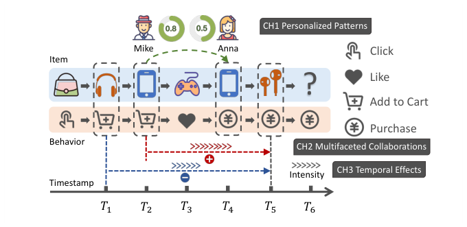
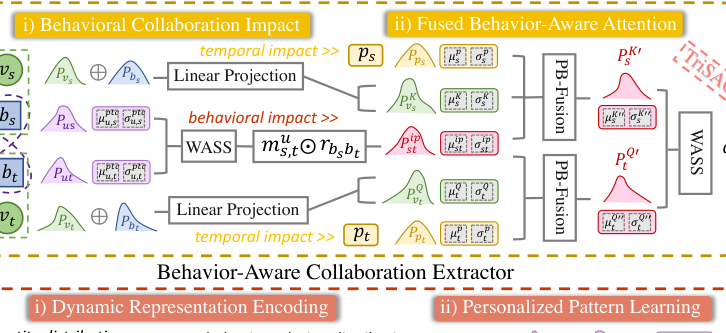
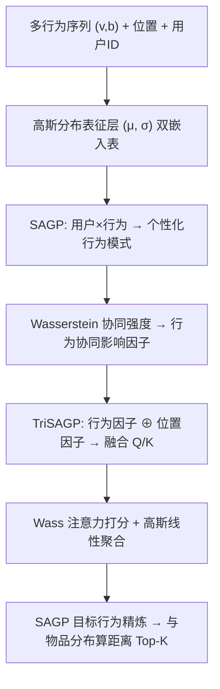

# Personalized Behavior-Aware Transformer for Multi-Behavior Sequential Recommendation (个性化行为感知 Transformer 的多行为序列推荐)

- **会议/期刊**: ACM MM 2023 (pp. 6321-6331)
- **作者与机构**: Jiajie Su, Chaochao Chen, Zibin Lin, Xi Li, Weiming Liu, Xiaolin Zheng（浙江大学）
- **推荐链路定位**: 召回（下一物品预测 / 序列建模）
- **研究方向**: 序列与会话推荐 / 多行为序列建模
- **论文原文**: [https://arxiv.org/abs/2402.14473v1](https://arxiv.org/abs/2402.14473v1)
- **开源代码**: [https://github.com/TiliaceaeSU/PBAT](https://github.com/TiliaceaeSU/PBAT)

## TL;DR (1分钟核心速览)

单行为序列在短序列（数据稀疏）时性能坍塌，而现有 MBSR 方法用**一套固定行为转移范式**应对所有用户，既忽略个性化行为习惯，也忽略"行为相关性 × 物品协同 × 时间间隔"的三元耦合。PBAT 把用户/物品/行为/位置/行为关系全部建模为**对角高斯分布**，用自适应的 SAGP 生产个性化行为模式，再用 Wasserstein 距离把行为因子与时间因子融合进注意力打分。在 Taobao/IJCAI/Yelp 的 Leave-One-Out 协议下，HR@5 相比最强基线 MB-STR 分别提升 **6.37% / 8.20% / 1.07%**，NDCG@5 提升 **10.3% / 12.9% / 1.74%**。

## Background & Motivation (背景与核心矛盾)

- **主流范式**: MBSR 分为两支——(i) 按行为类型切分子序列（DMT 多 Transformer、MGNN-SPred 多关系图）；(ii) 保留完整交互序列、把行为作为辅助信号注入（BINN、MBHT、MB-STR）。
- **前人局限 1（Ch1 个性化缺失）**: 所有用户共享同一套行为转移语义。图 1 中 Mike 的 "加购→购买" 强相关，而 Anna 几乎没有该关联；固定范式必然对 Anna 类用户过拟合噪声。
- **前人局限 2（Ch2/Ch3 三元关系缺失）**: 用户把手机加购会促成蓝牙耳机购买（互补），而把耳机加购会抑制耳机购买（竞争）——行为协同与物品协同双向纠缠；同时位置距离越近协同越强，但以往工作（SASRec、MBHT）只把位置当作**加性偏置编码进物品表征**，未让它直接调节"行为协同强度"。

<figure class="paper-figure" markdown="span">
  <figcaption>图1：一个动机示例。</figcaption>
</figure>

- **核心洞察 (Key Insight)**: 行为模式本质上是**带不确定性的分布**而非确定向量——用户与行为的协方差大小恰好可以刻画"该用户在此行为上有多不稳定"。
- **本文切入点**: 用高斯分布统一承载不确定性，把"个性化模式生成"与"注意力打分"都改造为**分布到分布的距离运算**。

## Method (核心方法设计)

### 1. 整体框架 (Overall Architecture)

输入为用户的多行为交互序列 $\mathcal{S}_u=\{(v_1,b_1),\dots,(v_L,b_L)\}$。物品、行为、位置、行为关系（$|\mathcal{B}|\times|\mathcal{B}|$关系表$\mathbf{R}$）均初始化为均值+协方差两套嵌入表。**个性化行为模式生成器**先用 SAGP 把"用户分布 × 行为分布"融合成用户专属的行为模式分布；**行为感知协同提取器**先用 Wasserstein 距离度量两位置模式的差异得到协同强度系数，乘上行为关系分布得"行为协同影响因子"，再经 TriSAGP 把行为因子与位置因子并入 Q/K，用负 Wasserstein 距离作注意力打分并聚合；最后在预测层再次用 SAGP 把序列状态与目标行为模式融合，与候选物品分布算距离排序。训练采用 BERT4Rec 式 Cloze 掩码任务。

<figure class="paper-figure" markdown="span">
  <figcaption>图2：PBAT 的框架。右侧面板展示了两个主要模块的详细放大视图，即个性化行为模式生成器和行为感知协作提取器。</figcaption>
</figure>

### 2. 关键设计拆解 (Key Designs)

1. **SAGP：把"用户×行为"合成个性化模式（精度加权）**：以往行为表征与用户表征只是简单相加/拼接，无法表达"该用户对该行为的依赖有多强"。SAGP 用**逆方差（精度）做权重**做高斯乘积：$\mu^{pt}_{u,i}=\alpha_1\mu^{e}_{u}+\alpha_2\mathbf{W}_{b\mu}\mu^{b}_{i}$，其中$\alpha_1=\sigma^{b2}_i/(\sigma^{b2}_i+\sigma^{e2}_u)$、$\alpha_2=\sigma^{e2}_u/(\sigma^{b2}_i+\sigma^{e2}_u)$；协方差$\sigma^{pt2}_{u,i}=2\sigma^{e2}_u\sigma^{b2}_i/(\sigma^{e2}_u+\sigma^{b2}_i)$。直觉：方差小的实体更"可信"因而权重更大，且合成后方差被严格约束在$[\min(\sigma^e_u,\sigma^b_i),\max(\cdot)]$ 内——不确定度只减不增，恰是"个性化模式"应具备的稳定性。

2. **行为协同因子 + TriSAGP 融合注意力（改造 Q/K 而非加偏置）**：普通点积无法度量两个分布。作者先算两个个性化模式的 Wasserstein 距离 $m^u_{s,t}=Wass\big(\mathcal{N}(\mu^{ptc}_{u,s},\sigma^{ptc}_{u,s}),\mathcal{N}(\mu^{ptc}_{u,t},\sigma^{ptc}_{u,t})\big)$，其中$Wass_{12}=\|\mu_1-\mu_2\|_2^2+\mathrm{Tr}(\sigma_1+\sigma_2-2(\sigma_1^{1/2}\sigma_2\sigma_1^{1/2})^{1/2})$；再查关系表得影响因子$\mu^{ip}_{s,t}=m^u_{s,t}\boldsymbol{r}^{\mu}_{b_sb_t}$。随后 TriSAGP 把行为因子与位置因子按精度加权注入 Key：$\sigma^{K'2}_{s}=\big(\sigma^{-2}_{K_s}+\sigma^{-2}_{ip}+\sigma^{-2}_{p}\big)^{-1}$，$\mu^{K'}_{s}=\sigma^{K'2}_{s}\big(\mu_{K_s}/\sigma^2_{K_s}+\mathbf{W}^{\mu}_{ip}\mu_{ip}/\sigma^2_{ip}+\mathbf{W}^{\mu}_{p}\mu_p/\sigma^2_{p}\big)$，注意力打分$\alpha_{s,t}=-Wass(Q'_t,K'_s)$，聚合时协方差按权重平方累加$\sum_j(\alpha_{j,t}/\sum_i\alpha_{i,t})^2\sigma_{V_j}$（高斯线性组合性质）。这样"间隔近 → 距离小 → 打分高"自然成立，等价于让时间直接调制协同强度，而非外挂位置编码。

3. **训练目标、负采样与推理开销**：Cloze 任务随机掩码比例 $\rho=0.2$的物品、保留行为 token，损失$\mathcal{L}_{pre}=\sum_{\mathcal{S}_u}\sum_{t\in\mathcal{P}_m}\sum_{v_j\notin\mathcal{S}_u}-[\log\sigma(\hat{y}_{v_t,t})+\log(1-\sigma(\hat{y}_{v_j,t}))]$，负样本为 **Uniform 随机采样**；预测打分为$\hat{y}_{v_i,t+1}=-Wass\big(\mathcal{N}(\hat{x}^{\mu}_t,\hat{x}^{\sigma}_t),\mathcal{N}(\mu_{v_i},\sigma_{v_i})\big)$，即 User/Item 双塔式的分布距离检索，可预计算物品分布做 ANN，且每个位置只增加一次$D$维协方差运算，增量开销为$O(L^2D)$ 的下界常数项放大。

## Experimental Setup & Evaluation Protocol (实验设置与评估协议)

- **数据集与预处理**: 三套公开基准，目标行为分别为 purchase/purchase/like；序列定长 $L=50$，行为种类共 4 类（Yelp 的 4 类由评分区间与 tip 派生）。

| 数据集 | 行为类型 | 目标行为 | 序列长度 | 特征/场景说明 |
| :--- | :--- | :---: | :---: | :--- |
| Taobao | pv / fav / cart / buy | purchase | 50 | 阿里电商全量行为链，稀疏度最高、短序列最多 |
| IJCAI | pv / fav / cart / buy | purchase | 50 | IJCAI 竞赛 B2C 电商活动数据 |
| Yelp | like / neutral / dislike / tip | like | 50 | 本地生活评论，行为由评分阈值派生，协同更弱 |

> 各数据集 #Users / #Items / #Interactions 的精确统计见原文附录 D；正文表格出题式地只保留行为语义与超参。

- **数据划分与防穿越**: **Leave-One-Out**（最后两次交互分别作验证/测试，其余为训练），与 SASRec/BERT4Rec 一致，避免时间穿越。
- **排名评测协议**: **Full-Ranking**（对全库未交互物品排序），指标 HR@{5,10}、NDCG@{5,10}，五次重复取均值。
- **对比基线与超参设置**: 覆盖 Traditional（DMF/NGCF）、SR（GRU4Rec/Caser/SASRec/BERT4Rec）、MBR（NMTR/MB-GCN/MB-GMN）、MBSR（DIPN/BINN/MGNN-SPred/DMT/ASLI/MBHT/MB-STR）四类共 16 个基线。嵌入维度 $D$=32（Taobao）/16（IJCAI、Yelp），注意力块$N$=2，head=2，batch=128，Adam lr=1e-3，$\mathcal{N}(0,0.02)$ 初始化分布嵌入。

## Key Experimental Results (实验关键数据)

### 1. 主实验对比 (Main Results)

| 模型 | Taobao HR@5 | NDCG@5 | HR@10 | NDCG@10 | IJCAI HR@5 | NDCG@5 | HR@10 | NDCG@10 | Yelp HR@5 | NDCG@5 |
| :--- | :---: | :---: | :---: | :---: | :---: | :---: | :---: | :---: | :---: | :---: |
| GRU4Rec | 0.241 | 0.176 | 0.368 | 0.215 | 0.498 | 0.347 | 0.592 | 0.391 | 0.684 | 0.432 |
| SASRec | 0.253 | 0.182 | 0.377 | 0.226 | 0.489 | 0.351 | 0.604 | 0.412 | 0.728 | 0.451 |
| BERT4Rec | 0.278 | 0.193 | 0.396 | 0.241 | 0.493 | 0.362 | 0.622 | 0.426 | 0.745 | 0.473 |
| MB-GCN | 0.247 | 0.172 | 0.362 | 0.215 | 0.345 | 0.209 | 0.453 | 0.269 | 0.734 | 0.468 |
| DMT | 0.547 | 0.355 | 0.654 | 0.408 | 0.592 | 0.354 | 0.675 | 0.458 | 0.549 | 0.471 |
| MBHT | 0.687 | 0.590 | 0.764 | 0.615 | 0.774 | 0.675 | 0.852 | 0.701 | 0.727 | 0.550 |
| MB-STR | 0.691 | 0.585 | 0.772 | 0.611 | 0.805 | 0.692 | 0.883 | 0.717 | 0.750 | 0.574 |
| **PBAT** | **0.735** | **0.651** | **0.802** | **0.673** | **0.871** | **0.781** | **0.924** | **0.798** | **0.758** | **0.584** |
| **Improv.%** | +6.37% | +10.3% | +3.89% | +9.43% | +8.20% | +12.9% | +4.64% | +11.3% | +1.07% | +1.74% |

### 2. 消融实验 (Ablation Study)

| 变体 | Taobao HR@10 | NDCG@10 | IJCAI HR@10 | NDCG@10 | Yelp HR@10 | NDCG@10 |
| :--- | :---: | :---: | :---: | :---: | :---: | :---: |
| w/o PBPG（去个性化模式生成） | 0.755 | 0.628 | 0.853 | 0.739 | 0.844 | 0.572 |
| w/o BACE（退化为 BERT4Rec 注意力） | 0.672 | 0.533 | 0.715 | 0.572 | 0.658 | 0.513 |
| w/o fob（去行为因子） | 0.715 | 0.577 | 0.801 | 0.673 | 0.746 | 0.551 |
| w/o fop（去时间因子） | 0.763 | 0.639 | 0.865 | 0.752 | 0.861 | 0.595 |
| w/o fobp（行为+时间双去） | 0.687 | 0.548 | 0.744 | 0.609 | 0.667 | 0.532 |
| **PBAT** | **0.802** | **0.673** | **0.924** | **0.798** | **0.889** | **0.627** |

### 3. 关键实验发现 (Key Findings)

- **协同提取器 > 模式生成器，且分布表征本身即强基线**: 去掉 BACE 后 Taobao HR@10 从 0.802 掉到 0.672（**-16.2%**），是全局最大跌幅；而仅保留分布编码、注意力退回普通自注意力的 w/o BACE 仍达 0.672/0.533，反超 DMT（0.654/0.408）与 MB-STR（0.772 HR@10 但 NDCG 仅 0.611）——说明"高斯分布 + Wasserstein 打分"这一表征层改造本身已贡献可观增益，TriSAGP 融合再叠加剩余部分。
- **行为因子是主导项，时间因子是增益项**: 去掉行为因子（w/o fob）Taobao HR@10 降 10.8%，去掉时间因子（w/o fop）仅降 4.9%，且 w/o fop 反优于 w/o fob，说明"哪类行为发生了"比"隔了多久"更能刻画物品协同；但时间因子并非无用，双去（w/o fobp, 0.687）明显差于单去 fob（0.715），证明二者互补而非冗余。
- **辅助行为收益随其信息量递减，且 Yelp 上收益收窄**: 数据消融（图 3）显示去掉 page view 掉点最多、去掉 add-to-cart 最少，仅用目标行为（+buy）最差；Yelp 上 PBAT 相对 MB-STR 仅 +1.07% HR@5，因该数据集的"行为"由评分区间派生、语义近似同质，行为转移几乎不携带额外交互意图——反证 PBAT 的收益来源确实是**异构行为语义**而非参数容量。

## Highlights & Limitations (亮点、对比与审稿批判)

- **与代表作对比 (vs. Prior Work)**: 相对 **MBHT**（多尺度 Transformer + 超图编码行为模式）与 **MB-STR**（行为特定语义 + 多行为依赖），PBAT 的差别不在"更强的序列编码器"，而在于把行为相关性做成**注意力打分的距离度量**而非特征拼接；相对 **DMT**（按行为切子序列、多 Transformer），它保留了完整交互序列以建模跨行为协同，因此短序列场景优势更大（Taobao +6.37% vs Yelp +1.07%）。
- **可迁移亮点**: ① "逆方差加权的高斯乘积（SAGP）"可作为通用的**多源信息融合算子**，替代注意力/门控中的简单相加，天然带不确定度收缩；② 把"位置间隔"实现为**距离度量的调节项**而非加性 embedding，可直接移植到 CTR 序列特征交叉或会话推荐的时间衰减建模。
- **审稿级局限批判**: ① **复杂度与工程代价**：每个位置对都要算 Wasserstein（含矩阵平方根），并额外维护 $|\mathcal{B}|^2$张关系分布表，$L=50$时尚可，长序列（>200）或行为种类多（>10）时训练成本显著上升，论文未给出 FLOPs/时延实测；② **评估与设定局限**：全部为离线的 Leave-One-Out + Full-Ranking，无采样排序与线上 A/B；Yelp 上增益仅 1% 量级且未做显著性检验（$p$值缺失），个性化模式的可解释性仅靠 4 个用户案例（图 4）支撑，缺少与"用户行为熵/活跃度分桶"的定量关联分析。此外掩码比例$\rho=0.2$、$D$与$N$ 均按数据集手调，超参敏感性只做了单变量扫描。

## Rating (四维评分)

- **方法创新性 (Novelty)**: ⭐⭐⭐⭐ （用对角高斯 + Wasserstein 距离重构自注意力 Q/K 与打分，把行为与时间影响做成精度加权融合，思路新颖且有分布几何支撑；但 SAGP 本质是精度加权乘积，理论增量偏温和）
- **评估协议与实验扎实度 (Protocol & Experiments)**: ⭐⭐⭐⭐ （三数据集、16 个基线、消融/数据消融/案例/超参四条线完整；扣分在于缺少显著性检验、无采样排序对照与线上验证）
- **写作与数学规范度 (Clarity & Rigor)**: ⭐⭐⭐⭐ （SAGP/TriSAGP/Wass 注意力公式推导自洽，且解释了协方差有界性与三角不等式动机；但部分实现细节（FFL/SAB 公式、数据统计）下放附录，正文符号密度偏高）
- **工业落地与复现价值 (Industrial & Practical Value)**: ⭐⭐⭐⭐ （代码已开源、改造点集中在表征与注意力层、可直接嵌入现有 Transformer 召回；代价是 Wasserstein 与关系表带来的显存/时延开销需工程裁剪，如低秩协方差或距离近似）

