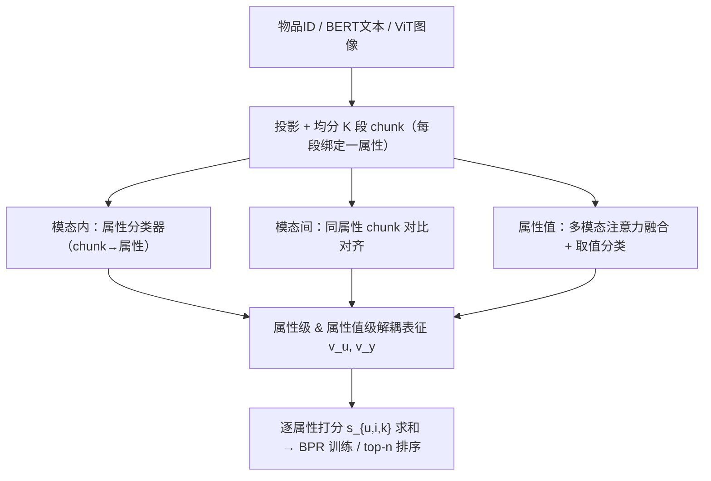
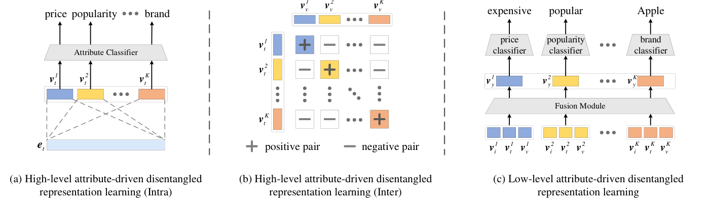

# Attribute-driven Disentangled Representation Learning for Multimodal Recommendation (属性驱动的多模态推荐解耦表征学习)

- **会议/期刊**: ACM Multimedia 2024 (MM '24)
- **作者与机构**: Zhenyang Li (山东大学)、Fan Liu (NUS)、Yinwei Wei (Monash)、Zhiyong Cheng (合肥工业大学)、Liqiang Nie (哈工大深圳)、Mohan Kankanhalli (NUS)
- **推荐链路定位**: 召回（多模态表征学习 + 打分）
- **研究方向**: 多模态推荐 / 自监督与解耦表征
- **论文原文**: [https://arxiv.org/abs/2312.14433v2](https://arxiv.org/abs/2312.14433v2)
- **开源代码**: [https://github.com/SDLZY/AD-DRL](https://github.com/SDLZY/AD-DRL)

## TL;DR (1分钟核心速览)

现有解耦推荐以**无监督**方式把用户/物品拆成若干隐因子，因子语义不明，既无法解释"为何推荐"，也无法按属性调控推荐结果。AD-DRL 把物品的 price、popularity、brand、category 四个属性显式绑定到表征的每一段 chunk 上，用「模态内属性分类 + 模态间同属性对比 + 属性值级多模态注意力分类」三级监督，实现**属性级**与**属性值级**双重解耦。在 Amazon Baby / Toys / Sports 上按每用户 8:2 随机划分、以 Recall@20 / NDCG@20 评估，相比最强基线 DMRL/BM3 取得 4.81%–8.01% 的稳定相对提升，并额外给出可解释性与可控性实验。

## Background & Motivation (背景与核心矛盾)

- **主流范式**: 多模态 CF（MMGCN、GRCN、MAML、DMRL、BM3）用 GCN 或注意力融合评论/图像特征补足交互稀疏；解耦路线（MacridVAE、DGCF、DRML、KDR）则把用户/物品拆成 $K$ 个隐因子以提升鲁棒性。
- **前人局限一**: 隐因子完全由无监督信号（重构、对比、图意图分布）驱动，一个因子可能同时混有 brand 与 price，另一因子混有 style 与 popularity，**因子与语义属性无对应关系**。
- **前人局限二**: 语义缺失直接导致**不可控**——用户若想"只看款式不看价格"，模型没有任何可操作的旋钮；KDR 虽用知识图谱约束语义，但仍是图结构间接约束，非属性级直接监督。
- **核心洞察 (Key Insight)**: 属性天然存在于多模态内容中（文本提及品牌与价格、图像反映类别与外观、交互统计反映流行度），因此**属性本身就是最好的解耦监督标签**，可把"隐因子"升级为"属性子空间"。
- **本文切入点**: 为每个 chunk 指定唯一属性，先用属性标签把 chunk 与属性对齐（属性级），再用属性取值把 chunk 内部结构拉开（属性值级）。

## Method (核心方法设计)

### 1. 整体框架 (Overall Architecture)

物品 ID、BERT 文本、ViT 图像三路特征先经线性投影到同一 $d$维空间，并被均分为$K$段 chunk，第$k$段绑定第$k$个属性。三条监督支路并行：(a) **模态内**用属性分类器迫使每段 chunk 只预测自己的属性（含用户 ID、物品 ID、文本、图像四路）；(b) **模态间**用同属性 chunk 互为正样本的对比损失，把 ID/文本/图像的同名属性拉齐、异名属性推开；(c) **属性值级**先用属性感知的多模态注意力把三路 chunk 融合为$\boldsymbol{v}^{k}_{y}$，再用分类器预测该属性的具体取值（如价格 5 档）。最终用户偏好按属性逐项打分再求和，用 BPR 优化，推理时对全库物品按$s_{u,i}$排序取 top-$n$。

<figure class="paper-figure" markdown="span">
  <figcaption>图1：我们提出的 AD-DRL 的高级与低级属性驱动解耦表示学习模块。为解耦多模态特征中的属性因素，(a) 模态内解耦模块利用同一模态特征内属性因素（例如价格、品牌、类别和流行度）之间的差异，(b) 模态间解耦模块利用不同模态特征中同一属性因素的一致性，(c) 低级解耦表示学习模块利用共享 t 的物品之间的内在关系</figcaption>
</figure>

### 2. 关键设计拆解 (Key Designs)

1. **模态内属性分类（Intra-modality Disentanglement）**：痛点是无监督解耦下 chunk 语义混杂。做法是对第 $k$段文本 chunk 接一个$K$类分类器，用属性标签做交叉熵：$l^{k}_{\text{intra},t}=-\sum_{n=1}^{K}\tilde{z}^{k}_{n}\log\frac{\exp z^{k}_{n}}{\sum_{m}\exp z^{k}_{m}}$，其中$\boldsymbol{z}^{k}=\boldsymbol{W}_{\text{intra},t}\boldsymbol{v}^{k}_{t}+\boldsymbol{b}_{\text{intra},t}$。直觉：梯度只允许该 chunk 编码"能区分本属性"的信息，其余属性信息被迫挤到别的 chunk，从而 chunk↔属性一一对应。

2. **模态间同属性对比（Inter-modality Disentanglement）**：单模态内解耦无法保证"品牌在图像与文本中指同一件事"。作者构造跨模态 InfoNCE，以同属性 chunk 对 $(\boldsymbol{v}^{k}_{t},\boldsymbol{v}^{k}_{v})$为正、异属性 chunk 对为负：$l^{k}_{t\to v}=-\log\frac{\exp(\boldsymbol{v}^{k}_{t}\cdot\boldsymbol{v}^{k}_{v}/\tau)}{\sum_{n=1}^{K}\exp(\boldsymbol{v}^{k}_{t}\cdot\boldsymbol{v}^{n}_{v}/\tau)}$，并在$(i,t),(i,v),(t,v)$三对上对称求和得$l_{\text{inter}}$。直觉：负样本仅来自"同模态其他属性"，迫使各属性子空间在跨模态语义上互相排斥又对齐。

3. **属性值级解耦与训练目标**：属性级只保证"这一段是价格"，还需保证"这一段是 94 美元而非 28 美元"。先按属性做多模态注意力 $\boldsymbol{a}^{k}=\mathrm{softmax}(\boldsymbol{W}_{a2}\tanh(\boldsymbol{W}_{a1}(\boldsymbol{v}^{k}_{i}+\boldsymbol{v}^{k}_{t}+\boldsymbol{v}^{k}_{v})+\boldsymbol{b}_{a}))$，融合得$\boldsymbol{v}^{k}_{y}=a^{k}_{i}\boldsymbol{v}^{k}_{i}+a^{k}_{t}\boldsymbol{v}^{k}_{t}+a^{k}_{v}\boldsymbol{v}^{k}_{v}$，再用分类器预测离散属性值$\tilde{y}^{k}$。最终偏好为属性分之和$s_{u,i}=\sum_{k}\mathrm{softplus}(\boldsymbol{v}^{k}_{u}\cdot\boldsymbol{v}^{k}_{y})$，总损失$\mathcal{L}=\mathcal{L}_{\text{BPR}}+\alpha\,l_{\text{intra}}+\beta\,l_{\text{inter}}+\gamma\,l_{\text{low}}$；训练用 BPR 随机负采样（负样本数在$\{2,4,8\}$ 中搜索），三路解耦损失是分类/对比辅助任务，**推理时不额外开销**，仅需一次内积求和。

## Experimental Setup & Evaluation Protocol (实验设置与评估协议)

- **数据集与预处理**: 取自 Amazon Review 的 Baby / Toys / Sports 三个类目，沿用 DRML 的 **5-core** 过滤（物品与用户均至少 5 条交互）；属性含 price（5 档）、popularity（按购买次数离散为 5 档）、brand、category。

| 数据集 | #Users | #Items | #Interactions | 稀疏度 | 属性取值数（price/pop/brand/category） |
| :--- | :---: | :---: | :---: | :---: | :--- |
| Baby | 12,637 | 18,646 | 121,651 | 99.95% | 5 / 5 / 663 / 1 |
| Toys Games | 18,748 | 30,420 | 161,653 | 99.97% | 5 / 5 / 1,288 / 19 |
| Sports | 21,400 | 36,224 | 209,944 | 99.97% | 5 / 5 / 2,081 / 18 |

- **数据划分与防穿越**: 每用户交互 **随机 8:2 划分**（训练/测试），再从训练集随机取 10% 作验证集调参；**非全局时间戳切分，存在轻度未来信息泄漏**风险。
- **排名评测协议**: 论文仅声明 top-$n$推荐、$n=20$，指标 Recall@20、NDCG@20；未显式交代候选集构造，从同源代码与基线惯例看应为**全库未交互物品排序**，但对比表未给出采样正负比，建议复现时显式声明为 Full-Ranking。
- **对比基线与超参**: 纯 CF 基线 NeuMF、NGCF、DGCF，多模态基线 JRL、MMGCN、MAML、GRCN、DMRL、BM3，外加去掉多模态的自身变体 AD-DRL$_{ID}$；每因子维度$d=32$，Adam，lr=1e-4，batch=1024，$\alpha,\beta,\gamma$与$L_2$系数网格搜索，Recall@20 早停（50 epoch），显著性检验为双尾配对 t 检验$p<0.05$。

## Key Experimental Results (实验关键数据)

### 1. 主实验对比 (Main Results)

| 模型 | Baby R@20 | Baby N@20 | Toys R@20 | Toys N@20 | Sports R@20 | Sports N@20 |
| :--- | :---: | :---: | :---: | :---: | :---: | :---: |
| NeuMF | 0.0502 | 0.0224 | 0.0253 | 0.0128 | 0.0330 | 0.0157 |
| NGCF | 0.0694 | 0.0313 | 0.0970 | 0.0587 | 0.0707 | 0.0337 |
| DGCF | 0.0788 | 0.0465 | 0.1262 | 0.1085 | 0.1026 | 0.0629 |
| AD-DRL$_{ID}$ | 0.0852 | 0.0529 | 0.1517 | 0.1429 | 0.1120 | 0.0722 |
| MMGCN | 0.0814 | 0.0496 | 0.1171 | 0.1065 | 0.0913 | 0.0572 |
| GRCN | 0.0883 | 0.0541 | 0.1336 | 0.1236 | 0.1065 | 0.0693 |
| DMRL | 0.0906 | 0.0561 | 0.1434 | 0.1331 | 0.1111 | 0.0711 |
| BM3 | 0.0911 | 0.0424 | 0.1147 | 0.0683 | 0.1121 | 0.0536 |
| **AD-DRL** | **0.0968\*** | **0.0588\*** | **0.1524\*** | **0.1435\*** | **0.1200\*** | **0.0756\*** |
| **Improv.%** | **6.84%** | **4.81%** | **6.28%** | **7.81%** | **8.01%** | **6.33%** |

### 2. 消融实验 (Ablation Study)

| 变体 | Baby R/N@20 | Toys R/N@20 | Sports R/N@20 |
| :--- | :---: | :---: | :---: |
| w/o disentangling | 0.0888 / 0.0550 | 0.1452 / 0.1375 | 0.1152 / 0.0741 |
| w/o intra | 0.0925 / 0.0567 | 0.1492 / 0.1397 | 0.1164 / 0.0750 |
| w/o inter | 0.0959 / 0.0585 | **0.1517 / 0.1429** | 0.1196 / 0.0754 |
| w/o high（属性级） | 0.0903 / 0.0564 | 0.1492 / 0.1391 | 0.1160 / 0.0748 |
| w/o low（属性值级） | 0.0916 / 0.0553 | 0.1492 / 0.1394 | 0.1177 / 0.0755 |
| **AD-DRL** | **0.0968 / 0.0588** | **0.1524 / 0.1435** | **0.1200 / 0.0756** |

### 3. 关键实验发现 (Key Findings)

1. **属性监督本身即强增益，与多模态无关**：仅用 ID 的 AD-DRL$_{ID}$ 已在 Baby 上把 DGCF 从 0.0788 拉到 0.0852（+8.1%）、Toys 从 0.1262 拉到 0.1517（+20.2%），说明收益主要来自"属性级 chunk 分配 + 属性值分类"的监督结构，而非额外的图像/文本特征。
2. **属性级 (high) 比属性值级 (low) 更关键，模态内比模态间更关键**：去掉 high 使 Baby 掉 6.7%（0.0968→0.0903），是各类变体中最大跌幅；在 high 内部，去 intra 掉 4.4%、去 inter 仅掉 0.9%，验证"模态内分类是解耦地基、模态间对比是锦上添花"的论断。
3. **可控性可量化**：固定 100 名偏好低价商品的用户，将价格项权重 $\xi$从 2 降到$-1$（$s'_{u,i}=\xi\cdot s_{u,i,a}+\sum_{k\neq a}s_{u,i,k}$），低价商品推荐占比从 66% 单调降至 0%，且$\xi=0$ 时仍偏向低价——作者归因为 brand chunk 与 price 存在相关性残留，这既是可控性证据也暴露了属性非完全独立。

## Highlights & Limitations (亮点、对比与审稿批判)

- **与代表作对比**: vs. **DGCF/DRML** —— 二者因子仍是纯隐变量，AD-DRL 的每段 chunk 有明确属性标签，可直接输出"该用户因价格/品牌而点击"；vs. **KDR** —— KDR 用知识图谱间接约束语义，本文用物品自身属性标签直接监督，且额外做到属性**值**级别；vs. **BM3/GRCN** —— 它们关注模态融合与假阳性边修剪，不涉及表征语义可分解性。
- **可迁移亮点**: (1) "把离散业务属性绑定到固定维度 chunk + 逐 chunk 分类"是极低成本的可解释性插件，可移植到短视频类目/价格带、电商 brand 场景；(2) 用 $\xi$ 缩放某一属性打分的**推理期可控性协议**，可直接作为推荐系统"用户偏好调节面板"的评测范式。
- **审稿级局限批判**: (1) **评估协议披露不足**——未说明是 Full-Ranking 还是采样排序，且 8:2 随机划分（非时间切分）在序列/时序敏感的 Amazon 数据上偏乐观；(2) **属性独立性假设过强**——price 与 brand 天然相关，实验中 $\xi=0$ 仍残留价格偏好即为其反证，论文未做属性去相关处理；(3) **实验可信度疑点**——Toys 上去掉 inter 的结果（0.1517/0.1429）与完整模型完全一致，疑似表格复制错误，且属性值分类器在 brand 有 2,081 类的 Sports 上是否退化为噪声未分析；(4) 依赖人工离散化属性档位（价格 5 档），档位粒度敏感性缺失。

## Rating (四维评分)

- **方法创新性 (Novelty)**: ⭐⭐⭐⭐ （把无监督隐因子解耦升级为属性/属性值双粒度有监督解耦，"属性即 chunk 标签"的思路简洁且解释力强，但对比/分类组件本身均为常规算子组合）
- **评估协议与实验扎实度 (Protocol & Experiments)**: ⭐⭐⭐ （三数据集 + 9 基线 + 完整消融 + 显著性检验齐备，但划分方式非时序、排序候选集协议未声明、Toys 消融数值疑似异常，扣分明显）
- **写作与数学规范度 (Clarity & Rigor)**: ⭐⭐⭐⭐ （三支路损失与打分公式定义清晰、符号统一，$\alpha/\beta/\gamma$作用明确；但对属性间相关性、属性数量$K$ 的选择缺乏理论讨论）
- **工业落地与复现价值 (Industrial & Practical Value)**: ⭐⭐⭐⭐ （代码开源、推理无额外开销、可控性旋钮对业务方极具吸引力；主要成本在于需维护高质量属性元数据与多档位离散化策略，冷启动物品属性缺失时如何退化未讨论）

