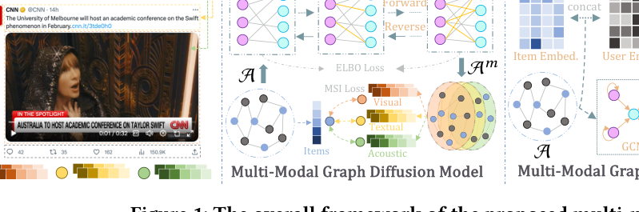
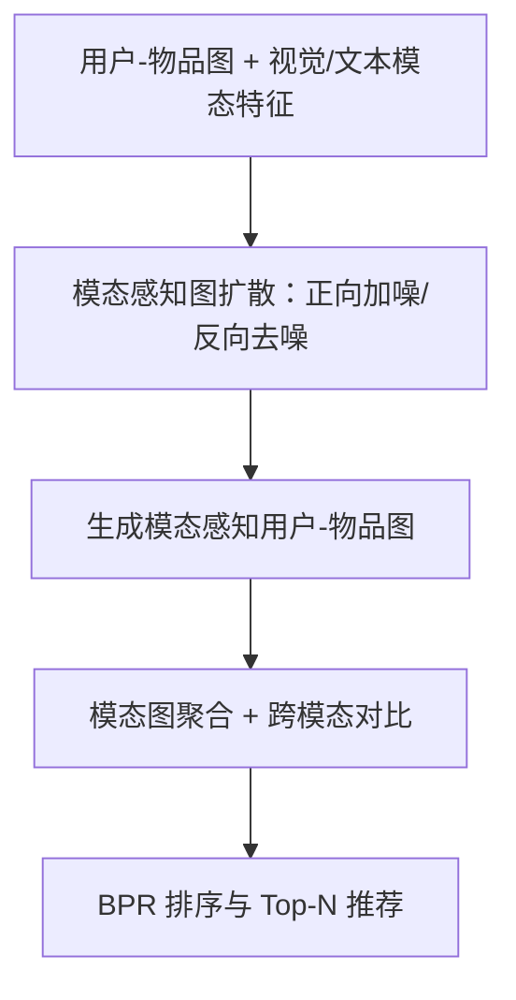

# DiffMM: Multi-Modal Diffusion Model for Recommendation (面向推荐的多模态图扩散模型)

- **会议/期刊**: ACM MM 2024
- **作者与机构**: Yangqin Jiang, Lianghao Xia, Wei Wei, Da Luo, Kangyi Lin, Chao Huang；香港大学、腾讯微信
- **推荐链路定位**: 召回/排序（Top-N 推荐）
- **研究方向**: 多模态推荐 / 自监督与去噪
- **论文原文**: [论文原文链接](https://arxiv.org/abs/2406.11781v1)
- **开源代码**: [开源代码仓库链接](https://github.com/HKUDS/DiffMM)

## TL;DR (1分钟核心速览)

针对多模态推荐中交互稀疏、随机增强易引入噪声且模态与协同信号错配的问题，DiffMM 用模态感知图扩散在正向加噪/反向去噪中生成用户-物品图，再以跨模态对比对齐不同模态视图。三份 Amazon 5-core 数据按 8:1:1 划分、全库排序，Recall@20/NDCG@20 相对最强基线 MMSSL 提升约 3.3%–5.2%。

## Background & Motivation (背景与核心矛盾)

- **主流范式**: 多模态推荐通常用 GNN 在用户-物品图上聚合视觉/文本特征；为缓解稀疏，SGL/MMGCL 等引入随机 dropout、特征扰动或跨视图对比。
- **前人局限**: 随机增强可能破坏协同结构并注入误点击/流行度噪声；直观跨视图对齐忽略“模态语义是否真正对应协同关系”，导致模态信息与交互建模脱节。
- **核心洞察 (Key Insight)**: 扩散模型的反向去噪可把噪声模态信号逐步投影回协同结构，生成“模态感知”的用户-物品图；同一用户在不同模态图下的一致性可作为高质量自监督。
- **本文切入点**: 用条件图扩散替代随机增强，生成模态感知交互图，再用跨模态对比把模态表示与协同关系对齐。

## Method (核心方法设计)

### 1. 整体框架 (Overall Architecture)

DiffMM 以用户-物品交互图和物品多模态特征为输入。对每个模态 $m$，先对交互矩阵做$T$ 步正向高斯加噪，再在模态信号注入条件下反向去噪，得到模态感知用户-物品图；随后在生成图上做 LightGCN 式传播，得到模态特定用户/物品表示；最后用跨模态对比约束同一用户在不同模态视图下的一致性，并以 BPR 完成 Top-N 排序训练。扩散图可离线生成，在线仅做表示查表与内积打分。

<figure class="paper-figure" markdown="span">
  <figcaption>图1：所提出的多模态扩散模型（DiffMM）的整体框架。</figcaption>
</figure>

### 2. 关键设计拆解 (Key Designs)

1. **模态感知图扩散 (MGD)**：随机增强的痛点是被动扰动、噪声不可控；DiffMM 改为主动生成。正向过程 $q(\mathbf{a}_u^t|\mathbf{a}_u^{t-1})=\mathcal{N}(\mathbf{a}_u^t;\sqrt{1-\beta_t}\mathbf{a}_u^{t-1},\beta_t\mathbf{I})$，反向网络在模态条件$\mathbf{c}_u^m$下预测$\hat{\mathbf{a}}_u^0$，以$\mathcal{L}_{ELBO}=\mathbb{E}_{t,\epsilon}[\|\mathbf{a}_u^0-\hat{\mathbf{a}}_u^0(\mathbf{a}_u^t,t,\mathbf{c}_u^m)\|_2^2]$ 去噪。直觉是让扩散过程学习“哪些交互在给定模态下应被保留”，从而过滤无关模态噪声。

2. **模态信号注入与模态图聚合**：条件向量由用户交互物品的模态特征聚合，$\mathbf{c}_u^m=\frac{1}{\sqrt{|\mathcal{N}_u|}}\sum_{i\in\mathcal{N}_u}\mathbf{f}_i^m$，把视觉/文本语义注入去噪器。生成图$\tilde{\mathcal{N}}_u^m$上传播：$\mathbf{e}_u^{m,(l+1)}=\sum_{i\in\tilde{\mathcal{N}}_u^m}\frac{1}{\sqrt{|\tilde{\mathcal{N}}_u^m||\tilde{\mathcal{N}}_i^m|}}\mathbf{e}_i^{m,(l)}$。这样不同模态获得独立图结构，避免静态融合把无关模态强灌入协同表示。

3. **跨模态对比与训练目标**：对同一用户不同模态表示拉近、不同用户推远：$\mathcal{L}_{CL}=-\sum_u\log\frac{\exp(\mathrm{sim}(\mathbf{e}_u^m,\mathbf{e}_u^{m'})/\tau)}{\sum_v\exp(\mathrm{sim}(\mathbf{e}_u^m,\mathbf{e}_v^{m'})/\tau)}$。总损失$\mathcal{L}=\mathcal{L}_{BPR}+\lambda_1\mathcal{L}_{ELBO}+\lambda_2\mathcal{L}_{CL}$。BPR 每正样本配 1 个均匀负样本，对比学习用 batch 内负样本；扩散训练采样$t$与$\epsilon$，推理阶段扩散图离线预计算，在线开销与 LightGCN 同阶。

## Experimental Setup & Evaluation Protocol (实验设置与评估协议)

- **数据集与预处理**: 三份 Amazon 5-core 数据，物品含图像与文本模态。

| 数据集 | #Users | #Items | #Interactions | 稀疏度/密度 | 特征/场景说明 |
| :--- | :---: | :---: | :---: | :---: | :--- |
| Baby | 19,445 | 7,050 | 160,792 | 0.117% | 母婴商品，图文 |
| Sports | 35,598 | 18,357 | 296,337 | 0.045% | 运动户外，图文 |
| Clothing | 39,387 | 23,033 | 278,675 | 0.031% | 服装鞋履，图文 |

- **数据划分与防穿越 (Splitting Strategy)**: 每用户交互按 8:1:1 随机划分为训练/验证/测试，验证集调参，测试集全库排序；不使用未来交互。
- **排名评测协议 (Ranking Protocol)**: 无偏 `Full-Ranking`，对全部未交互物品排序，报告 Recall@20 与 NDCG@20；非采样排序。
- **对比基线与超参设置**: 覆盖 VBPR、MMGCN、LATTICE、SLMRec、MMGCL、MMSSL 等；嵌入维度 $d=64$，Adam 优化，报告 5 次均值，显著性$p<0.05$。

## Key Experimental Results (实验关键数据)

### 1. 主实验对比 (Main Results)

| 数据集/指标 | VBPR | MMGCN | LATTICE | SLMRec | MMGCL | MMSSL | DiffMM | Improv. |
| :--- | :---: | :---: | :---: | :---: | :---: | :---: | :---: | :---: |
| Baby R@20 | 0.0517 | 0.0577 | 0.0655 | 0.0641 | 0.0647 | 0.0698 | **0.0725** | +3.9% |
| Baby N@20 | 0.0276 | 0.0319 | 0.0369 | 0.0359 | 0.0362 | 0.0389 | **0.0402** | +3.3% |
| Sports R@20 | 0.0678 | 0.0747 | 0.0870 | 0.0853 | 0.0853 | 0.0909 | **0.0946** | +4.1% |
| Sports N@20 | 0.0352 | 0.0392 | 0.0458 | 0.0446 | 0.0445 | 0.0479 | **0.0499** | +4.2% |
| Clothing R@20 | 0.0556 | 0.0626 | 0.0736 | 0.0717 | 0.0720 | 0.0764 | **0.0803** | +5.1% |
| Clothing N@20 | 0.0293 | 0.0338 | 0.0409 | 0.0399 | 0.0401 | 0.0426 | **0.0448** | +5.2% |

### 2. 消融实验 (Ablation Study)

| 变体 | Baby R/N@20 | Sports R/N@20 | Clothing R/N@20 |
| :--- | :---: | :---: | :---: |
| DiffMM | **0.0725/0.0402** | **0.0946/0.0499** | **0.0803/0.0448** |
| w/o MGD | 0.0701/0.0391 | 0.0918/0.0485 | 0.0775/0.0432 |
| w/o MSI | 0.0709/0.0394 | 0.0924/0.0487 | 0.0782/0.0435 |
| w/o CL | 0.0706/0.0393 | 0.0921/0.0486 | 0.0779/0.0434 |

### 3. 关键实验发现 (Key Findings)

- 去掉 MGD 后 Baby/Sports/Clothing 的 R@20 分别下降约 3.3%/3.0%/3.5%，降幅大于去掉 CL 的约 2.6%/2.6%/3.0%，说明“生成模态感知图”是主要增益来源。
- 去掉 MSI 后三数据集 R@20 下降约 2.2%/2.3%/2.6%，证明模态条件注入不是装饰项，而是把视觉/文本语义写入去噪图的关键。
- Clothing 密度仅 0.031%，DiffMM 相对 MMSSL 的 R@20 提升 5.1%，高于 Baby 的 3.9%，说明跨模态对比与扩散去噪在更稀疏场景下更能缓解协同信号不足。

## Highlights & Limitations (亮点、对比与审稿批判)

- **与代表作对比 (vs. Prior Work)**: 相比 MMGCL/MMSSL 的随机扰动/跨视图增强，DiffMM 用条件图扩散“生成”增强图，噪声更可控；相比 LATTICE 的静态模态融合，它让不同模态拥有独立交互图，并用对比损失对齐协同关系。
- **可迁移亮点**: 模态条件图扩散可迁移到短视频多模态召回；跨模态 batch 内对比可直接用于图文电商的模态对齐预训练。
- **审稿级局限批判**: 扩散需 $T$步去噪，训练与图生成开销高于轻量 GCN；实验仅限 Amazon 离线全库排序，缺少线上 A/B 与延迟/吞吐报告；$\lambda_1,\lambda_2,T$ 的敏感度仍需更充分分析。

## Rating (四维评分)

- **方法创新性 (Novelty)**: ⭐⭐⭐⭐ （用扩散生成模态感知交互图替代随机增强，思路新，但扩散理论本身无突破）
- **评估协议与实验扎实度 (Protocol & Experiments)**: ⭐⭐⭐⭐ （三份 5-core 数据、全库排序、6 个强基线加消融，但缺线上验证）
- **写作与数学规范度 (Clarity & Rigor)**: ⭐⭐⭐⭐ （扩散、聚合、对比三条链路公式清晰，符号稍多但可读）
- **工业落地与复现价值 (Industrial & Practical Value)**: ⭐⭐⭐ （代码开源、在线打分便宜，但扩散图生成增加离线训练成本）

