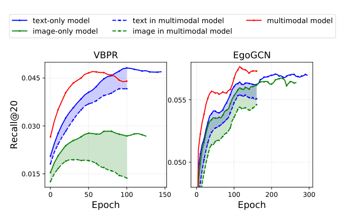
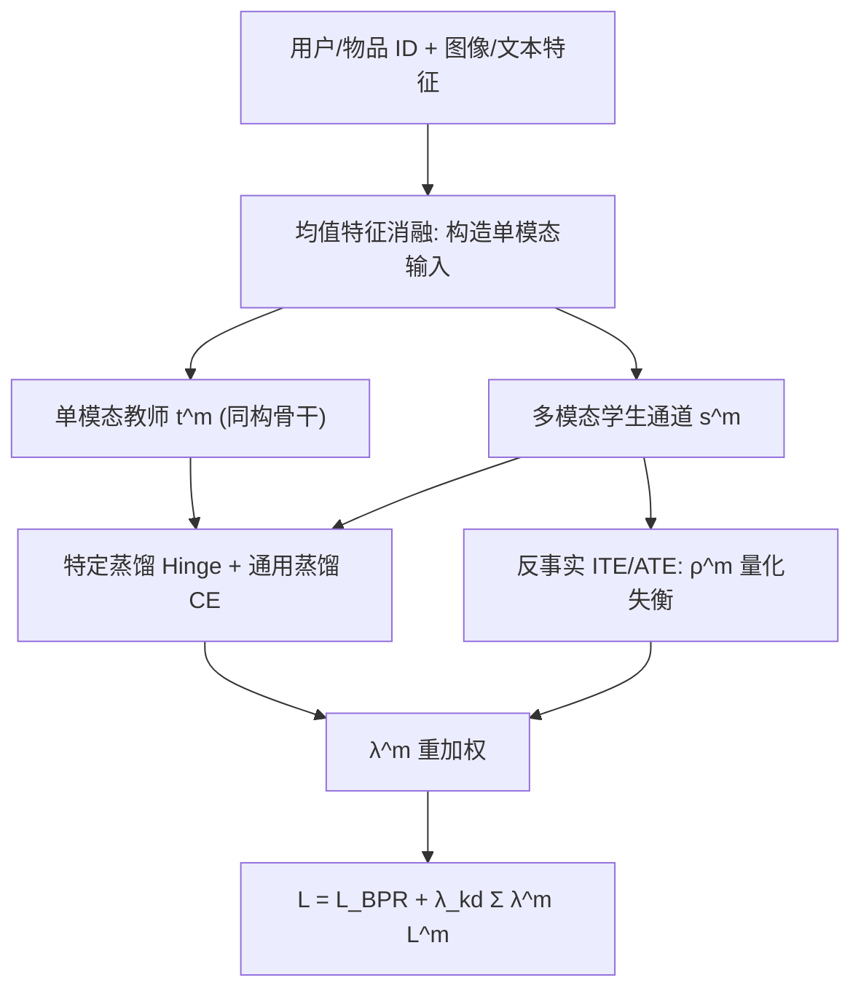
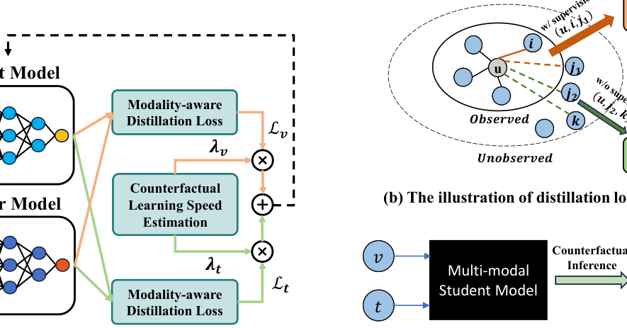

# Modality-Balanced Learning for Multimedia Recommendation (面向多媒体推荐的多模态均衡学习)

- **会议/期刊**: ACM Multimedia 2024 (Oral)
- **作者与机构**: Jinghao Zhang, Guofan Liu, Qiang Liu, Shu Wu, Liang Wang（中科院自动化所 NLPR/MAIS、国科大人工智能学院）
- **推荐链路定位**: 精排（多模态特征融合打分，全库排序）
- **研究方向**: 多模态推荐 / 去偏与可信（模态级优化失衡）
- **论文原文**: [https://arxiv.org/abs/2408.06360v1](https://arxiv.org/abs/2408.06360v1)
- **开源代码**: [https://github.com/CRIPAC-DIG/Balanced-Multimodal-Rec](https://github.com/CRIPAC-DIG/Balanced-Multimodal-Rec)

## TL;DR (1分钟核心速览)

多模态推荐中，各模态信息量高度不平衡（电商文本远比图像"好学"），联合优化同一 BPR 目标会让快收敛模态压制慢模态梯度，最终**所有模态都欠优化**（图 1 预研显示：多模态模型内的视觉/文本通道性能竟然低于各自的单模态模型，甚至出现 $1+1<2$）。本文提出反事实知识蒸馏 CKD：以同构单模态模型为教师、按模态通道做"通用+特定"双层蒸馏，并用反事实推断估计每个模态对训练目标的因果效应，动态重加权弱模态蒸馏损失。作为模型无关插件接入 6 个骨干（VBPR/DeepStyle/MMGCN/GRCN/EgoGCN/MGCN）与 4 个 Amazon 5-core 数据集，Recall@20 相对骨干提升 5.9%–45.6%（Baby/Sports/Clothing/Beauty 平均 +18.6%/+20.1%/+20.9%/+15.7%）。

## Background & Motivation (背景与核心矛盾)

- **主流范式**: 晚期融合（VBPR、DeepStyle、MMGCN、GRCN：各模态独立建模后求和/拼接）与早期融合（EgoGCN、MGCN：边级调制、细粒度跨模态交互）。
- **前人局限**: ① 多模态联合训练时，强模态收敛快、弱模态被压制，二者共享同一 BPR 目标导致梯度相互掣肘；② 现有均衡方案 GB（按过拟合/泛化比调损失）、OGM（在线梯度调制）**必须显式区分模态参数**，只能用在晚期融合，无法处理早期融合的纠缠参数。

**核心洞察 (Key Insight)**: 从梯度层面可证明"桥梁效应"——融合模型可写为 $\hat{y}_{ui}=\boldsymbol{x}_u^{\top}\boldsymbol{x}_i+\sum_m S^m_{uij}$，则对任意两模态

$$\frac{\partial\mathcal{L}_{uij}}{\partial S^{m_1}_{uij}}=\frac{\partial\mathcal{L}_{uij}}{\partial S^{m_2}_{uij}}=\sigma(-\Delta_{uij}),\quad \Delta_{uij}=\hat{y}_{ui}-\hat{y}_{uj}$$

即所有模态共享同一梯度缩放因子；强模态把 $\Delta_{uij}$ 推大 → 分母变大 → 其他模态更新步长自动变小。

- **本文切入点**: 视骨干为黑盒，只在输入/输出端做单模态消融与蒸馏，用因果效应量化失衡程度并重加权，从而兼容任意融合范式。

<figure class="paper-figure" markdown="span">
  <figcaption>图1：在 Amazon-Clothing 上对不同模型变体进行的初步研究。阴影区域表示各模态的欠优化程度（建议彩色查看）。采用早停后，训练在不同步数终止，导致曲线长度不同。</figcaption>
</figure>

## Method (核心方法设计)

### 1. 整体框架 (Overall Architecture)

CKD 分三层闭环：**(a) 教师构造**——用与骨干完全相同的架构训练单模态教师，训练某模态时把其余模态输入替换为均值特征（$\bar{\boldsymbol{p}}^m=\frac{1}{|\mathcal{U}|}\sum_u \boldsymbol{p}^m_u$、$\bar{\boldsymbol{e}}^m$同理），保持分布内但抹去信息，避免引入更强模型造成不公平比较；**(b) 学生蒸馏**——多模态骨干同样做输入消融得到"模态通道"预测$\hat{s}^m_{ui}$，与教师$\hat{t}^m_{ui}$做特定/通用双蒸馏；**(c) 反事实重加权**——每批次估计各模态的因果贡献$\rho^m$并转为蒸馏权重$\lambda^m$，最后与 BPR 联合优化。全流程仅触碰骨干输入输出，故对早期/晚期融合均可插拔。

<figure class="paper-figure" markdown="span">
  <figcaption>图2：CKD 模型架构示意图。</figcaption>
</figure>

### 2. 关键设计拆解 (Key Designs)

1. **特定蒸馏损失（Hinge，鼓励"超越教师"而非"模仿教师"）**：KL/MSE 只让学生复刻教师，但多模态本应因跨模态互补而优于单模态。故在**成对排序差值**上做单边 Hinge：

$$\mathcal{L}^m_{SD}=\sum_{(u,i,j)\in\mathcal{D}}\max\left(\Delta t^m_{uij}-\Delta s^m_{uij},\,0\right)$$

只有当学生排序差已超过教师时才停止惩罚，天然把"融合增益"写进优化目标；比较 pair-wise 差值而非点式分数，也更贴合 BPR 的相对偏好语义。

2. **通用蒸馏损失（暗知识，温度化 CE）**：训练三元组只覆盖有监督信号，泛化知识藏在"随机物品对"里。采样 $(u,j,k)$（$j,k$均非$u$交互过）无可信正负标签，故改用带温度$\tau$ 的对称 CE 对齐：

$$\mathcal{L}^m_{GD}=-\sum_{(u,j,k)}\left[\bar{\Delta}t^m_{ujk}\log\bar{\Delta}s^m_{ujk}+(1-\bar{\Delta}t^m_{ujk})\log(1-\bar{\Delta}s^m_{ujk})\right],\ \bar{\Delta}=\sigma(\Delta/\tau)$$

实现"更宽（更多三元组）+ 更深（软标签分布）"的知识迁移，$\mathcal{L}^m=\lambda_g\mathcal{L}^m_{GD}+\mathcal{L}^m_{SD}$。

3. **反事实学习速度估计与自适应重加权**：直接比较各模态 ATE 不公平（各模态能力上界不同）。故定义处理 $T$ 为该模态是否入模、结果为排序差值：

$$\delta^m(u,i,j)=\Delta s_{uij}-\Delta s^{\bar{m}}_{uij},\quad \gamma^m=\mathbb{E}_{\mathcal{B}}[\delta^m],\quad \rho^m=\frac{\gamma^m}{\mathbb{E}_{\mathcal{B}}[t^m]}$$

$\rho^m$用**单模态教师性能做归一化**得到"相对欠优化度"；越低说明该模态越被压制，权重$\lambda^{m_1}=(1-\rho^{m_1})/\sum_{m}\rho^m$，总目标$\mathcal{L}=\mathcal{L}_{BPR}+\lambda_{kd}\sum_m\lambda^m\mathcal{L}^m$。

4. **训练与开销**：负采样为标准均匀采样（BPR 未交互物品）；教师离线一次性训练可缓存，在线仅需骨干前向 + 反事实需额外一次"均值消融"前向（约 2× 训练成本，推理零额外开销）；$\tau=0.1$，$d=64$。

## Experimental Setup & Evaluation Protocol (实验设置与评估协议)

- **数据集与预处理**（Amazon 5-core，每用户/物品至少 5 次交互；视觉 4096 维、文本 1024 维 sentence-transformers 句向量）：

| 数据集 | #Users | #Items | #Interactions | 过滤 | 说明 |
| :--- | :---: | :---: | :---: | :---: | :--- |
| Baby | 原文未列 | 原文未列 | 原文未列 | 5-core | 图像+文本双模态 |
| Sports | 原文未列 | 原文未列 | 原文未列 | 5-core | 图像+文本双模态 |
| Clothing | 原文未列 | 原文未列 | 原文未列 | 5-core | 视觉最弱、文本最强 |
| Beauty | 原文未列 | 原文未列 | 原文未列 | 5-core | 图像+文本双模态 |

- **数据划分与防穿越**: **比例划分**——每用户历史交互按 8:1:1 切为训练/验证/测试（逐用户随机划分，非全局时间戳切分，存在轻度未来信息泄漏风险）。
- **排名评测协议**: Recall@20 / NDCG@20 / Precision@20，测试集全用户平均；沿用该系列基准的**全库未交互物品排序（Full-Ranking）**设定，未做负采样候选裁剪。
- **对比基线与超参**: 6 个骨干（VBPR、DeepStyle、MMGCN、GRCN、EgoGCN、MGCN）+ 两个均衡化 SOTA（GB、OGM）；$d=64$，网格搜索 lr∈{1e-4,…,5e-3}、dropout∈{0,…,0.8}、$\lambda_g$∈{0.1,0.5,1,5}、$\lambda_{kd}$∈{1e-3,…,0.5}，早停（验证 Recall@20 连续 10 轮不升），所有提升$p\le 0.05$ 显著。

## Key Experimental Results (实验关键数据)

### 1. 主实验对比 (Main Results)

Recall@20（括号内为相对该骨干的 `Improv.`，加粗为全局最优）：

| Backbone | Baby | Sports | Clothing | Beauty |
| :--- | :---: | :---: | :---: | :---: |
| VBPR | 0.0462 | 0.0493 | 0.0492 | 0.0977 |
| VBPR + GB | 0.0482 | 0.0564 | 0.0551 | 0.0105* |
| VBPR + OGM | 0.0448 | 0.0513 | 0.0533 | 0.0962 |
| **VBPR + CKD** | **0.0568 (+23.0%)** | **0.0621 (+26.0%)** | **0.0604 (+22.7%)** | **0.1169 (+19.6%)** |
| DeepStyle | 0.0425 | 0.0471 | 0.0450 | 0.0891 |
| **DeepStyle + CKD** | **0.0613 (+44.2%)** | **0.0684 (+45.2%)** | **0.0655 (+45.6%)** | **0.1214 (+36.3%)** |
| MMGCN | 0.0585 | 0.0483 | 0.0272 | 0.0704 |
| **MMGCN + CKD** | **0.0643 (+9.9%)** | **0.0578 (+19.7%)** | **0.0345 (+26.9%)** | 0.0820 (+16.5%) |
| GRCN | 0.0790 | 0.0834 | 0.0637 | 0.1321 |
| **GRCN + CKD** | **0.0866 (+9.7%)** | **0.0922 (+10.5%)** | 0.0667 (+4.8%) | 0.1355 (+2.6%) |
| EgoGCN | 0.0808 | 0.0969 | 0.0597 | 0.1391 |
| EgoGCN + GB | 0.0799 (−1.1%) | 0.0968 | 0.0621 | 0.1390 |
| EgoGCN + OGM | 0.0811 | 0.0971 | 0.0600 | 0.1384 |
| **EgoGCN + CKD** | 0.0856 (+5.9%) | 0.1004 (+3.6%) | 0.0651 (+9.1%) | **0.1440 (+3.5%)** |
| MGCN | 0.0638 | 0.0903 | 0.0745 | 0.1306 |
| **MGCN + CKD** | 0.0710 (+11.3%) | 0.0937 (+3.7%) | 0.0770 (+3.4%) | 0.1349 (+3.3%) |

（*GB 在 VBPR/DeepStyle+Beauty 上出现 0.0105、0.0101 等异常值，属原文数值明显笔误，不宜作为有效对比。）

### 2. 消融实验 (Ablation Study)

Recall@20（VBPR / MMGCN / EgoGCN 三种骨干）：

| 变体 | Baby | Sports | Clothing | Beauty |
| :--- | :---: | :---: | :---: | :---: |
| VBPR + CKD | **0.0568** | **0.0621** | **0.0604** | **0.1169** |
| w/o Gen.（去通用蒸馏） | 0.0549 | 0.0580 | 0.0550 | 0.1084 |
| w/o re-weight（去反事实重加权） | 0.0541 | 0.0594 | 0.0591 | 0.1120 |
| repl. KL-divergence | 0.0475 | 0.0517 | 0.0520 | 0.1059 |
| repl. MSE Loss | 0.0487 | 0.0526 | 0.0592 | 0.1053 |
| MMGCN + CKD | **0.0643** | **0.0578** | **0.0345** | **0.0820** |
| w/o Gen. | 0.0566 | 0.0493 | 0.0297 | 0.0731 |
| w/o re-weight | 0.0605 | 0.0551 | 0.0322 | 0.0783 |
| repl. KL-divergence | 0.0621 | 0.0573 | 0.0330 | 0.0747 |
| repl. MSE Loss | 0.0632 | 0.0564 | 0.0340 | 0.0796 |
| EgoGCN + CKD | **0.0856** | **0.1004** | **0.0651** | **0.1440** |
| w/o Gen. | 0.0836 | 0.0972 | 0.0630 | 0.1422 |
| w/o re-weight | 0.0833 | 0.0981 | 0.0622 | 0.1403 |
| repl. KL-divergence | 0.0841 | 0.0915 | 0.0651 | 0.1362 |
| repl. MSE Loss | 0.0834 | 0.0857 | 0.0633 | 0.1312 |

### 3. 关键实验发现 (Key Findings)

- **通用（暗知识）蒸馏是最大功臣，且骨干越弱收益越大**：MMGCN 上去掉 $\mathcal{L}_{GD}$ 使 Clothing 从 0.0345 跌至 0.0297（−13.9%）、Baby 从 0.0643 跌至 0.0566（−12.0%）；而在已很强的 EgoGCN 上仅 −0.9%～−2.3%。说明随机三元组的软对齐在融合能力不足时提供最多增量信号。
- **Hinge 相对 KL/MSE 的增益远超"重加权"本身**：VBPR-Baby 上换 KL 掉到 0.0475（比完整模型低 16.4%），甚至低于骨干 0.0462 附近；EgoGCN-Sports 换 KL 从 0.1004 掉到 0.0915（−8.9%）。印证"鼓励超越教师"的单边损失比"模仿教师"更契合多模态互补性；反事实重加权则贡献稳定但较小（MMGCN-Clothing 去掉后 −6.7%）。
- **单模态通道被真实"救活"**：以 VBPR+Clothing 为例，文本通道 0.0376→0.0484（+28.7%），视觉通道 0.0202→0.0319（+57.9%），且视觉通道 0.0319 已超过视觉教师 0.0283——弱模态提升幅度约为强模态 2 倍，与 $\rho^m$ 重加权"越是弱模态权重越大"的设计逻辑一致；在 Baby 上 CKD 文本/视觉通道（0.0550/0.0471）也双双超过单模态教师（0.0476/0.0362）。

## Highlights & Limitations (亮点、对比与审稿批判)

- **与代表作对比 (vs. Prior Work)**: GB（过拟合-泛化比重加权）与 OGM（在线梯度调制）都依赖"参数可分"，在早期融合 EgoGCN 上甚至负提升（0.0808→0.0799/0.0811）；CKD 只做输入消融 + 输出蒸馏，参数无关，是首个同时兼容早/晚期融合的均衡框架。与 OGM 相比，本文用**反事实 ATE 归一化**替代梯度范数作为失衡度量，度量更具因果语义。
- **可迁移亮点**: ①"均值特征消融"构造同构单模态教师，几乎零工程成本即可为任意融合骨干生成教师监督；②用**教师性能归一化的相对因果贡献**做损失重加权，可平移到多任务/多场景（如 CTR 多目标）中的目标失衡问题。
- **审稿级局限批判**: ① 训练需三次前向（教师通道消融 + 反事实消融），训练开销约 2×–3×，论文未给出耗时/收敛曲线对比；② 教师与骨干同构，若骨干自身表征能力弱，教师上界同样受限，实验也显示弱骨干上增益虽大但绝对值仍低；③ 逐用户 8:1:1 随机划分存在时间信息泄漏，且未给出数据规模与稀疏度统计，也未做采样排序下的效率对比与线上 A/B。

## Rating (四维评分)

- **方法创新性 (Novelty)**: ⭐⭐⭐⭐ （用梯度共享因子严格解释模态失衡，再以反事实 ITE/ATE 量化并重加权，问题建模与因果视角结合得较为优雅）
- **评估协议与实验扎实度 (Protocol & Experiments)**: ⭐⭐⭐⭐ （4 数据集 × 6 骨干 × 2 个均衡 SOTA + 单模态通道分析 + 消融，$p\le0.05$ 显著；扣分在缺少数据统计、时间切分与效率实验）
- **写作与数学规范度 (Clarity & Rigor)**: ⭐⭐⭐⭐ （从 Eq.5–7 的梯度"桥梁"推导到蒸馏目标链条清晰，公式规范；但 $\lambda^{m_1}=(1-\rho^{m_1})/\sum_m\rho^m$ 未归一化到和为 1，权重尺度含义略含糊）
- **工业落地与复现价值 (Industrial & Practical Value)**: ⭐⭐⭐⭐ （黑盒插拔、代码开源、推理零额外开销；训练期多前向与教师离线训练成本是主要落地约束）

