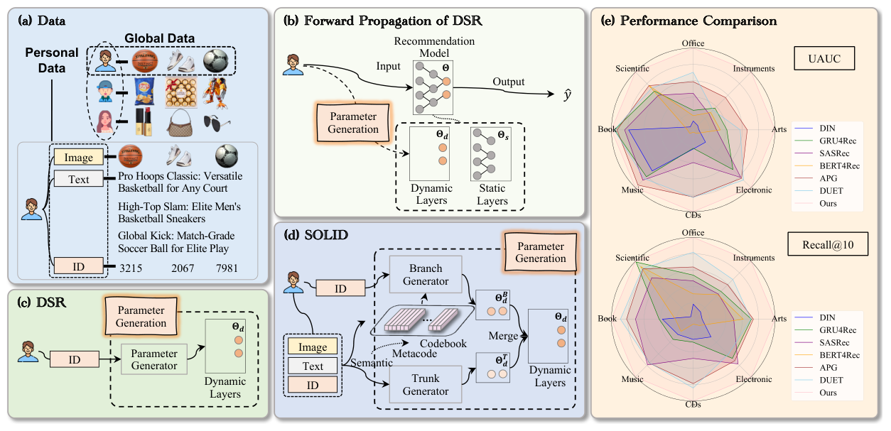
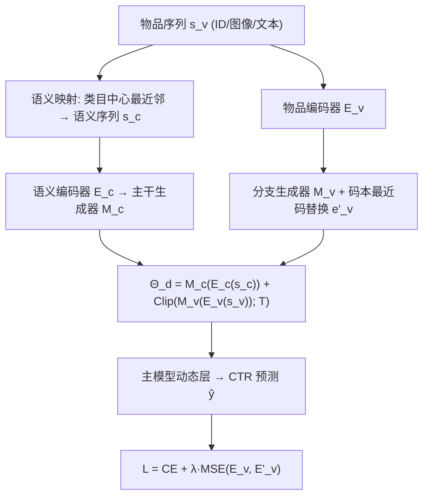
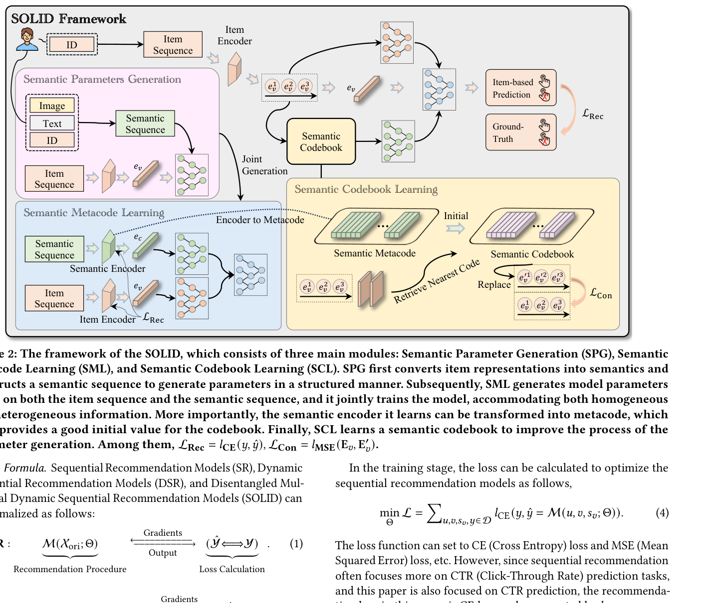

# Semantic Codebook Learning for Dynamic Recommendation Models (面向动态推荐模型的语义码本学习)

- **会议/期刊**: ACM MM 2024 (Proceedings of the 32nd ACM International Conference on Multimedia)
- **作者与机构**: Zheqi Lv, Shaoxuan He, Tianyu Zhan, Shengyu Zhang, Wenqiao Zhang, Jingyuan Chen, Zhou Zhao, Fei Wu（浙江大学 / 浙大上海高等研究院）
- **推荐链路定位**: 精排（CTR 预估）+ 动态参数生成（HyperNetwork 侧）
- **研究方向**: 序列与会话推荐 / 多模态推荐
- **论文原文**: [https://arxiv.org/abs/2408.00123v1](https://arxiv.org/abs/2408.00123v1)
- **开源代码**: 暂未开源

## TL;DR (1分钟核心速览)

动态序列推荐（DSR）用用户行为序列实时生成模型参数，但"物品→参数"的映射面临两个困境：物品基数导致参数搜索空间巨大且对序列顺序扰动敏感；隐式反馈稀疏含噪使物品表征不准，进而使生成的参数失真。本文提出 SOLID：把物品序列先经类目中心最近邻映射为**语义序列**，由语义序列生成"主干"（群体共性）参数，物品序列生成被 `Clip` 约束在小阈值内的"分支"（个体差异）参数，二者相加注入动态层；再用与语义编码器同维的**语义码本**对物品表征做最近码量化并加 MSE 锚定，码本由语义编码器权重（语义元码）初始化。在 8 个 Amazon/Douban 数据集、`Leave-One-Out` + 测试集 1:99 采样排序协议下，AUC/UAUC/NDCG@10 全面优于 APG 与 DUET，Arts 上 NDCG@10 相对提升 10.8%，UAUC 方差中位数下降 26%。

## Background & Motivation (背景与核心矛盾)

- **主流范式**: SR（DIN / GRU4Rec / SASRec / BERT4Rec）以静态参数建模序列；DSR（DUET、APG）把主模型拆为静态层与动态层，用参数生成器按实时行为输出动态层权重。
- **前人局限 1（搜索空间与不稳定性）**: 参数生成器直接以物品 ID 序列为输入，物品数量级直接决定映射空间；"衬衫→领带→西装"与"领带→衬衫→西装"这类偏好几乎相同的序列会映射到差异巨大的参数，生成过程不可控。
- **前人局限 2（稀疏与噪声）**: 隐式反馈下物品表征学习不准且高度异构，个性化参数的精度被表征噪声二次放大；同时生成参数无任何幅值约束，训练稳定性差。
- **核心洞察 (Key Insight)**: 物品在**解耦后的语义空间**中存在强同质性——相似用户的语义序列远比相似物品序列容易命中，因此"语义→参数"可提供稠密、鲁棒的群体级先验；而"物品→参数"只需承担小幅个性化残差。
- **本文切入点**: 把"物品→参数"解耦为"语义主干 + 受约束物品分支"，并用离散语义码本对物品表征做量化去噪，同时以语义元码热启动码本。

<figure class="paper-figure" markdown="span">
  <figcaption>图 1：（a）描述包含图像、文本和 ID 的多模态用户行为数据。（b）描述 DSR 的前向传播，其分为两条路径：第一条路径通过参数生成器处理由 ID 组成的用户行为数据，以生成主模型动态层的参数。第二条路径将相同的基于 ID 的用户行为数据先通过主模型的静态层，再通过动态层，得到预测输出。（c）和（d）比较现有 DSR 与 SOLID 的参数生成模式。（e）</figcaption>
</figure>

## Method (核心方法设计)

### 1. 整体框架 (Overall Architecture)

输入侧同时保留原始物品序列 $s_v$（ID/图像/标题）与由类目映射得到的语义序列$s_c$。SPG 模块先训练"语义→参数"通路，得到语义编码器$E_c$与主干生成器$M_c$；SML 模块让两条通路联合训练，物品分支输出被 `Clip` 到$[-T,T]$后与主干相加作为动态层参数；SCL 模块把$E_c$权重平移为码本初值（语义元码），将物品表征替换为最近码$e'^i_v$ 后走分支通路，并以 MSE 约束量化误差。推理时仅需一次前向：语义序列→主干参数，物品序列→量化后分支参数，合并注入主模型动态层完成 CTR 打分。

<figure class="paper-figure" markdown="span">
  <figcaption>图 2：SOLID 的框架包含三个主要模块：语义参数生成（SPG）、语义元码学习（SML）和语义码本学习（SCL）。SPG 首先将物品表示转换为语义，并构建语义序列，以结构化方式生成参数。随后，SML 基于物品序列和语义序列生成模型参数，并联合训练模型，同时容纳同质与异质信息。更重要的是，其学习到的语义编码器可以转换为……</figcaption>
</figure>

### 2. 关键设计拆解 (Key Designs)

1. **语义参数生成与"主干+裁剪分支"双路解耦**：痛点是无约束的物品级参数既噪声大又抖动。做法是先按类目质心 $m_c=\frac{1}{n_c}\sum_{v\in c}(e_v \text{ or } e_i \text{ or } e_t)$取最近类目$c_p=\arg\min_c \lVert (v \text{ or } i \text{ or } t)-m_c\rVert$得到语义序列，再合并两路参数$\Theta_d = M_c(E_c(s_c)) + \mathrm{Clip}(M_v(E_v(s_v)); T)$，$T=0.01$。直觉上主干提供跨用户组泛化的"组模型"，分支只做小幅个体偏移，等价于把个性化写成残差形式，从而在稀疏行为下抑制参数漂移。
2. **语义码本学习（去噪量化 + 语义元码初始化）**：残余物品分支仍是噪声源。本文维护码本 $D\in\mathbb{R}^{N_c\times L_r}$，用语义编码器权重初始化（维度对齐使$E_c$成为"语义元码"），对序列中每个物品表征做最近码替换$e'^i_v=\arg\min_{d\in D}\lVert e^i_v-d\rVert$，再以$L_{\mathrm{MSE}}=\lVert E_v-E'_v\rVert^2$ 把码本拉向真实物品分布。离散化把连续噪声投影到有限码字上，本质是对物品表征做向量量化式去噪 + 压缩参数生成的有效输入空间。
3. **训练目标、负采样与推理开销**：总损失 $\mathcal{L}=\sum_{u,v,s_c,y} l_{\mathrm{CE}}(y,\hat{y})+\lambda L_{\mathrm{MSE}}(E_v,E'_v)$，取$\lambda=0.1$、$T=0.01$（网格搜索最优）。训练集每正样本采 4 负样本，测试集 1:99 采样排序；无额外 hard negative 挖掘。推理侧以 BERT4Rec 为骨干时参数 695.84k→821.44k（+18%）、训练 106.0→130.7 s/epoch、测试 0.0084→0.0103 s/batch（+23%）。

## Experimental Setup & Evaluation Protocol (实验设置与评估协议)

- **数据集与预处理**: 8 个数据集均转成 CTR 预测任务，所有评分交互视为正样本（论文未给出 #Users/#Items 统计量，仅给出域与模态）：

| 数据集 | 领域 | 模态 | 用途 |
| :--- | :---: | :---: | :--- |
| Amazon Arts / Instruments / Office / Scientific | 商品 | ID+图像+文本 | 多模态主实验（主表） |
| Amazon CDs / Electronic | 商品 | ID+图像+文本 | UAUC 补充对比（图 3） |
| Douban Book / Music | 文化内容 | ID+图像+文本 | UAUC 补充对比（图 4） |

- **数据划分与防穿越**: `Leave-One-Out`——每用户最后 1 次交互作测试，之前全部用于训练与验证。
- **排名评测协议**: `Sampled Ranking`，训练 1:4、**测试 1:99** 负采样；指标 AUC、UAUC、NDCG@{10,20}、Recall@{10,20}。
- **对比基线与超参设置**: SR 骨干 4 个（DIN / GRU4Rec / SASRec / BERT4Rec），DSR 插件 2 个（APG、DUET），并对比"不使用 DSR"的下界；共 4×3 组合。表 1 中以 APG/DUET 与对应 Ours 版本作核心对照。

## Key Experimental Results (实验关键数据)

### 1. 主实验对比 (Main Results)

选取 Arts / Scientific 两个数据集，覆盖 SASRec、BERT4Rec 两种代表性骨干（`Improv.` 相对同骨干下的 APG 或 DUET；最后一行为该数据集全表最优）：

| 数据集 | 骨干 | DSR 变体 | AUC | UAUC | NDCG@10 | Recall@20 |
| :--- | :---: | :--- | :---: | :---: | :---: | :---: |
| Arts | SASRec | 无（SR only） | 0.8383 | 0.7737 | 0.2758 | 0.6273 |
| Arts | SASRec | APG | 0.8370 | 0.7687 | 0.2816 | 0.6222 |
| Arts | SASRec | DUET | 0.8345 | 0.7660 | 0.2727 | 0.6177 |
| Arts | SASRec | **Ours (DUET)** | **0.8469** | **0.7867** | **0.3022** | **0.6560** |
| Arts | SASRec | Ours (APG) | 0.8414 | 0.7820 | 0.3018 | 0.6468 |
| Arts | BERT4Rec | DUET | 0.8454 | 0.7834 | 0.2861 | 0.6424 |
| Arts | BERT4Rec | **Ours (DUET)** | **0.8497** | **0.7970** | **0.3088** | **0.6748** |
| Arts | BERT4Rec | Ours (APG) | 0.8504 | 0.7921 | 0.3054 | 0.6631 |
| Scientific | SASRec | DUET | 0.6992 | 0.6565 | 0.1579 | 0.4481 |
| Scientific | SASRec | Ours (DUET) | 0.7111 | 0.6738 | 0.1548 | 0.4614 |
| Scientific | BERT4Rec | APG | 0.7255 | 0.6953 | 0.1699 | 0.4758 |
| Scientific | BERT4Rec | **Ours (APG)** | 0.7456 | 0.7132 | 0.1760 | **0.5167** |
| Scientific | BERT4Rec | Ours (DUET) | 0.7420 | 0.7108 | **0.1826** | 0.5099 |

`Improv.`（Arts/BERT4Rec，Ours(DUET) vs DUET）：UAUC **+1.74%**、NDCG@10 **+7.9%**、Recall@20 **+5.0%**；Arts/SASRec（Ours(DUET) vs DUET）NDCG@10 相对提升 **+10.8%**、Recall@20 **+6.2%**，但 AUC 仅 **+1.5%**。

### 2. 消融实验 (Ablation Study)

模块消融（Arts + SASRec + DUET，逐行叠加）：

| SPG | SML | SCL | AUC | UAUC | NDCG@10 | Recall@20 |
| :---: | :---: | :---: | :---: | :---: | :---: | :---: |
| ✗ | ✗ | ✗ | 0.8345 | 0.7660 | 0.2727 | 0.6177 |
| ✓ | ✗ | ✗ | 0.8459 | 0.7783 | 0.2905 | 0.6425 |
| ✓ | ✓ | ✗ | 0.8270 | 0.7530 | 0.2491 | 0.5922 |
| ✗ | ✗ | ✓ | 0.8461 | 0.7828 | 0.2979 | 0.6481 |
| ✓ | ✓ | ✓ | **0.8469** | **0.7867** | **0.3022** | **0.6560** |

模态消融（同设置）：ID-only 0.8479 / 0.7850 / 0.2983 / 0.6510；Image-only 0.8438 / 0.7818 / 0.2953 / 0.6476；Text-only 0.8480 / 0.7858 / 0.3031 / 0.6548；ID+Text **0.8490** / **0.7881** / 0.3016 / 0.6566；三模态全用 0.8469 / 0.7867 / 0.3022 / 0.6560。

### 3. 关键实验发现 (Key Findings)

1. **SCL 是稳定器而非锦上添花**：只做双路生成（SPG+SML、无语义码本）时 NDCG@10 从基线 0.2727 **掉到 0.2491（-8.6%）**，甚至低于不用 DSR；而单独引入 SCL 即达 0.2979。说明无码字锚定的自由物品分支会放大隐式反馈噪声，量化约束是把"个性化残差"变成"可用残差"的必要条件。
2. **收益集中在头部排序、而非全局判别力**：Arts/SASRec 下 NDCG@10 +10.8%、Recall@20 +6.2%，但 AUC 只有 +1.5%，UAUC +2.7%。码本量化主要改善高相关候选的相对次序，对全库二分类边界的迁移有限——这也提示仅报 AUC 会显著低估该类方法的价值。
3. **多模态并非无脑叠加**：ID+Text 取得最佳 AUC（0.8490）与 UAUC（0.7881），三模态全用反而回落到 0.8469/0.7867；单模态中 Image 最弱（0.8438）。Amazon 商品域中图像与类目语义高度冗余，强行融合等价于注入噪声维度。
4. **鲁棒性与代价同增**：Arts 上逐条加入相似行为的 UAUC 方差中位数由 DUET 的 0.35 降至 0.26、均值 0.42→0.29（-31%），代价是参数量 +18%、测试时延 +23%（0.0084→0.0103 s/batch）。

## Highlights & Limitations (亮点、对比与审稿批判)

- **与代表作对比 (vs. Prior Work)**: DUET 用物品序列同时产出静态/动态两套注意力与参数，APG 用纯物品级超网络生成参数，二者均在"物品→参数"这一原始空间上做文章；SOLID 的关键差异是把生成通路**升维到语义域并做残差式拆分**，再叠加离散码本，因此不是换骨干而是换参数生成的坐标系。相比纯语义 ID / RQ-VAE 生成式推荐，本文码本只服务于参数生成，不用于自回归解码，定位更轻。
- **可迁移亮点**: ① 用"组级主干 + 裁剪残差"的 $M_c+\mathrm{Clip}(M_v;T)$ 形式实现从群体到个体的平滑个性化，任何 hypernetwork / adapter 场景可直接复用；② 用已训练语义编码器权重初始化码本（metacode warm start），避免 VQ 码本塌缩与冷启动，几乎零成本。
- **审稿级局限批判**: ① 语义完全依赖类目系统（取主类目 + 质心最近邻），类目粗糙或缺失时（改用聚类）语义序列个性化极弱，跨域迁移风险大；② 评估只有 1:99 采样排序，缺乏 Full-Ranking，且 Deep 分析仅展示 Arts+SASRec+DUET 单一配置，消融结论的普适性证据偏窄；③ 三模态融合方式固定、码本大小 $N_c$与$T,\lambda$需网格搜索（最优$T=0.01$ 极小意味着分支贡献被强压），且 +23% 推理时延在实时 DSR 场景下并不"可忽略"。

## Rating (四维评分)

- **方法创新性 (Novelty)**: ⭐⭐⭐⭐ （把 DSR 参数生成从物品域解耦到"语义主干+裁剪物品残差"并引入语义码本量化，机制组合新颖，但缺少理论/谱分析支撑）
- **评估协议与实验扎实度 (Protocol & Experiments)**: ⭐⭐⭐⭐ （8 数据集 × 4 SR × 2 DSR 组合覆盖充分，含方差稳定性与开销分析；不足是采样排序为主、消融仅单配置且无显著性检验）
- **写作与数学规范度 (Clarity & Rigor)**: ⭐⭐⭐ （公式链条清晰、Eq.11–13 递进可读，但符号复用较多、消融表中 SPG+SML 掉点的原因未做解释）
- **工业落地与复现价值 (Industrial & Practical Value)**: ⭐⭐⭐ （思路易落地于现有 DSR 插件，但未开源、参数量与时延各增约 20%，且强依赖平台类目体系）

