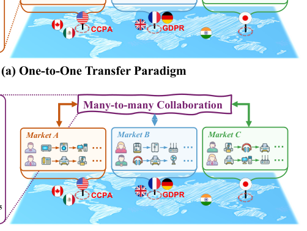
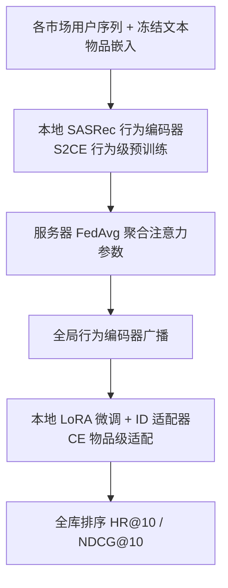

# From Transfer to Collaboration: A Federated Framework for Cross-Market Sequential Recommendation (从迁移到协作：跨市场序列推荐的联邦框架)

- **会议/期刊**: ACM MM 2026
- **作者与机构**: Jundong Chen, Honglei Zhang, Xiangmou Qu, Haoxuan Li, Han Yu, Yidong Li；北京交通大学、OPPO 研究院、北京大学、南洋理工大学
- **推荐链路定位**: 召回/精排（序列 Next-Item 全库排序）
- **研究方向**: 跨域与多场景推荐 / 序列与会话推荐
- **论文原文**: [论文原文链接](https://arxiv.org/abs/2604.13573v1)
- **开源代码**: [FeCoSR](https://github.com/jundongchen13/FeCoSR)

## TL;DR (1分钟核心速览)

跨市场序列推荐沿用的“源市场预训练→目标市场微调”一对一迁移会牺牲源市场性能，并因市场异质性产生负迁移。FeCoSR 改为多对多联邦协作：先以文本语义和行为编码器做联邦预训练，再用 S2CE 将 item 级 one-hot 监督软化为语义行为监督，最后用 LoRA 与 ID 适配器做本地微调。XMarket 八市场 Leave-One-Out Full-Ranking 下，FeCoSR 在多数市场最优，NDCG@10 相对最强基线最高提升 17.28%。

## Background & Motivation (背景与核心矛盾)

- **主流范式**: 为满足 GDPR/CCPA 等隐私约束，CMR 常继承 CDR 的一对一迁移：在源市场预训练可迁移行为编码器，再在目标市场微调；代表作为 UniSRec、CAT-SR。
- **前人局限**: 其一，**源市场退化 (CH1)**——源市场为学习 market-agnostic 模型牺牲自身 item 级偏好，微调后仍难恢复；其二，**负迁移 (CH2)**——市场用户不重叠且 item 偏好异质，单一源市场知识可能伤害目标市场。
- **核心洞察 (Key Insight)**: 作者理论证明 vanilla CE 的 one-hot 监督会把各市场预测分布推向不同峰值，市场间 KL 随训练收敛而放大；集中式训练虽可部分协作，但违反隐私，传统 FedAvg 又无法消解这种异质性。
- **本文切入点**: 用“联邦预训练共享行为级模式 + 本地微调建模 item 级偏好”的两阶段多对多协作，同时破解 CH1 与 CH2。

<figure class="paper-figure" markdown="span">
  <figcaption>图1：范式比较。一对一迁移会导致源市场性能下降，并对目标市场产生负迁移。多对多协作具有前景，但现有方法尚未充分探索，这促使我们提出联邦协作框架。</figcaption>
</figure>

## Method (核心方法设计)

### 1. 整体框架 (Overall Architecture)

FeCoSR 采用 company–market 架构：公司为 server，各市场为 client。Stage I 由 server 用 BERT 编码 item 文本并广播冻结语义嵌入，各市场仅训练 SASRec 行为编码器，以 S2CE 学习跨市场行为模式；server 用 FedAvg 聚合注意力相关参数并下发。Stage II 各市场冻结全局编码器，用 LoRA 低秩适配序列编码器，并以 ID 融合门注入本地 item 信息，最后用 vanilla CE 微调。推理时对市场内全库 item 打分排序。

<figure class="paper-figure" markdown="span">
  <figcaption>图2：面向CMR的FeCoSR概览。I.（橙色）使用文本模态进行联邦预训练，以学习跨市场行为级模式；II.（绿色）使用ID模态进行本地微调，以建模市场特定的物品级偏好。</figcaption>
</figure>

### 2. 关键设计拆解 (Key Designs)

1. **多对多联邦两阶段协作（破解 CH1）**：不再指定源/目标市场，所有市场共同参与预训练并保留本地微调权。聚合式为 $f_\theta^{agg}=\sum_{m\in\mathcal{M}}\alpha_m f_\theta^m,\ \alpha_m=1/|\mathcal{M}|$，仅聚合行为编码器注意力参数；随后各市场以$f_\theta^m=f_\theta^{agg}+W_AW_B$ 做低秩适配。直觉是共享行为模式、保留 item 偏好，避免源市场被“抽干”。

2. **Semantic Soft Cross-Entropy, S2CE（破解 CH2）**：vanilla CE 只把 ground-truth 置 1，迫使各市场追逐各自 item 峰值。S2CE 用冻结文本嵌入的余弦相似度构造软目标：
$q_{\mathrm{sem}}^m(j|j_u^+)=\frac{\exp(\mathrm{sim}(\mathbf{e}_j,\mathbf{e}_{j_u^+})/\tau)}{\sum_{k\in\mathcal{I}_m}\exp(\mathrm{sim}(\mathbf{e}_k,\mathbf{e}_{j_u^+})/\tau)}$，
$\mathcal{L}_{S^2CE}=-\sum_{u\in\mathcal{U}_m}\sum_{j\in\mathcal{I}_m}q_{\mathrm{sem}}^m(j|j_u^+)\log p_\theta^m(j|s_u^m)$。
语义相近 item 获得温和吸引、无关 item 仅弱排斥，从而把监督从 item 级拉到行为级。文中 Prop. 3.2 给出 $\mathrm{KL}(p^{m_1}\|p^{m_2})\le \log|\mathcal{I}_{m_2}|+(1-\sigma)/\tau$，显著低于 CE 的$\log(1/\epsilon)$ 级发散。

3. **本地 item 级适配与训练/推理效率**：微调阶段用 LoRA 适配全局编码器，并以 $\tilde{\mathbf{e}}_i^m=\mathbf{e}_i^m+\beta_i\odot g_\theta^m(\mathbf{e}_i^m)$注入 ID 信号；$\beta_i$为可学习门控，$g_\theta^m$为轻量 MLP。总目标为 Stage I 的$\mathcal{L}_{S^2CE}$与 Stage II 的$\mathcal{L}_{CE}$；两阶段均为市场内全库 softmax，**免负采样**。通信只传行为编码器参数，线上推理需对$|\mathcal{I}_m|$ 个 item 全库打分。

## Experimental Setup & Evaluation Protocol (实验设置与评估协议)

- **数据集与预处理**: XMarket 八个 Amazon 电子市场，含 item 文本；沿用官方/RecBole 预处理，原文未额外声明 `5-core` 过滤。

| 市场 | #Users | #Items | #Interactions | 稀疏度 | 场景/模态 |
| :--- | ---: | ---: | ---: | ---: | :--- |
| ca | 5,675 | 5,772 | 55,045 | 99.83% | 电子，文本 |
| mx | 1,878 | 1,645 | 17,095 | 99.45% | 电子，文本 |
| us | 35,916 | 31,125 | 364,339 | 99.97% | 电子，文本 |
| uk | 4,847 | 3,392 | 44,515 | 99.73% | 电子，文本 |
| fr | 2,396 | 1,911 | 22,905 | 99.50% | 电子，文本 |
| de | 2,373 | 2,210 | 22,247 | 99.58% | 电子，文本 |
| in | 239 | 470 | 2,015 | 98.21% | 电子，文本 |
| jp | 487 | 955 | 4,485 | 99.04% | 电子，文本 |

- **数据划分与防穿越**: `Leave-One-Out`；每用户最后交互为测试、倒数第二为验证、其余训练；各市场独立建序列，用户不重叠，避免跨市场穿越。
- **排名评测协议**: 无偏 `Full-Ranking`，ground-truth 对全部未交互 item 排序；指标 HR@10、NDCG@10。
- **对比基线与超参**: 覆盖 local-only（SASRec、S3Rec、SASRec_text）、centralized（MAML、FOREC、MA、SASRec_cen）、federated（FedAvg、FedDCSR）与 transfer（UniSRec、CAT-SR）。骨干 SASRec、文本编码 BERT；batch=256、Adam、lr∈{0.01,0.001,0.0001}；联邦轮数=20；$\tau$在 [0.01,0.1] 搜索取 0.05，低秩$r\in\{1,2,4,8,16\}$取小秩；显著性 paired$t$-test，$p<0.05$。

## Key Experimental Results (实验关键数据)

### 1. 主实验对比 (Main Results)

下表为 HR@10 / NDCG@10；保留 7 个代表性基线，FeCoSR 最优项加粗；`Imp.` 为相对最强基线的 NDCG@10 提升。

| 市场 | SASRec | S3Rec | MA | SASRec_cen | FedAvg | UniSRec | CAT-SR | FeCoSR | Imp. |
| :--- | :---: | :---: | :---: | :---: | :---: | :---: | :---: | :---: | :---: |
| ca | .1782/.1132 | .1804/.1270 | .1706/.1168 | .1808/.1253 | .1617/.1083 | .1810/.1163 | .1817/.1325 | **.1877/.1399** | +5.58% |
| mx | .4627/.3351 | .4915/.3421 | .4361/.3094 | .4963/.3236 | .4015/.2664 | .5075/.3056 | .4989/.3537 | **.5106/.3656** | +3.36% |
| us | .1641/.1171 | .1645/.1179 | .1518/.1049 | .1446/.1056 | .1470/.0984 | .1129/.0617 | .1416/.0910 | **.1654/.1191** | +1.01% |
| uk | .2703/.1692 | .3055/.1779 | .2784/.1908 | .3101/.2037 | .2706/.1656 | .2987/.1646 | .3013/.2193 | **.3132/.2265** | +3.38% |
| fr | **.2829**/.1919 | .2715/.1903 | .2453/.1796 | .2775/.1981 | .2454/.1669 | .2671/.1411 | .2748/.2024 | .2824/**.2028** | +0.20% |
| de | .2928/.1901 | .2885/.1919 | .2315/.1643 | **.3025**/.2126 | .2377/.1749 | .2474/.1342 | .2907/.2140 | .2944/**.2204** | +2.99% |
| in | .4435/.2517 | .4310/.2726 | .4187/.2478 | .4477/.2547 | .3933/.1781 | .3849/.1929 | .4561/.2840 | **.4728/.3562** | +17.28% |
| jp | .2895/.1851 | .2854/.1775 | .1956/.1321 | .2669/.1811 | .1971/.1162 | .2156/.1106 | .2936/.1781 | **.3060/.2062** | +11.40% |

### 2. 消融实验 (Ablation Study)

HR@10：去掉 Fed、S2CE、LoRA、ID 均造成不同程度下降，S2CE 与 ID 影响最明显。

| 变体 | ca | mx | us | uk | fr | de | in | jp |
| :--- | :---: | :---: | :---: | :---: | :---: | :---: | :---: | :---: |
| FeCoSR | .1877 | .5106 | .1654 | .3132 | .2824 | .2944 | .4728 | .3060 |
| w/o Fed | .1836 | .5037 | .1612 | .3049 | .2775 | .2885 | .4644 | .2854 |
| w/o S2CE | .1793 | .4920 | .1506 | .2983 | .2628 | .2804 | .4435 | .2752 |
| w/o LR | .1851 | .5080 | .1641 | .3058 | .2764 | .2836 | .4770 | .2854 |
| w/o ID | .1838 | .5037 | .1615 | .3019 | .2677 | .2890 | .4603 | .2895 |

### 3. 关键实验发现 (Key Findings)

1. **S2CE 是最大单点贡献**：去掉后 ca NDCG@10 从 .1399 降至 .1348，in 从 .3562 降至 .2446（-31.3%），jp 从 .2062 降至 .1891，印证语义软监督把 item 级异质性转为行为级共享。
2. **联邦协作对稀疏市场收益更大**：`w/o Fed` 使 in NDCG@10 从 .3562 降至 .2903、jp 从 .2062 降至 .1966；而纯 FedAvg 在 in NDCG@10 仅 .1781，说明“联邦”本身不够，需 S2CE 解决异质性。
3. **本地 item 级适配不可省**：去掉 ID 后 fr NDCG@10 从 .2028 降至 .1743、jp 从 .2062 降至 .1746；去掉 LoRA 后 in NDCG@10 从 .3562 降至 .3180，说明行为级共享后仍需低秩校准本地偏好。

## Highlights & Limitations (亮点、对比与审稿批判)

- **与代表作对比 (vs. Prior Work)**: UniSRec/CAT-SR 是一对一迁移，源市场被牺牲且目标市场易负迁移；FedAvg/FedDCSR 虽隐私友好，但前者未解异质性、后者面向跨域特征错位；FeCoSR 让所有市场共同受益，并用 S2CE 显式压低跨市场预测 KL。
- **可迁移亮点**: 语义软目标可作为联邦/多场景推荐的通用正则；行为级预训练与 item 级 LoRA+门控适配的解耦，可迁移到多语言、多地区电商排序。
- **审稿级局限批判**: 仅在 XMarket 电子品类离线验证，未给在线 A/B 或时延；依赖 item 文本描述，低资源/无文本市场可能失效。全库 softmax 与每轮参数广播在超大 catalog 下有成本，S2CE 的 $\tau$ 与 LoRA 秩也需逐市场调参，隐私仅停留在参数不共享层面，未引入形式化 DP。

## Rating (四维评分)

- **方法创新性 (Novelty)**: ⭐⭐⭐⭐ （多对多联邦两阶段与 S2CE 理论界结合较好，但组件多为已知技术的系统性重组）
- **评估协议与实验扎实度 (Protocol & Experiments)**: ⭐⭐⭐⭐ （八市场 LOO Full-Ranking、四类基线、消融与显著性检验完整，缺在线与跨品类验证）
- **写作与数学规范度 (Clarity & Rigor)**: ⭐⭐⭐⭐ （Prop. 3.1/3.2 清楚说明 CE 放大异质性、S2CE 收敛上界，符号略密）
- **工业落地与复现价值 (Industrial & Practical Value)**: ⭐⭐⭐⭐ （代码开源，LoRA/ID 适配对联邦部署友好；全库 softmax、通信轮数与文本依赖限制大规模即时收益）

