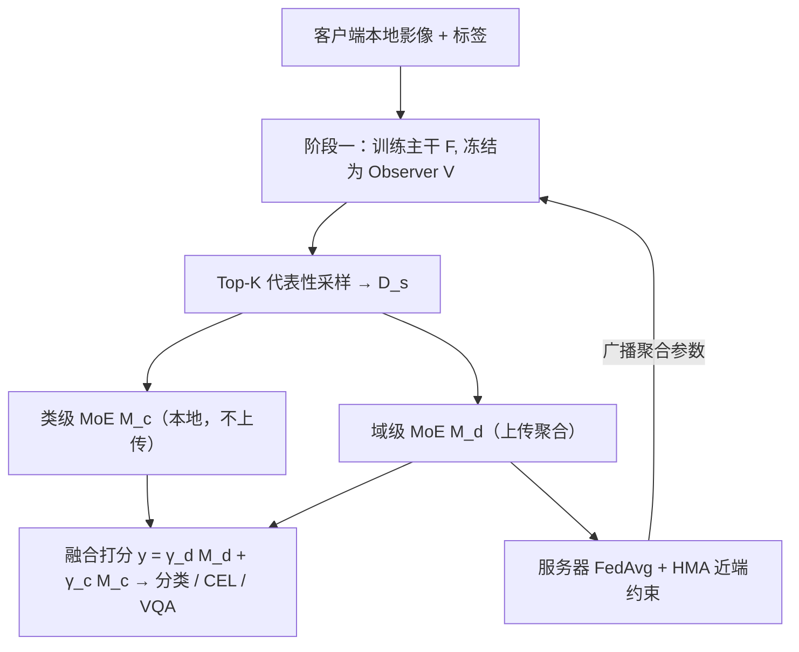
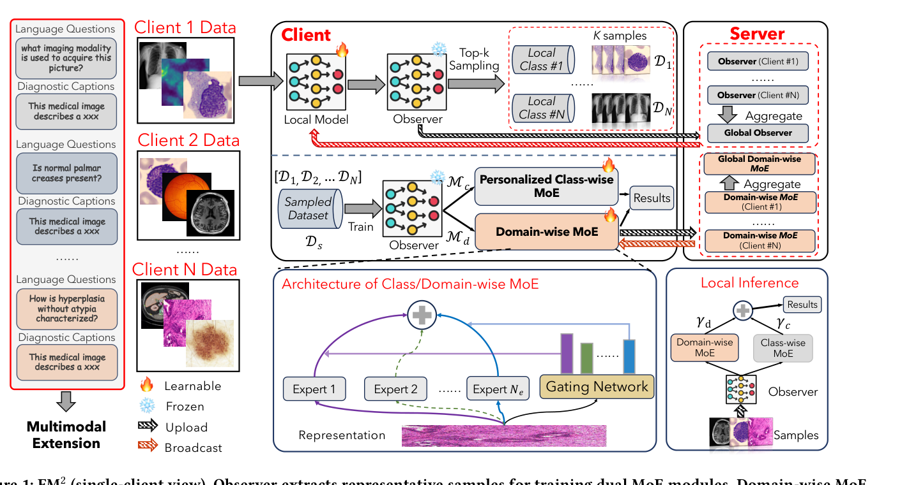

# FM2: Unified Federated Foundation Models for Heterogeneous Multimodal Medical Imaging (面向影像模态异构的统一联邦多模态基础模型)

- **会议/期刊**: ACM MM 2026 (Main Track)
- **作者与机构**: Shengchao Chen, Ting Shu（深圳大学人工智能学院 / 悉尼科技大学 Australian AI Institute）
- **推荐链路定位**: 端到端多模态表征与跨域联邦训练（非排序链路）
- **研究方向**: 多模态推荐 / 跨域多场景推荐
- **论文原文**: [https://arxiv.org/abs/2607.13386v1](https://arxiv.org/abs/2607.13386v1)
- **开源代码**: 暂未开源

## TL;DR (1分钟核心速览)

论文首次形式化**影像模态异构**（Overlapped：共享模态但标签非 IID；Non-overlapped：各客户端模态完全不相交）这一联邦多模态痛点。FM2 从零训练医疗主干，为每个客户端配备双 MoE——类级 MoE 本地个性化、域级 MoE 全局聚合——并用 HMA 近端正则只约束域级专家向全局共识靠拢（证明 $O(1/\sqrt{T})$收敛）。另以本地 GPT-4o 诊断描述做对比对齐（CEL）充当跨模态文本语义桥。在 MIMH-5-Domain（$\varphi=0.1,r=100\%$）上达 **86.68%**，超最强基线 FedRep 74.72% 达 **+11.96 abs / +16.0% 相对**；MIMH-SA 非重叠设定 76.11% vs. 本地训练 69.52%。

## Background & Motivation (背景与核心矛盾)

- **主流范式**: 联邦基础模型（FFM）走两条路——微调自然图像预训练模型（ViT/CLIP/SAM），或用单模态医疗数据从零训练。
- **前人局限**: ① 自然图像表征迁移到医疗域显著退化（类间差异细微、采集噪声、解剖语境缺失）；② 从零训练的工作只覆盖**单模态 + 单任务**，无法同时支撑分类、描述监督表征学习与 VQA；③ FedBN/FedRep/Ditto 等个性化 FL 只针对 label skew，隐含**同构特征空间**假设，一旦模态本身不同即失效；④ 集中式 missing-modality 方案在 FL 下不可用（禁止原始特征跨站聚合）。
- **核心洞察 (Key Insight)**: 视觉上模态间分布完全不可比，但诊断描述共享同一套医学词汇——**语言是可以跨模态对齐的公共坐标系**；且"类别异构"与"模态异构"应当被显式解耦优化，而非用同一套参数硬扛。
- **本文切入点**: 域级 MoE 承载跨模态共识并全局聚合，类级 MoE 完全本地不上传；近端项只打在域级专家上，保留个性化自由度。

## Method (核心方法设计)

### 1. 整体框架 (Overall Architecture)

两阶段协议。阶段一各客户端本地训练 $\{F_b,F_h\}$，训练好的主干$F_b$冻结为 **Observer**$V$，对每类计算代表性得分$S=\mathrm{Sigmoid}(V(\boldsymbol{X}_z))$并做 **Top-$K$采样**，得到蒸馏子集$\mathcal{D}_s=\bigcup_{i}\mathcal{D}_i$，缓解后续训练中的本地标签漂移。阶段二在$\mathcal{D}_s$上训练双 MoE：类级$\mathcal{M}_c$留存本地，域级$\mathcal{M}_d$与$V$上传聚合，下一轮以聚合后的$V$ 重新初始化阶段一。推理时两路专家加权融合；文本分支（PubMedBERT / 问题编码器）与 VQA 头共享同一 MoE 增强的视觉特征。

<figure class="paper-figure" markdown="span">
  <figcaption>图 1：FM2（单客户端视图）。Observer 提取代表性样本以训练双 MoE 模块。域级 MoE 全局聚合；类级 MoE 保持本地。文本输入（用于 CEL 的诊断描述；用于 VQA 的问题）由本地文本编码器处理，并与 MoE 增强的视觉特征融合，从而在单一协议内支持所有下游任务。</figcaption>
</figure>

### 2. 关键设计拆解 (Key Designs)

1. **双 MoE 解耦（Dual MoE）**：痛点是把类别异构与模态异构混在一套参数里，二者梯度相互污染。做法是按两种索引各建一套专家（$N_c$= 本地类数，$N_d$ = 全局模态词表大小），类级分支
$\hat{\boldsymbol{X}}=\sum_{n=1}^{N_c}W_n\cdot E_n(\boldsymbol{X}_{\mathrm{mid}}),\ E_n(\boldsymbol{X}_{\mathrm{mid}})=\mathrm{ReLU}(\mathrm{MLP}(\boldsymbol{X}_{\mathrm{mid}}))$不参与通信，域级分支结构同构但仅做全局 FedAvg；最终预测$y=\gamma_d\cdot\mathcal{M}_d(V(\boldsymbol{X}))+\gamma_c\cdot\mathcal{M}_c(V(\boldsymbol{X}))$。直觉：把分类问题拆成"多个类专属知识库 + 数个模态专属变换器"，个性化与共识各归其位。

2. **Heterogeneous Modality Alignment (HMA)**：直接聚合异模态专家会引入"共识偏差"。HMA 只在**域级专家参数**上加近端项：
$\min_{\{\theta_i\}}\sum_{i=1}^{Z}\frac{n_i}{n}\left[\mathcal{L}_i(\theta_i;\mathcal{D}_i,\mathcal{D}_s^i)+\lambda\|\mathcal{M}_d^i-\hat{\mathcal{M}}_d\|^2\right]$与 FedProx/Ditto 对**整个模型**加惩罚的本质区别在于：$\mathcal{M}_c$完全自由，不会被人为拉向全局均值。定理 1 给出$\frac{1}{T}\sum_t\mathbb{E}\|\nabla F\|^2\le \frac{2(F(\theta_0)-F^*)}{\eta T}+\frac{4L\eta\sigma^2}{Z}+4L\eta\delta^2+\frac{2\lambda L\Delta_{\mathcal{M}}}{T}$，对齐漂移项随$O(1/T)$消失，取$\eta=O(1/\sqrt{T})$即得$O(1/\sqrt{T})$。

3. **Caption-Enhanced Learning (CEL) 与训练目标**：Non-overlapped 下视觉无任何共享结构，CEL 用本地保留的 GPT-4o 描述做**联邦对比对齐**（视觉侧参与聚合，文本编码器留在本地）：$\mathcal{L}_{\mathrm{CEL}}=-\frac{1}{B}\sum_j\log\frac{\exp(\mathrm{sim}(\boldsymbol{v}_j,\boldsymbol{t}_j)/\tau)}{\sum_k\exp(\mathrm{sim}(\boldsymbol{v}_j,\boldsymbol{t}_k)/\tau)}$。总目标$\mathcal{L}^i+\alpha\mathcal{L}_{\mathrm{CEL}}(+\mathcal{L}_{\mathrm{VQA}})$，采用 in-batch 免负采样；推理仅需两路 MoE 前向，通信 718K 参数 / 57.4 MB 每轮（FedAvg 为 520K / 41.6 MB）。

## Experimental Setup & Evaluation Protocol (实验设置与评估协议)

- **数据集与预处理**: 由 5 个 MedMNIST 子集构建 MIMH 基准（统一 $224\times224$，用 MedMNIST+ 原生分辨率而非$28\times28$ 缩略图）：

| 数据集配置 | 模态 | 影像数 | 类别数 | 客户端数 |
| :--- | :---: | :---: | :---: | :---: |
| MIMH-5-Domain | Fundus/Blood/Tissue/Path/Derma | 372,273 | 37 | 10（模态重叠） |
| MIMH-4-Domain | 上述前 4 种 | 125,872 | 22 | 10（模态重叠） |
| MIMH-3-Domain | 上述前 3 种 | 135,887 | 29 | 10（模态重叠） |
| MIMH-SA | 5 种完全不相交 | 372,273 | 37 | 5（Stand-Alone） |
| 留出泛化 | Pneumonia/OCT/OrganA | 5,856 / 109,309 / 58,830 | 2/4/11 | 仅 5% 微调数据 |

- **数据划分与防穿越**: 标签异构用 $\mathrm{Dirichlet}(\varphi,p)$控制，$\varphi\in\{0.1,0.3,100\}$（0.1 为 Hard）；MIMH-SA 按模态一客户端一模态切分；客户端参与率$r\in\{30\%,50\%,100\%\}$ 模拟掉线。
- **排名评测协议**: 各客户端本地测试集上的 **closed-set Top-1 准确率（全类别排序，非采样负例）**；VQA 用答案级准确率；全部结果 5 次运行取均值并报标准差。
- **对比基线与超参**: 分类对比 FedAvg / FedProx / PerFedAvg / FedBN / FedProto / FedRep；VQA 另比 FedPer / FedDyn / FedAdam / FedAvgM / FedYogi，以及专用联邦 VLM 方法 FedDAT / PromptFL / F3OCUS。主干 ResNet-4，SGD（lr $5\times10^{-3}$），100 轮通信、1 local epoch（FM2 拆为 50 Observer + 50 MoE，总预算对齐）；$\gamma_d=\gamma_c=0.5$，$\lambda=0.1$；FM2-Tiny/Medium/Large 为每专家 2×/4×/8× MLP 层。

## Key Experimental Results (实验关键数据)

### 1. 主实验对比 (Main Results)

| Method | 5-Dom $\varphi$=0.1 | 4-Dom$\varphi$=0.1 | 3-Dom$\varphi$=0.1 | MIMH-SA | VQA T1 (F-CL, Non-IID) |
| :--- | :---: | :---: | :---: | :---: | :---: |
| FedAvg | 23.05 | 43.81 | 52.58 | 11.40 | 0.823 |
| FedProx | 38.70 | 40.33 | 52.70 | 11.23 | 0.816 |
| PerFedAvg | 50.91 | 45.71 | 58.40 | 20.90 | — |
| FedBN | 42.72 | 48.65 | 59.65 | 13.00 | — |
| FedProto | 70.84 | 88.14 | 81.55 | 59.66 | — |
| FedRep | 74.72 | 81.28 | 78.96 | 30.45 | 0.827 |
| Local-only | — | — | — | 69.52 | — |
| FM2-Tiny | 83.79 | 87.84 | 89.43 | 73.66 | 0.838 |
| **FM2-Large** | **86.68** | **93.12** | **90.19** | **76.11** | **0.844** |
| **Improv.** | **+11.96 (+16.0%)** | **+4.98 (+5.6%)** | **+7.05 (+8.5%)** | **+36.45** | **+0.011** |

> $\varphi=100$ 时 FM2-Large 仍达 90.39 / 96.00 / 87.69，对 FedProto（85.00 / 92.71 / 82.01）保持领先；跨模态迁移（FM2-Large-E）在留出集上为 98.06 / 93.21 / 91.00，较 FedProto-E 分别 +7.09 / +12.40 / +12.58。

### 2. 消融实验 (Ablation Study)

| 变体 | 分类 / VQA / CEL 掉点 | 说明 |
| :--- | :---: | :--- |
| w/o CMoE | −3.4 ~ −7.8 pp | 类级个性化被移除，退化为单一共享分类头 |
| w/o HMA | −2.1 ~ −4.3 pp | 域级专家局部漂移，聚合共识被污染 |
| Only CMoE（去 DMoE + HMA） | −5.1 ~ −10.4 pp | 只剩本地个性化 + 联邦主干，最差 |
| 通信/耗时（Tiny vs. FedAvg） | 718K vs 520K 参数；57.4 vs 41.6 MB；12.5 vs 8.2 s | +38% 带宽换 +60.75 pp 精度 |
| 超参 $(\gamma_c,\gamma_d,\lambda)$ 偏离默认 | 最大掉点 2.31% | 默认配置跨三任务稳健 |

### 3. 关键实验发现 (Key Findings)

1. **"只有个性化、没有全局域共识"是主要失效模式**：Only CMoE 在三个任务上掉 5.1–10.4 pp，显著大于单独去 HMA 的 2.1–4.3 pp；t-SNE 直接佐证——无 HMA 时特征按**模态**聚类，加 HMA 后五种模态在同语义类别内交织，说明 HMA 不只是正则，而是把表征空间从"模态轴"重排到"语义轴"。
2. **通信开销几乎可忽略，收益却是数量级**：FM2-Tiny 仅比 FedAvg 多 38% 参数（718K vs. 520K）、每轮 12.5 s，却把 5-Domain 准确率从 23.05% 拉到 83.79%；反观 FedProto 每轮仅传 0.1 MB 却卡在 70.84%，说明"传什么"远比"传多少"重要——CMoE 不上传是省带宽的关键设计。
3. **CEL 的增益随模态不相交程度单调放大**：MIMH-SA 上 FM2-Large 由 83.59%→88.73%、跨模态均值 90.48%→95.04%（+4.56 pp），增量明显大于 5-Domain 的 +3.96 pp；且 GPT-4o 描述达 87.25%，逼近专家标注 87.89% 而远超模板 84.53%，仅 20% 覆盖率也有 +1.57 pp，说明 LLM 描述在联邦场景下是廉价可用的语义桥。

## Highlights & Limitations (亮点、对比与审稿批判)

- **与代表作对比**: 相比 FedProx/Ditto 对**全模型**加近端项，HMA 只作用于域级专家，把"共识"与"个性化"在参数层面物理隔离，这是其能同时兼顾两者的根本原因；相比 FedRep/FedBN 假设同构特征空间且单任务，FM2 首次在模态异构下统一分类 / CEL / VQA；相比 FedProto 仅交换原型，FM2 交换的是**模态条件化的专家参数**，表达容量更高。
- **可迁移亮点**: ① Observer + Top-$K$ 代表性采样本质是"用已训练主干做第二阶段训练集蒸馏"，可迁移到任何两阶段联邦/增量训练以压低标签漂移；② 用 LLM 生成文本作为跨域公共语义坐标系，对**非重叠跨域推荐**（源域无重叠用户/物品）是极低成本的对齐手段。
- **审稿级局限批判**: ① 依赖联邦建立时**预声明全局模态词表**，新模态接入需重编号，附录仅给出在线聚类思路，工程闭环不完整；② 通信量 718K–1035K 参数、单轮 12.5–18.3 s，客户端规模上到百级后开销不可忽视，且未报告 GPU 显存峰值；③ 评测仅封闭集 Top-1 准确率与 VQA 答案准确率，缺少召回/排序类指标与临床 reader study，实际临床价值无法判定；④ CEL 强依赖 GPT-4o 生成描述，存在 API 成本与描述幻觉风险，论文只做了"质量分档"实验而未做幻觉鲁棒性压力测试。

## Rating (四维评分)

- **方法创新性 (Novelty)**: ⭐⭐⭐⭐ （把"类别异构 vs. 模态异构"在参数层显式解耦并用只作用于域级专家的近端项求解，配套 $O(1/\sqrt{T})$ 收敛与 JS 散度泛化界，理论-结构咬合度高）
- **评估协议与实验扎实度 (Protocol & Experiments)**: ⭐⭐⭐⭐ （5 类模态四套配置 + 重叠/非重叠双制度 + 留出模态迁移 + 三任务五轮均值，消融与通信成本齐全；扣分在于仅用准确率、无排序类指标与显著性检验）
- **写作与数学规范度 (Clarity & Rigor)**: ⭐⭐⭐⭐ （定理 1 与命题 2 推导链条完整、各项来源解释清晰；但 HMA 收敛证明对 $\Delta_{\mathcal{M}}$的界定依赖初始分歧假设，泛化界中的$\epsilon_V$ 仅给出定性说明）
- **工业落地与复现价值 (Industrial & Practical Value)**: ⭐⭐⭐ （无需集中数据即可从零训练多模态主干，通信增量仅 38%，具备真实部署形态；但"预声明模态词表"、LLM 描述生成与未开源三点抬高了复现与接入门槛）

