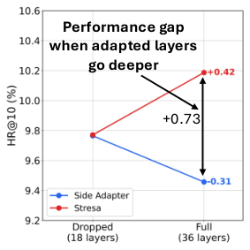
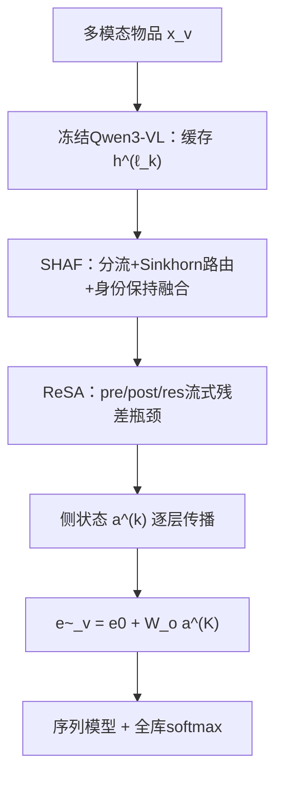
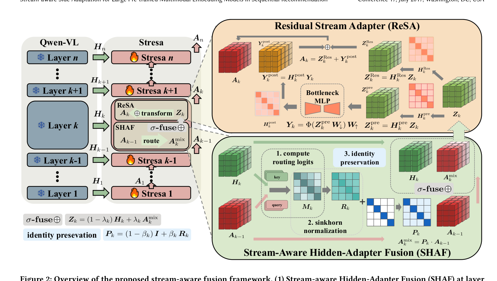

# Stream-aware Side Adaptation for Large Pre-trained Multimodal Embedding Models in Sequential Recommendation (面向序列推荐中大预训练多模态嵌入模型的流感知侧适配)

- **会议/期刊**: ACM MM 2026
- **作者与机构**: Junchen Fu, Kaiwen Zheng, Ioannis Arapakis, Wenhao Deng, Xin Xin, Joemon M. Jose, Xuri Ge；University of Glasgow、Telefónica Scientific Research、Shandong University
- **推荐链路定位**: 召回（物品表征）
- **研究方向**: 序列与会话推荐 / 多模态推荐与内容理解
- **论文原文**: [https://arxiv.org/abs/2607.10909v1](https://arxiv.org/abs/2607.10909v1)
- **开源代码**: [https://github.com/GAIR-Lab/Stresa](https://github.com/GAIR-Lab/Stresa)

## TL;DR (1分钟核心速览)

针对冻结Qwen3-VL在序列推荐中的域错配与深层侧适配退化，Stresa把侧记忆拆成多流：SHAF以Sinkhorn路由和身份保持门控融合历史侧状态，ReSA用流式残差瓶颈做选择性更新。在MicroLens-50K/100K与Scientific、Leave-One-Out全库排序协议下，HR@10较最强基线提升2.0%–7.4%，并可在全部36层稳定适配。

## Background & Motivation (背景与核心矛盾)

- **主流范式**: 冻结大multimodal embedding，离线缓存物品表示；轻量Side Adapter逐层适配，Two-Stage只取最后一层。
- **前人局限**: 常规Side Adapter直接残差相加，不建模融合中该保留/抑制什么；sigmoid渐进融合随深度覆盖早期侧记忆。结果是LayerDrop成为默认，只适配约9层，深层反降。
- **核心洞察 (Key Insight)**: 深层侧分支已不是局部特征，而是跨层传播的“侧记忆”；应把“记忆传输”与“状态精炼”解耦。
- **本文切入点**: SHAF控制历史记忆如何进入当前层，ReSA控制融合后如何生成下一侧状态。

<figure class="paper-figure" markdown="span">
  <figcaption>图1：传统 Side Adapter 与 Stresa 对比。使用冻结的 Qwen3-VL-8B-Embedding 骨干，Dropped 18 layers 和 Full 36 layers 表示物品编码器分别从 18 或 36 个骨干层提取隐藏状态用于适配器计算。左：两种设置下的 HR@10。右：Side Adapter 采用残差相加与 sigmoid 融合，而 Stresa 采用选择性残差更新（ReSA）与早期表示保留融合（SHAF）。HSP 和 HSA 分别表示预训练模型和前一适配层的隐藏状态。</figcaption>
</figure>

## Method (核心方法设计)

### 1. 整体框架 (Overall Architecture)

Stresa仅在冻结backbone侧边学习轻量分支：多模态物品经Qwen3-VL提取并缓存选层hidden state，逐层由SHAF将上一切片侧状态$a_{k-1}$与当前$h_k$做流式对齐融合，再由ReSA在瓶颈MLP前后及残差路径上做流级选择性更新，得到$a_k$并传向下一适配层；最终物品表示为$\tilde{e}_v=e^0_v+W_o a_K$，用户序列由两层Transformer编码后全库softmax预测下一物品。训练只更新侧分支、$W_o$和序列模型，backbone保持冻结以支持离线缓存与部署。

<figure class="paper-figure" markdown="span">
  <figcaption>图2：所提出的流感知融合框架概览。(1) 第 𝑘 层的流感知隐藏适配器融合（SHAF）首先将隐藏表示重塑为多个流，并通过查询-键交互计算路由 logits。应用身份保持操作以保留来自较早层的信息。(2) 残差流适配器（ReSA）在瓶颈 MLP 周围应用逐流的前、后和残差映射。将映射后的残差与非线性分支组合以产生下一侧状态 A𝑘，该状态直接传播到后续适配层。</figcaption>
</figure>

### 2. 关键设计拆解 (Key Designs)

1. **SHAF（历史侧记忆的流式传输）**：sigmoid只控制侧记忆注入强度，未建模跨流对齐，深层易覆盖早期信息。将$h_k,a_{k-1}$重塑为$s$条流，路由logits为$M_{ij}=q_i^\top k_j/\sqrt{d_r}$，经$R=\mathrm{Sinkhorn}(M/\tau)$与身份保持门控$P=(1-\beta)I+\beta R$得到$A^{mix}=P A_{k-1}$，再融合$Z=(1-\lambda)H+\lambda A^{mix}$。$\beta$控制跨流重排，$\lambda$控制记忆注入；$\beta=0$即退回普通侧路径。

2. **ReSA（选择性残差更新）**：普通残差用固定恒等捷径，无法在融合表示上做保留/抑制。ReSA先做$Z^{pre}=H^{pre}Z$，瓶颈映射$Y=\phi(Z^{pre}W_{\downarrow})W_{\uparrow}$，再做$Y^{post}=H^{post}Y$与$Z^{res}=H^{res}Z$，输出$A=Z^{res}+Y^{post}$。当$H^{pre}=H^{post}=H^{res}=I$时退化为标准残差瓶颈，因此是在流空间中的广义残差适配。

3. **训练目标、负采样与推理效率**：采用全库softmax下一物品损失$\mathcal{L}_{rec}=-\sum_{(u,t)}\log\frac{\exp(q_{u,t}^\top\tilde{e}_{v^+})}{\sum_{v'\in\mathcal{C}_{u,t}}\exp(q_{u,t}^\top\tilde{e}_{v'})}$，无额外负采样；仅训侧分支、$W_o$与序列模型。流算子为$s\times s$或$s\times d_s$，瓶颈秩$r\ll d_s$，额外开销温和；物品表示可离线刷新。

## Experimental Setup & Evaluation Protocol (实验设置与评估协议)

- **数据集与预处理**: 按时间构造用户交互序列，物品侧对齐多模态内容；未使用额外ID信号，属于ID-free侧信息设定。

| 数据集 | #Users | #Items | #Interactions | 稀疏度/密度 | 特征/场景说明 |
| :--- | :---: | :---: | :---: | :---: | :--- |
| MicroLens-50K | 50,000 | 19,099 | 339,511 | 0.036% | 微视频推荐，用户级子集 |
| MicroLens-100K | 100,000 | 19,738 | 719,405 | 0.036% | 微视频推荐，用户级子集 |
| Scientific | 12,076 | 20,314 | 81,711 | 0.033% | Amazon科学品类，跨域验证 |

- **数据划分与防穿越 (Splitting Strategy)**: `Leave-One-Out`：每用户最后一条交互测试，倒数第二条验证，序列按时间截断至长度10。
- **排名评测协议 (Ranking Protocol)**: 无偏`Full-Ranking`，在全部物品集上排序；报告HR@10、NDCG@10、HR@20、NDCG@20。
- **对比基线与超参设置**: 基线含Two-Stage、Side Adapter、IISAN、XSMoE、CROSSAN、IISAN-Versa；backbone为Qwen3-VL-Embedding-2B/8B。序列模型为2层Transformer、2头注意力；AdamW，weight decay 0.1，lr $1\times10^{-4}$，batch 512，adapter rank搜索$\{128,256,512,1024\}$；5个随机种子，$t$-test$p<0.05$。

## Key Experimental Results (实验关键数据)

### 1. 主实验对比 (Main Results)

下表保留HR@10/NDCG@10；Two-Stage与Side Adapter为Qwen3-VL-8B设定，Scientific未报告。`Improv.`为Stresa相对各列最强基线的相对提升。

| Method | ML-50K H@10 | ML-50K N@10 | ML-100K H@10 | ML-100K N@10 | Scientific H@10 | Scientific N@10 |
| :--- | :---: | :---: | :---: | :---: | :---: | :---: |
| Two-Stage | 0.0618 | 0.0335 | 0.0706 | 0.0385 | — | — |
| Side Adapter | 0.0813 | 0.0437 | 0.0977 | 0.0531 | — | — |
| IISAN (SIGIR'24) | 0.0771 | 0.0421 | 0.0960 | 0.0526 | 0.0683 | 0.0414 |
| XSMoE (CIKM'25) | 0.0550 | 0.0296 | 0.0697 | 0.0376 | 0.0620 | 0.0395 |
| CROSSAN (arXiv'25) | 0.0806 | 0.0431 | 0.0999 | 0.0553 | 0.0690 | 0.0422 |
| IISAN-Versa (TKDE'25) | 0.0784 | 0.0421 | 0.0964 | 0.0533 | 0.0739 | 0.0447 |
| **Stresa (Ours)** | **0.0841** | **0.0456** | **0.1019** | **0.0559** | **0.0794** | **0.0483** |
| **Improv.%** | **+4.34** | **+5.80** | **+2.00** | **+1.08** | **+7.44** | **+8.05** |

Stresa在ML-100K的H@20/N@20为0.1442/0.0666，在Scientific为0.1067/0.0551，均优于最强基线。

### 2. 消融实验 (Ablation Study)

| Setting | ML-50K HR@10 | ML-50K N@10 | ML-100K HR@10 | ML-100K N@10 |
| :--- | :---: | :---: | :---: | :---: |
| Side Adapter | 0.0813 | 0.0437 | 0.0977 | 0.0531 |
| + ReSA | 0.0829 | 0.0444 | 0.0999 | 0.0545 |
| + ReSA + SHAF (Stresa) | **0.0841** | **0.0456** | **0.1019** | **0.0559** |
| w/o Identity Preservation | 0.0807 | 0.0433 | 0.0991 | 0.0545 |

### 3. 关键实验发现 (Key Findings)

- **深层适配稳定性是核心收益来源**：Side Adapter约在9个适配层达到峰值后随深度下降，而Stresa在全部36层仍最优；ML-100K上H@10从Side Adapter的0.0977升至0.1019，相对提升4.3%。
- **ReSA与SHAF互补，身份保持不可省**：ML-100K上ReSA贡献HR@10 +0.0022，SHAF再贡献+0.0020；去掉identity preservation后HR@10降至0.0991、NDCG@10降至0.0545，说明历史侧记忆的直通路径关键。
- **参数更省但计算略增**：Stresa训练参数78.06M，较Side Adapter的155.73M减少约49.9%；代价是每epoch 392.41s vs 338.20s、FLOPs/step 5.311 vs 4.395，约+16%时间与+20.8%计算。

## Highlights & Limitations (亮点、对比与审稿批判)

- **与代表作对比 (vs. Prior Work)**: IISAN/CROSSAN/IISAN-Versa主要延续多塔或非对称侧适配并依赖LayerDrop；Stresa在单塔冻结Qwen3-VL上重设计残差融合与sigmoid融合，使深层hidden state真正可用。
- **可迁移亮点**: 将侧状态reshape成流后用Sinkhorn路由做受控跨流重排，再用可学习残差映射替代固定恒等捷径；该思路可迁移到其他冻结大模型的特征适配与多模态召回。
- **审稿级局限批判**: 绝对增益多为0.002–0.0055 HR@10，提升幅度有限；仅验证Qwen3-VL与三个数据集，缺少线上A/B、冷启动物品分桶与更广backbone；额外FLOPs约+20.8%，且未讨论自适应选层/调度。

## Rating (四维评分)

- **方法创新性 (Novelty)**: ⭐⭐⭐⭐ （把LLM中的流式残差/超连接思想迁移到多模态侧适配，SHAF/ReSA分工清晰，并有结构观察支撑）
- **评估协议与实验扎实度 (Protocol & Experiments)**: ⭐⭐⭐⭐ （三数据集、两种backbone、5种子与t检验、全库排序较规范；但数据集与线上验证仍有限）
- **写作与数学规范度 (Clarity & Rigor)**: ⭐⭐⭐⭐ （公式与模块职责定义清楚，Observation 1–3给出代数解释；复杂度分析偏经验化）
- **工业落地与复现价值 (Industrial & Practical Value)**: ⭐⭐⭐⭐ （代码开源、backbone冻结可缓存、参数更省；推理/训练计算略增，适合作为侧适配改进入口）

