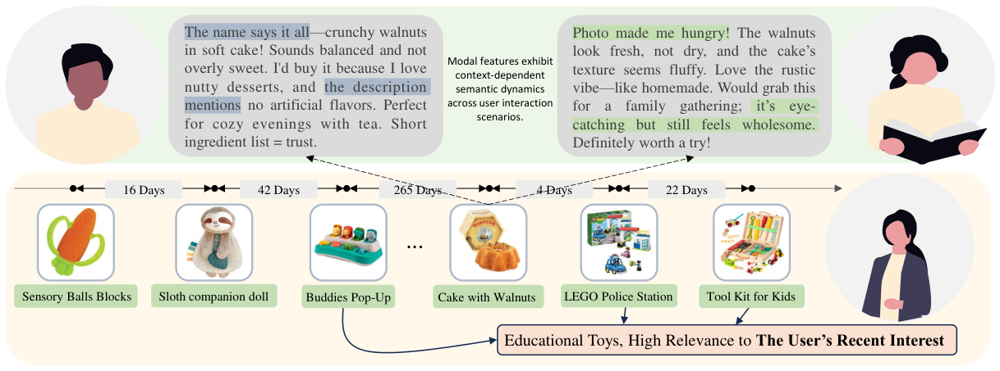
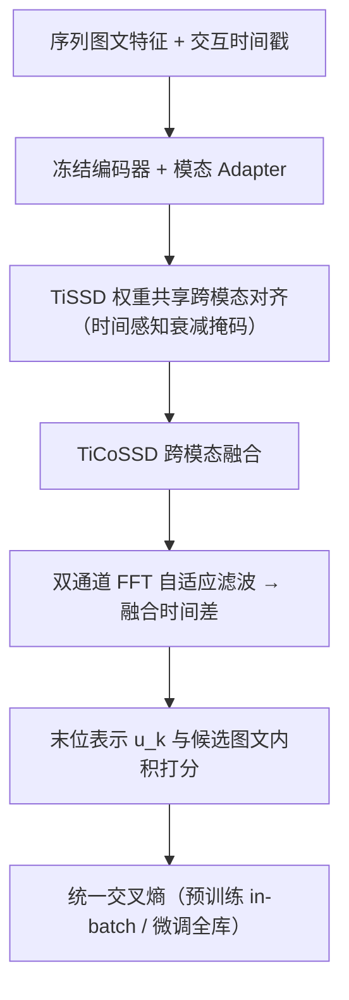
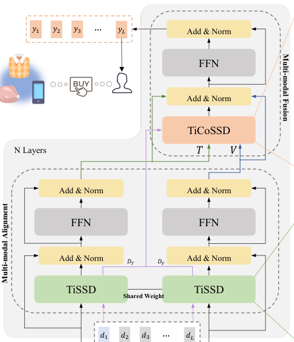

# Towards Transfer-Efficient Multi-modal Sequential Recommendation with State Space Duality (基于状态空间对偶的迁移高效多模态序列推荐)

- **会议/期刊**: ACM MM 2026 (Rio de Janeiro, Brazil)
- **作者与机构**: Hao Fan, Hongjiu Liu, Yanrong Hu, Kai Fang (浙江农林大学 数学与计算机学院)；Qingyang Liu (华东理工大学 信息科学与工程学院)
- **推荐链路定位**: 召回 / 端到端序列建模（跨域预训练 → 下游微调）
- **研究方向**: 序列与会话推荐 / 多模态推荐
- **论文原文**: [arXiv:2506.02916v5](https://arxiv.org/abs/2506.02916v5)
- **开源代码**: [AlwaysFHao/MMM4Rec](https://github.com/AlwaysFHao/MMM4Rec)

## TL;DR (1分钟核心速览)

多模态序列推荐 (SR) 的迁移学习长期被两件事拖累：跨模态对齐依赖重负采样对比学习、非端到端聚类/滤波模块破坏优化路径，导致下游微调收敛极慢并伴随负迁移。MMM4Rec 改用**代数结构约束**替代复杂目标：以时间感知 SSD 的衰减掩码天然编码"近因偏好"，以跨模态共享权重的 TiSSD 做序列级对齐，再以 TiCoSSD+双通道傅里叶自适应滤波完成融合，预训练与微调统一为单一交叉熵。在 Amazon 10 域（5 预训练 + 5 下游）、全库排序 R@K/NDCG@K 协议下取得多数域最优，Pantry 上 N@10 相对最强基线 **+31.78%**，下游收敛平均快约 **10×**（Scientific 13 epoch vs. MISSRec 76 epoch）。

## Background & Motivation (背景与核心矛盾)

- **主流范式**: 先用冻结的 ViT/BERT + 轻量 adapter 抽取物品图文特征，在大规模推荐语料上预训练多模态 SR 模型（UniSRec / VQRec / MISSRec），再迁移到下游域微调；对齐多依赖跨模态对比学习或用户侧模态融合系数。
- **前人局限**: (i) 对比式对齐需为"推荐语义"定制负采样策略，目标复杂、非端到端，微调收敛慢；(ii) Transformer 骨干对序列内所有物品的多模态特征**一视同仁**，位置编码并不等价于"近期优先"，MISSRec 靠多模态聚类去冗余则打断了端到端梯度。
- **核心洞察 (Key Insight)**: 作者在 Kindle 上的预实验显示，SASRec 只用最近 5 个物品即可保留 20 物品长度下 **97%** 的性能（图 2），说明 SR 的强近因偏置与 SSD 的状态衰减掩码在数学结构上同构——**不该用额外损失去"学到"这种偏置，而应把它写成结构约束**。
- **本文切入点**: 用"对齐-再融合"的两阶段代数约束（权重共享 + 结构化掩码 + 频域滤波）替换对比学习，使预训练与微调共用同一种交叉熵目标，从而兼顾效果与迁移效率。

<figure class="paper-figure" markdown="span">
  <figcaption>图1：多模态SR中的两个主要研究问题：(a) 多模态信息与推荐语义空间之间的对齐问题。(b) 交互序列内物品贡献不均衡问题。</figcaption>
</figure>

## Method (核心方法设计)

### 1. 整体框架 (Overall Architecture)

输入为用户交互序列及对应图文原始特征，经冻结的 SigLip-B/16 视觉/文本编码器与模态专属 adapter 投影到 $N{=}256$维；随后进入"对齐阶段"——视觉、文本两条 **TiSSD** 分支**共享全部参数**，各自输出语义已收敛的序列表示$\boldsymbol{P}^v,\boldsymbol{P}^t$；再进入"融合阶段"——**TiCoSSD** 借 cross-attention 式解耦（$\boldsymbol{C}$取自视觉、$[\boldsymbol{B},\boldsymbol{X},\Delta]$取自文本）并在时间差通道上做双通道傅里叶自适应滤波，输出统一用户兴趣序列$\boldsymbol{Y}$；取末位隐状态$u_k$ 与候选物品图文特征的内积和打分（式 21），预训练用 in-batch 负采样交叉熵、微调用全库交叉熵，无任何辅助损失。

<figure class="paper-figure" markdown="span">
  <figcaption>图3：MMM4Rec概览。</figcaption>
</figure>

### 2. 关键设计拆解 (Key Designs)

1. **时间感知 SSD 掩码（TiSSD）：把"近因偏好"写成掩码特征值**：SSD 将 Mamba 解释为带状态衰减掩码的线性注意力，但原始 $\Delta$与真实交互间隔无关。本文把归一化的物品间时间差$\boldsymbol{D}$经 MLP 门控与因果卷积增强为$\tilde{\boldsymbol{D}}=\alpha_D\cdot\sigma(\boldsymbol{D}*\omega_D)$，再注入离散化步长$\hat{\Delta}=\text{Softplus}(\Delta\cdot\tilde{\boldsymbol{D}})+b_\Delta$，使掩码元素$\hat{a}_i=A\cdot\hat{\Delta}_i$、输出$\tilde{\boldsymbol{X}}=\boldsymbol{L}\circ\boldsymbol{C}\boldsymbol{B}^\top\boldsymbol{X}$。间隔越长衰减越强，等价于在特征值层面**同时保留近期主导地位与远期关键物品**（避免纯位置掩码把早期信号压死）。实现上按维度自适应选择$O(TN^2)$线性式或$O(T^2N)$ 平方式 TiSSD kernel。

2. **共享权重跨模态对齐（Shared-Weight Alignment）：用参数约束替代对比损失**：视觉与文本两条 TiSSD+FFN 共用同一组权重，强制两模态序列被投影到同一收敛的推荐语义空间，$\boldsymbol{P}^v=\text{LN}(\text{FFN}(\boldsymbol{H}^v)+\boldsymbol{H}^v)$、$\boldsymbol{P}^t$ 同理。相比对比学习，它无需构造模态间正负样本对，梯度端到端且不引入额外超参，这正是收敛加速的主因。

3. **TiCoSSD + 双通道傅里叶自适应滤波**：融合阶段把"时间差"当作跨模态共享通道：对两模态时间差向量做 FFT 得 $\tilde{\boldsymbol{D}}^v,\tilde{\boldsymbol{D}}^t$，各经复数线性层生成自适应核$\boldsymbol{K}^v=\tilde{\delta}(\tilde{\boldsymbol{D}}^v)$做逐频点加权，相加后再经一个可学习复数滤波与逆 FFT 得$\tilde{\boldsymbol{D}}^f=\mathcal{F}^{-1}(\tilde{\delta}(\tilde{\boldsymbol{D}}^v_{\text{filt}}+\tilde{\boldsymbol{D}}^t_{\text{filt}}))$；随后解耦 SSD 算子$\boldsymbol{C}=\boldsymbol{P}^v\boldsymbol{W}_2$、$[\boldsymbol{B},\boldsymbol{X},\Delta]=\boldsymbol{P}^t\boldsymbol{W}_3$，得$\boldsymbol{M}=\boldsymbol{L}\circ\boldsymbol{C}\boldsymbol{B}^\top(\hat{\Delta}^\top\boldsymbol{X})$。频域滤波抑制噪声频段、时域掩码保证因果性，二者互补。

4. **训练目标与推理开销**：预训练用 in-batch 负采样 $\mathcal{L}_{\text{pre}}=-\log\frac{\exp(\langle u_k,i_{L+1}\rangle/\tau)}{\sum_{j\in\mathcal{B}}\exp(\langle u_j,i_{L+1}^j\rangle/\tau)}$（$\tau{=}0.8$），微调切换到全库负采样同一形式；候选物品特征离线预抽取，在线仅需一次前向 + ANN 检索，SSD 线性复杂度使其每 epoch 时间低于 MISSRec（Office：27.93s vs. 41.06s）。

## Experimental Setup & Evaluation Protocol (实验设置与评估协议)

- **数据集与预处理**: Amazon Reviews 10 个域，`5-core` 过滤，保留图文缺失物品（与 MISSRec 对齐）以公平比较：

| 数据集 | #Users | #Items | #Inters | 图像覆盖 | 说明 |
| :--- | :---: | :---: | :---: | :---: | :--- |
| 预训练合并 (Food/CDs/Kindle/Movies/Home) | 1,361,408 | 446,975 | 14.03M | 21.06% | 5 域联合预训练，平均序列长 13.51 |
| Scientific | 8,442 | 4,385 | 59,427 | 36.15% | 小规模下游，平均长 7.04 |
| Pantry | 13,101 | 4,898 | 126,962 | 93.65% | 图像覆盖最高 |
| Instruments | 24,962 | 9,964 | 208,926 | 63.12% | 中等规模 |
| Arts | 45,486 | 21,019 | 395,150 | 44.90% | 中等规模 |
| Office | 87,436 | 25,986 | 684,837 | 63.99% | 最大下游域 |

- **数据划分与防穿越**: 沿用 UniSRec/MISSRec 的 `Leave-One-Out` 协议（末位交互为测试目标，倒数第二位验证），预训练域与下游域严格分离，下游域不参与预训练。
- **排名评测协议**: 无偏 `Full-Ranking`（对全部 $|\mathcal{I}|$ 个候选未交互物品排序），报告 R@{10,50} 与 N@20/50 变体 N@{10,50}；预训练阶段为效率改用 in-batch 负采样，但**所有报告数值均来自全库排序**。
- **对比基线与超参**: 14 个基线，含 ID 类 (SASRec / Mamba4Rec / TiM4Rec / BSARec)、文本增强类 (ZESRec / FDSA / S³-Rec / UniSRec / VQRec)、多模态类 (MMSRec / M3Rec / HM4SR / ATHWE) 与最强迁移基线 MISSRec；NAdam，lr=1e-4，预训练 40 epoch，微调 early stopping (patience 10)，$N{=}256$，SSM state=64，dropout=0.4，显著性$t$-test$p<0.05$。为与无 ID 的 VQRec/MMSRec 公平比较，另报告去掉 Item Modality Bias 的 `w/o ID` 变体。

## Key Experimental Results (实验关键数据)

### 1. 主实验对比 (Main Results)

含 ID 设置（Table 2 摘选，R@10 / N@10，**粗体为列最优**）：

| Model | Scientific R@10 | Scientific N@10 | Pantry R@10 | Pantry N@10 | Instruments R@10 | Arts N@10 | Office R@10 | Office N@10 |
| :--- | :---: | :---: | :---: | :---: | :---: | :---: | :---: | :---: |
| SASRec | 0.1080 | 0.0553 | 0.0501 | 0.0218 | 0.1118 | 0.0587 | 0.1056 | 0.0710 |
| TiM4Rec | 0.1079 | 0.0605 | 0.0504 | 0.0229 | 0.1113 | 0.0630 | 0.1227 | 0.0876 |
| BSARec | 0.1102 | 0.0605 | 0.0531 | 0.0234 | 0.1156 | 0.0660 | 0.1194 | 0.0817 |
| UniSRec | 0.1235 | 0.0634 | 0.0693 | 0.0311 | 0.1267 | 0.0712 | 0.1280 | 0.0831 |
| MISSRec | **0.1360** | **0.0753** | 0.0779 | 0.0365 | 0.1300 | 0.0767 | 0.1275 | 0.0856 |
| ATHWE | 0.1070 | 0.0711 | 0.0573 | 0.0314 | 0.1193 | 0.0769 | 0.1223 | **0.0947** |
| **MMM4Rec** | 0.1348 | 0.0724 | **0.0984** | **0.0481** | **0.1330** | **0.0777** | **0.1337** | 0.0906 |
| Improv.% (best base) | −0.88% | −3.85% | **+26.32%** | **+31.78%** | **+2.31%** | +1.04% | **+4.45%** | −4.33% |

无 ID 设置（Table 3）：MMM4Rec 在 5 个下游域全部保持最优，Pantry R@10 +14.79% / N@10 +24.93%，Scientific R@50 +6.47%，而 MISSRec 反而落后于文本增强的 VQRec，说明性能并非来自 ID 记忆。

### 2. 消融实验 (Ablation Study)

| Variant | Scientific R@10 | Scientific N@10 | Scientific N@50 | Office R@10 | Office N@10 | Office N@50 |
| :--- | :---: | :---: | :---: | :---: | :---: | :---: |
| (0) MMM4Rec | **0.1348** | **0.0724** | **0.1002** | 0.1337 | 0.0906 | 0.1080 |
| (1) w/o PT（不预训练） | 0.1257 | 0.0647 | 0.0896 | 0.1178 | 0.0751 | 0.0901 |
| (2) w/o Time（去时间感知） | 0.1328 | 0.0696 | 0.0965 | 0.1329 | 0.0895 | 0.1069 |
| (3) w/o Shared（去权重共享） | 0.1294 | 0.0685 | 0.0955 | 0.1331 | 0.0897 | 0.1069 |
| (4) w/o LF（去可学习滤波） | 0.1303 | 0.0685 | 0.0968 | 0.1314 | 0.0886 | 0.1056 |
| (5) w/o AF（去自适应滤波） | 0.1317 | 0.0687 | 0.0949 | 0.1310 | 0.0891 | 0.1060 |
| (6) 2L（双层堆叠） | 0.1309 | 0.0698 | 0.0969 | **0.1343** | **0.0926** | **0.1101** |

**迁移效率（Table 4）**: Scientific 13 epoch vs. MMSRec 25 / MISSRec 76；Pantry 10 vs. 20 / 32；Instruments 7 vs. 50 / 65；Arts 5 vs. 67 / 166；Office 5 vs. 52 / 153；单 epoch 耗时亦全面更低（Arts 14.92s vs. 25.15s / 33.81s）。

### 3. 关键实验发现 (Key Findings)

1. **视觉覆盖度决定收益分配**：Pantry 图像覆盖率 93.65%，MMM4Rec 在此获得全场最大增益（N@10 +31.78%、R@10 +26.32%）；反之 Scientific 仅 36.15% 覆盖，模型仅在 R@50 上领先 6.23% 而 N@10 落后 MISSRec 3.85%，说明其跨模态融合上限受制于模态可得性而非对齐策略。
2. **收益主要来自"迁移"而非"容量"**：去掉预训练的 w/o PT 掉点最猛（Scientific N@10 0.0724→0.0647，−10.6%；Office N@10 0.0906→0.0751，−17.1%），单层 TiSSD/TiCoSSD 已足够，说明该框架的价值在于把 SR 先验写进结构以便快速适配，而非追求更深骨干。
3. **时间感知与频域滤波各自不可替代且互补**：w/o Time 使 Scientific N@50 从 0.1002 降至 0.0965（−3.7%），w/o Shared 使 R@10 降 4.0%，而 w/o LF 与 w/o AF 分别再降 1–4%，验证"掩码负责先后顺序、共享权重负责语义一致、频域滤波负责跨模态选择性传递"的分工；2L 在 Office 反超（N@10 0.0926）但在 Scientific 退化，暴露小域过拟合风险。

## Highlights & Limitations (亮点、对比与审稿批判)

- **与代表作对比**: 相比 MISSRec（用户侧融合系数 + 多模态聚类去冗余，非端到端）与 UniSRec/VQRec（纯文本迁移 / 向量量化，无视觉融合），MMM4Rec 的差别在于**把对齐从"损失层"搬到"参数与掩码结构层"**，因此不需要负采样设计；相比 Mamba4Rec/TiM4Rec，它把时间差注入 $\Delta$ 并扩展到跨模态融合算子，而非仅做单模态序列编码。
- **可迁移亮点**: (i) "共享权重即对齐"这一思路可直接移植到任意双塔/双通道模态融合场景，省去对比学习调参；(ii) 用物品间时间差调制 SSM 离散化步长的做法，可泛化到会话推荐与 Next-POI 的时序间隔建模。
- **审稿级局限批判**: (i) 优势并非全域占优——Instruments N@10 落后 ATHWE 5.7%、Office N@10 落后 4.3%，论文以 R@K 与 N@50 的领先掩盖了头部排序精度不足，缺少按序列长度/流行度分桶的细粒度归因；(ii) 融合阶段需在线计算两次 FFT 与复数线性层，且预训练依赖 1400 万级交互 + SigLip 离线特征抽取，对无图文元数据或冷启动物品的平台复现成本高；此外核心时间建模沿用 TiM4Rec 的 TiSSD，增量更多在融合与约束设计而非骨干原创性。

## Rating (四维评分)

- **方法创新性 (Novelty)**: ⭐⭐⭐⭐ （以代数结构约束替代对比目标、共享权重做模态对齐的思路简洁且有 SR 近因偏置的实证支撑，但 TiSSD 骨干沿用前人）
- **评估协议与实验扎实度 (Protocol & Experiments)**: ⭐⭐⭐⭐ （10 域双阶段 + 全库排序 + 无 ID 变体 + 14 基线 + 6 组消融与收敛效率对比相当完整，缺分桶分析与方差报告）
- **写作与数学规范度 (Clarity & Rigor)**: ⭐⭐⭐⭐ （SSD 与频域滤波公式推导清晰、掩码结构表述严谨，但审稿友好度上部分符号如 $\tilde{\delta}$ 的复数实现仅在脚注澄清）
- **工业落地与复现价值 (Industrial & Practical Value)**: ⭐⭐⭐⭐ （代码已开源、线性复杂度与 10× 收敛加速对跨域冷启推荐极具吸引力，代价是离线多模态特征与 FFT 推理开销）

