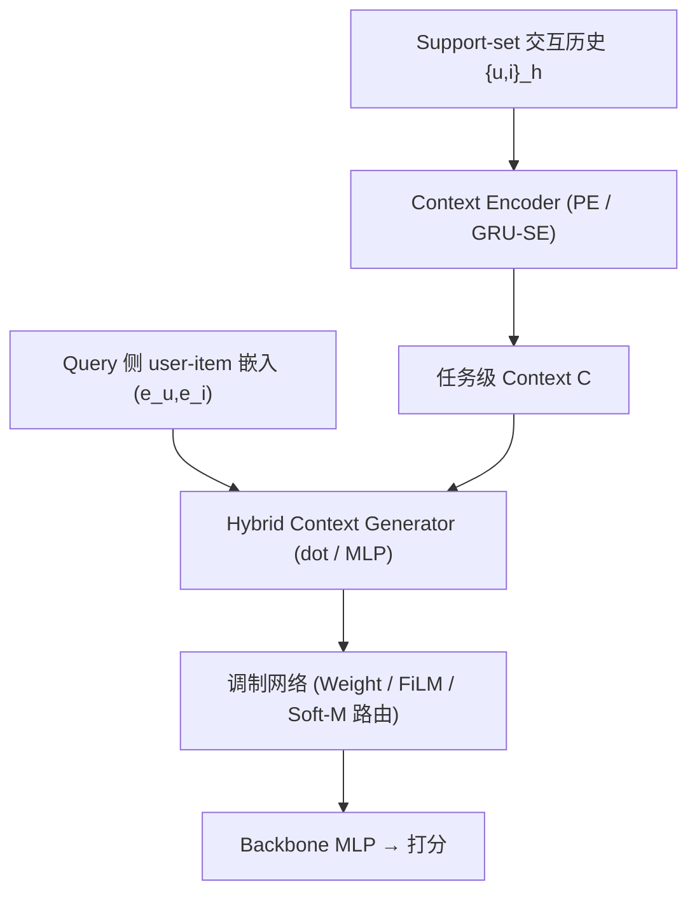
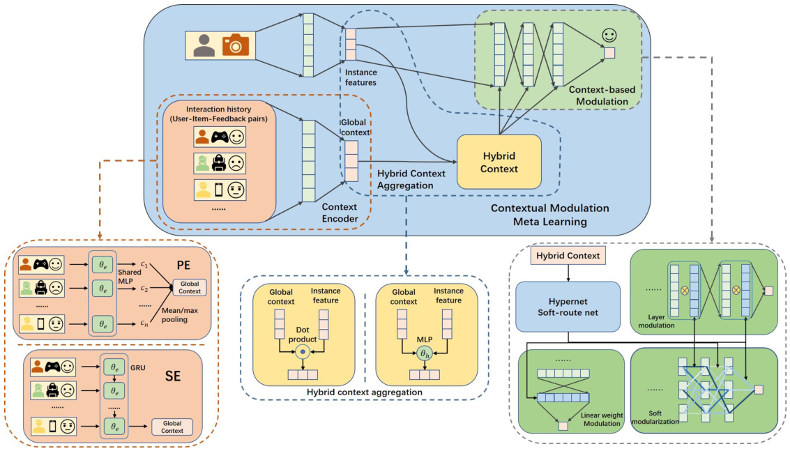

# CMML: Contextual Modulation Meta Learning for Cold-Start Recommendation (面向冷启动推荐的上下文调制元学习)

- **会议/期刊**: CIKM 2021
- **作者与机构**: Xidong Feng, Chen Chen, Dong Li, Mengchen Zhao, Jianye Hao, Jun Wang（UCL / 华为诺亚方舟实验室）
- **推荐链路定位**: 精排（CTR 打分 / 评分回归）
- **研究方向**: 冷启动与长尾推荐 / 跨域与多场景推荐
- **论文原文**: [https://arxiv.org/abs/2108.10511v4](https://arxiv.org/abs/2108.10511v4)
- **开源代码**: [https://github.com/THUDM/ScenarioMeta](https://github.com/THUDM/ScenarioMeta)

## TL;DR (1分钟核心速览)

梯度式元学习（MAML / MELU / s2Meta）靠内循环反向传播适配冷启动任务，精度虽好却**训练推理都需二阶梯度、且与工业界纯前馈 MLP 部署栈不兼容**。CMML 把"适配"从梯度下降改写成**前馈调制**：GRU 上下文编码器把 support-set 压成任务向量 $C$，与 query 侧 user-item 嵌入做点积生成混合上下文$C^h$，再由 FiLM / 软模块化路由调制骨干网络最后一层与各层输出。在 MovieLens-20M、Taobao、Hybrid 三套场景级 cold-start 与 MovieLens-1M 用户级 cold-start 上，精度与 s2Meta 持平（Hybrid 上 Recall@50 相对 +5.5%），而时间/显存比**单步** s2Meta 还低。

## Background & Motivation (背景与核心矛盾)

- **主流范式**: 把不同场景/用户视作元学习中的"任务"，用 MAML 学一组好的初始化参数，新任务来临时在 support-set 上做 $k$ 步梯度下降即可快速适配。
- **前人局限**: ① 内循环需前向+反向并计算 Hessian-vector 积，训练成本随步数 $k$ 线性膨胀；② 内循环梯度算子无法嵌入以 MLP 前馈为主的工业部署框架，线上无法低延迟执行。
- **核心洞察 (Key Insight)**: 适配的本质是"从少量样本中提取任务特征并调节模型"，这一步不必用反向传播——**把 support-set 直接映射为连续向量即可**，只要有一个强表达力的编码器和一个灵活的调制器。
- **本文切入点**: 以"上下文调制"替代内循环梯度，全流程前馈，元学习仍在外循环端到端训练以保证泛化。

## Method (核心方法设计)

### 1. 整体框架 (Overall Architecture)

输入一个任务 $T$的 support-set$\{u,i\}_h$与 query 的候选 user-item 对。上下文编码器把 support-set 中每对的嵌入编码后聚合为**任务级上下文**$C$；混合上下文生成器把$C$与 query 侧具体 user-item 嵌入交互，得到**实例级混合上下文**$C^h$；调制网络以$C^h$为条件生成权重/偏置或路由分布，改写骨干 MLP 的最后线性层或各隐层输出，最终输出打分。整个框架只有前向算子，元参数$\Theta_M$与骨干参数$\Phi$用外循环在 query-set 上联合反向传播。任务级损失对场景设定用 hinge、对用户设定用 MSE：$\min_{\Theta_M,\Phi}\mathbb{E}_{T\sim P(\mathcal{D}_{mtr})}[\mathcal{L}(D^T_q|D^T_s)]$。

<figure class="paper-figure" markdown="span">
  <figcaption>图1：CMML框架</figcaption>
</figure>

### 2. 关键设计拆解 (Key Designs)

1. **上下文编码器（PE / GRU-SE）**：痛点是对 support-set 的聚合必须是置换不变且能容纳高维隐语义。池化版为 $C=\text{Mean/MaxPool}(\{f_{\theta_e}([e_u,e_i]_k)\})$；序列版先用 GRU 编码再经 MLP 输出$C=f_{\theta_e^2}(o_n)$。GRU 被选用的是其**聚合能力**而非时序性——support-set 本身无时序，训练中随机制置换，使模型对顺序不敏感。直觉：一个任务的信息量主要来自样本分布而非样本排列。
2. **混合上下文与调制网络**：仅用任务级 $C$会让同一任务所有 query 对共享同一调制，丢失实例差异。混合上下文取低阶点积$C^h_{u,i}=C\odot\{M_ux_u,M_ix_i\}$（零额外参数且实测优于 MLP 版），随后：
   - FiLM 层调制：$w_h,b_h=f_{\theta_h}(C^h),\ o_i=w_h\odot l_i+b_h$，把参数空间从$n^2$降到$n$；
   - 软模块化：路由网络按 $C^h$生成层间分布$p^l_{i,j}=\text{softmax}(\sigma^l_{i,j})$，输出$ob^l_i=\sum_j p^{l-1}_{i,j}\,\text{MLP}_\Phi(ob^{l-1}_j)$，把"任务条件"换成连续向量而非 [37] 的离散任务 ID，故能泛化到全新任务，且路由权重低维可解释。
3. **训练目标、负采样与推理效率**：场景级用成对 hinge $\ell=\max(0,1-f(u,i^+)+f(u,i^-))$，用户级用$\ell=(y_{u,i}-f(u,i;\{u,i\}_h))^2$；support/query 分别随机采样（每场景 64 正+64 负 / 128 正+128 负），无需 hard negative mining。推理复杂度$O(mf_t)$对比 MAML-$k$的$O(mk(f_t+b_t))$，因$b_t>f_t$，理论快约$2k$倍；训练因需 Hessian-vector 积，MAML 为$O(5kmb_t)$而 CMML 仅$O(mb_t)$。

## Experimental Setup & Evaluation Protocol (实验设置与评估协议)

- **数据集与预处理**:

| 数据集 | #Users | #Items | #Interactions | 稀疏度/密度 | 特征/场景说明 |
| :--- | :---: | :---: | :---: | :---: | :--- |
| MovieLens-20M | 138,493 | 27,279 | 20,000,263 | 0.53% | 显式评分转隐式；306 个 genre 作场景，仅留 100–1000 item 的场景保证冷启动 |
| Taobao (Cloud Theme) | 700k | 1,400k | 5,717k | 0.0006% | 355 个主题场景，购买日志 |
| Hybrid Movie-Taobao | — | — | 拼接 | — | 两数据集场景拼接，测多域冷启动 |
| MovieLens-1M | 6,040 | 3,706 | 1,000k | 4.5% | 每用户截断至 50 条评分，评分回归 |

- **数据划分与防穿越 (Splitting Strategy)**: 场景级按**场景划分任务**（232 个场景作 meta-training，其余 meta-testing）；用户级按**用户划分**，并定义两种设定 W-W（暖用户训练/暖用户测试）与 C-W（冷用户训练/暖用户测试），与 MELU 的划分不同——冷用户取更早注册用户，强调对真正未见任务的泛化。
- **排名评测协议 (Ranking Protocol)**: 场景级为 **Sampled Ranking**：每场景 query 采 128 正 + 128 负，报 Recall@10/20/50（Taobao 与 Hybrid 报 @20/50/100），非全库 Full-Ranking；用户级报 MAE 与 NDCG@3。
- **对比基线与超参设置**: 场景级对比 DCN / DCN-F / ItemPop / CoNet / s2Meta；用户级对比 DCN / DCN-F / MetaCS-DNN / MELU。骨干为 ReLU-MLP(64,64,64)，上下文编码器 GRU + MLP(128,128)，软模块化 $k=3$层、每层$m=4$模块、每模块$d=32$，Adam lr=1e-4，item/user 嵌入由 CF 预生成。作者补充说明随机种子对场景级结果有影响，附录报 5 seed 结果。

## Key Experimental Results (实验关键数据)

### 1. 主实验对比 (Main Results)

| 方法 | ML-20M R@10 | ML-20M R@20 | Taobao R@20 | Taobao R@50 | Hybrid R@50 | Hybrid R@100 |
| :--- | :---: | :---: | :---: | :---: | :---: | :---: |
| DCN | 31.50 | 52.27 | 23.52 | 39.21 | 57.13 | 72.05 |
| DCN-F | 41.08 | 60.59 | 20.69 | 35.56 | 55.85 | 69.75 |
| ItemPop | 39.65 | 54.33 | 21.94 | 36.11 | 52.76 | 61.02 |
| CoNet | 46.27 | 63.11 | 20.27 | 31.48 | — | — |
| s2Meta | **47.52** | **66.09** | 25.52 | 42.03 | 56.84 | 70.19 |
| CMML-FiLM | 47.36 | 65.32 | **25.77** | **42.30** | 59.92 | **73.85** |
| CMML-Soft-M | 47.32 | 65.62 | 25.56 | 42.19 | **59.94** | 73.76 |
| **Improv. (vs best baseline)** | −0.34% | −0.71% | **+0.98%** | **+0.64%** | **+5.46%** | **+5.22%** |

用户级（MovieLens-1M）：W-W 上 MetaDNN 0.726/0.772、MELU 0.725/0.771、CMML-FiLM 0.727/0.771 三者几乎重合；C-W 上 MELU 0.734/0.763 略优于 CMML-FiLM 的 0.745/0.760。

### 2. 消融实验 (Ablation Study)

| 变体 | ML-20M R@10 | R@20 | R@50 | Taobao R@20 | Taobao R@50 |
| :--- | :---: | :---: | :---: | :---: | :---: |
| Non-negative + PE（去 support 负样本） | 31.67 | 52.69 | 86.20 | — | — |
| PE（池化编码器） | 40.05 | 61.24 | 87.78 | — | — |
| SE（GRU 编码器） | 44.30 | 63.82 | 88.10 | — | — |
| SE + MLP 混合上下文 | 46.37 | 65.18 | 88.61 | — | — |
| SE + dot 混合上下文（默认） | 47.29 | 65.50 | 88.62 | — | — |
| Weight Modulation (Linear) | 47.29 | 65.50 | — | 24.63 | 41.30 |
| Sigmoid 层调制 (S-LM) | 47.21 | 65.39 | — | 24.68 | 41.39 |
| FiLM 层调制 (F-LM) | **47.36** | 65.32 | — | **25.77** | **42.30** |
| 软模块化 (Soft-M) | 47.32 | **65.62** | — | 25.56 | 42.19 |

### 3. 关键实验发现 (Key Findings)

1. **上下文信息质量决定调制上限**：去掉 support-set 负样本后 R@10 从 40.05 暴跌到 31.67（−20.9%），说明调制器再强也无法从"只有正样本"的历史中推断场景偏好对比关系；而编码器从 PE 换 SE 带来 R@10 40.05→44.30（+10.6%），证明聚合表达力是第二瓶颈。
2. **低阶交互已足够，复杂调制按数据难度按需升级**：混合上下文 dots 版比 MLP 版 R@10 高 0.92 且零额外参数；调制器方面 ML-20M 上 Linear(47.29) 与 FiLM(47.36) 几乎无差，但 Taobao 上 FiLM 相对 Linear R@20 提升 +4.6%（25.77 vs 24.63），说明**数据越复杂（噪声大、场景数多）越需要高容量调制**，简单数据集上线性权调制即可。
3. **多域场景是前馈调制的最大受益点**：Hybrid 数据集上 CMML 相对 s2Meta R@50 提升 5.46%，归因于梯度法只能学一组共享初始化，难以同时覆盖 MovieLens 与 Taobao 两类分布，而连续上下文调制可实例级切换表示；同域单模态数据上则基本打平，说明 CMML 收益来源是"任务异质性"而非绝对拟合能力。效率上 CMML 的时间/显存低于**1 步** s2Meta 与 MELU，而后者实际用 5–20 步。

## Highlights & Limitations (亮点、对比与审稿批判)

- **与代表作对比 (vs. Prior Work)**: 与 MELU / MetaCS-DNN / s2Meta 同为元学习冷启动，但后三者都靠内循环梯度改写参数，CMML 改用上下文条件化调制，把二阶训练与推理反传彻底去掉；与 [31] 只对单线性模型做超网络调制不同，CMML 调制的是 MLP 末层乃至各隐层（FiLM/路由），表达力更强；与 MMoE 系多任务路由 [37] 相比，路由条件从离散任务 ID 换成连续 $C^h$，可外推至训练未见场景。
- **可迁移亮点**: ① 用 GRU 聚合 + 每轮随机制置换，可在无时序语义的集合输入上获得比 mean-pooling 更强的聚合能力；② 软模块化路由权重低维可视化（图 4）可作为"任务相似度探针"，直接观察新场景激活了哪些子模块，便于线上排障。
- **审稿级局限批判**: ① **评测协议偏乐观**：场景级 Recall 在 128 正 + 128 负的采样候选中计算，未做全库 Full-Ranking，绝对数值不可与工业全库召回横向比较，且负样本比例固定可能放大方法间差异；② **单模态同域数据上无增益**（ML-20M 上甚至略低于 s2Meta 0.16–0.9 个点），作者自承梯度下降是强适配器，未给出"何时该用 CMML"的判定准则；③ 随机种子敏感性需靠附录 5 seed 补救，主表未报方差与显著性检验；④ 上下文编码器需在推理时读取 support-set 全量前向，冷启动用户首次请求仍有额外编码开销。

## Rating (四维评分)

- **方法创新性 (Novelty)**: ⭐⭐⭐⭐ （把元学习适配从"梯度算子"重构为"上下文调制算子"，FiLM/软路由两种调制粒度 + 混合上下文的组合设计清晰，但单个组件多为已有技术的重组）
- **评估协议与实验扎实度 (Protocol & Experiments)**: ⭐⭐⭐ （覆盖场景级与用户级两类冷启动、四个数据集、9 个基线，消融较完整；但采样排序协议非全库、主表无方差与显著性检验、种子敏感问题外置到附录）
- **写作与数学规范度 (Clarity & Rigor)**: ⭐⭐⭐⭐ （三类调制的复杂度对比 $O(mk(f_t+b_t))$vs$O(mf_t)$与 Hessian 代价分析给得明确，符号统一；混合上下文与路由公式略简，路由下标$t$/$m$ 混用）
- **工业落地与复现价值 (Industrial & Practical Value)**: ⭐⭐⭐⭐⭐ （全前馈、与 MLP 部署栈天然兼容、显存/延迟优于单步 MAML，代码已开源，是冷启动元学习少见的可直接上线方案）

