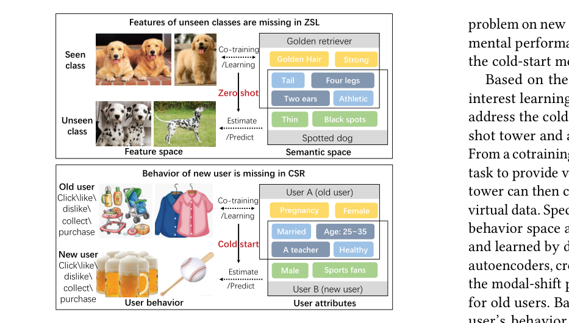
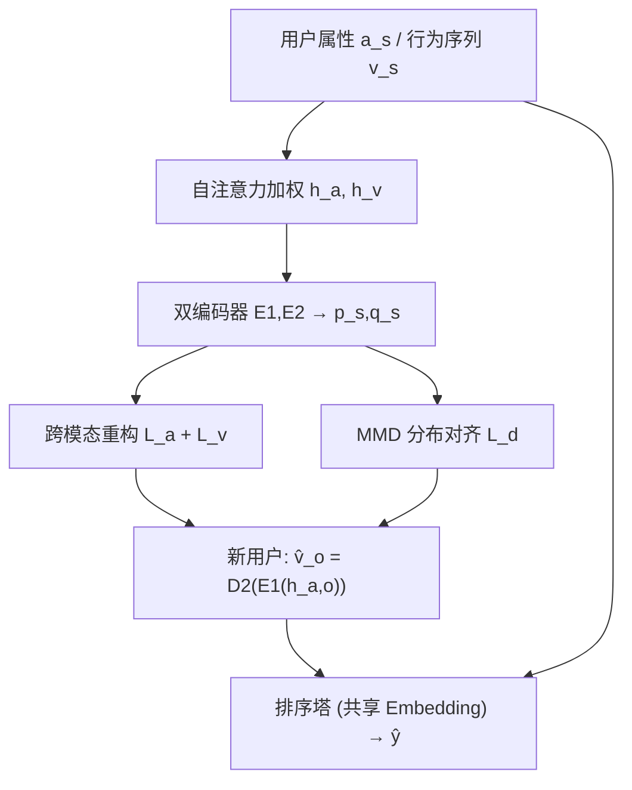

# Zero Shot on the Cold-Start Problem: Model-Agnostic Interest Learning for Recommender Systems (零样本视角下的冷启动问题：模型无关的兴趣学习框架)

- **会议/期刊**: CIKM 2021
- **作者与机构**: Philip J. Feng, Pingjun Pan, Tingting Zhou, Hongxiang Chen, Chuanjiang Luo（网易云音乐 NetEase Cloud Music）
- **推荐链路定位**: 精排（CTR/CVR 预估），冷启动补全模块挂载于排序塔之前
- **研究方向**: 冷启动与长尾推荐 / CTR 预估与特征交叉
- **论文原文**: [https://arxiv.org/abs/2108.13592v1](https://arxiv.org/abs/2108.13592v1)
- **开源代码**: [https://github.com/LiangjunFeng/MAIL](https://github.com/LiangjunFeng/MAIL)

## TL;DR (1分钟核心速览)

新用户行为序列为空导致兴趣零空间，已有冷启动方法（属性拼接、跨域迁移、元学习初始化）只是"补特征"或"改初始化"，无法真正补出行为。本文将冷启动重构为零样本学习问题：用双自编码器做属性-行为跨模态重构，并以 MMD 约束对齐两个隐空间，从属性端直接**生成虚拟行为序列** $\hat{\boldsymbol{v}}_o$ 喂给任意 embedding-based 排序塔。在 Alimama 与网易云工业集上，新用户 AUC 相对最强基线 DMR 分别提升 1.34% / 1.05%，线上半年 A/B（各 300 万用户）CTR 相对提升 13%–15%、CTCVR 提升 3%–4%。

## Background & Motivation (背景与核心矛盾)

- **主流范式**: 精排侧用 EmbLR / BaseDNN / DMR 等 embedding + MLP 模型做 CTR 预估；冷启动侧靠用户属性、跨域知识、异构信息网络或元学习（MetaEmb）补足新用户的表征。
- **前人局限**: 其一，LLAE 等零样本方法用**线性**低秩自编码器从属性回归行为，无法覆盖真实系统中用户-物品基数巨大造成的模态鸿沟（modal shift）；其二，跨域/元学习类方法始终停留在"改进初始化或增加辅助特征"，新用户的行为序列依旧是空集，模型对新用户的信息量本质少于老用户。
- **核心洞察 (Key Insight)**: 冷启动与新用户在结构上等价于 ZSL 的"未见类"——缺失的不是标签而是**该类样本的特征**；而排序塔已经很强，冷启动模块应当是**增量补充（supplement）而非替代（substitute）**，否则会牺牲老用户上已获得的 SOTA 排序性能。
- **本文切入点**: 把用户行为当作"视觉特征"、把用户属性当作"语义描述"，用生成式跨模态重构在隐空间完成属性→行为的迁移，并让该模块与任意排序塔端到端协同训练。

<figure class="paper-figure" markdown="span">
  <figcaption>图1：ZSL与CSR的范式。CSR中新用户行为缺失，如同ZSL中未见类特征缺失。相似范式使得可从零样本视角解决CSR。</figcaption>
</figure>

## Method (核心方法设计)

### 1. 整体框架 (Overall Architecture)

MAIL 采用双塔协同训练：**零样本塔**只在老用户（$flag=\text{false}$，行为$\boldsymbol{v}_s$可用）上训练，先用自注意力分别把属性集$\boldsymbol{a}_s$与行为序列$\boldsymbol{v}_s$压成$\boldsymbol{h}_{a,s}$、$\boldsymbol{h}_{v,s}$，经两个编码器$E_1,E_2$投到共享隐空间得$\boldsymbol{p}_s,\boldsymbol{q}_s$，再要求$\boldsymbol{p}_s$与$\boldsymbol{q}_s$**各自都能同时重构出属性与行为**（跨模态重构），并施加 MMD 分布对齐；**排序塔**对老用户用真实$\boldsymbol{v}_s$、对新用户用零样本塔由属性生成的虚拟行为$\hat{\boldsymbol{v}}_o$，经 sum-pooling + MLP 输出 CTR。两塔共享 embedding 查找表但使用两个独立优化器，保证重构梯度不污染 ID 表征。

### 2. 关键设计拆解 (Key Designs)

1. **跨模态重构（Cross-Modal Reconstruction）**：解决线性 LLAE 无法拟合属性→行为非线性映射的问题。核心做法是让属性隐向量与行为隐向量**共享同一组解码器**：$\mathcal{L}_a=\lVert D_1(\boldsymbol{p}_s)-\boldsymbol{a}_s\rVert_2^2+\lVert D_2(\boldsymbol{p}_s)-\boldsymbol{v}_s\rVert_2^2$，$\mathcal{L}_v$同理以$\boldsymbol{q}_s$为输入。直觉是：若两个隐向量对同一组解码器可互换，它们就具备"同等预测能力"，从而新用户的$\boldsymbol{p}_o$可直接绕过行为输入生成$\hat{\boldsymbol{v}}_o=D_2(E_1(\boldsymbol{h}_{a,o}))$。

2. **MMD 隐空间对齐**：仅有重构损失时，$\boldsymbol{p}_s$与$\boldsymbol{q}_s$可能落在隐空间的不同流形上，$D_2(E_1(\cdot))$在推理时会漂移。作者在 RKHS 中用高斯核（$\sigma=1$）最小化两批隐向量的分布距离：$\mathcal{L}_d=\lVert\frac{1}{n}\sum_i\phi(\boldsymbol{p}_{s,i})-\frac{1}{n}\sum_j\phi(\boldsymbol{q}_{s,j})\rVert_{\mathcal{H}}^2$，展开为三项核和。它把"点对点重构"升级为"分布对分布对齐"，是跨模态迁移收敛的关键正则。

3. **训练目标、双优化器与推理开销**：零样本塔损失 $\mathcal{L}_{zst}=\mathcal{L}_a+\mathcal{L}_v+\mathcal{L}_d$，排序塔为 BCE$\mathcal{L}_{rt}$，总损失$\mathcal{L}=\mathcal{L}_{zst}+\mathcal{L}_{rt}$。关键工程技巧：$G_A$只更新零样本塔参数，embedding 查找表**完全由$G_B$随排序塔训练**——因为重构目标是"贴合现有 embedding"而非"改动 embedding"，否则会退化表征。编码器/解码器采用残差拼接结构（1024-512-512 / 512-1024-$d_t$）缓解稀疏信息下的重构困难。推理期仅需对新用户多跑一次$E_1\!\to\!D_2$ 前向，在线开销可忽略；且两塔同时训练，天然支持训练集中也存在新用户的场景。

## Experimental Setup & Evaluation Protocol (实验设置与评估协议)

- **数据集与预处理**:

| 数据集 | #Users | #Items | #Interactions | 稀疏度/密度 | 特征/场景说明 |
| :--- | :---: | :---: | :---: | :---: | :--- |
| Public (Alimama) | 1,141,729 | 846,811 | ~6.0M | 密度 $6.2\times10^{-6}$ | 9 个用户属性、4 个上下文、6 个物品特征；淘宝广告曝光 8 天 |
| Industrial (NetEase Cloud Music) | 613,221 | 52,831 | ~2.0M | 密度 $6.2\times10^{-5}$ | 21 个用户属性、75 个上下文、105 个物品特征；约半数为真实新用户 |

- **数据划分与防穿越 (Splitting Strategy)**: 均为 `全局时间戳切分`——前 7 天日志训练、第 8 天测试。公有集**本身不含新用户**，作者随机抽取 40% 用户在训练与测试集中**删除其全部行为**以人工构造新用户（属于模拟冷启动划分）；工业集则保留真实新用户（行为序列为空）不做人工删改。
- **排名评测协议 (Ranking Protocol)**: 采用曝光级 **point-wise CTR 二分类评估**，指标为 AUC 与分用户组加权 GAUC，负样本即日志中真实未点击曝光（不做额外负采样，也不做 Full-Ranking 全库排序）。同时按新/老用户分组汇报，并以 $RI(a,b)=(b-a)/a\times100\%$ 报相对提升。
- **对比基线与超参设置**: 线性组 EmbLR、LLAE(2019)；深度组 BaseDNN、MetaEmb(2019)；强排序组 DMR(2020)，以及 MAIL-Base / MAIL-DMR。超参：学习率 0.001、embedding 维度 $d=32$、batch 1024、dropout 0.5、行为序列最大长度 100（不足补零）、Adam($\beta_1=0.9,\beta_2=0.999$)。

## Key Experimental Results (实验关键数据)

### 1. 主实验对比 (Main Results)

| 方法 | Public 新用户 AUC | Public 新用户 GAUC | Public 老用户 AUC | Industrial 新用户 AUC | Industrial 新用户 GAUC | Industrial 老用户 AUC |
| :--- | :---: | :---: | :---: | :---: | :---: | :---: |
| EmbLR | 0.5800 | 0.6252 | 0.5607 | 0.6682 | 0.6365 | 0.7728 |
| LLAE (2019) | 0.5854 | 0.6253 | 0.5646 | 0.6713 | 0.6384 | 0.7737 |
| BaseDNN | 0.5862 | 0.6271 | 0.5658 | 0.6771 | 0.6380 | 0.7782 |
| MetaEmb (2019) | 0.5911 | 0.6273 | 0.5682 | 0.6834 | 0.6404 | 0.7788 |
| MAIL-Base | 0.5934 | 0.6271 | 0.5710 | 0.6849 | 0.6413 | 0.7788 |
| DMR (2020) | 0.5879 | 0.6302 | 0.5668 | 0.6823 | 0.6420 | 0.7833 |
| **MAIL-DMR** | **0.5958** | **0.6302** | **0.5733** | **0.6895** | **0.6465** | **0.7838** |
| Improv.% (vs 对应基线) | +1.34% | +0.00% | +1.14% | +1.05% | +0.70% | +0.06% |

### 2. 消融实验 (Ablation Study)

| 变体 | Public 新用户 AUC | Public 老用户 AUC | Industrial 新用户 AUC | Industrial 老用户 AUC |
| :--- | :---: | :---: | :---: | :---: |
| BaseDNN（无零样本塔） | 0.5862 | 0.6271 | 0.6771 | 0.7788 |
| MAIL-None（仅属性→行为线性映射） | 0.5834 | 0.6263 | 0.6755 | 0.7782 |
| MAIL-Single（仅 $\mathcal{L}_a$） | 0.5844 | 0.6267 | 0.6764 | 0.7784 |
| MAIL-Dual（$\mathcal{L}_a+\mathcal{L}_v$） | 0.5897 | 0.6272 | 0.6802 | 0.7788 |
| **MAIL-Base（$\mathcal{L}_a+\mathcal{L}_v+\mathcal{L}_d$）** | **0.5934** | 0.6271 | **0.6849** | 0.7788 |

### 3. 关键实验发现 (Key Findings)

1. **重构对齐必须"双向 + 分布级"**：仅用单侧重构（MAIL-Single）甚至为负收益（Public 新用户 0.5844 < BaseDNN 0.5862，工业 0.6764 < 0.6771）；补上双侧重构后 +0.35pp/+0.31pp，再加 MMD 再 +0.37pp/+0.47pp。说明没有 MMD 约束时两隐空间不共享流形，生成的虚拟行为是"不可靠数据"，反而拖累排序塔（老用户 AUC 亦下降 0.05%–0.12%）。
2. **生成式迁移优于初始化式迁移**：同等 BaseDNN 骨干下 MAIL-Base 新用户 AUC 0.5934 vs MetaEmb 0.5911（+0.23pp），工业集 0.6849 vs 0.6834（+0.15pp）——补出"行为数据"比给出"更好的 embedding 初值"信息量更高，且老用户侧 MAIL 也不掉点（0.6271/0.7788 持平）。
3. **模型无关性带来可叠加增益**：把排序塔从 BaseDNN 换成更强的 DMR，MAIL 仍继续涨（Public 新用户 0.5934→0.5958，工业 0.6849→0.6895），而 DMR 单独使用在新用户上甚至不如 MetaEmb（工业 0.6823 < 0.6834），证明冷启动模块确实是增量补充而非替代；线上 MAIL-DMR vs DMR 相对 CTR +13%–15%、CTCVR +3%–4%（各 300 万用户、半个月），转化率提升比 CTR 更难，说明补全的是真实兴趣而非曝光偏置。

## Highlights & Limitations (亮点、对比与审稿批判)

- **与代表作对比 (vs. Prior Work)**: 相比 LLAE 的线性低秩自编码器 + LR 排序器，MAIL 用非线性残差双自编码器与 MMD 分布对齐攻克模态鸿沟，并可挂载任意深度排序塔；相比 MetaEmb 的"元学习给初值"，MAIL 直接生成虚拟行为序列，属于数据级而非参数级迁移；相比 DMR 这类纯排序模型，MAIL 不替换而是补全其输入，从而同时保住老用户 SOTA 与新用户增量。
- **可迁移亮点**: ①"共享解码器 + 双向重构"作为跨模态缺失补全的通用正则，可搬到跨域推荐与模态缺失的多模态推荐；②"embedding 表只由主任务优化器更新"的双优化器隔离技巧，对任何"辅助塔 + 主塔共享 embedding"的架构都适用。
- **审稿级局限批判**: ① 评估仅用曝光级 AUC/GAUC，没有 HR/NDCG 等全库排序指标，且公有集新用户是**人工删除 40% 行为**构造的，与真实冷启动分布存在偏差；② 可行性论证停留在"兴趣空间小于行为空间"的直觉 + t-SNE 可视化，缺乏对属性→行为映射可辨识性的理论刻画；③ 零样本塔对属性缺失同样敏感，论文未讨论属性本身也缺失（strict cold-start + 属性稀疏）时的退化，且两塔联合训练使工程链路比单塔更重。

## Rating (四维评分)

- **方法创新性 (Novelty)**: ⭐⭐⭐⭐ （把 CSR 严格对齐 ZSL 未见类范式，跨模态重构 + MMD 对齐的组合在冷启动方向上是清晰的新增量，但各组件本身并非首创）
- **评估协议与实验扎实度 (Protocol & Experiments)**: ⭐⭐⭐ （两套百万级真实数据 + 半年线上 A/B 很有说服力，但只有 AUC/GAUC 的 point-wise 评估、新用户靠人工删行为构造，缺排序指标与显著性检验）
- **写作与数学规范度 (Clarity & Rigor)**: ⭐⭐⭐⭐ （损失项、双优化器与算法伪码交代清楚，公式与符号定义完整；可行性分析偏定性是主要扣分点）
- **工业落地与复现价值 (Industrial & Practical Value)**: ⭐⭐⭐⭐⭐ （代码开源、模型无关可直接插到现有排序塔、线上 CTR +13%–15%，是少见的"论文即生产"级工作）

