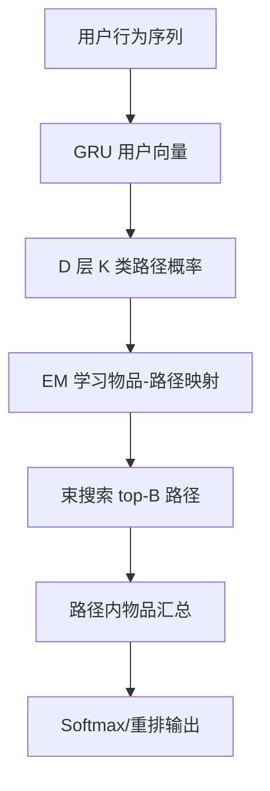
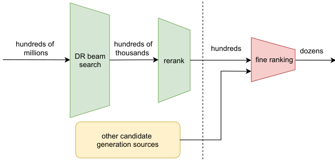

# Deep Retrieval: Learning A Retrievable Structure for Large-Scale Recommendations (深度检索：面向大规模推荐的可检索结构学习)

- **会议/期刊**: CIKM 2021
- **作者与机构**: Weihao Gao, Xiangjun Fan, Chong Wang 等，字节跳动
- **推荐链路定位**: 召回
- **研究方向**: 协同过滤与双塔召回
- **论文原文**: [https://arxiv.org/abs/2007.07203v2](https://arxiv.org/abs/2007.07203v2)
- **开源代码**: 暂未开源

## TL;DR (1分钟核心速览)

针对大规模召回中“双塔内积+ANN”受欧氏空间假设与两阶段目标不一致限制，DR 将物品编码为 \(K\times D\) 离散路径，与用户塔联合优化，并用束搜索亚线性召回。MovieLens@10、Amazon@200 全库评测逼近暴力检索，线上视频完播率相对提升 +3.0%。

## Background & Motivation (背景与核心矛盾)

- **主流范式**: 先学习用户-物品内积模型，再用 ANN/MIPS 做近似最近邻检索；树模型则把物品映射到叶节点并联合学习树结构。
- **前人局限**: 内积结构未必足以刻画复杂交互；ANN 只逼近已学内积模型，并非直接优化点击目标。树模型每个物品仅对应一个叶节点，亿级物品下叶级数据稀疏，树结构难学。
- **核心洞察 (Key Insight)**: 召回不需要“叶节点级”区分，只需把物品聚到可检索路径；若一个物品可属于多条路径，就能表达多面兴趣并缓解稀疏。
- **本文切入点**: 用 \(K\times D\) 路径作为离散可学习索引，以 EM 联合学习路径分配与神经网络参数，推理时束搜索路径而非全库内积。

## Method (核心方法设计)

### 1. 整体框架 (Overall Architecture)

用户行为序列经 GRU 编码为用户向量；DR 含 \(D\) 层、每层 \(K\) 个节点，逐层输出下一节点概率，形成路径 \(c=(c_1,\dots,c_D)\) 的概率。训练时 E 步用梯度优化网络，M 步为物品重新分配多条路径；线上用束搜索取 top-B 路径，汇总路径内物品后由 softmax/重排模型精排。结构参数规模为 \(\Theta(KD^2)\)，远小于 \(K^D\) 条可能路径。

<figure class="paper-figure" markdown="span">
  ![图 1：(a) 考虑一个宽度 𝐾=100、深度 𝐷=3 的结构，以及由路径 \[36, 27, 20\] 编码的条目。该路径表示条目被分配到 𝐾×𝐷 矩阵的 (1, 36)、(2, 27)、(3, 20) 索引。图中同色箭头构成一条路径。不同路径可通过在某一层共享公共索引而相交。(b) 构建 𝑝(𝑐|𝑥,𝜃) 的过程流程图，即给定输入 𝑥 时路径 𝑐=\[𝑐1,𝑐2,𝑐3\] 的概率。](../../../../assets/papers/2007.07203v2/figure_1.png)<figcaption>图 1：(a) 考虑一个宽度 𝐾=100、深度 𝐷=3 的结构，以及由路径 [36, 27, 20] 编码的条目。该路径表示条目被分配到 𝐾×𝐷 矩阵的 (1, 36)、(2, 27)、(3, 20) 索引。图中同色箭头构成一条路径。不同路径可通过在某一层共享公共索引而相交。(b) 构建 𝑝(𝑐|𝑥,𝜃) 的过程流程图，即给定输入 𝑥 时路径 𝑐=[𝑐1,𝑐2,𝑐3] 的概率。</figcaption>
</figure>
图 1：K×D 路径索引与路径概率生成流程。

### 2. 关键设计拆解 (Key Designs)

1. **多路径概率结构（multi-path）**：痛点是一对一树映射容量不足。DR 将路径概率分解为逐层条件概率 \(p(c|x,\theta)=\prod_{d=1}^{D}p(c_d|x,c_1,\dots,c_{d-1},\theta_d)\)，并允许物品 \(y_i\) 属于 \(J\) 条路径，目标为 \(\mathcal{Q}_{str}=\sum_i\log\sum_{j=1}^{J}p(\pi_j(y_i)|x_i,\theta)\)。多层依赖让路径共享前缀又可在某层分叉，多路径则让巧克力既可归“食品”也可归“礼物”，提升多面召回。

2. **带惩罚的 EM 路径分配**：若直接优化映射，模型会把全部物品塞进单一路径。DR 加惩罚 \(\mathcal{Q}_{pen}=\mathcal{Q}_{str}-\alpha\sum_c f(|c|)\)，取 \(f(|c|)=|c|^4/4\)。M 步用累计分数 \(s[v,c]=\sum_{i:y_i=v}p(c|x_i,\theta)\)，坐标下降时按增量 \(\Delta s=N_v[\log(s[v,c]+\text{sum})-\log(\text{sum})]-\alpha(f(|c|+1)-f(|c|))\) 贪心选路径；流式训练仅保留 top-S 分数，新路径用 \(\min(s)\) 初始化以鼓励探索，衰减 \(\eta=0.999\)。

3. **训练目标、负采样与推理效率**：总损失 \(\mathcal{Q}=\mathcal{Q}_{pen}+\mathcal{Q}_{softmax}\)，重排器用 sampled softmax；结构模型仅用正交互，未建模负反馈。推理束搜索每层从 \(K\times B\) 选 top-B，复杂度 \(O(DKB\log B)\)，对物品数 \(V\) 亚线性；Amazon 上 0.266 ms/实例，暴力检索 1.064 ms/实例。

## Experimental Setup & Evaluation Protocol (实验设置与评估协议)

- **数据集与预处理**:

| 数据集 | #Users | #Items | #Interactions | 稀疏度/密度 | 特征/场景说明 |
| :--- | :---: | :---: | :---: | :---: | :--- |
| MovieLens-20M | 129,797 | 20,709 | 9,939,873 | 0.37% | 评分≥4，用户≥10条；序列建模 |
| Amazon Books | 294,739 | 1,477,922 | 8,654,619 | 0.00199% | 沿用JTM预处理；更稀疏、物品更多 |

- **数据划分与防穿越**: 用户级不相交划分；MovieLens 采 1,000 验证/1,000 测试用户，Amazon 各 5,000；每用户按时间前一半为历史行为，后一半为预测真值。
- **排名评测协议**: 无偏 Full-Ranking，按用户返回 top-10（MovieLens）与 top-200（Amazon），逐用户计算 P/R/F 后不加权平均；非采样排序。
- **对比基线与超参**: Item-CF、YouTube DNN、TDM、JTM、Brute-force 上界。MovieLens：\(K=50,D=3,B=25,J=3,\alpha=3\times10^{-5}\)；Amazon：\(K=100,D=3,B=50,J=3,\alpha=3\times10^{-7}\)。序列截断 69，GRU 编码；论文未显式报告 embedding 维度 \(d\)。DR/暴力检索独立训练 5 次报告均值±标准差，线上 A/B 称显著。

## Key Experimental Results (实验关键数据)

### 1. 主实验对比 (Main Results)

| 数据集/协议 | 指标 | Item-CF | YouTube DNN | TDM | JTM | DR | Brute-force | DR vs 最强基线 |
| :--- | :--- | :---: | :---: | :---: | :---: | :---: | :---: | :---: |
| MovieLens@10 | Precision | 8.25% | 11.87% | 14.06% | — | **20.58%** | 20.70% | +46.4% vs TDM |
| MovieLens@10 | Recall | 5.66% | 8.71% | 10.55% | — | **10.89%** | 10.96% | +3.2% vs TDM |
| MovieLens@10 | F-measure | 5.29% | 7.96% | 9.49% | — | **12.32%** | 12.38% | +29.8% vs TDM |
| Amazon@200 | Precision | 0.52% | 0.53% | 0.56% | 0.79% | **0.95%** | 0.95% | +20.3% vs JTM |
| Amazon@200 | Recall | 8.18% | 8.26% | 8.57% | 12.45% | **13.74%** | 13.75% | +10.4% vs JTM |
| Amazon@200 | F-measure | 0.92% | 0.93% | 0.98% | 1.38% | **1.63%** | 1.63% | +18.1% vs JTM |

注：Brute-force 为不可部署的全库内积上界；DR 在可部署方法中全面最优。

### 2. 消融实验 (Ablation Study)

| 结构配置 \((K,D)\) | P@200 | R@200 | F@200 |
| :--- | :---: | :---: | :---: |
| (100, 2) | 0.93% | 13.34% | 1.59% |
| (100, 3) | **0.95%** | **13.74%** | **1.63%** |
| (100, 4) | 0.95% | 13.67% | 1.63% |
| (1000, 2) | 0.95% | 13.68% | 1.62% |

### 3. 关键实验发现 (Key Findings)

1. MovieLens 上 DR 相对 TDM 的 P@10 提升 46.4%，而 R@10 仅提升 3.2%，说明路径聚类+重排在候选精准度上收益更大；F@10 仍提升 29.8%，整体显著优于树模型。
2. Amazon 稀疏集上 DR 的 R@200 比 JTM 高 10.4%、F 高 18.1%，且与暴力检索持平；推理仅 0.266 ms/实例，约为暴力检索的 1/4，验证了亚线性召回上界逼近能力。
3. 线上 A/B 中完播率 +3.0%、App 时长 +0.87%、次日留存 +0.036%；同时更多长尾视频/创作者被推荐。结构上 \(D=3\) 最优，\(D=4\) 无增益；\(\alpha\) 从 \(3\times10^{-9}\) 到 \(3\times10^{-6}\) 可将最大路径规模从 1948 降至 242。

<figure class="paper-figure" markdown="span">
  <figcaption>图 6：展示如何在工业推荐系统中使用 DR 的示意图。</figcaption>
</figure>
图 6：DR 在工业推荐系统中的候选召回位置。

## Highlights & Limitations (亮点、对比与审稿批判)

- **与代表作对比 (vs. Prior Work)**: 相比 TDM/JTM 的一对一叶节点树，DR 无叶节点、多对多路径映射，缓解亿级物品下叶级稀疏；相比 FFM/HNSW 双塔+ANN，DR 不依赖欧氏空间假设，结构直接由交互目标端到端学习。
- **可迁移亮点**: 多路径离散索引+EM 坐标下降可用于任何超大规模召回；路径规模惩罚与流式 top-S 分数更新可迁移到动态物料系统，兼顾负载均衡与探索。
- **审稿级局限批判**: 结构模型仅用正交互，未建模曝光未点击/负反馈；M 步使用上界近似，缺乏最优性保证，且路径容量依赖 \(\alpha\) 调参。评估仅两个公开集，embedding 维度未报告，线上仅给相对指标，缺延迟分位数与覆盖率细节。

## Rating (四维评分)

- **方法创新性 (Novelty)**: ⭐⭐⭐⭐ （离散K×D路径+多路径EM+束搜索，非ANN召回路线新颖且有部署验证）
- **评估协议与实验扎实度 (Protocol & Experiments)**: ⭐⭐⭐⭐ （全库排序、5次重复、公开集+线上A/B较完整，但基线数量与显著性细节有限）
- **写作与数学规范度 (Clarity & Rigor)**: ⭐⭐⭐⭐ （概率分解、EM与坐标下降增量公式清晰，上界近似与流式估计交代充分）
- **工业落地与复现价值 (Industrial & Practical Value)**: ⭐⭐⭐⭐⭐ （亿级物品线上部署、4倍推理加速、流式构架，工程价值突出；可惜未开源）

