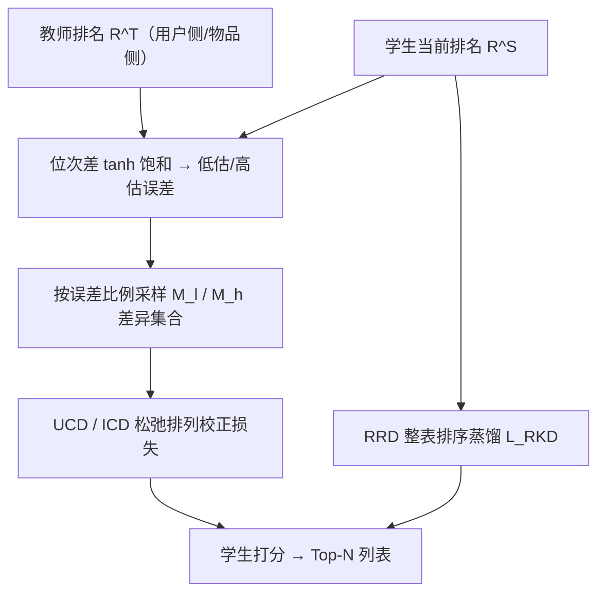
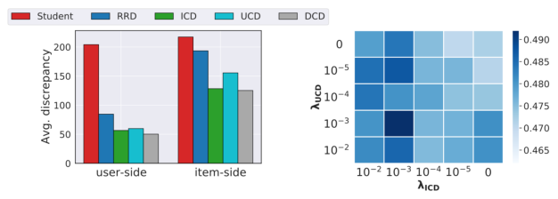

# Dual Correction Strategy for Ranking Distillation in Top-N Recommender System (Top-N 推荐排序蒸馏的双向校正策略)

- **会议/期刊**: CIKM 2021（5 页短文）
- **作者与机构**: Youngjune Lee, Kee-Eung Kim（KAIST 计算学院 / AI 研究生院）
- **推荐链路定位**: 精排（大模型→小模型压缩部署）
- **研究方向**: 协同过滤与双塔召回 / 大模型知识蒸馏
- **论文原文**: [arxiv.org/abs/2109.03459v4](https://arxiv.org/abs/2109.03459v4)
- **开源代码**: 暂未开源

## TL;DR (1分钟核心速览)

针对排序蒸馏 SOTA（RRD）的两处短板——① 无差别蒸馏教师排名，忽略学生已有的预测误差，训练效率低；② 只蒸馏用户侧排名，在稀疏隐式反馈下视角单一——本文提出 DCD：先用师生排名位次差定义「低估/高估」两类误差并经 $\tanh$ 饱和加权采样，再在采样出的差异物品上做松弛排列概率校正（UCD），并把同一套机制镜像到物品侧（ICD）。在 CiteULike / Foursquare 上沿用 Leave-One-Out + 全库排序协议，BPR 与 NeuMF 两种骨干上 H@5 相对 RRD 提升 3.00%–6.55%，相对无蒸馏学生提升 9.17%–23.52%。

## Background & Motivation (背景与核心矛盾)

- **主流范式**: 用大容量教师（$d=200$）的排名列表作为额外监督，指导小容量学生（$d=20$）学习 Top-N 排序；RRD 将蒸馏形式化为「师生排列概率匹配」，用松弛 ListMLE 只约束 top 段序关系。
- **前人局限**: (1) RRD 生成的训练信号完全由教师单向决定，学生已能正确复现的序关系被反复蒸馏，边际收益趋零；(2) 只做用户侧（同一用户内物品间）排序，稀疏隐式反馈下用户/物品表征质量不足，而学生容量本就受限，缺陷被放大。
- **核心洞察 (Key Insight)**: 真正有价值的知识应是「学生当前排错了的那部分」——把师生排名位次差当作课程信号，可让蒸馏目标随训练动态漂移，等价于为学生定制纠错路径。
- **本文切入点**: 用位次差量化两类误差并概率采样，再把校正损失同时铺到用户侧与物品侧（Dual）。

## Method (核心方法设计)

### 1. 整体框架 (Overall Architecture)

教师先在隐式反馈上预训练；学生每个 mini-batch 同时承载三条损失：原始 BPR/BCE 监督 $\mathcal{L}_{RS}$、教师整表排名的松弛排列蒸馏$\mathcal{L}_{RKD}$（同 RRD）、以及在「差异样本」上计算的用户侧/物品侧校正损失$\mathcal{L}_{UCD},\mathcal{L}_{ICD}$。差异样本每 5 个 epoch 依据当前师生排名重新采样一次，故监督信号随学生能力演进而变化；推理阶段只保留学生模型出分排序，教师不参与线上。

### 2. 关键设计拆解 (Key Designs)

1. **差异感知的误差量化与采样（Identifying Discrepancy）**：痛点是「蒸馏什么」缺乏依据。定义低估误差 $D^u_i(S,T)=\tanh\!\big(\max(\mu(R^S_u(i)-R^T_u(i)),0)\big)$，高估误差对称地取$D^u_i(T,S)$；$\tanh$的饱和性把超过阈值的误差一视同仁（$\mu=10^{-3}$控制锐度），避免个别极端错排垄断采样。采样概率正比于误差$p^u_l(i)\propto D^u_i(S,T)$、$p^u_h(i)\propto D^u_i(T,S)$，各取$M^u_l=M^u_h=40$ 个。直觉：误差越大表示学生「最该被纠正」的位置，样本自然聚焦于决策边界。

2. **双向校正损失（UCD / ICD）**：痛点是单侧排序视角不足。将采样出的低估集合 $\rho^u$（按教师原序排好）做精细校正、高估集合$M^u_h$ 整体压到最低位之后：

$$p(\rho^u|S)=\prod_{k=1}^{|\rho^u|}\frac{\exp S(u,\rho^u_k)}{\sum_{i=k}^{|\rho^u|}\exp S(u,\rho^u_i)+\sum_{j\in M^u_h}\exp S(u,j)}$$

   ICD 把 $S(u,i)$换成$S(i,u)$、在物品侧未交互用户列表上同理构造$p(\rho^i|S)$。分母只含「被选中的差异项」，从而在极小样本集上做高分辨率序校正，等价于对 Top-N 最敏感的区域做局部 ListMLE。

3. **训练目标、负采样与推理效率**：总损失 $\min_{\theta_s}\mathcal{L}_{RKD}+\lambda_{UCD}\mathcal{L}_{UCD}+\lambda_{ICD}\mathcal{L}_{ICD}$，基础监督沿用 BPR/NeuMF 的 1:1 均匀负采样，校正损失无需额外负样本（高估项即充当「相对负例」）。推理端学生参数量约为教师 1/10（BPR CiteULike 0.61M vs 6.08M），GPU 生成全用户列表 3.67s vs 5.90s，CPU 端 14.90s vs 59.80s。

## Experimental Setup & Evaluation Protocol (实验设置与评估协议)

- **数据集与预处理**（沿用 RRD 的过滤流程）：

| 数据集 | #Users | #Items | #Interactions | 稀疏度/密度 | 特征/场景说明 |
| :--- | :---: | :---: | :---: | :---: | :--- |
| CiteULike | 5,220 | 25,182 | 115,142 | 0.0876% | 学术文献收藏，纯隐式 |
| Foursquare | 19,466 | 28,594 | 609,655 | 0.1095% | LBS 签到，纯隐式 |

- **数据划分与防穿越**: `Leave-One-Out`——每用户留 2 个交互分别作 test / validation，其余训练；教师与学生共享同一划分。
- **排名评测协议**: `Full-Ranking`（对全部未交互物品打分排序，无采样候选池），指标 H@5/M@5/H@10/M@10，报告 5 次独立运行的均值；DCD vs RRD 采用配对 t-test（$p\le0.005$/$p\le0.0005$）。
- **对比基线与超参设置**: 骨干为 BPR 与 NeuMF，教师 $d=200$、学生$d=20$；对照 Student（无蒸馏）、RRD（SOTA），点式蒸馏方法 RD/CD 因已被 RRD 大幅超越而未纳入。$\lambda_{UCD},\lambda_{ICD}\in\{1,\dots,10^{-5}\}$网格搜索，$\mu=10^{-3}$，采样周期 5 epoch。

## Key Experimental Results (实验关键数据)

### 1. 主实验对比 (Main Results)

| 骨干 | 方法 | CiteULike H@5 | M@5 | H@10 | M@10 | Foursquare H@5 | M@5 | H@10 | M@10 |
| :--- | :--- | :---: | :---: | :---: | :---: | :---: | :---: | :---: | :---: |
| BPR | Teacher | 0.5282 | 0.3704 | 0.6328 | 0.3844 | 0.5623 | 0.3618 | 0.7068 | 0.3812 |
| BPR | Student | 0.4570 | 0.3061 | 0.5673 | 0.3214 | 0.4982 | 0.3140 | 0.6498 | 0.3342 |
| BPR | RRD | 0.4735 | 0.3200 | 0.5800 | 0.3343 | 0.5132 | 0.3259 | 0.6625 | 0.3454 |
| BPR | **DCD** | **0.4989** | **0.3412** | **0.6082** | **0.3560** | **0.5468** | **0.3483** | **0.6958** | **0.3683** |
| BPR | Improv. vs RRD | +5.36% | +6.63% | +4.86% | +6.49% | +6.55% | +6.87% | +5.03% | +6.63% |
| NeuMF | Teacher | 0.4840 | 0.3346 | 0.5827 | 0.3478 | 0.5459 | 0.3499 | 0.6897 | 0.3693 |
| NeuMF | Student | 0.3805 | 0.2499 | 0.4817 | 0.2634 | 0.4793 | 0.2959 | 0.6312 | 0.3162 |
| NeuMF | RRD | 0.4563 | 0.2952 | 0.5647 | 0.3092 | 0.5076 | 0.3119 | 0.6615 | 0.3313 |
| NeuMF | **DCD** | **0.4700** | **0.3101** | **0.5742** | **0.3241** | **0.5287** | **0.3303** | **0.6734** | **0.3497** |
| NeuMF | Improv. vs RRD | +3.00% | +5.05% | +1.68% | +4.82% | +4.16% | +5.90% | +1.80% | +5.55% |

### 2. 消融实验 (Ablation Study)

| 骨干 | 变体 | H@5 | M@5 | H@10 | M@10 |
| :--- | :--- | :---: | :---: | :---: | :---: |
| BPR | DCD（完整） | **0.5468** | **0.3483** | **0.6958** | **0.3683** |
| BPR | w/o Correction（仅双侧 RRD） | 0.5318 | 0.3408 | 0.6710 | 0.3594 |
| BPR | w/o Item-side | 0.5399 | 0.3424 | 0.6908 | 0.3628 |
| BPR | w/o User-side | 0.5377 | 0.3419 | 0.6870 | 0.3620 |
| BPR | w/o Sampling（取误差最大者） | 0.5420 | 0.3426 | 0.6898 | 0.3621 |
| NeuMF | DCD（完整） | **0.5287** | **0.3303** | **0.6734** | **0.3497** |
| NeuMF | w/o Correction | 0.5147 | 0.3214 | 0.6704 | 0.3424 |
| NeuMF | w/o Item-side | 0.5180 | 0.3210 | 0.6716 | 0.3417 |
| NeuMF | w/o User-side | 0.5225 | 0.3254 | 0.6681 | 0.3450 |
| NeuMF | w/o Sampling | 0.5196 | 0.3230 | 0.6706 | 0.3433 |

### 3. 关键实验发现 (Key Findings)

1. **校正机制本身贡献最大**：Foursquare+BPR 去掉校正策略（仅做双边 RRD）H@5 从 0.5468 掉到 0.5318（−2.74%），而单去 UCD 或 ICD 分别只掉 1.26%/1.68%，说明「按误差选知识」比「多一个蒸馏视角」更关键；双侧同时保留才能拿满收益。
2. **增益集中在 Top-5**：DCD 相对 RRD 在 H@5/M@5 上提升 3.00%–6.87%，而在 H@10 上仅 1.68%–5.03%（NeuMF 尤甚），印证误差校正确实作用在列表头部而非尾部序关系。
3. **采样优于确定性取最大误差**：w/o Sampling 在 NeuMF 上 H@5 掉 1.08%（0.5287→0.5196），说明按误差比例概率采样保留了探索性，避免训练被少数极端错排样本带偏；图 1a 进一步显示 DCD 的师生平均排名差异在用户侧与物品侧均为最低，直接对应最优精度。

<figure class="paper-figure" markdown="span">
  <figcaption>图1：DCD 的效果。(a) 与 Teacher 的平均差异，(b) 在不同 𝜆𝑈𝐶𝐷 和 𝜆𝐼𝐶𝐷 下的 H@5。</figcaption>
</figure>

## Highlights & Limitations (亮点、对比与审稿批判)

- **与代表作对比**: RRD 用教师整表排名做单向 ListMLE 蒸馏；RD/CD 只蒸馏点式软标签；DCD 的差异在于把「学生误差」提升为损失设计的自变量（动态课程），且首次把排序蒸馏扩展到物品侧（镜像用户侧），在不增加推理成本的前提下逼近教师（BPR CiteULike H@5 0.4989 vs 教师 0.5282）。
- **可迁移亮点**: (1) 用 $\tanh$ 饱和位次差 + 概率采样构造「纠错样本池」，可迁移到任何师生排序对齐任务（重排、跨域蒸馏、LLM→小模型蒸馏）；(2) 物品侧反向排序作为免费的第二视角，仅需一次转置即可复用同一套损失代码。
- **审稿级局限批判**: (1) 实验仅两个中小规模数据集、两个传统骨干，缺少工业级千万级样本与 Transformer 序列骨干验证；(2) 超参较多（$\lambda_{UCD},\lambda_{ICD},\mu,M_l,M_h$、5-epoch 采样周期），图 1b 显示$\lambda$跨两个数量级性能波动明显，调参成本不易评估；(3) 每 5 epoch 需重算全量师生排名并排序（$O(|U||I|\log|I|)$），训练开销随物品数超线性增长，论文未给出训练时长对比。

## Rating (四维评分)

- **方法创新性 (Novelty)**: ⭐⭐⭐⭐ （把「师生位次差」做成可微采样权重并双向镜像，思路简洁有效，但本质是对 RRD 排列损失的样本重加权，理论分析止于经验曲线）
- **评估协议与实验扎实度 (Protocol & Experiments)**: ⭐⭐⭐ （沿用 RRD 的 LOO + Full-Ranking 协议并做配对 t-test 与完整消融，但仅 2 数据集、2 骨干、无显著性之外的敏感性系统性分析）
- **写作与数学规范度 (Clarity & Rigor)**: ⭐⭐⭐⭐ （误差定义、采样分布与 UCD/ICD 概率式一一对应，符号统一；采样与训练交错流程的伪代码缺失）
- **工业落地与复现价值 (Industrial & Practical Value)**: ⭐⭐⭐⭐ （学生模型压缩 10×、CPU 推理 4× 加速、教师仅离线参与，工程收益直接；未开源代码与训练开销数据略减分）

