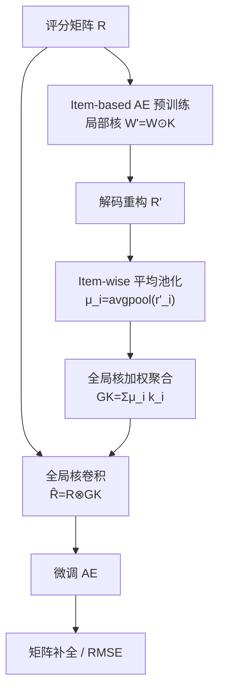

# GLocal-K: Global and Local Kernels for Recommender Systems (全局与局部核推荐系统)

- **会议/期刊**: CIKM 2021
- **作者与机构**: Soyeon Caren Han, Taejun Lim, Siqu Long, Bernd Burgstaller, Josiah Poon；The University of Sydney & Yonsei University
- **推荐链路定位**: 召回/评分预测（矩阵补全）
- **研究方向**: 协同过滤与双塔召回
- **论文原文**: [https://arxiv.org/abs/2108.12184v1](https://arxiv.org/abs/2108.12184v1)
- **开源代码**: 暂未开源

## TL;DR (1分钟核心速览)

针对高维稀疏评分矩阵且无侧信息的矩阵补全，GLocal-K 先用有限支撑 2D-RBF 局部核对 AE 权重做动态稀疏化预训练，再用 item-wise 池化加权的全局卷积核生成评分矩阵进行微调。在 ML-100K/ML-1M/Douban 的 RMSE 协议上，ML-1M 降至 0.822（较 SparseFC 0.824 降 0.24%），ML-100K/Douban 与最强基线持平，低资源训练下更稳。

## Background & Motivation (背景与核心矛盾)

- **主流范式**: 以 I-AutoRec、SparseFC、GC-MC 为代表的 AE/图 AE 矩阵补全，将稀疏 user-item 评分矩阵映射到低维隐空间，再重构缺失评分。
- **前人局限**: 现实平台常只有评分矩阵、缺少用户/物品侧信息；同时纯 AE 在高稀疏下易过拟合，SparseFC 只做局部核稀疏化，缺少对 item 全局特征的提炼。
- **核心洞察 (Key Insight)**: 局部核可把权重矩阵中“该连的连得更密、该断的断得更稀”，起正则化作用；全局卷积核则能从整个评分矩阵中提取 item 级共性特征，二者互补。
- **本文切入点**: 不做 side information 增强，而是用“局部核预训练 + 全局核微调”的两阶段 AE，强化纯评分矩阵的特征抽取。

## Method (核心方法设计)

### 1. 整体框架 (Overall Architecture)

输入仅为 $R\in\mathbb{R}^{m\times n}$的 user-item 评分矩阵。第一阶段以 item 向量$r_i$为输入训练 item-based AE，并用 2D-RBF 局部核重参数化权重；第二阶段将预训练 AE 的解码重构矩阵做 item-wise 平均池化，得到核权重并聚合出全局卷积核$GK$，再对原评分矩阵卷积得到$\hat{R}$，以其为输入微调 AE，最终输出补全后的评分矩阵。训练用 L-BFGS-B 最小化正则平方误差，推理只需一次前向。

### 2. 关键设计拆解 (Key Designs)

1. **局部核化权重矩阵（动态稀疏正则）**：AE 权重若全稠密，稀疏评分下易记忆噪声。本文用有限支撑核
$K_{ij}(U,V)=\max(0,1-\|u_i-v_j\|_2^2)$对权重做 Hadamard 乘积：$W'_{ij}=W_{ij}K_{ij}(U,V)$。
相似隐向量保留连接，远距离向量连接趋零；且 $U,V$ 随训练更新，稀疏度动态变化，等价于可学习的结构正则。AE 重构为
$r'_i=f(W^{(d)}g(W^{(e)}r_i+b)+b')$。

2. **全局卷积核评分矩阵（item 级特征提炼）**：预训练解码输出 $R'$ 含初始缺失评分。先对每个 item 向量池化：
$\mu_i=\mathrm{avgpool}(r'_i)$；
再以 $\mu_i$ 为权重聚合多个卷积核：
$GK=\sum_{i=1}^{m}\mu_i k_i$；
最后卷积原评分矩阵：
$\hat{R}=R\otimes GK$。
这样卷积核由当前评分矩阵动态决定，能按 item 特性提炼全局模式；$\hat{R}$ 作为微调输入，相当于把“重构先验”再注入 AE。

3. **训练目标、负采样与推理效率**：损失为观测评分上的正则平方误差：
$\mathcal{L}=\sum_{(i,j)\in\Omega}(R_{ij}-\hat{R}_{ij})^2+\lambda_2\|W\|_2^2+\lambda_s\|K\|_2^2$。
矩阵补全不需要负采样；不使用 BPR/InfoNCE，也不做全库排序。推理为单次 AE 前向，复杂度主要来自矩阵级卷积与池化，离线批处理友好。

## Experimental Setup & Evaluation Protocol (实验设置与评估协议)

- **数据集与预处理**: 仅用评分矩阵，$r\in\{1,\dots,5\}$，无侧信息。

| 数据集 | #Users | #Items | #Interactions | 密度 | 特征/场景说明 |
| :--- | :---: | :---: | :---: | :---: | :--- |
| ML-100K | 943 | 1,682 | 100k | 0.0630 | 经典评分矩阵，u1.base/u1.test |
| ML-1M | 6,040 | 3,706 | 1M | 0.0447 | 随机 90:10 划分 |
| Douban | 3,000 | 3,000 | 136k | 0.0152 | 最稀疏，Monti 等预处理 |

- **数据划分与防穿越 (Splitting Strategy)**: ML-100K 用 canonical `u1.base/u1.test`；ML-1M 随机 90:10；Douban 用 Monti 等给定 split。非 `Leave-One-Out`，也不是全局时间戳切分。
- **排名评测协议 (Ranking Protocol)**: 非 Top-N 排序，原文报告 **RMSE 评分预测**；在测试集已观测评分上计算，既不是 `Full-Ranking` 也不是 `Sampled Ranking`，无负采样。
- **对比基线与超参设置**: 对比 LLORMA、I-AutoRec、CF-NADE、GC-MC、GraphRec、GRAEM、SparseFC、IGMC、MG-GAT 等；AE 隐层 500，RBF 向量 5 维，全局核 3×3、1 层卷积；L-BFGS-B，$\lambda_2=20/70/10$、$\lambda_s=.006/.018/.022$（按数据集）；重复 5 次取均值，未报告显著性检验。

## Key Experimental Results (实验关键数据)

### 1. 主实验对比 (Main Results)

| 模型 | 侧信息 | ML-100K | ML-1M | Douban |
| :--- | :---: | :---: | :---: | :---: |
| I-AutoRec | × | - | 0.831 | - |
| GC-MC | × | 0.910 | 0.832 | - |
| GraphRec | × | 0.904 | 0.843 | - |
| GRAEM | ✓ | 0.917 | - | 0.732 |
| SparseFC | × | 0.895 | 0.824 | 0.730 |
| IGMC | × | 0.905 | 0.857 | **0.721** |
| MG-GAT | ✓ | **0.890** | - | 0.727 |
| **GLocal-K** | × | **0.890** | **0.822** | **0.721** |
| **Improv.% vs. 最优基线** | - | 0.00% | 0.24% | 0.00% |

GLocal-K 在 ML-1M 唯一最优；ML-100K 与 MG-GAT 并列 0.890，Douban 与 IGMC 并列 0.721。但注意：MG-GAT/GRAEM 用了侧信息，GLocal-K 仅用评分矩阵即达到或超过其水平，例如 ML-100K 0.890 优于 GC-MC+Extra 0.905、GraphRec+Extra 0.897；Douban 0.721 优于 GC-MC+Extra 0.734、GRAEM 0.732。

### 2. 消融实验 (Ablation Study)

| 变体 | ML-100K | ML-1M | Douban |
| :--- | :---: | :---: | :---: |
| Full: 3×3, 1 conv, weighted | **0.890** | **0.822** | **0.721** |
| 5×5 kernel | 0.891 | 0.823 | 0.723 |
| 7×7 kernel | 0.891 | 0.823 | 0.723 |
| 2 conv layers | 0.893 | 0.827 | 0.725 |
| 3 conv layers | 0.897 | 0.848 | 0.732 |
| Element-wise aggregation | 0.894 | 0.822 | 0.730 |

### 3. 关键实验发现 (Key Findings)

1. **全局核的收益主要来自“加权聚合 + 小卷积核”**：3×3、1 层卷积最优；改为 3 层后 ML-1M 从 0.822 退化到 0.848，说明矩阵级深层卷积会过平滑/过拟合。加权聚合比 element-wise 在 ML-100K/Douban 分别降 RMSE 0.004/0.009，item 摘要作为核权重确实有选择性。
2. **局部核预训练是稳定增益项，但轮数受稀疏度影响**：图 3 显示预训练 0→20/30 epoch 后 RMSE 先降后升；ML-100K 最优 30，ML-1M/Douban 最优 20，说明物品更多、密度更低时不宜过度预训练。
3. **低资源场景下全局核更稳**：图 2 中 Douban 训练比例从 0.4 降到 0.2 时，SparseFC 误差明显偏离原曲线，而 GLocal-K 仍近似平稳上升；配合 ML-1M 0.822 vs. SparseFC 0.824，说明全局核的矩阵级特征提取能缓解极端稀疏。

## Highlights & Limitations (亮点、对比与审稿批判)

- **与代表作对比 (vs. Prior Work)**: SparseFC 只做局部核稀疏化权重，缺少全局 item 特征；GC-MC/GraphRec 依赖二部图消息传递且常需侧信息；IGMC 做归纳子图但无“局部核预训练 + 全局核微调”的两阶段设计。GLocal-K 的差异在于纯评分矩阵下把核方法同时用于权重正则与矩阵卷积。
- **可迁移亮点**: 局部核化权重可作为 AE/VAE 召回层的通用稀疏正则；item-wise 池化加权的动态卷积核，也可迁移到序列/多模态特征融合中的动态卷积。
- **审稿级局限批判**: 其一，绝对提升很小且多处并列，未做显著性检验，亦未报告 Top-N/全库排序指标；其二，矩阵级卷积与池化在千万级 user/item 平台上开销较高，预训练 epoch 与 $\lambda$ 对数据集敏感，复现成本不低。

## Rating (四维评分)

- **方法创新性 (Novelty)**: ⭐⭐⭐⭐ （局部核正则 + 全局核微调的两阶段组合有新意，但本质仍是 AE 正则化与卷积微调。）
- **评估协议与实验扎实度 (Protocol & Experiments)**: ⭐⭐⭐ （三数据集 RMSE 对比完整，但缺显著性检验、排序指标与局部核单独消融，提升幅度有限。）
- **写作与数学规范度 (Clarity & Rigor)**: ⭐⭐⭐⭐ （流程与公式简洁；将有限支撑核称为 2D-RBF 略宽泛，符号定义基本清楚。）
- **工业落地与复现价值 (Industrial & Practical Value)**: ⭐⭐⭐ （无需侧信息、离线矩阵补全易嵌入，但矩阵级卷积/池化扩展性与复现细节是主要障碍。）

