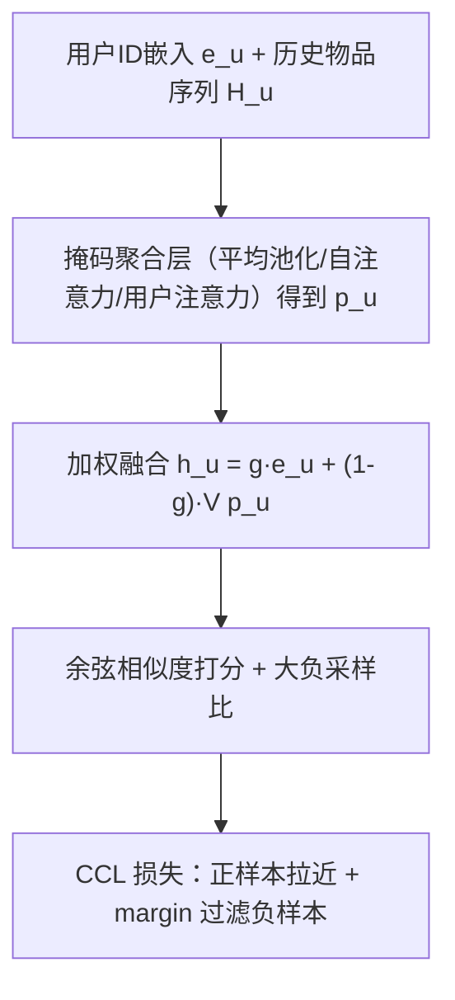
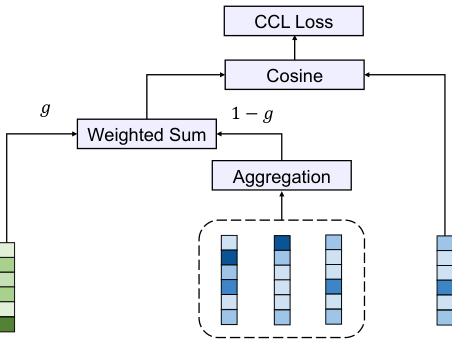
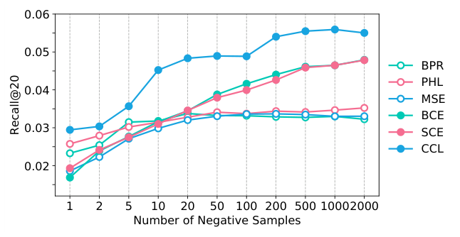

# SimpleX: A Simple and Strong Baseline for Collaborative Filtering (SimpleX：协同过滤的简单强基线)

- **会议/期刊**: CIKM 2021
- **作者与机构**: Kelong Mao, Jieming Zhu, Jinpeng Wang, Quanyu Dai, Zhenhua Dong, Xi Xiao, Xiuqiang He（中国人民大学高瓴人工智能学院 / 华为诺亚方舟实验室 / 清华深研院）
- **推荐链路定位**: 召回（隐式反馈协同过滤）
- **研究方向**: 协同过滤与双塔召回 / 自监督对比学习与交互去噪
- **论文原文**: [https://arxiv.org/abs/2109.12613v3](https://arxiv.org/abs/2109.12613v3)
- **开源代码**: [https://reczoo.github.io/SimpleX](https://reczoo.github.io/SimpleX)

## TL;DR (1分钟核心速览)

本文指出协同过滤的性能瓶颈不只在交互编码器，**损失函数与负采样比例同等重要**。作者提出余弦对比损失 CCL（余弦相似度 + margin 过滤冗余负样本 + 权重 $w$ 平衡正负项），并配以"MF + 行为聚合 + 大负采样比（100~1000）"的极简模型 SimpleX。在 11 个数据集、29 个基线、Leave-One-Out + Full-Ranking 协议下，Amazon-Books 上 Recall@20/NDCG@20 较 LightGCN 提升 41.9%/48.5%，总训练时间仅 19 分钟（约 10 倍加速）。

## Background & Motivation (背景与核心矛盾)

- **主流范式**: 近年 CF 研究几乎全部押注"更强的交互编码器"——MLP、AutoEncoder、Attention、GNN（NGCF→LightGCN→DGCF→SGL），模型复杂度的军备竞赛持续升级。
- **前人局限一**: 损失函数选择高度随意，BPR/BCE/SCE/Hinge/MSE 混用却缺乏系统对比；多数 GNN 工作沿用 BPR 且把负采样比设为 1 或 10 就宣称编码器优越。
- **前人局限二**: 小负采样比 + BPR 的组合本身训练不充分，导致**基线被系统性削弱**，社区可能高估了新模型（尤其 GNN）的真实增量。
- **核心洞察**: 作者用最简单的 MF 做探针，发现仅替换损失函数即可让 MF 超过 DGCF 等 SOTA；说明"数据侧（损失/负采样）"与"模型侧（编码器）"至少同等重要。
- **本文切入点**: 设计面向 CF 的余弦对比损失 CCL，堆叠在一个刻意简化的统一架构上，作为低成本强基线。

## Method (核心方法设计)

### 1. 整体框架 (Overall Architecture)

SimpleX 沿用 MF 的双侧嵌入，但把用户历史物品序列 $\mathcal{H}_u$作为额外输入：先经带掩码的聚合层得到行为向量$\boldsymbol{p}_u$，再与用户 ID 嵌入$\boldsymbol{e}_u$做加权融合得到最终用户表示$\boldsymbol{h}_u$，最后以余弦相似度$\hat{y}_{ui}=\cos(\boldsymbol{h}_u,\boldsymbol{e}_i)$ 打分并送入 CCL 训练。整模型无特征变换、无非线性激活、无多层消息传递，训练用均匀负采样但采样比拉到 100~1000，推理即双侧向量余弦检索，可直接接 ANN 索引。

<figure class="paper-figure" markdown="span">
  <figcaption>图1：SimpleX 的简单模型架构。</figcaption>
</figure>

### 2. 关键设计拆解 (Key Designs)

1. **余弦对比损失 CCL（本文核心增量）**：BPR 对每个负样本等权、且用点积打分，点积模长会被物品流行度严重带偏。CCL 改用 L2 归一化后的余弦并把负样本损失截断在 margin $m$ 之下：
$$\mathcal{L}_{CCL}(u,i)=(1-\hat{y}_{ui})+\frac{w}{|\mathcal{N}|}\sum_{j\in\mathcal{N}}\max\big(0,\ \hat{y}_{uj}-m\big)$$
直觉在于：当 $|\mathcal{N}|$很大时海量"易分"负样本会产生梯度噪声并拖慢收敛，margin 使$\hat{y}_{uj}<m$的冗余负样本贡献零损失，只保留真正难分的硬负样本；$w$ 则用于平衡 1:1000 量级的正负样本失衡（相当于 WMF 的置信权重）。与同样带 margin 的 Pairwise Hinge 相比，CCL 惩罚的是**绝对相似度**而非正负相对距离，避免"正样本本身分很高时硬负样本被漏训"的歧义。
2. **行为聚合与加权融合（刻意保持简单）**：$\boldsymbol{p}_u=\sum_{k\in\mathcal{H}_u}I_k\alpha_k\boldsymbol{e}_k$，$\alpha_k$可取平均池化（$I_k/\sum I_k$）、自注意力（全局 query$q$）或用户注意力（$e_u$作 query）。因池化向量与 ID 嵌入处在不同子空间，用$\boldsymbol{h}_u=g\cdot\boldsymbol{e}_u+(1-g)\cdot\boldsymbol{V}\boldsymbol{p}_u$融合；实现上平均池化最鲁棒、调参成本最低，$g=0.5$ 通常最优。
3. **训练目标、负采样与推理效率**：总损失即逐正样本的 CCL 之和（无额外正则项耦合），负采样为**均匀采样**（不做硬负挖掘，硬负由 margin 隐式筛出），$|\mathcal{N}|\in\{100,500,1000\}$，$m$在$0\sim1$ 间按 0.1 网格搜索（Amazon-Books 取 0.4，Yelp/Gowalla 取 0.9）。推理为纯余弦内积检索，单 epoch 40~131 秒、28~35 轮收敛，无图卷积的多跳邻居聚合开销。

## Experimental Setup & Evaluation Protocol (实验设置与评估协议)

- **数据集与预处理**: 共 11 个数据集，全部复用已公开预处理版本以保证可比性。三个主数据集（Amazon-Books / Yelp2018 / Gowalla）采用 LightGCN 等的标准划分；其余 6 个（Amazon-CDs/Movies/Beauty/Electronics、CiteUlike-A、Movielens-1M）分别与原论文设定对齐；Movielens-20M 与 MillionSongData 采用**强泛化（strong generalization）**划分——训练/验证/测试用户不相交，要求模型具备归纳能力（此时令 $g=0$ 只用行为序列生成用户表示）。

| 数据集 | #Users | #Items | #Interactions | 稀疏度 | 特征/场景说明 |
| :--- | :---: | :---: | :---: | :---: | :--- |
| Amazon-Books | 52,643 | 91,599 | 2,984,108 | 0.062% | 图书隐式反馈，GNN-CF 主战场 |
| Yelp2018 | 31,668 | 38,048 | 1,561,406 | 0.129% | 本地商户点评 |
| Gowalla | 29,858 | 40,981 | 1,027,370 | 0.084% | LBSN 签到 |
| Amazon-CDs / Movies / Beauty | — | — | — | — | 复用 NIA-GCN/BGCF 预处理 |
| Movielens-20M / MillionSongData | — | — | — | — | 强泛化划分，对比 AutoEncoder 系 |

- **数据划分与防穿越**: 主实验 `Leave-One-Out`（每用户最后一条交互作测试）；Movielens-20M/MillionSongData 为 `冷启动/强泛化划分`（用户不重叠）。
- **排名评测协议**: `Full-Ranking`（对全部未交互物品排序），指标 Recall@20、NDCG@20，部分数据集用 F1@20 / Precision@20。
- **对比基线与超参设置**: 29 个模型分四类（MF 系 5、AutoEncoder 系 4、GNN 系 14、其他 6）。嵌入维度与对比模型对齐（LightGCN 为 64、LCFN 为 128），Adam，lr $\in\{1\text{e-}3,5\text{e-}4,1\text{e-}4\}$，$L_2$正则$1\text{e-}9\sim1\text{e-}2$，batch 1024。

## Key Experimental Results (实验关键数据)

### 1. 主实验对比 (Main Results)

| 模型 | Amazon-Books R@20 | N@20 | Yelp2018 R@20 | N@20 | Gowalla R@20 | N@20 |
| :--- | :---: | :---: | :---: | :---: | :---: | :---: |
| MF-BPR (UAI'09) | 0.0338 | 0.0261 | 0.0576 | 0.0468 | 0.1627 | 0.1378 |
| YouTubeNet (RecSys'16) | 0.0502 | 0.0388 | 0.0686 | 0.0567 | 0.1754 | 0.1473 |
| Mult-VAE (WWW'18) | 0.0407 | 0.0315 | 0.0584 | 0.0450 | 0.1641 | 0.1335 |
| NGCF (SIGIR'19) | 0.0344 | 0.0263 | 0.0579 | 0.0477 | 0.1570 | 0.1327 |
| LightGCN (SIGIR'20) | 0.0411 | 0.0315 | 0.0649 | 0.0530 | 0.1830 | 0.1554 |
| DGCF (SIGIR'20) | 0.0422 | 0.0324 | 0.0654 | 0.0534 | 0.1842 | **0.1561** |
| SGL-ED (SIGIR'21) | 0.0478 | 0.0379 | 0.0675 | 0.0555 | — | — |
| MF-CCL (Ours) | 0.0559 | 0.0447 | 0.0698 | 0.0572 | 0.1837 | 0.1493 |
| **SimpleX (Ours)** | **0.0583** | **0.0468** | **0.0701** | **0.0575** | **0.1872** | 0.1557 |
| Improv. vs LightGCN | **+41.9%** | **+48.5%** | **+8.0%** | **+8.5%** | **+2.3%** | +0.2% |

### 2. 消融实验 (Ablation Study)

| 配置 | Amazon-Books R@20 | N@20 | Yelp2018 R@20 | N@20 |
| :--- | :---: | :---: | :---: | :---: |
| avg_pooling（默认） | **0.0583** | **0.0468** | **0.0701** | 0.0575 |
| self_attn | 0.0580 | 0.0462 | 0.0698 | **0.0576** |
| user_attn | 0.0551 | 0.0436 | 0.0698 | 0.0574 |
| $g=0$（仅行为向量） | 0.0534 | 0.0429 | 0.0679 | 0.0555 |
| $g=1$（退化为 MF-CCL） | 0.0540 | 0.0432 | **0.0701** | 0.0575 |
| $w=1$/$150$/$300$/$1000$ | 0.0163 / 0.0542 / **0.0583** / 0.0481 | 0.0128 / 0.0429 / **0.0468** / 0.0379 | 0.0238 / **0.0701** / 0.0666 / 0.0568 | 0.0189 / **0.0575** / 0.0549 / 0.0463 |

**效率对比（Amazon-Books）**: SimpleX($|\mathcal{N}|$=100) 每 epoch 40s / 28 轮 / **总 19 分钟**；$|\mathcal{N}|$=1000 为 131s / 35 轮 / 1h16m；LightGCN 为 51s / 780 轮 / 11h3m；ENMF 为 129s / 81 轮 / 2h54m。

### 3. 关键实验发现 (Key Findings)

1. **损失函数是最大瓶颈**：固定 MF 骨干，CCL 在 Amazon-Books 上 Recall@20 达 0.0559，较 BPR 的 0.0338 提升 65%、较次优 BCE 的 0.0479 提升 16.7%，且 MF-CCL 单枪匹马即超过 DGCF/SGL-ED 等图模型——说明此前"编码器带来的增益"有相当部分可被损失函数替代。
2. **负采样比存在"损失函数依赖"的平台效应**：$|\mathcal{N}|$从 1 增至 1000 普遍带来增益，但 PHL/MSE/BPR 在$|\mathcal{N}|\approx50$ 即饱和，而 CCL/BCE/SCE 可持续吃到 1000 的红利；CCL 在全部采样比下都优于其他损失。这也意味着负采样比必须与损失函数联合调参，否则基线不可比。
3. **CCL 可跨模型迁移且收益与编码器复杂度互补**：LightGCN 换用 CCL 后 Amazon-Books Recall@20 从 0.0411 升至 0.0528（+28.5%），YouTubeNet 从 0.0502 升至 0.0544；但提升幅度弱于 MF，说明编码器与损失函数捕获的是高度重叠的协同信息。另外 $w$极度敏感（$w=1$ 时性能崩塌至 0.0163），必须在大负采样比下同步放大负项权重。

<figure class="paper-figure" markdown="span">
  <figcaption>图2：不同损失函数下负样本数量在 Amazon-Books 上的影响。</figcaption>
</figure>

## Highlights & Limitations (亮点、对比与审稿批判)

- **与代表作对比 (vs. Prior Work)**: 相较 LightGCN/DGCF/SGL-ED 等"加层、加对比增广、加意图解耦"的路线，SimpleX 反向证明**简化编码器 + 正确损失**即可反超；相较 CML 的 pairwise hinge，CCL 用绝对余弦 + margin 精确刻画硬负样本；相较 YouTubeNet，只把 concat 融合换成加权和并去掉侧特征。
- **可迁移亮点**: (1) margin + 负项权重的组合可直接插入任意双塔召回模型，无需改结构；(2) 用大负采样比 + 均匀采样的低成本方案替代复杂硬负挖掘，在工业界性价比极高；(3) "用最简单骨干做损失对比"的实验范式可作为基线公平性的自检手段。
- **审稿级局限批判**: (1) 主实验结果的相当部分（GNN/AutoEncoder 基线）直接复用原论文数字而非统一重跑，且 CCL 的最优 $m$、$w$、$|\mathcal{N}|$需逐数据集网格搜索，公平性依赖作者调参投入；(2) 训练时$|\mathcal{N}|=1000$ 使每 epoch 耗时增至 131s，虽总时长仍优，但在亿级物品库上均匀采样的方差与内存开销仍不可忽视；此外模型对稀疏/长尾物品（无历史交互、行为序列短）并无专门设计，强泛化场景下也仅做到与降维后的 RecVAE/EASER 持平而非全面领先。

## Rating (四维评分)

- **方法创新性 (Novelty)**: ⭐⭐⭐ （CCL 本身是 CV 对比损失的 CF 适配，编码器结构几乎无新意，但"损失+负采样比同等重要"的问题重定义具有范式价值）
- **评估协议与实验扎实度 (Protocol & Experiments)**: ⭐⭐⭐⭐⭐ （11 个数据集、29 个基线、Full-Ranking 协议、效率与参数敏感性分析齐备，是罕见的"基线体检"式完整实验）
- **写作与数学规范度 (Clarity & Rigor)**: ⭐⭐⭐⭐ （CCL 三处设计选择的动机解释清晰，与 MF/YouTubeNet/GAT 的关系定位明确；但对 margin 与 $w$ 的理论刻画仍停留在直觉层面）
- **工业落地与复现价值 (Industrial & Practical Value)**: ⭐⭐⭐⭐⭐ （代码与基准全开源，纯余弦内积可直接接 ANN，19 分钟训练成本与 10 倍加速使其成为极具吸引力的召回基线）

