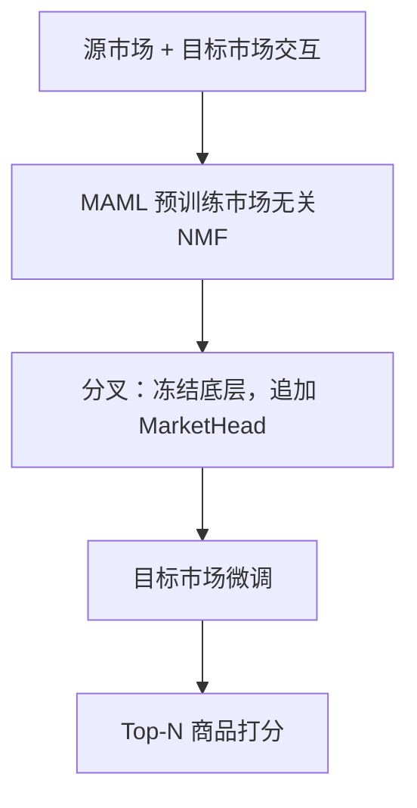
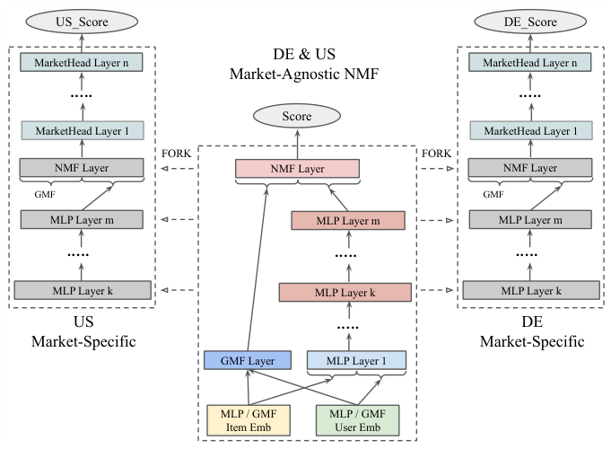
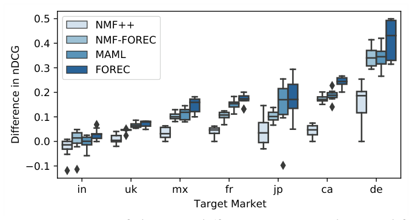

# Cross-Market Product Recommendation (跨市场商品推荐)

- **会议/期刊**: CIKM 2021
- **作者与机构**: Hamed Bonab 等，UMass Amherst / University of Amsterdam
- **推荐链路定位**: 排序（Top-N 商品推荐）
- **研究方向**: 跨域与多场景推荐 / 冷启动与长尾推荐
- **论文原文**: [https://arxiv.org/abs/2109.05929v1](https://arxiv.org/abs/2109.05929v1)
- **开源代码**: [https://xmrec.github.io](https://xmrec.github.io)

## TL;DR (1分钟核心速览)

针对低资源目标市场直接复用高资源市场数据易负迁移的问题，本文发布 XMarket，并提出 FOREC：先用 MAML 预训练市场无关 NMF，再分叉冻结底层、加市场头并在目标市场微调。Electronics 8 市场、5-core/留一/99 负采样下，Ave-Src 的 nDCG@10 均值 0.4730，较 NMF 0.4113 提升 15.0%；原文报告平均 +24%、最高 +50%。

## Background & Motivation (背景与核心矛盾)

- **主流范式**: 单市场 NMF/GMF/MLP 做 Top-N 推荐；跨域推荐（CDR）用共享用户迁移，跨市场推荐（CMR）则共享商品、用户不重叠。
- **前人局限**: 直接池化多市场会导入源市场流行度与评分偏置；CDR 方法把“共享用户”换成“共享商品”后，训练视角与按用户评测不一致，DDTCDR 在 CMR 上明显退化。
- **核心洞察 (Key Insight)**: XMarket 分析显示同一商品在不同市场的购买/评分分布显著不同；欧洲 de/fr/uk 较相似，us 数据最丰富但并非对所有目标市场最优，说明需要“可适配”而非“一刀切”的迁移。
- **本文切入点**: 用元学习获得可快速适应的共享初始化，再用分叉网络保留通用底层、增加市场特定容量。

## Method (核心方法设计)

### 1. 整体框架 (Overall Architecture)

FOREC 分三步：先在源市场与目标市场上用 MAML 预训练市场无关 NMF；随后为每个市场分叉，冻结嵌入与底层 MLP/GMF，仅保留可微调的中高层并追加 MarketHead；最后只用目标市场交互微调，输出 Top-N 商品分数。该设计把“跨市场通用知识”和“市场特定偏好”解耦，避免朴素共享参数被源市场主导。

<figure class="paper-figure" markdown="span">
  <figcaption>图3：我们的 FOREC 推荐系统的总体架构。对于一对市场，中间部分展示了我们预训练的市场无关模型，然后针对左右两侧所示的每个市场分别分支并进行微调。</figcaption>
</figure>

### 2. 关键设计拆解 (Key Designs)

1. **市场无关 MAML 预训练**：痛点是为数据丰富市场优化的参数难以小样本适配低资源市场。对市场 $M_i$先做内循环$\theta_i'=\theta-\alpha\nabla_\theta\mathcal{L}^{M_i}_{\mathrm{NMF}}(\theta)$，再优化$\min_\theta\sum_{M_i\in\mathcal{M}}\mathcal{L}^{M_i}_{\mathrm{NMF}}(\theta_i')$。每个市场等量采样任务，避免 us 数据量压制其他市场，使$\theta$ 落在“几步梯度即可适配”的位置。
2. **Forking + MarketHead**：痛点是小样本微调容量不足，而全量微调又易过拟合/遗忘通用知识。冻结 $\theta_{\le k}$与嵌入，克隆中高层，并在 NMF 层后加$[16,32,16]$的 MarketHead，得到$\theta_{\text{target}}=[\theta_{\le k}^{\text{frozen}};\theta_{>k}^{\text{FT}};\theta_{\text{MarketHead}}^{\text{new}}]$。直觉是通用表征留在底层，市场偏移由轻量头部吸收。
3. **训练目标、负采样与推理**：损失为 $\mathcal{L}=\mathcal{L}_{\mathrm{BCE}}(y,\hat y)+\lambda\|\Theta\|_2^2$；每用户每 epoch 采 4 个负样本，MAML 采用$K=20$shot，微调阶段$\lambda=0.001$。推理仍是 NMF 点积+MLP 前向，开销与单市场 NMF 同阶，仅多出轻量 MarketHead。

## Experimental Setup & Evaluation Protocol (实验设置与评估协议)

- **数据集与预处理**: XMarket 覆盖 18 市场、11 语言、16 类；实验取 Electronics 的 8 个市场，按 5-core 过滤。

| 数据集 | #Users | #Items | #Interactions | 稀疏度/密度 | 特征/场景说明 |
| :--- | :---: | :---: | :---: | :---: | :--- |
| XMarket | 9.56M | 3.81M（跨市场）/0.295M unique | 52.48M | ≈1.4e-6 | 18 市场、11 语言、16 类 |
| XMarket-Electronics | 4.67M | ≈98K（市场内合计） | 7.18M | ≈1.6e-5 | 8 市场，5-core 子集 |

- **数据划分与防穿越 (Splitting Strategy)**: 采用 `Leave-One-Out`；未使用全局时间戳切分，属于该时期 Top-N 推荐常用协议。
- **排名评测协议 (Ranking Protocol)**: `Sampled Ranking`，每用户 1 个正样本 + 99 个负样本排序，报告 HR@10 与 nDCG@10。
- **对比基线与超参设置**: 单市场 GMF/MLP/NMF；跨市场共享的 GMF++/MLP++/NMF++；CDR 强基线 DDTCDR；仅 MAML；NMF-FOREC。嵌入维度 8，MLP 结构 $[16,64,32,16,8]$，Adam，NMF/MLP 学习率 0.01、GMF 0.005，$l_2=1e-7$，MAML 步长 0.1、$K=20$；显著性用 Student's t-test，$p<0.05$。

## Key Experimental Results (实验关键数据)

### 1. 主实验对比 (Main Results)

下表为 `Ave-Src` 场景下各目标市场的 nDCG@10（对可用源市场取平均），最后一列为 7 市场均值及相对 NMF 的提升。

| 方法 | de | jp | in | fr | ca | mx | uk | Ave | Improv. vs NMF |
| :--- | :---: | :---: | :---: | :---: | :---: | :---: | :---: | :---: | :---: |
| NMF | 0.2486 | 0.3394 | 0.5970 | 0.3961 | 0.2917 | 0.5212 | 0.4853 | 0.4113 | — |
| NMF++ | 0.2876 | 0.3533 | 0.5809 | 0.4123 | 0.3044 | 0.5387 | 0.4899 | 0.4239 | +3.1% |
| DDTCDR | 0.2155 | 0.2044 | 0.3095 | 0.3285 | 0.2551 | 0.4670 | 0.3923 | 0.3103 | -24.6% |
| MAML | 0.3336 | 0.3756 | 0.5948 | 0.4555 | 0.3463 | 0.5793 | 0.5174 | 0.4575 | +11.2% |
| NMF-FOREC | 0.3340 | 0.3742 | 0.5974 | 0.4374 | 0.3423 | 0.5747 | 0.5063 | 0.4523 | +10.0% |
| **FOREC** | **0.3523** | **0.4007** | **0.6140** | **0.4637** | **0.3616** | **0.5989** | **0.5200** | **0.4730** | **+15.0%** |

### 2. 消融实验 (Ablation Study)

| 配置 | Ave nDCG@10 | Δ vs full |
| :--- | :---: | :---: |
| Single NMF（无迁移） | 0.4113 | -13.0% |
| NMF++（仅共享训练） | 0.4239 | -10.4% |
| MAML（仅元学习预训练） | 0.4575 | -3.3% |
| NMF-FOREC（无 MAML 预训练，仅分叉微调） | 0.4523 | -4.4% |
| **FOREC（完整）** | **0.4730** | — |

### 3. 关键实验发现 (Key Findings)

1. FOREC 在 `Ave-Src` 下 7/7 个目标市场均为最优，均值 0.4730 较 MAML 再高 3.4%；在 49 个源-目标市场中 44 个优于 MAML，mx/uk 作为源市场时平均相对提升达 6.18%，说明“元初始化+分叉”互补而非简单叠加。
2. 源市场选择显著影响收益：固定 us 仍能普遍帮助目标市场，但并非总是最佳；例如 de 上 FOREC 的 `Ave-Src` nDCG@10 为 0.3523，较单市场 NMF 0.2486 提升 41.7%，而 uk 仅提升约 7.1%，因此上线时需用验证集选源。<figure class="paper-figure" markdown="span">
  <figcaption>图4：对于不同模型，选择不同源市场对不同目标市场的影响。</figcaption>
</figure>
3. 用户分桶显示 FOREC 对 cold/warm 用户均有提升，cold 组差距略大；但当目标市场仅保留 10% 训练交互时，单市场 NMF/NMF++ 反而更稳，表明跨市场模型需要最低限度的目标市场数据，否则元初始化会过度偏向源市场。

## Highlights & Limitations (亮点、对比与审稿批判)

- **与代表作对比 (vs. Prior Work)**: DDTCDR 假设跨域共享用户，直接搬到 CMR 会造成用户/商品角色错位；MAML 只提供元初始化、缺少市场特定容量；NMF++ 只是等量混合，易负迁移。FOREC 用 forking 把“共享底层”与“市场头部”显式拆分，因而更稳。
- **可迁移亮点**: 冻结底层+轻量 MarketHead 的“分叉微调”可直接用于多语言/多地区推荐；按市场等概率任务采样可缓和大市场主导；用验证集选择辅助市场比固定用 us 更可靠。
- **审稿级局限批判**: 仅验证 Electronics 单一品类，且用评分作为隐式反馈、99 负采样排序，未覆盖 Full-Ranking 与时间切分；只考虑单源市场，未实现自动源选择；MAML 的 K-shot 预训练与多市场分叉带来额外训练/维护成本，极低资源市场仍可能失效。

## Rating (四维评分)

- **方法创新性 (Novelty)**: ⭐⭐⭐⭐ （将 MAML 预训练、分叉冻结与市场头结合，机制清晰，但单模块并非全新）
- **评估协议与实验扎实度 (Protocol & Experiments)**: ⭐⭐⭐⭐ （8 市场、49 源-目标组合、消融与用户/数据量分析较完整；但仅单品类、采样排序）
- **写作与数学规范度 (Clarity & Rigor)**: ⭐⭐⭐⭐ （三步流程与算法伪代码清楚，公式简洁；理论分析偏少）
- **工业落地与复现价值 (Industrial & Practical Value)**: ⭐⭐⭐⭐ （XMarket 与代码开放，分叉微调易落地；多市场维护与源选择仍需工程化）

