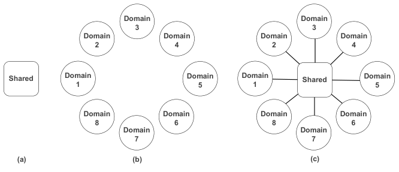
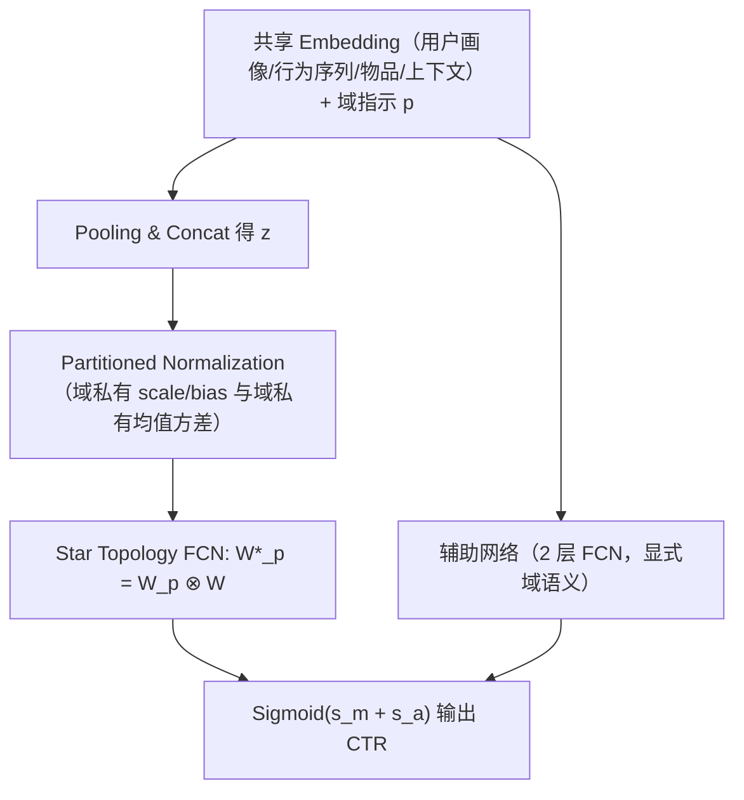
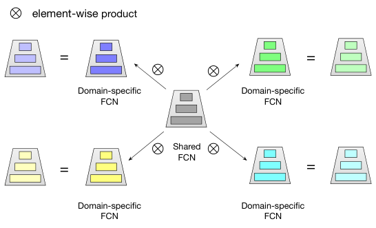

# One Model to Serve All: Star Topology Adaptive Recommender for Multi-Domain CTR Prediction (一模型服务全域：星型拓扑自适应多域 CTR 推荐)

- **会议/期刊**: CIKM 2021
- **作者与机构**: Xiang-Rong Sheng, Liqin Zhao, Guorui Zhou 等（阿里巴巴集团）
- **推荐链路定位**: 精排（展示广告 CTR 预估）
- **研究方向**: 跨域与多场景推荐 / CTR 预估与特征交叉
- **论文原文**: [https://arxiv.org/abs/2101.11427v5](https://arxiv.org/abs/2101.11427v5)
- **开源代码**: 暂未开源

## TL;DR (1分钟核心速览)

工业推荐常需同时服务数十个业务域（Banner、猜你喜欢等），而主流做法要么把所有样本混训一个共享模型（淹没域差异），要么每域独立建模（小域数据饥饿、维护成本爆炸）。STAR 提出星型拓扑：一个全域共享中心 FCN 与每域私有 FCN 逐元素相乘生成该域网络权重，并用分区归一化（PN）为每域累积独立统计量、用域指示辅助网络直接注入域语义。在阿里 19 个业务域生产数据（整日训练/次日测试、用户加权 AUC）上 Overall AUC 0.6506，较最强基线 Cross-Stitch 提升 1.42%，19 域全部无例外提升；线上 60+ 域部署带来 CTR +8.0%、RPM +6.0%。

## Background & Motivation (背景与核心矛盾)

- **主流范式**: 单域 CTR 模型遵循 Embedding + Pooling(DIEN) + MLP(7 层 FCN) + BN 范式，每个业务域独立训练、独立服务。
- **前人局限**: ① 混训单一共享模型忽略域特异分布——19 个域 CTR 从 1.27%(#13) 到 12.05%(#11) 相差近十倍，全局共享权重必然折中；② 每域独立建模使小域样本极少（#16 仅占 0.46%、#6 占 0.56%），且上百域意味着上百套模型的内存与人力开销。
- **核心洞察 (Key Insight)**: 多域与多任务本质不同——多域是**同一标签空间下的分布漂移**，而非不同任务的不同标签空间；因此不应照搬 MMoE/Cross-Stitch 那种"底层共享、顶层分离"或门控隐式建模的做法，而应让**网络权重本身按域自适应生成**，同时让域指示 $p$ 显式进入前向图。
- **本文切入点**: 以"中心共享 + 域私有"权重的乘性组合实现参数级自适应，并把归一化统计量与域对齐。

<figure class="paper-figure" markdown="span">
  <figcaption>图2：(a)：所有域共享的单一模型，方形节点表示共享模型。(b)：每个域一个模型，各模型单独学习。圆形节点表示域特定模型。(c)：所提出的 Star Topology Adaptive Recommender (STAR)，每个域具有特定参数并共享一个公共中心模型。边表示中心共享参数与域特定参数的组合。</figcaption>
</figure>

## Method (核心方法设计)

### 1. 整体框架 (Overall Architecture)

输入为 $(x,y,p)$，$x$含用户画像、行为序列、目标物品与上下文，$p\in\{1..M\}$为域指示。同一 ID 特征在各域共享同一 Embedding 表（工业场景 Embedding 参数约为 FCN 的$10^4$倍，分域独占既学不好也存不下）。Embedding 经 Pooling & Concatenation 得到定长向量$\mathbf{z}$，先过分区归一化 PN 得到$\mathbf{z}'$，再送入星型拓扑 FCN（1 个共享中心 FCN +$M$个域私有 FCN）；同时域指示$p$ 作为一个 ID 特征走一条 2 层轻量辅助网络。两路 logit 相加后过 Sigmoid 得预测，训练端最小化各域交叉熵之和。

### 2. 关键设计拆解 (Key Designs)

1. **星型拓扑 FCN（权重级参数生成）**：痛点是门控/Cross-Stitch 只是隐式混合表征，梯度仍会跨域冲突。STAR 对第 $p$域第$l$层直接组合权重与偏置：$W^{\star}_{p}=W_{p}\otimes W,\; b^{\star}_{p}=b_{p}+b$，前向为$out_{p}=\phi\big((W^{\star}_{p})^{\top}in_{p}+b^{\star}_{p}\big)$。共享项$W$由全量样本梯度更新以学共性，私有项$W_p$ 仅由本域样本更新——这从**梯度隔离**层面消除域间冲突，而乘性组合比加性更接近"按域调制"的门控语义。

2. **分区归一化 PN（统计量与仿射双私有化）**：BN 假设全局 i.i.d.，跨域共享 moving mean/var 会抹平差异。PN 训练时用当前 batch 统计量但配以域私有仿射：$z'=(\gamma*\gamma_{p})\frac{z-\mu}{\sqrt{\sigma^{2}+\epsilon}}+(\beta+\beta_{p})$；推理时改用**域私有滑动统计**$E_{p},Var_{p}$：$z'=(\gamma*\gamma_{p})\frac{z-E_{p}}{\sqrt{Var_{p}+\epsilon}}+(\beta+\beta_{p})$。相比 LN 沿通道归一的实例级做法，PN 在域内累积更准确的矩估计，故物理上更契合"域内局部 i.i.d."假设。

3. **辅助网络与训练目标**：传统模型把所有特征等权喂入深网，域差异易被淹没。STAR 将域指示 $p$显式嵌入并连同域相关特征送入远浅于主网的 2 层 FCN，输出$s_a$与主网$s_m$相加：$\hat{y}=\sigma(s_m+s_a)$，使域信号可直接、低损耗地影响最终打分。总损失为各域交叉熵之和$\min\sum_{p=1}^{M}\sum_{i=1}^{N_p}\big[-y^{p}_{i}\log\hat{y}^{p}_{i}-(1-y^{p}_{i})\log(1-\hat{y}^{p}_{i})\big]$，无额外负采样（曝光级真实标签）；线上推理时各域$W^{\star}_p$ 可**预计算**，单次前向开销与共享底层模型持平。

<figure class="paper-figure" markdown="span">
  <figcaption>图5：STAR 为不同域生成全连接网络（FCN）参数方式的示意图。STAR 由一个共享中心 FCN 和每个域独立的 FCN 组成。对于每个域，神经网络层的最终权重通过将共享 FCN 与域特定 FCN 的权重逐元素相乘得到。共享参数通过所有样本的梯度更新，而域特定参数仅通过该域内样本更新。</figcaption>
</figure>

## Experimental Setup & Evaluation Protocol (实验设置与评估协议)

- **数据集与预处理**: 阿里展示广告系统生产日志，覆盖 19 个业务域，单日训练样本达十亿量级；原文仅披露各域样本占比与平均 CTR，未给出用户/物品绝对量。

| 域 | #10 | #14 | #8 | #16 | #6 | #11 | #13 | #15 |
| :--- | :---: | :---: | :---: | :---: | :---: | :---: | :---: | :---: |
| 样本占比 | 12.16% | 28.76% | 16.76% | 0.46% | 0.56% | 0.76% | 3.34% | 1.17% |
| 平均 CTR | 2.08% | 3.75% | 3.24% | 4.02% | 3.45% | 12.05% | 1.27% | 12.03% |

  物品在多数域间高度重叠（如 #1 与 #2 物品集相同），但用户重叠仅 8.52%，即"同物不同人、同人不同行为"。
- **数据划分与防穿越**: 采用**全局时间戳切分**——用某一天全量日志训练，紧接着的次日数据测试，严格避免未来信息泄漏。
- **排名评测协议**: 曝光级二分类打分，指标为**用户加权 AUC**（先按用户算 AUC 再以曝光数加权平均，$\text{AUC}=\frac{\sum_i \#imp_i\times AUC_i}{\sum_i \#imp_i}$），更贴近线上排序效果；分别报告 19 个单域 AUC 与混合全部样本的 Overall AUC。未做负采样。
- **对比基线与超参**: Base（DIEN Pooling + BN + 7 层 FCN）、Shared Bottom（共享 Embedding、各域独立 7 层 FCN）、MulANN（加域判别器对抗）、MMoE（专家数=域数）、Cross-Stitch（逐层线性交叉单元）。所有方法**统一加装辅助网络**以保证公平；Adam，lr=0.001，batch=2000。

## Key Experimental Results (实验关键数据)

### 1. 主实验对比 (Main Results)

| 模型 | #1 | #10 | #15 | #16 | #19 | Overall AUC |
| :--- | :---: | :---: | :---: | :---: | :---: | :---: |
| Base | 0.6134 | 0.6392 | 0.6745 | 0.6638 | 0.6330 | 0.6364 |
| Shared Bottom | 0.6186 | 0.6434 | 0.6888 | 0.6627 | 0.6375 | 0.6398 |
| MulANN | 0.6143 | 0.6375 | 0.6710 | 0.6517 | 0.6306 | 0.6353 |
| MMoE | 0.6143 | 0.6431 | 0.6787 | 0.6634 | 0.6374 | 0.6403 |
| Cross-Stitch | 0.6183 | 0.6278 | 0.6819 | 0.6727 | 0.6381 | 0.6415 |
| **STAR** | **0.6306** | **0.6577** | **0.7021** | **0.6901** | **0.6476** | **0.6506** |
| Improv. | +1.94% | +2.22% | +1.93% | +2.59% | +1.49% | +1.42% |

### 2. 消融实验 (Ablation Study)

| 配置 | Overall AUC | 说明 |
| :--- | :---: | :--- |
| Base (BN) | 0.6364 | 单共享网络 + 全局 BN |
| Base (PN) | 0.6485 | 仅换归一化，+1.21pt |
| STAR FCN (BN) | 0.6455 | 仅换拓扑，+0.91pt |
| **STAR FCN (PN)** | **0.6506** | 二者叠加，+1.42pt |
| STAR FCN (LN) | 0.6463 | 实例级归一化劣于 PN |

辅助网络在所有基线（Base/Shared Bottom/MulANN/MMoE/Cross-Stitch/STAR）上均带来一致提升；其中 MulANN 增益最弱，因其对抗损失"抹除域差异"的目标与域特征建模相冲突。

### 3. 关键实验发现 (Key Findings)

1. **两组件互补且 PN 贡献更大**：PN 单独带来 0.6364→0.6485（+1.21pt），拓扑单独仅 0.6364→0.6455（+0.91pt），叠加得 0.6506，说明"先对齐分布、再按域调制权重"是正确顺序；LN(0.6463) < PN(0.6506) 进一步证明域级统计量优于实例级。
2. **显式梯度隔离优于隐式门控**：MMoE/Cross-Stitch/Shared Bottom 虽 Overall 超过 Base，却在 #5、#6、#16 等域反低于 Base（如 Cross-Stitch 在 #10 仅 0.6278，低于 Base 的 0.6392），即隐式共享产生负迁移；STAR 在 19 个域**全部**优于 Base，域内私有参数只吃本域梯度是直接原因。
3. **校准与线上收益同步兑现**：PCOC（预测 CTR/真实 CTR）分布上 STAR 比 Base 更紧致地聚拢在 1.0 附近，符合 CPC 计费对校准的严苛要求；线上 60+ 域 A/B 取得 CTR +8.0%、RPM +6.0%，且因权重可预计算，推理耗时与共享底层模型相同。小域收益更明显（#16 占比仅 0.46% 却获 +2.59%），佐证"共享中心迁移知识、私有分支保留差异"对小域最友好。

## Highlights & Limitations (亮点、对比与审稿批判)

- **与代表作对比 (vs. Prior Work)**: 相比 MMoE 用门控在专家池上做**输出级加权**、Cross-Stitch 用标量矩阵做**表征级线性混合**，STAR 在**权重级做乘性生成**，配合 PN 的统计量私有化与域指示显式通路，构成"参数—统计量—特征"三层域自适应；相较于经典多任务共享底层范式，它明确利用了多域共享标签空间这一结构先验。
- **可迁移亮点**: ① PN 的"域私有 moving moments + 乘性 scale/加性 bias"可零成本迁到任何多场景/多国别排序模型，替代 BN；② 推理前预计算组合权重 $W^{\star}_p$ 使"多模型效果、单模型开销"成立，是极具工程价值的技巧。
- **审稿级局限批判**: ① 组合算子 $W_p\otimes W$缺乏理论刻画（如表达能力、与低秩/秩一分解的关系），作者亦承认"其他组合函数留待后续"，乘性选择偏经验；② 评测仅有阿里内部生产数据，无公开数据集与代码，多域数据分布、物品/用户统计未完整披露，复现与横向比较困难；③ 域数$M$ 增大时私有 FCN 参数线性增长，且论文未对不同稀疏度分桶做细粒度敏感性分析，也未讨论新域冷启动的接入成本。

## Rating (四维评分)

- **方法创新性 (Novelty)**: ⭐⭐⭐⭐ （权重级乘性参数生成 + 域私有归一化统计量的组合在 2021 年工业多域场景中简洁有效，但缺乏理论刻画）
- **评估协议与实验扎实度 (Protocol & Experiments)**: ⭐⭐⭐⭐ （次日全量测试、用户加权 AUC、19 域逐一报告与三重消融较完整，唯缺公开数据集与显著性检验）
- **写作与数学规范度 (Clarity & Rigor)**: ⭐⭐⭐⭐ （PN 训练/推理公式与星型拓扑前向定义清晰，组合算子与复杂度仅有定性说明）
- **工业落地与复现价值 (Industrial & Practical Value)**: ⭐⭐⭐⭐⭐ （60+ 域线上稳定服务、CTR +8.0%/RPM +6.0%，权重预计算使推理零增量，落地证据极强；但未开源削弱复现性）

