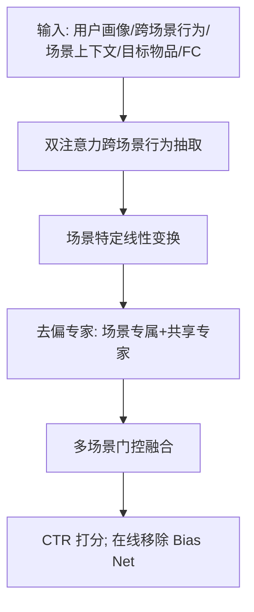
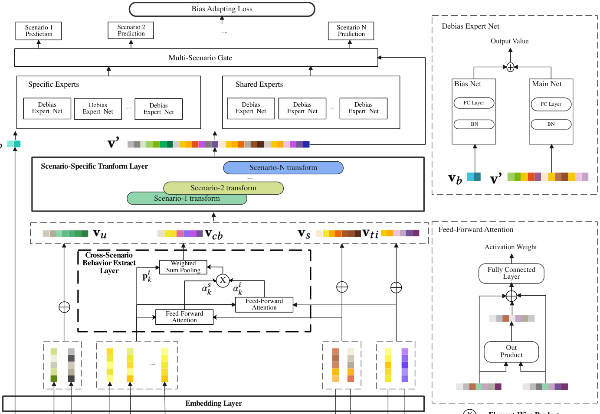

# SAR-Net: A Scenario-Aware Ranking Network for Personalized Fair Recommendation in Hundreds of Travel Scenarios (SAR-Net：面向数百旅行场景的个性化公平推荐场景感知排序网络)

- **会议/期刊**: CIKM 2021
- **作者与机构**: Qijie Shen, Wanjie Tao, Jing Zhang, Hong Wen, Zulong Chen, Quan Lu；阿里巴巴 & 悉尼大学
- **推荐链路定位**: 精排（CTR 预估）
- **研究方向**: 跨域与多场景推荐 / 去偏公平、可信隐私与工业架构
- **论文原文**: [https://arxiv.org/abs/2110.06475v2](https://arxiv.org/abs/2110.06475v2)
- **开源代码**: 暂未开源

## TL;DR (1分钟核心速览)

针对阿里旅行平台数百场景中“统一模型难兼顾差异”和“促销人工干预导致曝光偏置”两大痛点，提出 SAR-Net：双注意力跨场景兴趣抽取、场景特定变换、去偏专家门控与 Fairness Coefficient 加权。离线 20 场景 Overall AUC 0.6997，较 PLE 提升 2.88%，线上 7 天 CTR 提升超 5%。

## Background & Motivation (背景与核心矛盾)

- **主流范式**: 多场景 CTR 常用三类方案：每场景独立模型、全场景统一模型、以及 HPS/MMOE/CGC/PLE 等多任务共享-专属专家模型。
- **前人局限**: 独立模型维护成本高且小场景数据不足；统一模型淹没问题差异；MTL 的早共享/门控忽略跨场景兴趣迁移与场景上下文重要性。
- **第二矛盾**: 促销期人工重排使部分物品曝光被放大，日志偏置会让模型对干预物品自强化，系统性地压低弱势物品曝光，即“数据公平性”问题。
- **核心洞察 (Key Insight)**: 近 89% 用户在过去 30 天访问过至少 2 个场景，跨场景行为携带兴趣迁移信号；干预物品的曝光占比上升，可用“预测份额/曝光份额”构造逆向权重。
- **本文切入点**: 用目标物品与场景上下文分别调制跨场景行为，再以场景变换、去偏专家和 FC 加权同时建模场景差异与干预偏置。

## Method (核心方法设计)

### 1. 整体框架 (Overall Architecture)

SAR-Net 输入用户画像、跨场景行为序列、场景上下文、目标物品及 Fairness Coefficient（FC）。先经 Embedding 层，再由两个独立注意力分别以目标物品和场景上下文为 query 抽取跨场景兴趣，得到 $v_{cb}$；随后拼接特征并做场景特定线性变换，送入场景专属与共享两组去偏专家；每个专家含 Main Net 与仅训练期使用的 Bias Net，最后由多场景门控融合为场景 CTR。线上移除 Bias Net，仅保留 Main Net 与门控以控制时延。

<figure class="paper-figure" markdown="span">
  <figcaption>图1：我们提出的模型 SAR-Net 的总体架构。跨场景行为提取层通过两个注意力模块学习用户的跨场景兴趣，从而从不同场景中采集丰富数据。随后采用场景特定变换层进一步提取场景特定信息，再接两组去偏专家网络。我们使用公平系数衡量单个样本的重要性，并用其重新加权去偏专家网络中的预测。多场景门控模块用于融合这些预测。</figcaption>
</figure>
图1：SAR-Net 总体架构；双注意力抽取跨场景兴趣，场景变换后由专属/共享去偏专家输出并经门控融合。

### 2. 关键设计拆解 (Key Designs)

1. **双注意力跨场景兴趣抽取（Delta）**：痛点在于早共享 MTL 不建模“用户在哪些场景看过什么”。将行为拆为物品序列 $p_{i,k}$与场景序列$p_{s,k}$，分别算目标物品相关权重与目标场景相关权重：$\alpha_{i,k}=\frac{\exp(\psi(p_{i,k},p_{i,t}))}{\sum_{l=1}^{|p(B_i)|}\exp(\psi(p_{i,l},p_{i,t}))}$，场景权重同理；最终$v_{cb}=\sum_{k=1}^{t}\alpha_{i,k}\alpha_{s,k}p_{i,k}$。两个权重独立学习再相乘，避免拼接 query 时的信息互扰。

2. **场景特定变换 + 去偏专家门控（Delta）**：痛点在于共享参数难描述场景异质性，纯专属又易过拟合小场景。对第 $i$个场景做低参数逐元素变换$v'=v\otimes\beta_i+\gamma_i$；专家分为场景专属与全场景共享两组，每组专家内 Main Net 输出 CTR，Bias Net 以 FC 为输入学习重标定因子，仅训练期乘到 Main Net 输出。门控$y_k(x)=w_k(x)S_k(x)$ 融合各专家分数，缓解 seesaw 现象。

3. **Fairness Coefficient 与 Bias Adapting Loss（Delta）**：FC 用一日内物品预测份额与曝光份额之比衡量干预程度：$w_{i,s}^{\text{fairness}}=\frac{F(i,s)/\sum_{j=0}^{N_s}F(j,s)}{PV(i,s)/\sum_{j=0}^{N_s}PV(j,s)}$。曝光被干预放大时分母增大、FC 变小。训练损失为$\mathcal{L}=\sum_{k}\sum_{l}w_{i,k}^{\text{fairness}}\ell_{k,l,i}$，其中$\ell_{k,l,i}=-I_{k,l,i}\log p_{k,l,i}-(1-I_{k,l,i})\log(1-p_{k,l,i})$。CTR 二元分类，无额外负采样；在线推理移除 Bias Net，仅保留 Main Net + 门控。

## Experimental Setup & Evaluation Protocol (实验设置与评估协议)

- **数据集与预处理**: 阿里旅行生产日志，20 个场景，2020-10-20 至 11-20（含双 11 促销期）；无公开数据集。

| 数据集 | #Users | #Items | #Interactions | 稀疏度/密度 | 特征/场景说明 |
| :--- | :---: | :---: | :---: | :---: | :--- |
| Alibaba Travel | >80M | 1.55M | 未披露（1 个月日志） | 场景样本占比 0.15%–12.17%，CTR 1.23%–9.39% | 跨场景行为、场景上下文、干预 FC；20 场景极度不均衡 |

- **数据划分与防穿越 (Splitting Strategy)**: 原文仅说明组织为训练/测试集，未披露时间戳切分或比例细节；含促销期日志，非冷启动划分。
- **排名评测协议 (Ranking Protocol)**: Pointwise CTR 预估，使用全体曝光样本的 AUC 与 Overall AUC，非 top-K Full-Ranking / Sampled Ranking；无额外负采样。
- **对比基线与超参设置**: 单场景 Wide&Deep、PNN、DIN；混场景同模型；多场景 HPS、Cross-Stitch、MMOE、CGC、PLE。Adam，lr=0.001，batch=2048，行为截断 50；SAR-Net 每场景 2 个专属专家 + 8 个共享专家，10 次均值；Embedding 维度原文未披露，未报告显著性检验。

## Key Experimental Results (实验关键数据)

### 1. 主实验对比 (Main Results)

| 模型 | 训练范式 | Overall AUC | 备注 |
| :--- | :---: | :---: | :--- |
| Wide&Deep | 单场景 | 0.6640 | 单场景基线 |
| DIN | 单场景 | 0.6682 | 行为注意力基线 |
| HPS | 多场景 MTL | 0.6702 | 硬共享 |
| Cross-Stitch | 多场景 MTL | 0.6759 | 线性交叉单元 |
| MMOE | 多场景 MTL | 0.6762 | 多门控专家 |
| CGC | 多场景 MTL | 0.6791 | 共享/专属专家分离 |
| PLE | 多场景 MTL | 0.6801 | 渐进式路由，最优基线 |
| **SAR-Net** | 多场景 | **0.6997** | **较 PLE +2.88% AUC；RelaImpr +10.9%** |

### 2. 消融实验 (Ablation Study)

| 消融组 | 配置 | Overall AUC | 相对同组基线 RelaImpr |
| :--- | :--- | :---: | :---: |
| 跨场景抽取 | SAR-Net*（均值池化） | 0.6925 | — |
| | +Target Attention | 0.6956 | +1.61% |
| | +Scenario Attention | 0.6934 | +1.00% |
| | +Hierarchical Attention | 0.6955 | +1.56% |
| | 双注意力 full | **0.6997** | **+3.74%** |
| 去偏机制 | SAR-Net†（无 Bias Net/Loss） | 0.6911 | — |
| | +Subsampling 0.8（最佳） | 0.6921 | +0.52% |
| | +Bias Net | 0.6955 | +2.30% |
| | +Bias Adapting Loss | 0.6964 | +2.77% |
| | full | **0.6997** | **+4.50%** |
| 场景变换 | SAR-Net‡（无场景变换） | 0.6948 | — |
| | +Multi-layer experts (3) | 0.6956 | +0.52% |
| | full 场景变换 | **0.6997** | **+2.52%** |

### 3. 关键实验发现 (Key Findings)

- **跨场景迁移对稀疏场景增益明确**：SAR-Net Overall AUC 0.6997，较 PLE 0.6801 提升 2.88%；在仅占训练数据 0.15% 的场景 #18 上，SAR-Net 0.6691，仍高于 PLE 0.6595，说明跨场景行为能补足小场景监督不足。
- **双注意力优于单注意力与层次注意力**：双注意力 full 相对均值池化 RelaImpr +3.74%，而单独 Target/Scenario 注意力仅 +1.61%/+1.00%；拼接 query 或两层层次注意力也未超过双路相乘，证明“物品相关性 × 场景相关性”解耦更有效。
- **去偏机制优于粗暴降采样**：SAR† 0.6911，Bias Net/Loss 分别升至 0.6955/0.6964，完整模型 0.6997；而子采样 0.8 仅 0.6921，0.7/0.6 反降至 0.6909/0.6899。线上 7 天 A/B 中 CTR 提升超 5%，各类目曝光更均衡，小流量类目提升更明显。

## Highlights & Limitations (亮点、对比与审稿批判)

- **与代表作对比 (vs. Prior Work)**: 相比 PLE/CGC 只做共享-专属专家路由，本文显式建模跨场景行为迁移；相比 DIN 只做单场景行为注意力，本文同时用场景上下文调制兴趣；相比 MMOE 门控，本文加入干预偏置感知的 Bias Net 与 FC 加权损失。
- **可迁移亮点**: FC 作为“预测份额/曝光份额”的逆曝光权重，可用于促销/运营干预后的样本重加权；Bias Net 仅训练期使用、线上移除，是低时延的去偏落地范式。
- **审稿级局限批判**: 离线数据私有且划分细节不透明，难以复现；FC 依赖历史预测与一日统计，可能存在滞后与循环依赖，Bias Net 下线后训练/推理存在结构不一致。AUC 为 pointwise CTR 指标，未验证 top-K 排序公平性与统计显著性。

## Rating (四维评分)

- **方法创新性 (Novelty)**: ⭐⭐⭐⭐ （多场景兴趣迁移与干预偏置去偏结合，双注意力+FC 设计实用且较新颖，但理论分析偏弱）
- **评估协议与实验扎实度 (Protocol & Experiments)**: ⭐⭐⭐ （20 场景离线+7 天线上 A/B 较扎实，但数据私有、无显著性检验且划分细节缺失）
- **写作与数学规范度 (Clarity & Rigor)**: ⭐⭐⭐⭐ （模块与公式清晰，FC 与损失定义明确；部分实现细节如 Bias Net 重标定公式未完全展开）
- **工业落地与复现价值 (Industrial & Practical Value)**: ⭐⭐⭐⭐⭐ （已服务数百场景并带来超 5% CTR 提升，Bias Net 线上移除，工程落地价值高；复现受私有数据限制）

