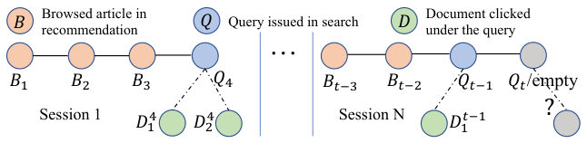
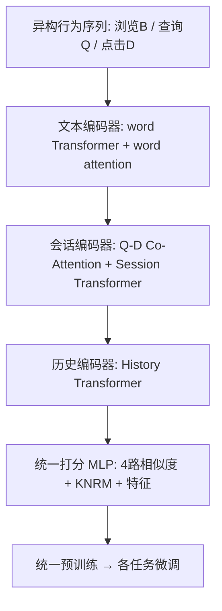
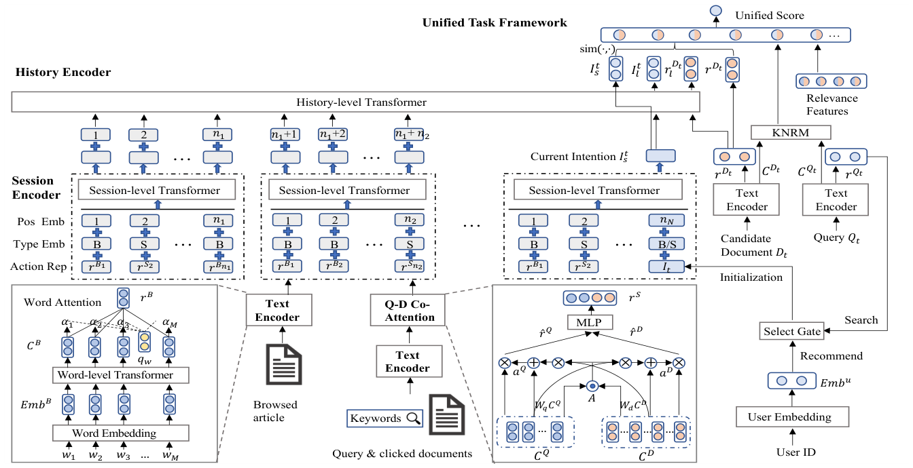

# USER: A Unified Information Search and Recommendation Model based on Integrated Behavior Sequence (基于融合行为序列的统一信息搜索与推荐模型)

- **会议/期刊**: CIKM 2021
- **作者与机构**: Jing Yao, Zhicheng Dou (人大高瓴), Ruobing Xie, Yanxiong Lu, Zhiping Wang (腾讯微信搜索), Ji-Rong Wen
- **推荐链路定位**: 重排（候选文档个性化排序）
- **研究方向**: 跨域与多场景推荐 / 序列与会话推荐
- **论文原文**: [https://arxiv.org/abs/2109.15012v1](https://arxiv.org/abs/2109.15012v1)
- **开源代码**: [https://github.com/jingjyyao/Personalized-Search](https://github.com/jingjyyao/Personalized-Search)

## TL;DR (1分钟核心速览)

信息内容平台同时提供搜索与推荐，但工业界普遍训练两套独立模型，浪费了「浏览激发搜索、搜索影响浏览」的行为依赖，也放大了单任务数据稀疏。本文把用户 query、点击文档与推荐浏览文章按时间拼成**异构行为序列**，用 USER 模型（文本/会话/历史三级编码器 + 统一打分框架）以「推荐 = 空 query 的个性化搜索」范式统一处理两任务。在真实平台 10 万用户日志上，统一数据训练的 USER 相对原始排序搜索 MAP +3.49%、推荐 MAP +71.96%，并显著优于联合损失基线 JSR。

## Background & Motivation (背景与核心矛盾)

- **主流范式**: 个性化搜索用层次 RNN/注意力从搜索历史推断意图（HRNN、RPMN、PEPS、HTPS），新闻推荐用文本编码 + 用户编码器从浏览历史建模兴趣（NPA、NRMS、LSTUR、GERL），两者各自为政。
- **前人局限**: ① 现有联合方案 JSR 只是用联合损失训练两个独立模型，完全没有利用两类行为之间的语义依赖，效果与单任务模型几乎持平；② 单任务数据稀疏，尤其用户首次搜索/首次推荐时几乎无历史可用。
- **核心洞察 (Key Insight)**: 搜索与推荐本质同源——都是「在合适时刻满足信息需求」，推荐可视为 **query 为空的个性化搜索**；同一 session 内浏览文章与后续 query 高度相关（如浏览「Japanese jack mackerel」后搜索同名 query），可互为上下文补充。
- **本文切入点**: 先把两类行为按时间合并成一条异构序列，再用**一个模型、一套打分函数**同时完成两任务。

<figure class="paper-figure" markdown="span">
  <figcaption>图2：整合行为序列示意图。目标行为为带查询𝑄𝑡的个性化搜索，或查询为空的推荐。</figcaption>
</figure>

## Method (核心方法设计)

### 1. 整体框架 (Overall Architecture)

输入是用户按 30 分钟不活跃切分的会话序列，当前 session 内历史行为 $H_s$与长期历史$H_l$ 均由 query、点击文档、浏览文章构成。文本编码器给出词级上下文表示；会话编码器用 co-attention 融合「query–其点击文档」形成搜索行为表示，再与目标意图一起送入 session 级 Transformer，捕获 session 内搜索/浏览的相互触发关系；历史编码器在全部历史 session 上再做一层 Transformer，得到长期增强的意图与候选文档表示；最后由统一任务框架把 4 个意图–文档相似度、query–文档交互分与相关性特征拼接进 MLP 输出排序分。训练采用「双任务预训练 + 单任务微调」两阶段。

<figure class="paper-figure" markdown="span">
  <figcaption>图3：我们的USER模型架构。包含四个主要组件：学习查询和文档表示的文本编码器；建模当前会话中整合行为的会话编码器；从长期行为序列中挖掘信息的历史编码器；以统一方式完成两项任务的统一任务框架。</figcaption>
</figure>

### 2. 关键设计拆解 (Key Designs)

1. **query–文档 co-attention 行为编码**: 单个搜索行为内部 query 与点击文档强相关，普通 word attention 无法互相提示重点词。先算亲和矩阵 $A=\tanh(C_Q^{\top}W_lC_D)$，再双向注意$a_Q=\mathrm{softmax}(W_{hq}^{\top}\tanh(W_qC_Q+(W_dC_D)A))$，最终$r_S=\mathrm{MLP}([\hat{r}_Q;\hat{r}_D])$。直觉是让 query 关键词为文档词加权、文档词反过来消解 query 歧义。
2. **双粒度意图编码**: 目标意图初始化用门控 $I_t=r_{Q_t}$（搜索）或$I_t=\mathrm{Emb}_u$（推荐浏览），随后$I_t^s=\mathrm{Transformer}^{last}_s([H_s,I_t]+P+T)$注入 session 上下文（位置 + 行为类型嵌入），$I_t^l=\mathrm{Transformer}^{last}_h([H_l,I_t^s]+P)$注入长期稳定兴趣；候选文档同样过历史层得$r_{D_t}^l$。短序列靠 session 澄清、长序列靠历史兜底，正好缓解冷启动。
3. **统一打分与训练**: 打分特征 $f=[\mathrm{sim}(I_t^s,r_D),\mathrm{sim}(I_t^l,r_D),\mathrm{sim}(I_t^s,r_D^l),\mathrm{sim}(I_t^l,r_D^l),\mathrm{inter}(C_{Q_t},C_{D_t}),F_{q,d}]$，$p=\Phi(f)$；推荐场景后两项置空，实现真正的算子级统一而非仅损失级联合。损失为带$K=4$负样本的 pairwise softmax$\mathcal{L}=-\log\frac{\exp(p(D^+))}{\exp(p(D^+))+\sum_{i=1}^{K}\exp(p(D_i^-))}$，负样本取同一次曝光内未点击文档，免去全库采样开销；推理时仅需一次前向，复杂度与 NRMS 同级。

## Experimental Setup & Evaluation Protocol (实验设置与评估协议)

- **数据集与预处理**: 某真实信息内容平台 3 个月日志，随机采样 10 万用户，脱敏处理；推荐记录只保留被点击文章，需人工构造伪负样本。

| 数据集 | #Users | #Sessions | #Search 记录 | #Recommend 记录 | 密度/说明 |
| :--- | :---: | :---: | :---: | :---: | :--- |
| 工业日志 | 100,000 | 515,247 | 203,190 | 840,867 | 92 天，平均会话长 3.58 |

- **数据划分与防穿越**: 按 **30 分钟不活跃**切 session；前 8 周日志作历史库，后 5 周作实验数据并按 **4:1:1** 划分 train/valid/test，严格时间先行，无穿越。
- **排名评测协议**: 属 **候选集重排（Re-ranking）**，非全库 Full-Ranking——搜索侧对原始 top-20 返回文档重排，推荐侧对「1 正 + 9 个按热度与主题相似度采样的伪负例」重排；训练负采样为曝光内未点击文档（$K=4$）。停留时长 >30s 记为 sat-click 正例。
- **指标与基线**: MAP/MRR/P@1/Avg.C/NDCG@5/NDCG@10，推荐追加 AUC；基线含 HRNN、RPMN、PEPS、HTPS（搜索）、NPA、NRMS、LSTUR、GERL（推荐）与 JSR（联合）；词/用户嵌入 $d=100$，Transformer 8 头、隐层 50，学习率 1e-3，Adam，显著性用 paired t-test$p<0.05$。

## Key Experimental Results (实验关键数据)

### 1. 主实验对比 (Main Results)

| 场景 | 模型 | MAP | MRR/AUC | P@1 | NDCG@5 | NDCG@10 | MAP Improv. |
| :--- | :--- | :---: | :---: | :---: | :---: | :---: | :---: |
| 搜索 | Ori. | .6614 | .6859 | .5766 | .6720 | .7148 | - |
| 搜索 | HRNN | .6707 | .6951 | .5800 | .6839 | .7258 | +1.41% |
| 搜索 | PEPS | .6727 | .6979 | .5811 | .6867 | .7303 | +1.71% |
| 搜索 | HTPS | .6789 | .7012 | .5851 | .6941 | .7369 | +2.65% |
| 搜索 | JSR-HRNN | .6705 | .6954 | .5796 | .6843 | .7258 | +1.38% |
| 搜索 | **USER** | **.6845** | **.7074** | **.5892** | **.7001** | **.7422** | **+3.49%** |
| 推荐 | Ori. | .2928 | .4994 | .0989 | .2952 | .4543 | - |
| 推荐 | NPA | .4787 | .7104 | .2679 | .5306 | .6037 | +63.49% |
| 推荐 | NRMS | .4984 | .7203 | .2948 | .5361 | .6147 | +70.22% |
| 推荐 | LSTUR | .4841 | .7131 | .2767 | .5268 | .6075 | +65.33% |
| 推荐 | GERL | .4591 | .7229 | .2417 | .5253 | .5885 | +56.80% |
| 推荐 | JSR-NRMS | .4931 | .7251 | .2765 | .5432 | .6143 | +68.41% |
| 推荐 | **USER** | **.5035** | **.7442** | **.2910** | **.5514** | **.6222** | **+71.96%** |

### 2. 消融实验 (Ablation Study)

| 变体 | 搜索 MAP | 搜索 NDCG@10 | 推荐 MAP | 推荐 NDCG@10 |
| :--- | :---: | :---: | :---: | :---: |
| USER (full) | .6845 | .7422 | .5035 | .6222 |
| w/o Session Encoder | .6760 (-1.24%) | .7343 (-1.06%) | .3963 (-21.29%) | .5393 (-13.32%) |
| w/o History Encoder | .6768 (-1.12%) | .7348 (-1.00%) | .4443 (-11.76%) | .5766 (-7.33%) |
| w/o Unified Pre-train | .6801 (-0.64%) | .7383 (-0.53%) | .5032 (-0.06%) | .6215 (-0.11%) |
| w/o Unified Data | .6768 (-1.12%) | .7341 (-1.09%) | .4975 (-1.19%) | .6204 (-0.29%) |

### 3. 关键实验发现 (Key Findings)

1. **跨任务数据互补是主要收益来源，且对推荐侧更关键**：同一 backbone 换成融合数据后，HTPS 搜索 MAP 仅 +0.6%、NRMS 推荐 MAP +1.6%，但 USER 相对 USER-S/USER-R 在两任务上分别再涨 1.14%/1.20% MAP，说明收益来自「联合建模」而非单纯数据量叠加。
2. **去除 Session Encoder 对推荐打击最大（MAP −21.29%）**，远大于搜索侧（−1.24%）；原因是推荐缺少显式 query，必须依赖 session 内搜索行为提供意图信号，而搜索有 query 兜底，故统一预训练对搜索增益明显（−0.64%）而对推荐几乎无影响（−0.06%，因浏览行为本身样本充足）。
3. **冷启动子集验证了稀疏缓解**：在每个用户的首条搜索/首条推荐子集（近似 cold-start）上，USER 相对各基线的 ΔMAP 均最大；在「同时含搜索与推荐的 session」子集上亦全面领先，而 JSR 与其组成模型持平，证明仅靠联合损失学不到行为交互。

## Highlights & Limitations (亮点、对比与审稿批判)

- **与代表作对比 (vs. Prior Work)**: 相对 HTPS/NRMS 等单任务强基线，USER 的差异不在于更深的网络，而在于**输入端把两类行为拼成一条序列**；相对 JSR 的「损失级联合」，USER 实现了**数据级、表示级、打分级三层统一**，因此能在含两类行为的 session 上学到真实的相互触发信号（案例中 USER 对历史浏览文章「Japanese jack mackerel」与同名 query 同时给出高注意力，HTPS 只能看到 query）。
- **可迁移亮点**: ① 「推荐 = 空 query 搜索」的门控意图初始化，可低成本复用到任何双场景（如直播 + 短视频）联合排序；② KNRM 交互分 + 手工相关性特征的 MLP 融合，便于在工业系统中渐进式替换。
- **审稿级局限批判**: ① 推荐侧的「负例」是按热度 + 主题相似度人工合成的伪未点击样本，并非真实曝光未点击日志，AUC/MAP 的绝对数值可信度受限，且缺少线上 A/B 或 CTR 增益证据；② 模型含 session 级与历史级两层 Transformer，历史序列保留 20 个 session × 5 行为，线上长历史用户推理延迟与时延预算未做分析，超参（会话切分 30 分钟、$K=4$）敏感性亦未讨论。

## Rating (四维评分)

- **方法创新性 (Novelty)**: ⭐⭐⭐⭐ （首个把搜索与推荐行为显式融合为异构序列并做算子级统一打分的框架，思路清晰但模块本身多为已有组件的巧妙重组）
- **评估协议与实验扎实度 (Protocol & Experiments)**: ⭐⭐⭐ （真实工业数据 + 多场景子集 + t 检验较完整，但推荐侧伪负例构造与候选集重排协议削弱了说服力，无线上验证）
- **写作与数学规范度 (Clarity & Rigor)**: ⭐⭐⭐⭐ （四模块结构清楚、公式与符号定义完整，训练两阶段说明明确，复杂度分析略欠）
- **工业落地与复现价值 (Industrial & Practical Value)**: ⭐⭐⭐⭐ （代码开源、可直接在微信类双引擎平台落地，数据依赖私有日志使完全复现受限）

