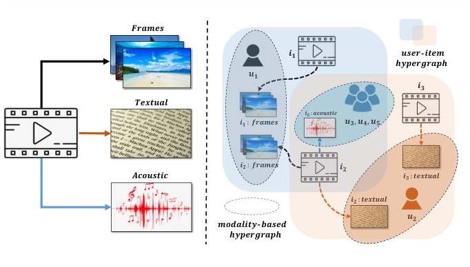
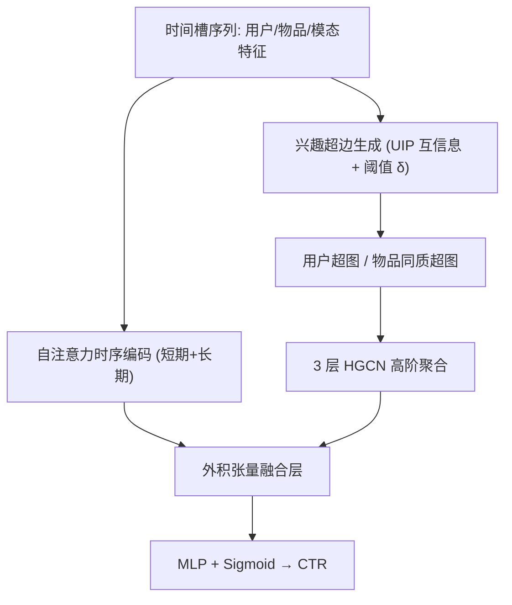
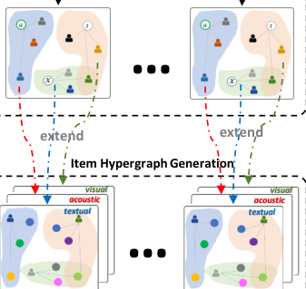

# Click-Through Rate Prediction with Multi-Modal Hypergraphs (多模态超图点击率预估)

- **会议/期刊**: CIKM 2021 (30th ACM International Conference on Information and Knowledge Management)
- **作者与机构**: Li He, Hongxu Chen, Guandong Xu (University of Technology Sydney); Dingxian Wang (eBay Research America); Shoaib Jameel (University of Essex); Philip Yu (University of Illinois at Chicago)
- **推荐链路定位**: 精排 (CTR 预估)
- **研究方向**: CTR/CVR 预估与特征交叉 / 多模态推荐
- **论文原文**: [https://arxiv.org/abs/2109.02398v1](https://arxiv.org/abs/2109.02398v1)
- **开源代码**: 暂未开源

## TL;DR (1分钟核心速览)

微视频场景下，视觉/声学/文本三模态把本就稀疏的 user-item 交互再稀释三倍，而现有 CTR 模型（FM/DNN 系）只做单模态成对特征交叉，无法刻画"一群用户因同一模态喜欢同一视频"的高阶共性。HyperCTR 用时间槽切分交互序列，构造**兴趣超图（user-user）**与**同质物品超图（item-item）**做二阶数据增广，经 HGCN + 自注意力 + 外积融合后用 MLP 打分。在 7:2:1 划分、每正样本配 1000 负例的 AUC 评测下，Kuaishou/MV1.7M/MovieLens 分别提升 **3.18% / 7.43% / 3.85%**。

## Background & Motivation (背景与核心矛盾)

- **主流范式**: AutoFIS、UBR4CTR 等以 FM+MLP 挖掘 user-item 的 2/3 阶特征交叉；GRU4Rec、MIMN、ALPINE 用 RNN/记忆网络从长行为序列抽取时序兴趣；DSTN 融合辅助数据。
- **前人局限**: (1) 单模态建模丢弃了"用户因画面而非音轨点击"的模态级偏好差异；(2) 成对（pairwise）图结构无法表达多元共现关系，而多模态引入后交互稀疏度按模态数成倍恶化（Kuaishou 稀疏度 99.98%）。
- **核心洞察 (Key Insight)**: 超边可连接任意多节点，"同一点击同一模态的一组用户/一组物品"天然是一个无度约束超边；这类超边等价于**一阶 user-item 关系升维成二阶 user-user / item-item 关系的数据增广**。
- **本文切入点**: 按时间槽截断历史，对每个模态分别构造群体感知用户超图与同质物品超图，用 HGCN 做高阶聚合，再与自注意力时序表征做张量融合。

<figure class="paper-figure" markdown="span">
  <figcaption>图1：多模态用户偏好示意图。</figcaption>
</figure>

## Method (核心方法设计)

### 1. 整体框架 (Overall Framework)

输入为按时间槽 $t_n$切分的用户行为序列（含 item 的 visual/acoustic/textual 特征）。先由模态级自监督互信息学习用户-模态兴趣矩阵$\mathbf{F}$，按阈值$\delta$生成兴趣超边（user-user），同时把"同一用户点击的多个物品"聚成同质物品超边（item-item）；两路超图分别经 HGCN 聚合得到群体感知嵌入$\mathbf{E}^{t_n}_g$，序列侧经多头自注意力得到时序嵌入$\mathbf{E}^{t_n}$；融合层以**外积张量**而非拼接建模二者交互，最后与目标物品嵌入拼接送入三层 MLP，Sigmoid 输出点击概率，端到端 BCE 训练。

<figure class="paper-figure" markdown="span">
  <figcaption>图3：HyperCTR的结构：基于不同时间槽的用户-物品相关性构建两个超图视图，超图神经网络能够捕获多跳连接中的相关性。注意力层能够捕获交互序列中的动态模式。群体感知和序列用户嵌入融合以表示每个个体，同时，将目标物品嵌入和一组同质物品-物品超图嵌入结合多层感知机学习最终预测。</figcaption>
</figure>

### 2. 关键设计拆解 (Key Designs)

**1) 自监督兴趣超边生成（解决模态偏好无显式标注）**：没有 label 告诉模型"用户 $u$ 到底爱看画面还是听声音"，于是把用户、物品、模态属性视为三个视图，用互信息最大化对齐：

$$\mathcal{L}_{UIP}= \mathbb{E}_{a_j\in \mathbf{E}_A^i}\Big[f(u,i,a_j)-\log\!\sum_{\tilde{a}\in \mathbf{E}_A\setminus \mathbf{E}_A^i}\exp f(u,i,\tilde{a})\Big],\quad f(u,i,a_j)=\sigma\big[(\mathbf{E}_I^{\top}\mathbf{W}_{UIP}\mathbf{E}_{A}^{j})\cdot \mathbf{E}_U\big]$$

其中负属性 $\tilde a$从该物品真实模态集合之外采样。直觉：把"配错的模态"推远，学出的兴趣矩阵$\mathbf{F}$超过阈值$\delta$ 即连边，等价于用对比信号自动完成**模态级用户分群**。

**2) 双超图上的谱卷积（解决多跳共现建模）**：超边连接数无上限，用关联矩阵 $\mathbf{H}$、超边权重$\mathbf{W}$与度矩阵$\mathbf{D}_v,\mathbf{D}_e$ 做超图谱卷积：

$$\mathbf{X}^{(l+1)}=\sigma\big(\mathbf{D}_v^{-1/2}\mathbf{H}\mathbf{W}\mathbf{D}_e^{-1}\mathbf{H}^{\top}\mathbf{D}_v^{-1/2}\mathbf{X}^{(l)}\mathbf{\Theta}^{(l)}\big)$$

$\mathbf{D}_e^{-1}$起到按超边规模归一化的作用——大群体共现（流行模态）不会压倒小群体共识，这正是普通 GCN 固定度 2 做不到的。构造复杂度为$O(k(|I|+|V|))$，随输入线性可扩。

**3) 张量融合与训练目标（解决拼接信息交互不足）**：群组嵌入与序列嵌入拼接会让交叉信息丢失，改用外积：$\mathbf{T}_U=\mathbf{W}^{\top}(\mathbf{E}^{t_n}\otimes \mathbf{E}^{t_n}_g)$，显式建模"个体时序 × 群体共性"的所有二阶组合。总损失$\mathcal{L}=\mathcal{L}_{BCE}+\lambda\mathcal{L}_{UIP}$（$\mathcal{L}_{UIP}$为预训练阶段），负采样为随机负例；推理仅需查超图邻域 + 一次前向，代价由邻居采样数$n$ 控制（最优 15–25）。

## Experimental Setup & Evaluation Protocol (实验设置与评估协议)

| 数据集 | #Users | #Items | #Interactions | 稀疏度 | 模态维度 (v/a/t) |
| :--- | :---: | :---: | :---: | :---: | :--- |
| Kuaishou | 10,000 | 3,239,534 | 13,661,383 | 99.98% | 2048 / – / 128 |
| MV1.7M | 10,986 | 1,704,880 | 12,737,619 | – | 128 / 128 / 128 |
| MovieLens-10M | 71,567 | 10,681 | 10,000,054 | 99.63% | 2048 / 128 / 100 |

- **数据划分与防穿越**: 随机 **7:2:1** 比例划分 train/val/test；序列按时间戳排序后按时间槽截断，未严格采用全局时间戳切分（存在轻微信息泄漏风险）。
- **排名评测协议**: **Sampled Ranking**——测试阶段每个真实 user-item 正例配 **1000 个未交互负样本**，指标为 AUC 与 Logloss（非 Full-Ranking 全库排序）。训练侧为随机负采样。
- **对比基线与超参**: 基线 7 个，覆盖 RNN 序列（GRU4Rec）、微视频兴趣（THACIL、ALPINE）、DNN 融合（DSTN、MIMN）与 FM 系特征交叉（AutoFIS、UBR4CTR）；嵌入维度搜索 {32,64,128}，报告 $d=64$，Adam 优化，HGCN 层数最优 3。

## Key Experimental Results (实验关键数据)

### 1. 主实验对比 (Main Results)

| 模型 | Kuaishou AUC | Logloss | MV1.7M AUC | Logloss | MovieLens AUC | Logloss |
| :--- | :---: | :---: | :---: | :---: | :---: | :---: |
| GRU4Rec | 0.7367 | 0.5852 | 0.7522 | 0.6613 | 0.7486 | 0.6991 |
| THACIL | 0.6640 | 0.5793 | 0.6842 | 0.6572 | 0.6720 | 0.6791 |
| DSTN | 0.7722 | 0.5672 | 0.7956 | 0.6492 | 0.8008 | 0.6162 |
| MIMN | 0.7593 | 0.5912 | 0.7486 | 0.6862 | 0.7522 | 0.6751 |
| ALPINE | 0.6840 | 0.5632 | 0.7130 | 0.6591 | 0.7390 | 0.6163 |
| AutoFIS | 0.7870 | 0.5756 | 0.8010 | 0.5404 | 0.7983 | 0.5436 |
| UBR4CTR | 0.7520 | 0.5710 | 0.8070 | 0.5605 | 0.8050 | 0.5663 |
| **HyperCTR** | **0.8120** | **0.5548** | **0.8670** | **0.5160** | **0.8360** | **0.5380** |
| Improv.% | +3.18% | +1.49% | +7.43% | +4.51% | +3.85% | +1.03% |

### 2. 消融实验 (Ablation Study)

| 变体 | Kuaishou AUC | MV1.7M AUC | MovieLens AUC | 结论指向 |
| :--- | :---: | :---: | :---: | :--- |
| 全模态 (完整模型) | **0.8120** | **0.8670** | **0.8360** | — |
| 仅 visual 模态 | 0.8110 | 0.8567 | 0.8259 | 视觉主导 |
| 仅 acoustic 模态 | – | 0.8260 | 0.8134 | 次之 |
| 仅 textual 模态 | 0.7720 | 0.8158 | 0.8123 | 最弱（除电影域） |
| w/o hypergraph (退化为单图/序列) | 0.8034 | 0.8137 | 0.8064 | **掉幅最大：−5.33pt** |

### 3. 关键实验发现 (Key Findings)

- **超图增广是主要增益源**：移除超图结构后 MV1.7M AUC 从 0.8670 跌至 0.8137（−5.33 个百分点），远大于任意单模态替换造成的损失（−1.03~−5.12），证明二阶 user-user/item-item 超边确实缓解了多模态稀疏，而非仅仅"多喂了特征"。
- **模态价值与内容形态强相关**：Kuaishou 上仅用 visual 已达 0.8110，与全模态 0.8120 几乎持平，textual 单独仅 0.7720，符合"短视频先看画面"的先验；MovieLens 三模态差距收窄（0.8259/0.8134/0.8123），说明电影域文本（简介/影评）语义有效，提示模态加权应按域自适应而非固定。
- **时间粒度与层数是强敏感超参**：HGCN 最优 3 层（1 层显著不足，>3 层在稀疏数据上过平滑）；最优时间槽 Kuaishou ≈ 6 个月、MovieLens ≈ 12 个月、MV1.7M ≈ 3 个月，与内容消费/传播速度一致；邻居采样 15–25 最优，40 时因引入无关邻居而下降。

## Highlights & Limitations (亮点、对比与审稿批判)

- **与代表作对比**: 相较 AutoFIS/UBR4CTR 仅做特征级成对交叉，本文把交叉搬到**图结构层**（超边自由度 > 2）；相较 GRU4Rec/MIMN 的纯序列建模，本文额外注入群体级共识；相较 DSTN 的异构数据拼接，本文用 UIP 互信息显式对齐模态与用户，避免"无标注下的模态盲配"。
- **可迁移亮点**: (1) 把"同一点击同一模态的用户集合"直接视为超边，是一套无需额外标注的多模态数据增广范式，可移植到图文电商与短视频广告；(2) 外积张量融合替代 concat，在双路表征（个体+群体）融合场景通用。
- **审稿级局限批判**: (1) 评测仅用 **1000 负例采样排序**而非 Full-Ranking，AUC 绝对值易被高估，且未报告多随机种子方差与显著性检验；(2) 超图需按时间槽离线重建，全量重构图在千万级交互上开销大，论文仅给出多线程线性加速曲线而未报告单 epoch 墙钟时间与线上更新策略；(3) 式 (8) 的 BCE 写法缺负号、$\mathcal{L}_{UIP}$记法不规范，复现细节（$\delta$、$\lambda$、预训练轮数）缺失且未开源。

## Rating (四维评分)

- **方法创新性 (Novelty)**: ⭐⭐⭐⭐ （用模态级互信息自动生成兴趣超边、再升维成二阶超图增广，思路在 2021 年 CTR 语境下新颖，但 HGCN 算子本身为标准谱卷积）
- **评估协议与实验扎实度 (Protocol & Experiments)**: ⭐⭐⭐ （三数据集 + 7 基线 + 多组敏感性分析较完整，但为 1000 负例采样排序、随机划分、无显著性检验，结论强度受限）
- **写作与数学规范度 (Clarity & Rigor)**: ⭐⭐⭐ （框架图清晰、动机叙事流畅，但损失函数符号有误、多处定义重复冗余，$\delta$ 等关键超参缺乏说明）
- **工业落地与复现价值 (Industrial & Practical Value)**: ⭐⭐⭐ （复杂度线性可扩、多线程近线性加速，具备工程可行性；但超图离线重建成本与代码未开源削弱复现与部署便利性）

