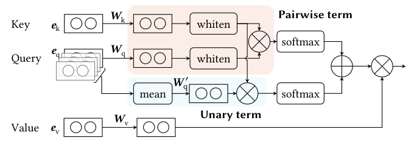
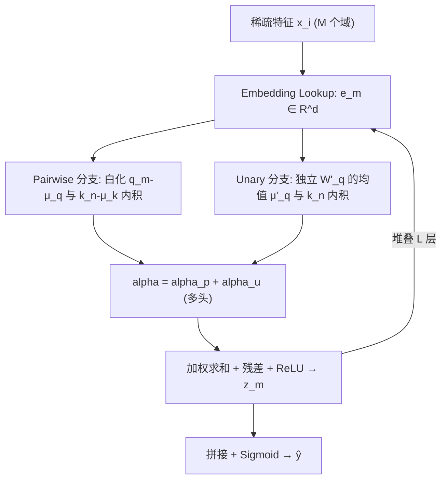

# Disentangled Self-Attentive Neural Networks for Click-Through Rate Prediction (面向点击率预估的解耦自注意力网络)

- **会议/期刊**: CIKM 2021 (Applied Research Track, short paper)
- **作者与机构**: Yichen Xu, Yanqiao Zhu, Feng Yu, Qiang Liu, Shu Wu（北邮 / 中科院自动化所 CRIPAC / 阿里 / 中科院 AI 研究院）
- **推荐链路定位**: 精排（CTR 预估）
- **研究方向**: CTR/CVR 预估与特征交叉
- **论文原文**: [https://arxiv.org/abs/2101.03654v3](https://arxiv.org/abs/2101.03654v3)
- **开源代码**: [https://github.com/CRIPAC-DIG/DESTINE](https://github.com/CRIPAC-DIG/DESTINE)

## TL;DR (1分钟核心速览)

CTR 场景下自注意力（AutoInt）用特征对点积构造注意力权重，但点积把"该特征对所有域的泛化影响（一元语义）"与"特征对之间的专属交互（成对语义）"混在同一打分里，梯度相互污染。DESTINE 将注意力分数显式拆为 **白化成对项** + **独立参数化一元项** 再相加，几乎不增参数即可训练。在 Avazu / Criteo 上按 8:1:1 随机划分、AUC/logloss 评测，DESTINE 相比最强显式交叉基线 AutoInt 在 Avazu 上 AUC 提升 **+1.02%**（0.7752 → 0.7831），叠加 DNN 的 DESTINE+ 亦全面刷新 SOTA，且训练时间不升反降（Avazu 104.9 min vs 112.6 min）。

## Background & Motivation (背景与核心矛盾)

- **主流范式**: 用 embedding 内积建模二阶交叉（FM），或堆叠自注意力层 + 残差学习任意阶交叉（AutoInt、CIN、HOFM），避免指数级枚举组合特征。
- **前人局限**: ①纯 DNN 隐式交叉（DeepCrossing）在稀疏高维类别特征上甚至打不过二阶 FM，说明"隐式学交叉"不可靠；②自注意力中 $\boldsymbol{q}_m^\top\boldsymbol{k}_n$ 同时编码成对相关性与特征自身的全局重要性，导致注意力分布被"高影响力特征"整体抬高而掩盖真正的强交互对；③乘法式/共享变换的融合会引入耦合梯度，训练互相拉扯。
- **核心洞察 (Key Insight)**: 视觉表征学习已证明注意力重要性可分解为一元（general impact）+ 成对（pure interaction）两项；CTR 中二者共享同一 $W_q/W_k$ 是梯度耦合的根源，唯有**参数分离**才谈得上真正解耦。
- **本文切入点**: 给一元项单独一套 query 变换 $W'_q$，并对成对项做 query/key 去均值白化，使两项在数值与梯度上互不干扰。

## Method (核心方法设计)

### 1. 整体框架 (Overall Architecture)

输入 $M$个域的稀疏类别特征 → embedding lookup 得到$\mathbf{e}_m\in\mathbb{R}^d$ → 堆叠若干解耦自注意力层（每层内含共享的 key/value 投影 + 独立的成对 query 与一元 query 两路打分，多头拼接后接残差与 ReLU）→ 末层拼接全部域表征做 logistic 输出。训练用二分类交叉熵 + Adam + dropout 0.2，无需额外负采样。

<figure class="paper-figure" markdown="span">
  <figcaption>图1：我们提出的用于CTR预测的解耦自注意力网络，其将成对项与一元项的学习解耦。</figcaption>
</figure>

### 2. 关键设计拆解 (Key Designs)

1. **白化成对项 (Whitened Pairwise Term)**：痛点是在原始点积下，两个语义高度相关的域（如广告主与广告类别）天然获得高相似度，注意力被"共性"占满。做法是对 query/key 分别减去该样本内所有域的均值向量：$\alpha_p(\mathbf{e}_m,\mathbf{e}_n)=\sigma\big((\boldsymbol{q}_m-\boldsymbol{\mu}_q)^\top(\boldsymbol{k}_n-\boldsymbol{\mu}_k)\big)$，其中$\boldsymbol{\mu}_q=\frac{1}{M}\sum_i W_q\mathbf{e}_i$。去均值后打分只保留"该对相对其余域的偏离"，物理上等价于样本内的交互增益，天然抑制共性噪声。
2. **独立参数化一元项 (Unary Term)**：痛点是一元语义（某域整体有多重要）与成对语义共用 $W_q$会让两者的梯度耦合。本文另引入$W'_q$，用整样本均值向量代表"该域对全体的平均影响"：$\alpha_u(\mathbf{e}_m,\mathbf{e}_n)=\sigma\big((\boldsymbol{\mu}'_q)^\top \mathbf{k}_n\big)$，$\boldsymbol{\mu}'_q=\frac{1}{M}\sum_i W'_q\mathbf{e}_i$。最终打分$\alpha=\alpha_p+\alpha_u$，多头下各自持独立$W_k^{(h)},W_q^{(h)},W_q'^{(h)},W_v^{(h)}$，再$\mathbf{z}_m=\sum_k\alpha(\mathbf{e}_m,\mathbf{e}_k)\mathbf{v}_k$并接残差$\hat{\mathbf{z}}_m=\mathrm{ReLU}(\mathbf{z}_m+W_r\mathbf{e}_m)$。
3. **训练目标与推理开销**：损失为 $\mathcal{L}=-\frac{1}{N}\sum_{(y,\hat{y})}(y\log\hat{y}+(1-y)\log(1-\hat{y}))$，端到端训练、无负采样。新增参数仅每头一个$W'_q\in\mathbb{R}^{d'\times d}$，空间$O(dd'H)$；时间$O(MHd'(2M+d+1))$，相比原始自注意力的$O(MHd'(M+d))$只多一项$O(M^2Hd')$，在$M\le 39,d'=32$ 下几乎无损。

## Experimental Setup & Evaluation Protocol (实验设置与评估协议)

- **数据集与预处理**: 沿用公开版本数据（Avazu 已按官方 train/test 分流后重采样），全部强类别特征哈希为 embedding 索引，无额外低活跃过滤。

| 数据集 | #Users/实例 | #Fields | #Features | 稀疏度/密度 | 特征/场景说明 |
| :--- | :---: | :---: | :---: | :---: | :--- |
| Avazu | 40,428,967 | 23 | 1,544,488 | 正样本率 17% | 10 天移动广告点击日志（domain/category/connection 等） |
| Criteo | 45,840,617 | 39 | 998,960 | 正样本率 26% | 7 天展示广告日志，13 数值 + 26 类别域 |

- **数据划分与防穿越 (Splitting Strategy)**: **随机比例划分** 80% 训练 / 10% 验证 / 10% 测试（沿用 AutoInt、xDeepFM 等既有工作设定，非时间切分）。
- **排名评测协议 (Ranking Protocol)**: CTR 场景不涉及候选排序，直接在全量测试样本上计算 **AUC 与 Logloss**；作者注明工业界 AUC 提升 1‰ 即具实际意义，本文报告 1% 级提升。
- **对比基线与超参设置**: 基线含一阶 LR、二阶 FM/AFM、高阶 DeepCrossing/CrossNet/CIN/HOFM/AutoInt；DNN 融合组 Wide&Deep、DeepFM、Deep&Cross、xDeepFM、AutoInt+、DeepIM、AutoCTR。超参：注意力头 $H=2$，注意力维度$d'=32$，embedding 维度$d=64$，Adam lr=0.001，dropout=0.2，$\ell_2$在$\{5\times10^{-3},\dots,5\times10^{-6}\}$ 网格调优。

## Key Experimental Results (实验关键数据)

### 1. 主实验对比 (Main Results)

显式特征交叉模型对比（AUC ↑ / Logloss ↓ / 训练时间 min）：

| Model | Criteo AUC | Criteo Logloss | Criteo Time | Avazu AUC | Avazu Logloss | Avazu Time |
| :--- | :---: | :---: | :---: | :---: | :---: | :---: |
| LR | 0.7820 | 0.4695 | 535.2 | 0.7560 | 0.3964 | 342.6 |
| FM | 0.7836 | 0.4700 | 391.3 | 0.7706 | 0.3856 | 480.2 |
| AFM | 0.7938 | 0.4584 | 468.3 | 0.7718 | 0.3854 | 130.7 |
| CrossNet | 0.7907 | 0.4591 | 216.7 | 0.7667 | 0.3868 | 56.3 |
| CIN | 0.8009 | 0.4517 | 219.0 | 0.7758 | 0.3829 | 179.6 |
| HOFM | 0.8005 | 0.4508 | 696.2 | 0.7701 | 0.3854 | 903.0 |
| AutoInt | 0.8061 | 0.4455 | 375.9 | 0.7752 | 0.3824 | 112.6 |
| **DESTINE** | **0.8087** | **0.4425** | 477.3 | **0.7831** | **0.3789** | 104.9 |
| **Improv.% (vs. AutoInt)** | **+0.32%** | **−0.67%** | — | **+1.02%** | **−0.92%** | −6.8% |

与 DNN 隐式交叉融合（DESTINE+ 全面最优）：Criteo 上 DESTINE+ **0.8118** / **0.4398**，优于 AutoCTR (0.8104/0.4413) 与 AutoInt+ (0.8083/0.4434)；Avazu 上 **0.7851** / **0.3779**，优于 DeepIM (0.7828/0.3809) 与 AutoCTR (0.7791/0.3800)。

### 2. 消融实验 (Ablation Study)

原文以图 2（AUC/Logloss 条形图）报告，此处给出各变体定义与结论方向：

| 变体 | 打分形式 | 相对 DESTINE 的表现 |
| :--- | :--- | :--- |
| DESTINE-P | 仅保留白化成对项 $\alpha_p$ | 双数据集均下降，一元语义缺失 |
| DESTINE-U | 仅保留一元项 $\alpha_u$ | 双数据集均下降，纯交互信息丢失 |
| DESTINE-M | $\alpha=\sigma(\cdot)\cdot\sigma(\cdot)$ 乘法耦合 | 最差，甚至被 P/U 单分支反超 |
| DESTINE-S | 一元项复用 $W_k$，$\alpha_p+\sigma(\boldsymbol{\mu}_q^\top\boldsymbol{k}_n)$ | 仍低于完整 DESTINE |
| **DESTINE** | 加法 + 独立 $W'_q$ | **最优** |

### 3. 关键实验发现 (Key Findings)

1. **显式交叉 > 隐式交叉**：纯 DNN 的 DeepCrossing 在 Criteo 仅 0.8009，与 CIN (0.8009)、HOFM (0.8005) 持平却远逊 DESTINE (0.8087)，说明稀疏高维域下必须以显式算子约束交叉形式，否则参数被浪费在无用组合上。
2. **解耦方式比"有没有两项"更重要**：DESTINE-M 同时使用两项却因乘法导致梯度耦合，性能反被单分支 DESTINE-P/U 超越，DESTINE-S 复用 $W_k$ 同样受损——这说明增益来自**参数与梯度的彻底分离**，而非简单堆加语义项。
3. **DNN 增益趋于饱和**：DESTINE+ 相对 DESTINE 的 AUC 平均增益约 +0.0026，与 AutoInt+ 的 +0.0023 接近，说明基座已充分刻画交叉，隐式 DNN 只剩边际收益；同时 DESTINE 在 Avazu 训练只需 104.9 min（AutoInt 112.6 min），精度提升不以算力为代价。

## Highlights & Limitations (亮点、对比与审稿批判)

- **与代表作对比 (vs. Prior Work)**: 相比 AutoInt，本文不改注意力骨架、只改打分分解，额外参数仅一个投影矩阵，"零成本换精度"；相比 CIN/HOFM 的向量级/显式高阶算子，DESTINE 用 $O(M^2)$ 注意力即可逼近其表达能力；相比 DeepFM/xDeepFM 等依赖 DNN 隐式补足交叉的方案，本文证明显式解耦已能吃掉大部分收益。
- **可迁移亮点**: ①"样本内去均值白化"可移植到序列推荐的自注意力打分，抑制流行度共性；②把注意力权重拆成 unary 与 pairwise 两路独立投影，可推广到多任务精排中的专家—门控解耦设计。
- **审稿级局限批判**: ①两项各自独立过 softmax 后**相加**，破坏了注意力权重归一化（$\sum_k\alpha\neq1$），缺乏概率解释与缩放因子校准；②仅两个数据集、随机 80/10/10 划分而非时间切分，与线上分布漂移下的表现存在差距；③未报告多随机种子方差与显著性检验，AUC 提升 0.0026 量级在小数据集上可能不稳健；④训练时间在 Criteo 上反而高于 AutoInt（477.3 vs 375.9 min），与文中"高效"表述存在张力。

## Rating (四维评分)

- **方法创新性 (Novelty)**: ⭐⭐⭐⭐ （将自注意力打分显式拆为一元/成对两项并指出梯度耦合根源，思路干净，但本质是打分函数改造而非新架构）
- **评估协议与实验扎实度 (Protocol & Experiments)**: ⭐⭐⭐ （两大数据集 + 完整基线谱系 + 变体消融，但随机划分、无多次重复与显著性检验，消融仅以柱状图呈现无具体数值）
- **写作与数学规范度 (Clarity & Rigor)**: ⭐⭐⭐⭐ （公式与复杂度推导简洁自洽，$W'_q$ 引入动机清晰；但两项相加后未归一化、未讨论 softmax 竞争关系，理论解释留有缺口）
- **工业落地与复现价值 (Industrial & Practical Value)**: ⭐⭐⭐⭐⭐ （代码开源，额外参数仅 $O(dd'H)$、推理几乎零增开销，Avazu 上训练更快，可直接替换精排层自注意力模块）

