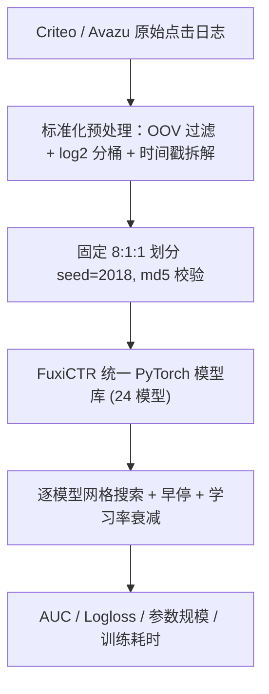

# Open Benchmarking for Click-Through Rate Prediction (点击率预估的开放式基准评测)

- **会议/期刊**: CIKM 2021
- **作者与机构**: Jieming Zhu、Jinyang Liu、Shuai Yang、Qi Zhang、Xiuqiang He（华为诺亚方舟实验室、香港中文大学、北京大学）
- **推荐链路定位**: 精排（CTR 预估）
- **研究方向**: CTR/CVR 预估与特征交叉 / 工业架构与评测基准
- **论文原文**: [arXiv:2009.05794v6](https://arxiv.org/abs/2009.05794v6)
- **开源代码**: [BARS-CTR / FuxiCTR](https://openbenchmark.github.io/BARS/CTR)（配套库 `DeepCTR` 亦在文中被引用）

## TL;DR (1分钟核心速览)

CTR 领域长期缺乏统一评测口径：数据过滤阈值、数值特征处理、划分随机种子各不相同，导致任何两个模型的报告数字不可比。本文构建 BARS-CTR 开放基准，以固定 seed=2018 的 8:1:1 随机划分为唯一协议，用 FuxiCTR 统一实现并逐模型网格搜索（平均 73 次/模型，共 7000+ 实验、12000+ GPU 小时）重评估 24 个模型。结论反直觉：在 Criteo_x4/Avazu_x4 上，IPNN、DeepFM、DCN、xDeepFM、ONN 的 AUC 全部挤在 81.4% / 79.6% 一档，且重调参本身即可带来最高约 5‰ logloss 的"伪创新"增益。

## Background & Motivation (背景与核心矛盾)

- **主流范式**: 从 LR/FM/FFM 演进到 Wide&Deep、DeepFM、DCN、xDeepFM、AutoInt+、FiBiNET 等深层特征交叉网络，各家均在自建划分上宣称 SOTA。
- **前人局限**: 其一，预处理不透明——数值特征是否分桶、稀有类目 `min_count` 阈值（1/2/10）未知，直接改变特征空间与结果上界；其二，基线实现不透明——多数论文不开源基线代码、不写明调参预算，1‰ AUC 的微弱差异极可能来自实现质量而非结构创新。
- **核心洞察 (Key Insight)**: 在 ImageNet/GLUE 式的统一协议下重新搜索超参后，所谓"高阶交叉结构"带来的边际收益被调参收益吞没；甚至 InterHAt、AFN+、LorentzFM 等新模型反而不及 LR/DNN 等老模型。
- **本文切入点**: 不做新模型，而是把"可复现性"本身工程化为五条硬要求（预处理脚本、模型代码、模型超参、基线代码、基线超参），并公开全部日志与配置。

## Method (核心方法设计)

### 1. 整体框架 (Overall Architecture)

流水线为：原始 CSV → 统一特征变换（类目 OOV 替换、数值 log2 分桶、多值域池化）→ HDF5 存储并记录 md5 → 固定划分与随机种子 → PyTorch 统一模型实现 → 网格搜索（学习率 $10^{-3}$、batch 初始 10000、$L_2$ 与 dropout 按 10 倍量级扫）→ `ReduceLROnPlateau` 与验证集 early stopping（2–3 轮）→ 输出 AUC/logloss、`#Params`、`#Runs`、`Time×Epochs`。所有环节写入配置文件与运行日志，保证任一结果可逐位复现。

### 2. 关键设计拆解 (Key Designs)

1. **协议级去偏：把"数据侧变量"钉死**。痛点是同数据集不同论文结果不可比。本文复用 AutoInt 的划分代码并固定种子，对 Criteo 数值特征改用竞赛冠军方案的 $\hat{x}=\lfloor \log_2 x\rfloor\ (x>2)$ 分桶替代原 Z-score 归一化，稀有类目以 `OOV` 归并；Avazu 则删除每个样本唯一取值的 `id` 域（原实现缺陷），并把 timestamp 拆为 hour/weekday/is_weekend。直觉是：把"数据决定的上界"统一抬高后，模型差异才暴露真实结构差异。
2. **调参预算显式化，构建可比基线**。痛点是基线欠调优导致虚假提升。本文对每个模型记录实验次数 `#Runs`（如 DCN 在 Criteo_x4_002/Avazu_x4_002 分别跑了 544/496 次），并定义重调参增益 $\Delta_{\text{tune}}=\mathrm{AUC}_{\text{retuned}}-\mathrm{AUC}_{\text{reported}}$ 作为"论文涨点"的对照量，使新模型的增益必须超过该噪声地板才具说服力。
3. **训练目标与效率口径**。损失仍为标准 BCE $\mathcal{L}=-\frac{1}{N}\sum_{(x,y)\in\mathcal{D}}\left[y\log\hat{y}+(1-y)\log(1-\hat{y})\right]$，$\hat{y}=\sigma(\phi(x))$，无负采样（全量曝光样本即真实分布）；评测以 AUC 与 logloss 双指标并报，训练开销以"每轮耗时×轮数"给出，作为线上时延约束下的第二决策维度。

## Experimental Setup & Evaluation Protocol (实验设置与评估协议)

- **数据集与预处理**:

| 数据集 | #Users | #Items | #Interactions | 稀疏度/密度 | 特征/场景说明 |
| :--- | :---: | :---: | :---: | :---: | :--- |
| Criteo_x4 | 匿名 | 匿名 | 46M | 26% 正例 | 39 域 / 5.55M 特征，13 数值 + 26 类目，一周广告点击 |
| Avazu_x4 | 匿名 | 匿名 | 40M | 17% 正例 | 24 域 / 8.37M 特征，10 天点击，23 个类目域 |

- **数据划分与防穿越**: 随机 `8:1:1` 比例划分（train/valid/test），固定随机种子 `seed=2018`，沿用 AutoInt 划分脚本并校验 md5；**非**时间切分，作者在 Discussion 中承认这是与线上分布偏移的妥协，未来将补时间序贯划分与校准。
- **排名评测协议**: 不做采样排序，直接在测试全集上按真实曝光样本计算 AUC 与 logloss（全库口径、无负采样）；工业显著性门槛取 $\Delta\text{AUC}\ge 0.001$。
- **对比基线与超参设置**: 24 个模型分浅层（LR、FM、FFM、HOFM、FwFM、LorentzFM）与深层（DNN、Wide&Deep、IPNN、DeepCross、NFM、AFM、DeepFM、DCN、xDeepFM、HFM+、FGCNN、AutoInt+、FiGNN、ONN、FiBiNET、AFN+、InterHAt、CCPM）；Embedding 维度 $d\in\{16,40\}$两套设置，分为 `_001`（$d=16$、Criteo `min_count=10`、Avazu `min_count=2`）与 `_002`（$d=40$、Criteo `min_count=2`、Avazu `min_count=1`）。

## Key Experimental Results (实验关键数据)

### 1. 主实验对比 (Main Results)

Criteo_x4_002 / Avazu_x4_002（$d=40$）代表性结果（Logloss×10⁻²，AUC%）：

| 模型 | Criteo Logloss | Criteo AUC | Avazu Logloss | Avazu AUC | #Params(C) | Time×Epochs(C) |
| :--- | :---: | :---: | :---: | :---: | :---: | :---: |
| LR (2007) | 45.66 | 79.36 | 37.99 | 78.04 | 5.5M | 7m×12 |
| FM (2010) | 44.45 | 80.78 | 37.36 | 79.09 | 227.5M | 18m×5 |
| DeepFM (2017) | 43.78 | 81.41 | 37.02 | 79.62 | 229.1M | 18m×9 |
| DCN (2017) | 43.78 | 81.41 | 36.99 | 79.65 | 245.1M | 14m×9 |
| xDeepFM (2018) | **43.75** | **81.44** | 36.97 | 79.67 | 232.3M | 1h9m×8 |
| IPNN (2016) | 43.88 | 81.32 | 36.86 | 79.88 | 258.5M | 32m×2 |
| FiBiNET (2019) | 43.86 | 81.34 | **36.75** | **80.03** | 482.5M | 2h21m×2 |
| FFM (2016) | 44.09 | 81.11 | 37.11 | 79.48 | 638.2M | 3h59m×5 |
| ONN (2019) | 43.81 | 81.41 | 36.77 | 80.01 | 436.7M | 2h13m×8 |
| InterHAt (2020) | 44.01 | 81.17 | 37.22 | 79.27 | 222.1M | 18m×20 |

> 与各模型原文自报值对比：Criteo 上 xDeepFM 原文 80.91 → 本文 **81.44**（+0.53），Avazu 上 FiBiNET 原文 78.32 → 本文 **80.03**（+1.71，Improv. 约 2.2% 相对），ONN 75.13 → **80.01**（+4.88）；反之 InterHAt 原文 78.45 低于同表 LR 的 79.34，说明原报告的"新模型优势"多为口径差异所致。

### 2. 消融实验 (Ablation Study)

原文无结构消融，等价消融为"报告值 / 同划分复跑（沿用原文超参）/ 重调参"三档对照（Logloss×10⁻²，AUC%）：

| 模型 | 设置 | Criteo Logloss | Criteo AUC | Avazu Logloss | Avazu AUC |
| :--- | :--- | :---: | :---: | :---: | :---: |
| AutoInt+ | Reported / Rerun / Retuned | 44.34 / 44.25 / 43.85 | 80.83 / 80.92 / **81.34** | 38.11 / 37.32 / 37.09 | 77.74 / 79.13 / **79.53** |
| FiGNN | Reported / Rerun / Retuned | 44.53 / 44.28 / 43.79 | 80.62 / 80.89 / **81.41** | 38.25 / 37.44 / 37.11 | 77.62 / 78.93 / **79.44** |
| FiBiNET | Reported / Rerun / Retuned | 44.23 / 44.31 / 43.86 | 81.03 / 80.88 / **81.34** | 37.86 / 37.24 / 36.75 | 78.32 / 79.37 / **80.03** |
| AFN+ | Reported / Rerun / Retuned | 44.51 / 44.32 / 43.87 | 80.74 / 80.84 / 81.34 | 37.18 / 37.15 / 37.00 | 75.55 / 79.39 / **79.65** |

### 3. 关键实验发现 (Key Findings)

1. **"复跑"即涨点，调参再涨点**：仅把原论文超参搬到自己划分上复跑（Rerun），FiBiNET 在 Avazu 上就从 78.32 → 79.37 AUC，重调参后到 80.03；三档之间最大差 5‰ logloss，远超工业 1‰ 显著性门槛，等于给所有"新模型 +1‰"类结论判了存疑。
2. **充分调参后 SOTA 相互淹没**：Criteo 上 IPNN(81.32)、DeepFM/DCN(81.41)、xDeepFM(81.44)、ONN(81.41)、FiGNN(81.41) 差异 ≤0.12 个百分点；Avazu 上 DCN 跑了 496 次实验仍与 DeepFM 不可区分（36.99 vs 37.02），高频交叉结构的边际价值基本饱和。
3. **效率方差远大于精度方差**：FFM 638.2M 参数、3h59m/epoch，FiGNN 1h40m×14 轮，而 DCN 仅 14m×9、DeepFM 18m×9 就达到同档 AUC；FGCNN/ONN 参数膨胀 2–3 倍但仅在 Avazu 上换来 0.3–0.4 个百分点，工业选型应优先考虑"精度-时延"帕累托前沿而非榜首小数位。

## Highlights & Limitations (亮点、对比与审稿批判)

- **与代表作对比 (vs. Prior Work)**: 相较 DeepCTR 这类"模型仓库"，本文补齐了数据处理、种子、早停、调参搜索与日志的完整闭环；相较同期 Dacrema 等的复现批评工作，本文把复现升级为可持续维护的公开榜单 BARS-CTR；相较各模型原论文，本文首次在同一划分上给出 24 模型的可比排名，并主动指出部分新模型不如老模型的负结果。
- **可迁移亮点**: ①`min_count` 阈值敏感性——重调预处理阈值可换来比换模型更大的收益，任何论文都应报告过滤策略与特征空间规模；②"Reported / Rerun / Retuned"三档报告范式，可作为自审或审稿时的调参充分性检查清单。
- **审稿级局限批判**: ①两数据集均匿名且缺 `user_id`/`item_id`，DIN/DIEN、FLEN 等序列与用户交互模型无法纳入，也无法报 gAUC，基准覆盖面存在结构性缺口；②仅随机 8:1:1 划分、未做时间序贯切分与概率校准，与线上分布漂移场景存在落差；③调参靠人工分组网格搜索（每模型 ~73 次），未引入贝叶斯优化，也未统计多次种子的方差与显著性检验，个别 0.01 量级差距的可信度仍存疑。

## Rating (四维评分)

- **方法创新性 (Novelty)**: ⭐⭐⭐ （无新网络结构，创新在评测方法论与可复现工程，负结果本身是核心贡献）
- **评估协议与实验扎实度 (Protocol & Experiments)**: ⭐⭐⭐⭐⭐ （24 模型、7000+ 实验、12000+ GPU 小时、固定种子与 md5 校验，涵盖效率与参数量维度）
- **写作与数学规范度 (Clarity & Rigor)**: ⭐⭐⭐⭐ （公式仅保留 BCE 与预处理算子，符号干净；但缺多次种子方差与显著性检验说明）
- **工业落地与复现价值 (Industrial & Practical Value)**: ⭐⭐⭐⭐⭐ （FuxiCTR 全开源、配置与日志齐全，直接为工业选型提供精度-时延对账表，可直接复现部署）

