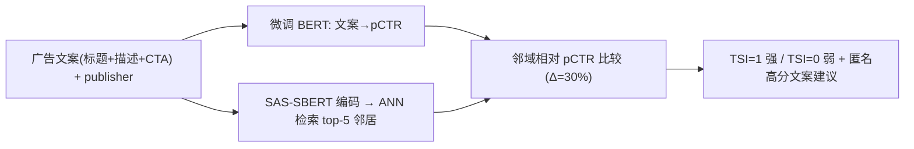
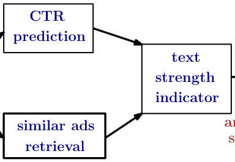

# TSI: an Ad Text Strength Indicator using Text-to-CTR and Semantic-Ad-Similarity（用文案-to-CTR 与广告语义相似度的广告文案强度指示器）

- **会议/期刊**: CIKM 2021
- **作者与机构**: Shaunak Mishra, Changwei Hu, Manisha Verma, Kevin Yen, Yifan Hu, Maxim Sviridenko（Yahoo Research / Verizon Media）
- **推荐链路定位**: 精排（CTR 预估）+ 创意侧诊断，非召回/生成
- **研究方向**: CTR 预估与特征交叉 / 大语言模型推荐（预训练文本表征）
- **论文原文**: [https://arxiv.org/abs/2108.08226v1](https://arxiv.org/abs/2108.08226v1)
- **开源代码**: 暂未开源

## TL;DR (1分钟核心速览)

针对小广告主不会写文案、生成式改写又有幻觉与高延迟的痛点，本文提出 TSI：用微调 BERT 把文案+publisher 映射为 pCTR，用弱监督 SAS-SBERT 在 5 万广告池中 ANN 检索 top-5 语义邻居，再以"邻居中高于输入的 pCTR 中位数是否超过 $1+\Delta$（$\Delta=30\%$）"判定文案强弱并展示匿名高分邻居作建议。冷启动（按广告主划分）AUC 0.6314→0.6483（+1.7%），同品类检索 P@1=0.93（较 SBERT +0.02），线上 25.12% 采纳者 CTR 提升 27%。

## Background & Motivation (背景与核心矛盾)

- **主流范式**: 广告 CTR 精排已成熟（用户/上下文/创意特征），但创意优化仍靠人工 A/B 测试与 DCO 大规模试错；近期尝试用生成模型直接改写文案。
- **前人局限**: ① 生成式改写存在幻觉、重复、逐字记忆与高延迟（秒级不可用）；② TF-IDF/word2vec 类表征无法区分词面高度重叠但类目不同的文案（"shoes" vs "pets" 的在线商店）。
- **核心洞察 (Key Insight)**: 平台内已沉淀大量历史广告及其曝光/点击，天然构成"语义邻域"；不同类目 CTR 量级不可比，故判强弱的正确参照系是**邻域内相对 pCTR**，而非全局绝对阈值。
- **本文切入点**: 双模型离线训练（文案→CTR、广告→相似度），在线只做一次前向+一次 ANN 检索，用邻域相对规则合成 0/1 分数并给出可溯源建议。

## Method (核心方法设计)

### 1. 整体框架 (Overall Architecture)

输入为广告文案（title+description+CTA 拼接）与 publisher one-hot。两路并行：微调 BERT 回归 pCTR；SAS-SBERT 编码后在约 5 万广告池上做 cosine ANN 检索 top-$k{=}5$邻居（邻居预先离线算好 pCTR 与匿名文案）。TSI 模块比较邻居与输入的 pCTR，输出强弱标签；若判弱，则把高出$\Delta$ 的匿名邻居作为改进灵感。全流程离线训练、在线仅 BERT 前向 + ANN 检索，端到端延迟 <1s。

<figure class="paper-figure" markdown="span">
  <figcaption>图2：整体架构。</figcaption>
</figure>

### 2. 关键设计拆解 (Key Designs)

1. **加权 BCE 的文案-to-CTR 回归**：逐条 impression 级训练既受隐私限制又极稀疏，故把每条广告拆成"点击 / 未点击"两条样本，权重取点击数或未点击数，等价于把聚合曝光统计当软标签：$pCTR=P(click\mid\text{ad text},\text{publisher})$，$\ell=-\frac{1}{\sum_i w_i}\sum_i w_i\big[y_i\log p(y_i)+(1-y_i)\log(1-p(y_i))\big]$。再将 publisher one-hot 与 BERT [CLS] 池化向量拼接、过 64 维 ReLU 全连接，显式吸收展示位的系统性 CTR 偏置。
2. **弱监督广告语义相似（SAS-SBERT）**：平台无人工相似标注，作者用 campaign 层级造标签——同 advertiser 且同类目记 $+1$，异 advertiser 且异类目记$-1$；以 cosine 回归损失微调 mean-pooling 句向量：$loss_{ij}=\|\langle\boldsymbol{\phi}(a_i),\boldsymbol{\phi}(a_j)\rangle-label_{ij}\|^2$。直觉是：句向量需编码"卖什么"而非"用了哪些词"，类目约束把这一先验注入度量空间；实测优于交叉熵与三元组损失。
3. **邻域相对判据 TSI**：绝对阈值跨类目失效，改为取邻居中 pCTR **高于输入者**的中位数（抗离群），若该中位数 $>(1+\Delta)\cdot pCTR_{in}$（$\Delta=30\%$）则 TSI=0。$\Delta$单调控制推荐覆盖率（$\Delta=20\%$ 时约 50% 测试广告获建议），是唯一需要在线调的业务旋钮。

**训练与推理开销**：相似度模型 1:30 正负采样、batch=30、10 epochs；BERT-base uncased、lr=$2\times10^{-5}$、seq_len=100、20 epochs。检索用 cosine+ANN，50k 池 <0.5s；线上为压延迟将检索退化为 word2vec。

## Experimental Setup & Evaluation Protocol (实验设置与评估协议)

- **数据集与预处理**（Verizon Media 单月数据，publisher 限曝光 top-15，广告文案=标题+描述+CTA）：

| 数据集 | #Advertisers | #Ads | #Interactions | 稀疏度/密度 | 特征/场景说明 |
| :--- | :---: | :---: | :---: | :---: | :--- |
| US (EN) | 4,000 | 50,000 | 单月曝光/点击聚合（原文未披露精确量） | — | Native/Display 英文广告 |
| TW (ZH) | — | 15,000 | 同上 | — | 繁体中文广告，跨语言扩展 |
| HK (ZH) | — | 5,000 | 同上 | — | 与 TW 合并微调后分域评测 |

- **数据划分与防穿越**: CTR 模型两套划分——`随机划分`（80/6/14，同一广告主可跨 split）与 `冷启动划分`（按 advertiser 分组，test 广告主不出现在 train）；**未使用全局时间戳切分**，同月统计存在轻度穿越风险。
- **排名评测协议**: 非候选排序任务。CTR 侧用 AUC（以 impression 为样本）+ `Relative AUC`（=AUC/上界，上界由真值 CTR 作 pCTR 得到：warm 0.7812、cold 0.7252）+ Kendall $\tau_B$ 与 SRCC（以广告为单位度量 pCTR 与真实 CTR 的序一致性）。检索侧用 category/advertiser/campaign/adgroup 四种相似定义的 Precision@k，在 50k 全池上检索，属无偏全库评估；无显著性检验报告（仅定性称 "significantly"）。
- **对比基线与超参**: CTR 基线为 LR、NBLR（NB-SVM 的 LR 变体）、未微调 BERT；检索基线为 TF-IDF、Spacy word2vec 均值、SBERT。

## Key Experimental Results (实验关键数据)

### 1. 主实验对比 (Main Results)

| 设置 | 方法 | 输入特征 | AUC | Rel. AUC | KTC | SRCC |
| :--- | :--- | :--- | :---: | :---: | :---: | :---: |
| Warm | LR | 文案 | 0.7240 | 92.67% | 0.3436 | 0.4872 |
| Warm | NBLR | 文案 | 0.7252 | 92.83% | **0.3891** | **0.5431** |
| Warm | BERT（未微调） | 文案 | 0.6862 | 87.83% | 0.2426 | 0.3550 |
| Warm | BERT | 文案 | 0.7254 | 92.85% | 0.3652 | 0.5138 |
| Warm | **BERT** | 文案+publisher | **0.7351** (+1.37%) | **94.09%** | **0.4418** | **0.6118** |
| Warm | BERT+NBLR | 文案+publisher | 0.7352 | 94.11% | 0.4414 | 0.6112 |
| Cold | NBLR | 文案 | 0.6314 | 87.06% | 0.2052 | 0.2976 |
| Cold | **BERT** | 文案+publisher | **0.6483** (+1.7%) | **89.39%** | **0.2616** | **0.3758** |

| 检索模型 | cat. P@1 | P@3 | P@5 | P@10 |
| :--- | :---: | :---: | :---: | :---: |
| TF-IDF | 0.89 | 0.83 | 0.79 | 0.74 |
| word2vec | 0.89 | 0.84 | 0.81 | 0.76 |
| SBERT | 0.91 | 0.87 | 0.85 | 0.83 |
| **SAS-SBERT** | **0.93** | **0.91** | **0.90** | **0.89** (+7.2%) |

### 2. 消融实验 (Ablation Study)

| 变体 | 关键指标 | 相对完整模型 |
| :--- | :--- | :--- |
| w/o BERT 微调（Set1） | AUC 0.6862 | −0.0392（warm） |
| w/o publisher 特征 | AUC 0.7254 | −0.0097 |
| 加 NBLR 集成 | AUC 0.7352 | +0.0001（无增益） |
| 弱标签改 campaign×cat | cat. P@1 0.87 | −0.06 |
| 弱标签改 adgroup×cat | cat. P@1 0.86 | −0.07 |
| 损失改交叉熵/三元组 | P@k 劣于 cosine | 定性下降 |
| 线上检索退化为 word2vec | P@1 0.89 | −0.04 |

### 3. 关键实验发现 (Key Findings)

1. **预训练表征红利集中在冷启动**：cold-start 下 BERT 相对 NBLR AUC 0.6314→0.6483、KTC/SRCC 各 +0.06/+0.08；但 warm-start 下同输入的 BERT KTC(0.3652) 反低于 NBLR(0.3891)，说明收益来自"未见过广告主"的词片泛化，而非更强拟合。
2. **publisher 是必须显式解耦的混杂因子**：加入其一维 one-hot 即带来 AUC +0.0097、SRCC +0.098；若缺失，展示位偏置会被误读为文案质量，直接污染 TSI 的弱文案判定。
3. **弱标签粒度决定语义层级，微调收益随 k 放大**：advertiser×category 标签使 category P@1=0.93，而 advertiser P@1 仅 0.72——约 21% 的最近邻来自同品类但不同广告主，正是"跨广告主知识迁移"的价值来源；P@10 上 SAS-SBERT 0.89 对 SBERT 0.83（+7.2%），优于 P@1 的 +0.02。
4. **线上可用**：56% session 出现 TSI=0（与离线 $\Delta{=}20\%$ 的 ~50% 覆盖率吻合），25.12% session 借用了建议中的新词，该批采纳者相对未采纳者 CTR +27%；15 位策略师评分 4.1/5。

## Highlights & Limitations (亮点、对比与审稿批判)

- **与代表作对比**: 相比生成式改写（如广告文案 refine 模型），本文不做生成，规避幻觉/记忆/延迟，且建议可溯源到真实高分广告；相比 BOW 类 CTR 模型（LR/NBLR），在上下文理解与冷启动上确有优势；相比无监督 SBERT/TF-IDF，用平台 campaign 结构注入类目先验，零人工标注。
- **可迁移亮点**: ① 用平台自身层级（advertiser/category/adgroup）构造弱相似标签，几乎零成本，可迁移至商品/视频同款检索；② `Relative AUC`（AUC/真值上界）为"聚合曝光当软标签"场景提供了公平比较口径。
- **审稿级局限批判**: ① **离线上线不一致**：SAS-SBERT 的 +7.2% 检索增益未真正上线（线上退化 word2vec），核心创新之一缺在线证据；② **因果性不足**：27% CTR 提升是采纳者 vs 未采纳者的观察性对比，非随机 A/B，存在自选择偏差，作者亦承认需接入 DCO；③ 无时间戳切分与 CTR 季节性建模，同月聚合统计可能穿越；④ 仅用 clicks、无转化，天然奖励标题党，策略师反馈中亦指出该风险。

## Rating (四维评分)

- **方法创新性 (Novelty)**: ⭐⭐⭐ （"相对邻域 pCTR 判强弱"的问题重定义+弱标签构造有新意，但两个子模型均为 BERT/SBERT 常规微调）
- **评估协议与实验扎实度 (Protocol & Experiments)**: ⭐⭐⭐ （warm/cold 双划分、相对 AUC 与序相关指标设计周到，中英多语种复现；但无显著性检验、无时间切分、线上非随机对照）
- **写作与数学规范度 (Clarity & Rigor)**: ⭐⭐⭐⭐ （架构与 TSI 规则描述清晰、损失与阈值定义完整，复杂度与延迟有交代；相似度部分理论分析偏浅）
- **工业落地与复现价值 (Industrial & Practical Value)**: ⭐⭐⭐⭐⭐ （Yahoo DSP 真实部署、<1s 端到端、25.12% 采纳率与 27% CTR 提升，弱标签方案可低成本复用；未开源且依赖内部日志为主要短板）

