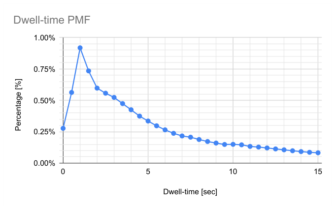
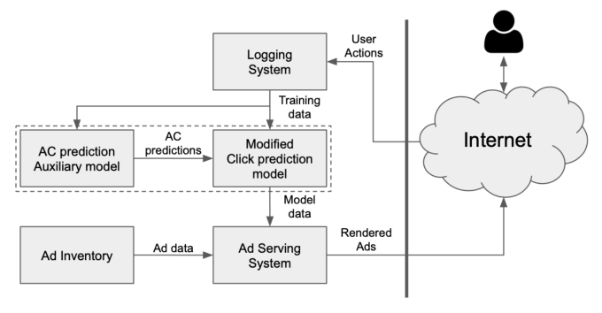
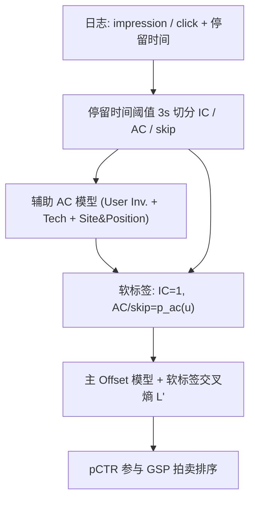

# Unbiased Filtering of Accidental Clicks in Verizon Media Native Advertising (Verizon Media 原生广告意外点击的无偏过滤)

- **会议/期刊**: CIKM 2021（30th ACM International Conference on Information and Knowledge Management）
- **作者与机构**: Yohay Kaplan, Naama Krasne, Alex Shtoff, Oren Somekh（Yahoo / Verizon Media Research, Haifa）
- **推荐链路定位**: 精排（pCTR 预估，驱动 GSP 拍卖排序与计费）
- **研究方向**: CTR/CVR 预估与特征交叉 / 去偏公平与工业架构
- **论文原文**: [https://arxiv.org/abs/2312.05017v1](https://arxiv.org/abs/2312.05017v1)
- **开源代码**: 暂未开源（数据与代码因商业保密与隐私不可复现）

## TL;DR (1分钟核心速览)

原生广告中大量"停留时间 < 3 秒"的误触点击污染了 pCTR 模型：直接剔除会带来系统性低估（拍卖掉量），保留又会误导用户-广告亲和度学习。本文用辅助 AC 模型预测每个 skip 的"误触概率"，把误触点击的正权重摊到全部负样本上，将训练改为非二值标签的交叉熵；在 Yahoo 桌面首页流量上取得 0.39% LogLoss 提升，线上 1% 流量桶 11 天平均 CPM/收入提升 1.18%。

## Background & Motivation (背景与核心矛盾)

- **主流范式**: VZM 原生广告用 Offset（特征增强的协同过滤/隐因子双塔）预测 pCTR，$pCTR(u,a)=\sigma(b+\boldsymbol{\nu}_u^{\top}\boldsymbol{\nu}_a)$，按二值标签最小化 LogLoss，模型每 15 分钟在线增量更新。
- **前人局限**: 其一，点击与 skip 被统一视为 $\{1,0\}$，而误触点击（AC）几乎不含亲和信息，等同噪声正样本；其二，按 [21] 的思路硬剔除 AC（只用持久点击 IC 训练）虽在离线更准，却在线上因**系统性低估**而减少竞价胜出与展示，加上分段偏差校正也未获收入增益而未被采纳。
- **核心洞察 (Key Insight)**: 误触点击并非"应删除的样本"，而是"权重为 $p_{ac}$的正样本"——它本可等价地发生为一次 skip。真正需要的 pCTR 是$p_c = p_{ac}+p_{ic}$，剔除 AC 只去掉了分量却未补偿总量，故必须做**权重再分配而非剔除**。停留时间分布分析（图 3）给出支撑：3 秒阈值下 4.17% 点击为 AC，且 AC 率与广告/活动几乎无关（两个活动总 CTR 差 45.5%，但低停留段 CTR 仅差 6.1%）。

<figure class="paper-figure" markdown="span">
  <figcaption>图3：停留时间概率质量函数（PMF）。</figcaption>
</figure>

- **本文切入点**: 训练期只改标签与损失（软标签 + 广义交叉熵），serving 侧零改动，从而在成熟系统中以极低工程成本获得无偏的 AC 过滤。

## Method (核心方法设计)

### 1. 整体框架 (Overall Architecture)

系统由两支模型串行构成：辅助 AC 模型 $\Theta_{ac}$只用**用户/上下文特征**（User Involvement、Tech、Site&Position），将 Site&Position 充当 Offset 中的"广告侧"向量以套用双塔结构，训练目标是把 AC 当正样本、skip 当负样本；主点击模型$\Theta_c$则把 IC 标为 1，把 AC 与 skip 统一标为其 AC 预测概率$\ell=p^{ac}(u)$，用非二值交叉熵训练。线上只部署$\Theta_c$，AC 模型仅参与训练（夜间增量），因此 QPS 与内存开销几乎不变。

<figure class="paper-figure" markdown="span">
  <figcaption>图9：系统高层框图。</figcaption>
</figure>

### 2. 关键设计拆解 (Key Designs)

1. **软标签权重重分配（Unbiased Filtering）**：痛点是把 AC 当 1 会污染亲和度、当 0 会低估。本文改为把 AC 的正质量铺到负样本上：$\sum_{e\in \mathcal{T}_{ac}\cup\mathcal{T}_{n}}\ell(e)=|\mathcal{T}_{ac}|$，即全部 AC 与 skip 的标签之和恰等于 AC 总量。直觉上它不改变"应有多少点击"这一总量约束，只改变这些点击归属于哪些广告，因此既清洗了信号又保住校准。
2. **非二值交叉熵与校准性证明**：把 LogLoss 推广为 $\mathcal{L}'= \ell\ln\frac{\ell}{p}+(1-\ell)\ln\frac{1-\ell}{1-p}$，其中$p$为预测 IC 概率、$\ell$为软标签。由于交叉熵属 Bregman 散度，最优处标签均值等于预测均值，于是$\mathbb{E}[p_c]=\mathbb{E}[p_{ac}+X_{ic}]+\varepsilon_c=\mathbb{E}[X_c]+\varepsilon_c+\varepsilon_{ac}$，即模型平均 pCTR 仍近似等于真实点击率（含误触），实现"过滤但无偏"。
3. **训练目标、负采样与推理效率**：总损失为 $\sum \mathcal{L}'+\frac{\lambda}{2}\|\Theta_c\|^2$，用 AdaGrad 单遍在线更新。关键工程细节：AC 模型**不纳入 IC**（否则破坏$\sum\ell=|\mathcal{T}_{ac}|$的约束）；skip 以速率$R$下采样并通过$b\leftarrow b-\ln R$ 校正偏置，而**AC 不能被下采样**（它在 AC 模型中是正样本未被采样），否则权重总量失衡。推理侧沿用原 Offset 单塔点积，无额外模型调用。

## Experimental Setup & Evaluation Protocol (实验设置与评估协议)

- **数据集与预处理**: 全部为 VZM 内部流量，因保密与隐私不公开；只有 13% 点击记录到停留时间（仅覆盖手机与平板），未记录者按无穷停留处理（不算 AC）。

| 数据切片 | 规模/占比 | 说明 |
| :--- | :---: | :--- |
| VZM 原生整体 | 日均 >20 亿曝光、数十万在投广告 | GSP 实时竞价，CPC 计价 |
| 停留时间可观测点击 | 13% 点击 | 仅 smartphone / tablet |
| 3 秒阈值下 AC 率 | 4.17% 全量点击 | 平板 4.77%、手机 6.37% |
| 主模型离线评估流量 | Yahoo 桌面首页（最大最稳站点） | 该段不记录停留时间，保证两模型标签集相同 |
| 线上实验 | 两个各 1% 流量桶，11 天 | 一桶用新模型，一桶为生产同构基线 |

- **数据划分与防穿越 (Splitting Strategy)**: 工业在线**流式评估**（单遍 SGD，每条曝光先训练后计入指标），非 leave-one-out；离线对比用"同一时段、同一无停留时间流量段"对齐标签，避免标签集不同导致的不可比。
- **排名评测协议 (Ranking Protocol)**: 不做采样排序或 Top-K 评测，直接以**全量流量的 LogLoss（离线）与 CPM/收入 lift（线上 A/B）**为标准；AC 定义为停留时间 $<3$s（网格搜索得到的最优阈值）。
- **对比基线与超参设置**: 基线包括 (a) AC 无关的生产模型，(b) 仅 IC 硬过滤模型 [21]，(c) 硬过滤 + 分段 AC 偏差校正（未公开数值、未上线）；辅助模型做"Site&Position → +Tech → +User Involvement"逐层特征消融，隐含维度极短（o=s=4，"thin" 模型），超参由 Offset 自适应在线调优，千万级曝光量级下结果视为统计显著。

## Key Experimental Results (实验关键数据)

### 1. 主实验对比 (Main Results)

原文仅报告相对提升（保密），下表汇总可核对的定量结果：

| 方案 | 训练标签策略 | 离线 LogLoss | 线上 CPM / 收入 |
| :--- | :--- | :---: | :---: |
| AC 无关生产模型（基线） | AC 与 IC 同为 1 | — | — |
| 硬过滤 AC（仅 IC）[21] | AC 移除 | 更优（文中定性） | 低估掉量、无收入增益，未采纳 |
| 硬过滤 + 分段偏差校正 | AC 移除 + 后置 bias | 未公开 | 表现差、未采纳 |
| **本文无偏软标签过滤** | IC=1，AC/skip=$p_{ac}$ | **提升 0.39%** | **提升 1.18%** |

### 2. 消融实验 (Ablation Study)

辅助 AC 模型特征消融（8 天平均 LogLoss lift，相对 Site&Position 基线）：

| 特征配置 | LogLoss lift | 增量 |
| :--- | :---: | :---: |
| Site & Position（等价加权流行度模型） | 基线 | — |
| + Tech（设备/OS/浏览器/运营商） | **0.70%** | +0.70% |
| + User Involvement（近月广告曝光分桶） | **0.96%** | +0.26% |
| 广告/活动特征 | 故意不加入 | 见发现 3 |

### 3. 关键实验发现 (Key Findings)

1. **AC 主要由"谁在看、在哪看"决定，而非"看什么广告"**：User Involvement 从 [0-10] 桶的 6.37% AC 率单调降到 [1001-5000] 桶的 1.58%，说明新客/偶访客更易误触；同站点不同位置 AC 率相近而点击密度不同，两个活动低停留段归一化 CTR 仅差 6.1% 而总 CTR 差 45.5%，故 AC 模型刻意剔除广告侧特征，避免退化为"广告 CTR 记忆器"。
2. **软标签带来"成熟模型上难得"的 0.39% LogLoss 提升**：Offset 已在亿级曝光上长期在线调优，小幅离线增益通常意味着显著的在线收益——最终换算为 1% 桶 11 天平均 1.18% CPM 提升，文中估计全量上线后年增收数千万美元。
3. **偏差补偿方式决定成败**：与"剔除 + 后置偏差"相比，把 AC 质量前移到负样本标签使 $\sum\ell$ 与真实点击总量守恒，避免了分段偏差估计不准导致的二次失调，这是唯一在线上获得正向收入的方案。

## Highlights & Limitations (亮点、对比与审稿批判)

- **与代表作对比 (vs. Prior Work)**: 与 [21] 的停留时间混合分布建模+硬过滤相比，本文不改数据分布而去改**标签语义**；与 FFM/FwFM 类特征交叉模型相比，改动完全发生在损失层，与任何 pCTR 骨干正交；与两模型串联打分（分别建 IC/AC 模型后相加）相比，本文以单模型维持同等精度却避免 QPS 翻倍。
- **可迁移亮点**: ①"总量守恒的软标签再分配"可直接迁移到退货、误点、机器人流量等假阳性场景；②用辅助模型的输出充当主模型软标签，等价于把难以观测的隐变量做成一种 importance-reweighting，无需 serving 侧改动。
- **审稿级局限批判**: ①数据完全不可复现，且只报告 lift 不给绝对 LogLoss/PR-AUC，主模型离线结论仅在"无停留时间的桌面首页段"成立，存在切片选择偏置；②仅有 13% 点击可观测停留时间且覆盖设备不全，AC 标签本身稀疏且缺失非随机；③3 秒全局阈值虽经网格搜索，仍可能误把"快速但有意"的点击标为 AC，且未做分段阈值与延迟/时变敏感性分析。

## Rating (四维评分)

- **方法创新性 (Novelty)**: ⭐⭐⭐⭐ （把"过滤噪声样本"重构为"标签质量再分配"，并给出基于 Bregman 散度的校准性证明，思路简洁且有理论落点）
- **评估协议与实验扎实度 (Protocol & Experiments)**: ⭐⭐⭐ （有真实线上 A/B 与 11 天稳定增益，但数据封闭、只给相对 lift、缺显著性检验与绝对指标）
- **写作与数学规范度 (Clarity & Rigor)**: ⭐⭐⭐⭐ （校准推导与下采样/标签守恒的实现细节交代清楚，但停留时间特征缺失与特征工程部分偏工程叙述）
- **工业落地与复现价值 (Industrial & Practical Value)**: ⭐⭐⭐⭐⭐ （不改 serving、辅助模型极薄、单遍在线可训练，是少见的可直接照搬到大规模广告/推荐系统的去噪方案）

