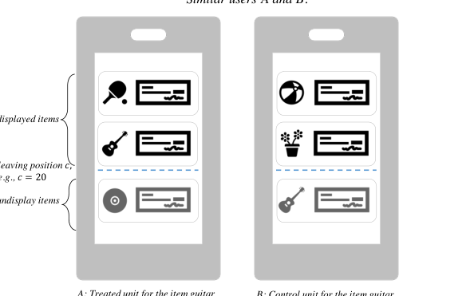
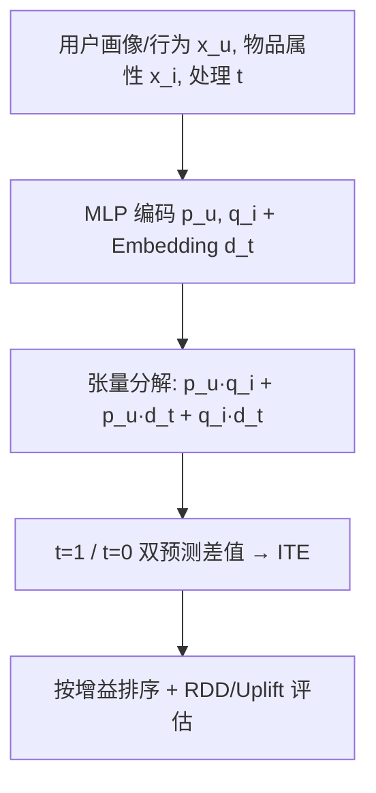

# CausCF: Causal Collaborative Filtering for Recommendation Effect Estimation (因果协同过滤：面向推荐效应的因果估计)

- **会议/期刊**: CIKM 2021
- **作者与机构**: Xu Xie, Zhaoyang Liu, Shiwen Wu, Fei Sun, Cihang Liu, Jiawei Chen, Jinyang Gao, Bin Cui, Bolin Ding（阿里巴巴、北京大学、中国科学技术大学）
- **推荐链路定位**: 精排（按因果增益而非点击率排序）
- **研究方向**: 去偏公平、可信隐私与工业架构 / CTR 预估与概率校准
- **论文原文**: [https://arxiv.org/abs/2105.13881v1](https://arxiv.org/abs/2105.13881v1)
- **开源代码**: [https://github.com/clinicalml/cfrnet](https://github.com/clinicalml/cfrnet)（RDD/基线复现依赖的外部实现，CausCF 本体未单独开源）

## TL;DR (1分钟核心速览)

传统推荐系统最大化"用户是否会交互"，却忽略了用户即便不被推荐也会购买（如刚需洗发水 vs. 游戏机）的**推荐增益（uplift）**问题。本文提出 CausCF，把协同过滤的"相似用户有相似偏好"推广为"相似用户/相似物品有相似因果效应"，用 $p_u^\top q_i + p_u^\top d_t + q_i^\top d_t$ 的三维张量分解同时建模偏好与用户/物品级处理效应；并以浏览离开位置为断点的 RDD 分析替代昂贵的 RCT，构造无偏的 ATE 真值。在淘宝工业数据与 Xing 公开集上，ATE 估计误差相对最优基线下降约 13.8%–17.1%，Uplift@10 提升 21.3%。

## Background & Motivation (背景与核心矛盾)

- **主流范式**: 工业推荐以 CTR/CVR 为优化目标排序，即最大化 $P(Y=1\mid T=1)$；因果推断在推荐中的主流用法是去偏（位置偏置 IPS/DR），而非估计推荐本身带来的增量。
- **前人局限**: ① 现有 uplift 方法（CausE 双网络差分、ULRMF 重采样）**未利用用户-物品交互中的协同信息**，且不区分用户侧/物品侧效应的异质性；② 效果验证几乎完全依赖 RCT，在线牺牲体验且成本高，公开数据集又缺少反事实标签。
- **核心洞察 (Key Insight)**: 观测到的"推荐后购买率"会把**刚需品**（纸尿裤、瑜伽服、一次性洗脸巾）的效应严重高估——表 1 显示洗发水推荐增益仅 5%，而游戏机达 40%，即高购买率不等于高增益。
- **本文切入点**: 把处理变量 $T$ 当作张量的第三个模态，让相似用户/物品通过隐因子共享来"补齐"各自缺失的反事实结果；并用浏览位置的自然断点做准实验评估。

<figure class="paper-figure" markdown="span">
  <figcaption>图3：包含流式推荐物品的典型推荐系统。蓝色虚线以上的物品被成功推荐，其余物品未被成功推荐。</figcaption>
</figure>

## Method (核心方法设计)

### 1. 整体框架 (Overall Architecture)

输入为每一对 (用户, 物品) 的前处理变量 $x_u,x_i$：用户 62 维画像/行为经 MLP 编码为$p_u$，物品 50 维属性经 MLP 编码为$q_i$，处理$t\in\{0,1\}$经 one-hot 嵌入为$d_t$。三者在同一$k$维空间做两两内积并加和得到潜在结果预测，训练用 BCE 端到端优化；推理时对同一 (用户, 物品) 手工赋值$t=0$与$t=1$ 各预测一次，差值即 ITE，排序按 ITE 而非原始购买概率。评估侧独立于模型，用 RDD 与 Uplift 指标给出统计结论。

### 2. 关键设计拆解 (Key Designs)

1. **三维张量分解的加性因子化（核心创新）**: 直接对 $m\times n\times l$ 稀疏张量做 Tucker/CP 分解计算不可行，本文改用**两两交互加和**的低秩形式：
$\hat{y}_{u,i,t}=p_u^\top q_i+p_u^\top d_t+q_i^\top d_t$。
三项语义明确分离：$p_u^\top q_i$是控制偏好（confounder 的显式剥离），$p_u^\top d_t$是用户级效应，$q_i^\top d_t$ 是物品级效应。直觉是：在扣掉偏好基线后，**协同相似性可以把效应"借"给观测缺失的单元**，故只需建模二阶交互即可获得与高阶张量分解竞争的表达力，且计算量显著更低。
2. **ITE 差分与双世界推断**: 反事实不可观测，模型不预测"是否购买"，而预测两个潜在结果再相减：
$\widehat{\mathrm{ITE}}_{u,i}=\hat{y}_{u,i,t=1}-\hat{y}_{u,i,t=0}$。
由于 $d_t$在同一空间内被共享，$t=0$与$t=1$ 的差别仅落在处理因子上，避免了 CausE 中"两个独立网络难以对齐"的问题，也让用户/物品效应可解释、可分组聚合（CATE）。
3. **训练目标与推理开销**: 观测集 $S=\{(u,i,t)\}$上采用二分类交叉熵$\mathcal{L}=-\sum_{S}\big[y\log\sigma(\hat{y})+(1-y)\log(1-\sigma(\hat{y}))\big]+\lambda\|\cdot\|_2^2$，SGD/Adagrad 优化；**无需负采样**（未推荐样本天然构成对照组，淘宝侧约 1.03e10 处理样本 vs 3.99e10 对照样本）。线上打分仅需一次前向 + 两次处理嵌入替换，成本与 MF 同阶（嵌入维度 8，隐层 512→256→128）。
4. **RDD 无 RCT 评估协议**: 定义运行变量 $r$为物品曝光位次、断点$c$为用户离开推荐流的位置（成功推荐$r\le c$，未曝光$r>c$），
$\mathrm{CATE}_c=\lim_{\epsilon\to0}\mathbb{E}[Y\mid r=c-\epsilon]-\lim_{\epsilon\to0}\mathbb{E}[Y\mid r=c+\epsilon]$，
再按各断点的用户占比加权 $\mathrm{ATE}=\sum_c w_c\mathrm{CATE}_c$；仅当标准化均值差$\mathrm{smd}_j=\frac{|\mu_{j,1}-\mu_{j,0}|}{\sqrt{0.5(\sigma^2_{j,1}+\sigma^2_{j,0})}}$均值$<0.1$ 的断点才纳入，以保证断点两侧人群同质。

## Experimental Setup & Evaluation Protocol (实验设置与评估协议)

- **数据集与预处理**:

| 数据集 | #Users | #Items | #Interactions(购买) | 处理/对照样本 | 特征/场景说明 |
| :--- | :---: | :---: | :---: | :---: | :--- |
| Taobao | 232,949,123 | 2,767（叶子类目） | 764,550,731 | 1.03×10¹⁰ / 3.99×10¹⁰ | 62 用户特征 + 50 物品特征，含"猜你喜欢"曝光位次与离开位置 |
| Xing | 30,108 | 68,924 | 75,467 | 4.83×10⁶ / 2.44×10⁷ | 点击/收藏/投递为正反馈，曝光为推荐；≥10 交互物品、≥10 登录日 |

- **数据划分与防穿越**: 全局时间戳切分——训练 2020-08-10~08-16（within-sample），测试为其后一天 2020-08-17（out-of-sample），严格防止未来信息泄漏；淘宝侧将近 90% 无购买记录的细粒度 item 上卷到叶子类目以缓解稀疏。
- **评估协议**: 因果精度用 $\epsilon_{\mathrm{ATE}}=|\mathrm{ATE}_{\mathrm{RDD}}-\frac{1}{mn}\sum(\hat{y}_{u,i,1}-\hat{y}_{u,i,0})|$（以 RDD 结论为真值）；排序指标为 Uplift@N（N=10/30/50）及其 SNIPS 变体；Xing 上对照组按 1:5 随机采样未推荐物品，淘宝侧为真实全量日志（近似天然 Full-Ranking 对照）。
- **对比基线**: 因果估计侧 Statistic、SNIPS、TARNet、CFR-MMD、CEVAE；排序侧 NCF、WDL、CausE、CausE$_i$、ULRMF。嵌入维度$d=8$，batch 512/128，Adagrad 学习率 0.001，淘宝侧 10 PS + 201 worker 分布式训练。

## Key Experimental Results (实验关键数据)

### 1. 主实验对比 (Main Results)

因果效应估计（Taobao，RDD 真值 ATE = 0.000740）：

| Method | ATE$_{\text{within-s}}$| ATE$_{\text{out-of-s}}$|$\epsilon_{\text{within-s}}$|$\epsilon_{\text{out-of-s}}$ | 误差下降 |
| :--- | :---: | :---: | :---: | :---: | :---: |
| Statistic | 0.002906 | 0.002900 | 0.002165 | 0.002160 | −191.6% |
| SNIPS | 0.001735 | 0.001714 | 0.000994 | 0.000974 | −31.4% |
| TARNet | 0.001833 | 0.001828 | 0.001092 | 0.001088 | −31.9% |
| CFR-MMD | 0.001639 | 0.001634 | 0.000898 | 0.000894 | −17.1% |
| CEVAE | 0.002279 | 0.002275 | 0.001535 | 0.001535 | −51.7% |
| **CausCF** | **0.001515** | **0.001481** | **0.000774** | **0.000741** | — |

排序性能（Taobao / Xing，Uplift 越大越好）：

| Model | Uplift@10 (TB) | Uplift@30 (TB) | Uplift@50 (TB) | Precision@10 (TB) | Uplift@10 (Xing) |
| :--- | :---: | :---: | :---: | :---: | :---: |
| NCF | 0.01105 | 0.01115 | 0.01130 | **0.02715** | 0.00139 |
| WDL | 0.01002 | 0.01086 | 0.01120 | 0.02713 | 0.00142 |
| CausE | 0.01497 | 0.01169 | 0.01112 | 0.01965 | 0.00227 |
| CausE$_i$ | 0.01641 | 0.01341 | 0.01242 | 0.01653 | 0.00219 |
| ULRMF | 0.00826 | 0.01213 | 0.01307 | 0.02619 | 0.00218 |
| **CausCF** | **0.01816** (+21.3%) | **0.01548** | **0.01435** | 0.02054 | **0.00277** (+99.3%) |

### 2. 消融实验 (Ablation Study)

| 变体 | 建模内容 | Uplift@10 | Uplift@30 | Uplift@50 |
| :--- | :--- | :---: | :---: | :---: |
| CausCF$_u$| 仅用户级效应$p_u^\top d_t$ | 0.01099 | 0.01075 | 0.01086 |
| CausCF$_i$| 仅物品级效应$q_i^\top d_t$ | 0.01698 | 0.01437 | 0.01351 |
| **CausCF** | 用户 + 物品双效应 | **0.01816** | **0.01548** | **0.01435** |

### 3. 关键实验发现 (Key Findings)

- **数据统计结论把效应放大近 4 倍**（0.0029 vs. RDD 0.00074），偏差最大的 Top-10 物品集中在纸尿裤、瑜伽服、一次性洗脸巾等刚需低价品（偏差 0.0617 / 0.0278 / 0.0227），实证了"高购买率 ≠ 高增益"这一核心动机。
- **物品侧效应远比用户侧重要**：去掉物品效应（CausCF$_u$）使 Uplift@10 从 0.01816 崩至 0.01099（−39.5%），甚至低于 NCF 水平；仅保留物品效应已可得 0.01698，说明流行度/物品偏置是增益估计的主要混杂源。
- **增益与转化率存在明确权衡**：CausCF 的 Precision@10（0.02054）显著低于 NCF（0.02715），但 Uplift@10 高出 64.3%，即在牺牲短期点击的同时把预算投向真正被推荐"推动"的物品；Xing 上 Uplift@10 近乎翻倍（0.00139→0.00277）佐证了跨域有效性。

## Highlights & Limitations (亮点、对比与审稿批判)

- **与代表作对比 (vs. Prior Work)**: 相比 CausE 的两个独立 NCF 差分，CausCF 用共享处理因子强制对齐双世界，避免了跨网络不可比问题；相比 ULRMF 的重采样策略，本文免去调采样比的昂贵工程；相比 TARNet/CFR-MMD 的域适应正则，CausCF 以张量结构替代 MMD 约束，更轻量且可解释到"用户侧/物品侧"维度。
- **可迁移亮点**: ① 把"RDD + 曝光位次断点"作为无 RCT 的因果评估范式，可直接迁移到信息流/搜索等有浏览深度的场景；② 加性两两交互的张量因子化，是把任何双塔 MF 升级为"多模态（用户/物品/上下文/干预）"的通用模板。
- **审稿级局限批判**: ① 以 RDD 估计值作为真值来评判所有模型，本质是"用估计检验估计"，若同质性假设在深层浏览位置失效（长尾位置样本量小、smd 波动），误差排序可能被系统性偏移；② 断点依赖用户离开位置日志，Xing 数据集缺失该字段导致因果精度实验只能在单一工业集上做，泛化证据偏弱；③ 淘宝侧将细粒度 item 上卷到叶子类目（2,767 个），实际上弱化了"物品级效应"的粒度，工业部署时对 SKU 级的稀疏性挑战仍未回答。

## Rating (四维评分)

- **方法创新性 (Novelty)**: ⭐⭐⭐⭐ （把 CF 同质性假设平移为"效应同质性"并落成加性三因子张量分解，思路简洁但理论仅靠假设与直觉支撑，缺乏误差界分析）
- **评估协议与实验扎实度 (Protocol & Experiments)**: ⭐⭐⭐⭐⭐ （RDD 断点 + smd 同质性检验 + 时间切分 out-of-sample + 工业与公开双数据集，评估设计罕见地严谨，唯因果真值来源仍为自证）
- **写作与数学规范度 (Clarity & Rigor)**: ⭐⭐⭐⭐ （符号与公式干净、RDD 举例（奖学金）解释到位；但 ITE 的可识别性仅引用三大假设而未给出证明，部分表格数据口径（用户量 vs 样本量）标注含糊）
- **工业落地与复现价值 (Industrial & Practical Value)**: ⭐⭐⭐⭐ （免负采样、推理成本与 MF 同阶、分布式实现可跑 10¹⁰ 级样本，评估方法本身即是可直接复用的线上准实验工具；但 CausCF 核心代码未独立开源）

