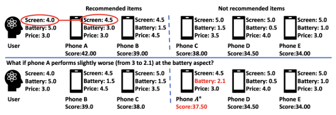
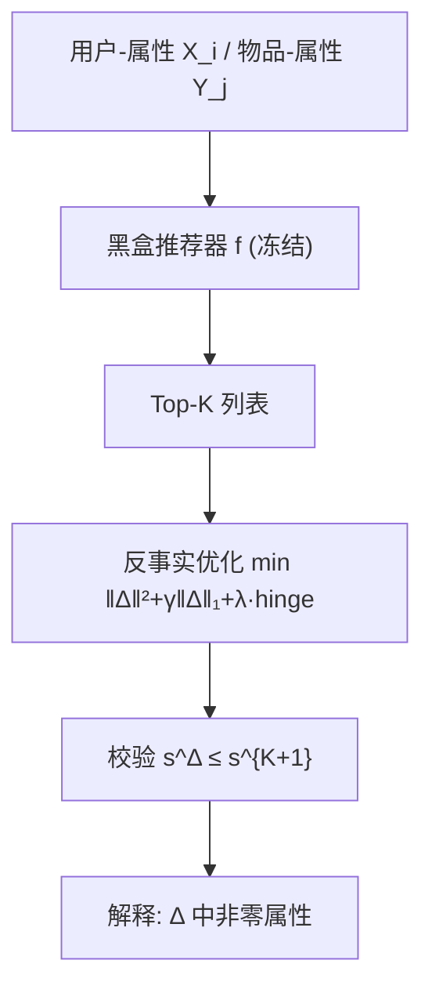

# Counterfactual Explainable Recommendation (反事实可解释推荐)

- **会议/期刊**: CIKM 2021
- **作者与机构**: Juntao Tan, Shuyuan Xu, Yingqiang Ge, Yunqi Li, Yongfeng Zhang (Rutgers University); Xu Chen (Renmin University of China)
- **推荐链路定位**: 重排 / 事后解释（post-hoc，作用于已生成的 top-$K$ 列表）
- **研究方向**: 去偏公平、可信隐私与工业架构 / 对话推荐与可解释理由生成
- **论文原文**: [https://arxiv.org/abs/2108.10539v3](https://arxiv.org/abs/2108.10539v3)
- **开源代码**: [https://github.com/chrisjtan/counter](https://github.com/chrisjtan/counter)

## TL;DR (1分钟核心速览)

现有属性级可解释推荐（EFM/MTER/A2CF）基于**匹配**取"用户偏好 × 物品表现"最高的属性作解释，既不保证解释数量，也不保证该属性真的驱动了推荐决策。本文提出 CountER：对物品属性向量求解**最小扰动 $\Delta$**，使黑盒模型的排序分数跌破第$K+1$名，被改动的属性即为解释；在 5 个真实数据集上，多属性解释的模型视角$F_{NS}$相对最优基线平均提升 15.6%~38.5%，用户视角$F_1$ 全面领先。

## Background & Motivation (背景与核心矛盾)

- **主流范式**: 属性级可解释推荐从评论中抽取 (Aspect, Opinion, Sentiment) 三元组，构建用户-属性偏好矩阵 $X$与物品-属性质量矩阵$Y$，用矩阵/张量分解对齐隐因子后取 top-1 属性作解释。
- **前人局限**: ① 多为 intrinsic 模型，难以解释其他黑盒推荐器；② 只取**单个**属性，无法决定"该用几个属性"；③ 只做关联（feature importance / attention），从不做**干预**，因此解释"强度"无从刻画。
- **核心洞察 (Key Insight)**: 如图 1 所示，匹配分最高的"屏幕"（$4.0\times4.5=18$）在候选手机中其实表现最差；而把"电池"从 3.0 微调到 2.1 就足以让该物品掉出榜单——**高匹配 ≠ 高因果贡献**。
- **本文切入点**: 用因果推断的反事实干预替代相关性匹配，并把"简单（低复杂度）+ 有效（高强度）"直接写进优化目标。

<figure class="paper-figure" markdown="span">
  <figcaption>图1：基于匹配与反事实推理的对比。三个方面（屏幕、电池和价格）旁边的数字表示用户对某方面的关注程度以及物品在某方面的表现程度。在此示例中，基于匹配的解释方法会使用“屏幕”构建解释，而反事实推理方法会使用“电池”构建解释。</figcaption>
</figure>

## Method (核心方法设计)

### 1. 整体框架 (Overall Architecture)

先用一个冻结的 DNN 黑盒推荐器 $s_{i,j}=f(X_i,Y_j|Z,\Theta)$（1 个拼接层 + 3 层 FC，输出经 Sigmoid）在全库上排序得到 top-$K$列表；随后对列表中每个物品单独求解式(11)的反事实优化，得到稀疏扰动$\Delta$，其非零维对应的属性即构成解释；最后做一次后处理校验$s_{i,j}^{\Delta}\le s_{i,j}^{K+1}$，仅对翻转成功的物品输出解释（未翻转则计入 fidelity 分母）。整个解释阶段模型参数$\Theta$ 完全固定，不反传进推荐器。

### 2. 关键设计拆解 (Key Designs)

1. **解释复杂度与强度 (Explanation Complexity / Strength)**：痛点是没有量化"解释好坏"的标尺。定义复杂度 $C(\Delta)=\lVert\Delta\rVert_2^2+\gamma\lVert\Delta\rVert_0$（改了几个属性 + 改了多少），强度$S(\Delta)=s_{i,j}-s_{i,j}^{\Delta}$（改动后排序分下降多少）。两者正交——复杂解释未必强，简单解释未必弱，故依奥卡姆剃刀构造约束优化$\min_\Delta C(\Delta)\ \text{s.t.}\ S(\Delta)\ge\epsilon$，其中$\epsilon=s_{i,j}-s_{i,j}^{K+1}$恰为该物品"掉出 top-$K$"所需的最小落差。
2. **松弛求解与单属性变体**：$\lVert\Delta\rVert_0$非凸、约束不可微，用$\ell_1$ 松弛得稀疏性（等价于自动决定属性个数），约束改写为 hinge 损失并入目标：
   $\min_\Delta \lVert\Delta\rVert_2^2+\gamma\lVert\Delta\rVert_1+\lambda\max(0,\alpha+s_{i,j}^{\Delta}-s_{i,j}^{K+1})$。
   若需单属性解释，引入可训练 one-hot 掩码 $\mathbf{a}$，$\min_{\Delta,\mathbf{a}}\lVert\mathbf{a}\odot\Delta\rVert_2^2+\lambda L(\cdot)\ \text{s.t.}\ \lVert\mathbf{a}\rVert_1=1$；为与基线公平比较，再用用户历史提及掩码$\Delta'=M_i\odot\Delta$（$M_{i,k}=1 \Leftrightarrow X_{i,k}\neq 0$）把候选属性限制在用户偏好空间。
3. **训练目标、负采样与推理开销**：推荐器用交叉熵 $\mathcal{L}=-\sum_{i,j}B_{i,j}\log s_{i,j}+(1-B_{i,j})\log(1-s_{i,j})$，负采样比 1:2；解释阶段是**逐 (用户,物品) 对**的$\Delta$优化（免负采样、无监督信号），超参$\lambda=100,\gamma=1,\alpha=0.2$，推理需对每个待解释物品跑一次梯度下降并重算$K+1$ 名分数——这是其主要在线开销来源。

## Experimental Setup & Evaluation Protocol (实验设置与评估协议)

- **数据集与预处理**: Yelp 保留 ≥20 条评论用户，Amazon 保留 ≥10 条；属性由 Sentires 情感工具抽取，$X/Y$经 sigmoid 重标度至$(1,N)$：

| 数据集 | #Users | #Items | #Interactions | 稀疏度/密度 | 特征/场景说明 |
| :--- | :---: | :---: | :---: | :---: | :--- |
| Yelp | 11,863 | 20,181 | 497,252 | 0.208% | 本地生活商户，106 个属性 |
| CDs and Vinyl | 8,119 | 52,193 | 245,391 | 0.058% | 亚马逊音像，230 个属性 |
| Kindle Store | 5,907 | 41,402 | 136,039 | 0.056% | 电子书，77 个属性 |
| Electronic | 2,832 | 19,816 | 53,295 | 0.095% | 电子产品，105 个属性 |
| Cell Phones | 251 | 1,918 | 4,454 | 0.935% | 手机配件，88 个属性 |

- **数据划分与防穿越**: `Leave-Last-N` 留出法——每用户最后 5 条交互作测试集，其余训练；掩码 $M_i$ 仅由训练集计算，避免泄漏。
- **排名评测协议**: `Full-Ranking`——黑盒模型在**全物品库**上打分取 top-$K$（$K=5$），非采样排序；解释指标在训练后的原始列表上计算。
- **Evaluation Protocol (本文核心贡献之一)**: ① **用户视角** 以评论中正向提及属性为 ground-truth，算 Precision/Recall/$F_1$；② **模型视角** 用因果推断的 Probability of Necessity 与 Probability of Sufficiency：$\mathrm{PN}_{ij}=\mathbb{I}(v_j^*\notin R^*_{i,K})$（把解释属性置 0 后物品是否掉榜），$\mathrm{PS}_{ij}=\mathbb{I}(v_j'\in R'_{i,K})$（只保留解释属性时物品是否仍在榜），并取调和均值$F_{NS}$。
- **对比基线与超参设置**: Random / EFM / MTER / A2CF；$\lambda=100$，$\gamma=1$，$\alpha=0.2$；Kendall 之外的显著性未做$p$ 检验（原文只在报告中给出百分比）。

## Key Experimental Results (实验关键数据)

### 1. 主实验对比 (Main Results)

用户视角（表 3，多属性解释，$F_1$%，**加粗为本列最优**）：

| 模型 | Electronic | Cell Phones | Kindle | CDs | Yelp |
| :--- | :---: | :---: | :---: | :---: | :---: |
| Random | 0.30 | 1.46 | 1.74 | 0.49 | 1.62 |
| EFM (CIKM'14) | 27.48 | 17.81 | 43.39 | 20.50 | 6.70 |
| MTER | 13.42 | 16.67 | 18.90 | 19.74 | 7.56 |
| A2CF | 25.32 | 18.76 | 43.27 | 26.62 | 7.00 |
| CountER | 22.13 | 25.05 | 40.68 | 19.96 | 10.18 |
| **CountER (w/ mask)** | **29.73** | **26.97** | **44.57** | **30.00** | **13.57** |
| Improv.% | +8.2% | +43.8% | +2.7% | +12.7% | +79.5% |

模型视角（表 4，多属性解释，$F_{NS}$%）：

| 模型 | Electronic | Cell Phones | Kindle | CDs | Yelp |
| :--- | :---: | :---: | :---: | :---: | :---: |
| Random | 3.08 | 7.73 | 6.65 | 4.53 | 13.36 |
| EFM | 43.92 | 65.88 | 67.33 | 61.66 | 27.81 |
| A2CF | 68.82 | 66.52 | 65.64 | 63.93 | 58.24 |
| CountER | **96.66** | **99.00** | **70.79** | **84.57** | **96.93** |
| CountER (w/ mask) | 83.23 | 89.13 | 69.06 | 70.01 | 95.55 |
| Improv.% (w/ mask) | +20.9% | +34.0% | +2.6% | +9.5% | +64.1% |

### 2. 消融实验 (Ablation Study)

解释保真度 (Fidelity，成功翻转决策的物品占比)：

| 数据集 | 单属性 无掩码 | 单属性 掩码 | 多属性 无掩码 | 多属性 掩码 |
| :--- | :---: | :---: | :---: | :---: |
| Yelp | 62.54% | 61.60% | 86.38% | 79.30% |
| CDs and Vinyl | 75.84% | 41.52% | 94.20% | 93.80% |
| Kindle Store | 94.76% | 93.72% | 100.00% | 100.00% |
| Electronic | 70.52% | 63.32% | 98.00% | 81.80% |
| Cell Phones | 74.26% | 69.33% | 99.92% | 85.20% |

其余消融（图 2）：$\lambda\uparrow$→ fidelity 与复杂度同步上升、$F_1$下降，而强度与$F_{NS}$基本不随$\lambda$变化（强度由$\alpha$ 控制）；top-1 位置物品所需属性数比 top-5 多 1.59 个。

### 3. 关键实验发现 (Key Findings)

1. **单属性天然不够**：允许 $\Delta$ 稀疏自动选择后，多属性解释平均仅需 2.79 个属性即可把 fidelity 从 41.5%~93.7%（单属性）推到 79.3%~100%，说明"只用 top-1 属性"的 EFM/A2CF 范式在决策翻转能力上有结构性缺陷。
2. **匹配法只会"讲好话"**：EFM 在 Electronic 上 PS=84.67% 但 PN 仅 29.65%（CountER 为 96.24%/97.08%），即匹配属性"保留即充分、删除不必要"——它们解释的是物品为何讨喜，而非模型为何推荐。
3. **复杂度与强度确实正交**：$F_1$随复杂度单调下降、与强度近乎无关；$F_{NS}$ 随强度上升、与复杂度无关。这从数据上验证了奥卡姆剃刀式的双目标设计，而非简单加正则。

## Highlights & Limitations (亮点、对比与审稿批判)

- **与代表作对比 (vs. Prior Work)**: EFM/MTER/A2CF 属 intrinsic 匹配模型、仅输出单属性、无法解释他模；Ghazimatin 等的反事实解释作用于**用户侧历史行为**，Tran 等依赖 influence function 反推训练点；CountER 则是**物品侧属性 + 显式把复杂度/强度编码进目标的黑盒事后解释**。
- **可迁移亮点**: ① 用"第 $K+1$名分数"作为翻转阈值$\epsilon$，把列表级约束转成可微 hinge——可直接迁移到重排/去偏的触发条件设计；② PN/PS/$F_{NS}$ 这套"删掉解释是否掉榜 / 只留解释是否仍在榜"的因果指标，可复用到任何事后解释方法的离线评测。
- **审稿级局限批判**: ① 黑盒模型仅是自训的小型 DNN，未在真实工业深度模型（如 DIN/双塔）上验证可迁移性，且解释需逐物品梯度优化，线上延迟不可忽略；② 解释仅限属性维度，图片/文本/KG 路径未覆盖，且 $\alpha>0.5$ 后性能显著崩塌，超参敏感；③ 用户视角 ground-truth 来自评论，存在"用户语言偏好"偏置，掩码只是缓解而非消除，五项数据集中三项用户数不足 6k，统计功效偏弱。

## Rating (四维评分)

- **方法创新性 (Novelty)**: ⭐⭐⭐⭐ （首次将"解释复杂度/强度"形式化并写成反事实约束优化，物理直觉清晰；但反事实扰动 + $\ell_1$ 稀疏本身是成熟套路）
- **评估协议与实验扎实度 (Protocol & Experiments)**: ⭐⭐⭐⭐ （PN/PS/$F_{NS}$双视角指标是领域级贡献，5 数据集 + fidelity +$\lambda$ 曲线完整；缺显著性检验，且基线仅 3 个且被改造以适配设定）
- **写作与数学规范度 (Clarity & Rigor)**: ⭐⭐⭐⭐ （从约束到松弛的推导链条干净，复杂度-强度正交性有图 2 支撑；掩码、单/多属性等多版本设定略增生，符号重复定义可精简）
- **工业落地与复现价值 (Industrial & Practical Value)**: ⭐⭐⭐（代码与 Sentires 均已开源，可直接复现；但逐物品优化带来线性推理开销，且需黑盒模型暴露属性输入，落地需额外蒸馏或缓存策略）

