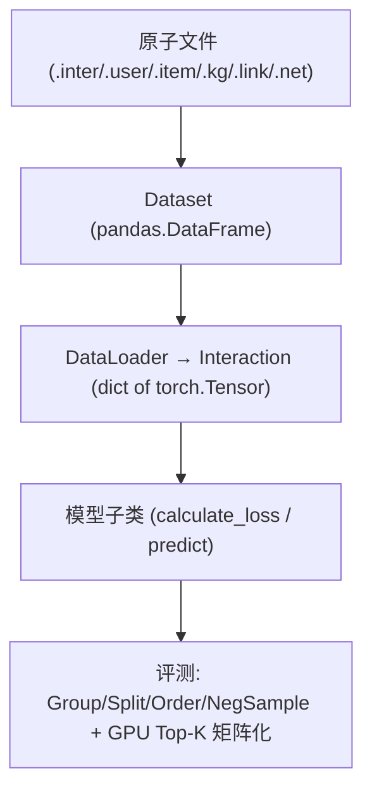

# RecBole: Towards a Unified, Comprehensive and Efficient Framework for Recommendation Algorithms (迈向统一、全面、高效的推荐算法框架)

- **会议/期刊**: CIKM 2021 (30th ACM International Conference on Information and Knowledge Management)
- **作者与机构**: Wayne Xin Zhao, Shanlei Mu, Yupeng Hou, Zihan Lin, Yushuo Chen, Xingyu Pan, Kaiyuan Li, Yujie Lu, Hui Wang, Changxin Tian, Yingqian Min, Zhichao Feng, Xinyan Fan, Xu Chen, Pengfei Wang, Wendi Ji, Yaliang Li, Xiaoling Wang, Ji-Rong Wen — 中国人民大学高瓴人工智能学院 / 北京邮电大学 / 华东师范大学 / 阿里巴巴
- **推荐链路定位**: 端到端离线训练 + 全模型评测（覆盖召回/精排/序列/知识图谱）
- **研究方向**: 工业级全链路架构与评测基准 / 协同过滤与评测标准化
- **论文原文**: [https://arxiv.org/abs/2011.01731v3](https://arxiv.org/abs/2011.01731v3)
- **开源代码**: [https://github.com/RUCAIBox/RecBole](https://github.com/RUCAIBox/RecBole)

## TL;DR (1分钟核心速览)

针对推荐算法"各自为战、实现碎片化、复现困难、评测协议不统一"的社区痛点，RecBole 以 PyTorch 为基础构建统一框架：用六类**原子文件**（.inter/.user/.item/.kg/.link/.net）统一数据入口，用 **Interaction**（dict-of-tensor）统一算法内部表示；提供 `calculate_loss(·)` 与 `predict(·)` 两个最小接口即可接入 73 个模型（通用/上下文感知/序列/知识图谱 4 类）与 28 个基准数据集；评测层抽象出 Group / Split / Order / NegSample 四接口，覆盖全排序与采样排序；并设计 GPU 矩阵化 Top-K 加速，使 Full-Ranking 评测在 MovieLens-10M 上从 29.9s 降至 2.21s（约 13.5×）。

## Background & Motivation (背景与核心矛盾)

- **主流范式**: 每年新增大量深度推荐模型，但实现分布在不同平台/框架上，缺乏统一开发接口与复现基准。
- **前人局限**:
  1. 数据入口格式五花八门（MovieLens/MovieLens、Amazon、Yelp、Gowalla 各自不同字段），同一份数据在不同任务（通用/序列/上下文）下需重组；
  2. 评测协议互不兼容（`Leave-One-Out` vs 比例切分、随机排序 vs 时间排序、全库 vs 采样排序），同一模型不同库给出不同 SOTA 结论，社区复现冲突严重 [87]。
- **核心洞察 (Key Insight)**: 推荐算法的"模型结构"各式各样，但"数据形态—内部表示—评测解码"存在高度共性，可逐层统一而不过度约束模型表达力。
- **本文切入点**: 把"数据、模型、评测"三层各自抽象为*可组合接口*，让新模型只需实现 2–3 个函数，其余透明复用；同时用 GPU 矩阵化替代 Python 循环实现 Top-K 高速评测。

## Method (核心方法设计)

### 1. 整体框架 (Overall Architecture)

RecBole 由配置层（config 文件 / 命令行 / 参数字典）、数据层、模型层、评测层和执行层构成。数据层提供"原始文件 → 原子文件 → pandas.DataFrame Dataset → Interaction 张量"四级流水线；模型层封装通用网络组件（BPR loss / InfoNCE 类损失、MLP、GNN、Multi-Head Attention）与初始化方法；评测层把评测协议拆解为 Group/Split/Order/NegSample 四个可插拔算子；执行层负责训练循环与断点恢复。

### 2. 关键设计拆解 (Key Designs)

1. **原子文件与 Interaction 双层数据抽象 (Atomic Files + Interaction)**：痛点在于数据文件与任务强耦合（切换任务需重造数据）。RecBole 定义 6 种后缀文件作为"用户面"入口——`.inter`（必需），`.user`/`.item`（上下文），`.kg`/`.link`（知识图谱），`.net`（社交）；任务仅决定**组合**而非格式。算法层面统一为 `Interaction`：以 `python.dict` 为骨架，key 是特征名、value 是该 batch 的 `torch.Tensor`。`to(device)`、`repeat`、`repeat_interleave`、`update` 等方法把"拷 GPU、复制 batch、合并字典"这类高频样板操作全部抽象，模型开发者无需关心数据流细节。

2. **评测协议四接口 + GPU 矩阵化 Top-K 加速 (Group / Split / Order / NegSample + Matrix-form TopK)**：痛点是不同论文协议不可比，以及 `Full-Ranking` 下逐用户 for-loop 极慢。RecBole 把协议拆成四个正交接口的笛卡尔积（示例配置 `RO_RS`、`TO_LS`、`RO_LS`、`TO_RS` + `full` 或 `uni$N$`），共覆盖 8+ 种组合。加速的核心是把**长度不一的用户 test-item 矩阵**统一成$n\times m$同尺寸矩阵$D$：采样排序时先以$-\infty$初始化再填入已采样分数（*reshaping*）；全排序时把训练集中出现过的 item 分数置为$-\infty$（*filling*）。随后用 `torch.topk()` 得到$n\times K$的索引矩阵$A$，用 `gather()` 在二值标签矩阵$B_{n\times m}$中按行 gather 得到稀疏命中矩阵$C_{n\times K}$（*indexing*），直接用 `sum()` 得命中数。整个评测仅 3 个 kernel 调用，消除了 Python 层 for-loop 与变长处理，为 GPU 并行铺路。

3. **训练目标、负采样与推理效率**：模型层不绑定单一损失，而是把 BPR / margin / 正则 / 交叉熵 / InfoNCE 等封装为可组合组件，负采样策略通过 `NegSample` 接口在评测阶段挂载（`uni$N$` 表示 1 正 :$N$负）。复杂度上，全排序一次$O(nm)$前向 +$O(nm\log K)$ TopK，但全部批量化跑在 GPU 上；实测效率见下节。自动调参基于 hyperopt，支持 Grid / Random / TPE / Adaptive TPE 四种搜索策略。

## Experimental Setup & Evaluation Protocol (实验设置与评估协议)

- **数据集与预处理**: 库内置 28 个数据集 + 预处理脚本，支持 $k$-core 过滤、缺失填充、ID remap 等 Table 2 中的 7 类预处理函数。下表摘录 5 个代表性数据集（完整 28 个见原文 Table 1）：

| 数据集 | #Users | #Items | #Interactions | 密度 | 特征/场景说明 |
| :--- | :---: | :---: | :---: | :---: | :--- |
| Anime | 73,515 | 11,200 | 7,813,737 | 0.95% | 动漫评分；稠密 |
| Netflix | 480,189 | 17,770 | 100,480,507 | 1.18% | 视频评分；经典 CF 基准 |
| Yelp | 1,968,703 | 209,393 | 8,021,122 | $\sim2\times10^{-5}$ | 本地商户；极稀疏 |
| Last.FM | 1,892 | 17,632 | 92,834 | 0.28% | 音乐；小规模、可快速迭代 |
| Tmall | 963,923 | 2,353,207 | 44,528,127 | $\sim2\times10^{-5}$ | 电商行为序列；极稀疏 |

- **数据划分与防穿越 (Splitting Strategy)**: 支持 `Ratio-based`（如 8:1:1）与 `Leave-One-Out` 两类划分，可与 `Random` / `Temporal` 排序组合，形成 4 种矩阵组合，线性评测中采用 `8:1:1` 随机划分。
- **排名评测协议 (Ranking Protocol)**: 同时支持无偏 `Full-Ranking（全库未交互排序）`与 `Sampled Ranking（uni$N$，1 正 :$N$ 负）`；`full` 模式会自动 mask 训练集已交互项，防止穿越。
- **对比基线与超参设置**: 主比较为 16 个既有库（Table 9）；效率基线为 BPR（单模型架构最简单，便于隔离加速效果），下表中摘录 7 个代表性对手 + RecBole；显著性检验本论文未提供 $p$ 值，属工程基准而非假设检验类工作。

## Key Experimental Results (实验关键数据)

### 1. 主实验对比 (Main Results)

**覆盖面与功能对比（摘录原文 Table 9，精选 8 个库）**：RecBole 在模型数量、数据集数量、深度学习支持、自动调参 4 维全部第一或并列第一。

| Library | Lang | #Models | #Datasets | Neural | Auto-tuning | #Forks | #Stars |
| :--- | :---: | :---: | :---: | :---: | :---: | :---: | :---: |
| LibRec | Java | 93 | 11 | ✗ | manual | 1000+ | 3009 |
| Surprise | Python | 11 | 3 | ✗ | manual | 888 | 4989 |
| Cornac | TF | 42 | 14 | ✓ | automatic | 75 | 397 |
| Elliot | TF | 50 | - | ✓ | automatic | 19 | 108 |
| Spotlight | PyTorch | 8 | 5 | ✓ | automatic | 389 | 2552 |
| DaisyRec | PyTorch | 20 | 14 | ✓ | automatic | 59 | 354 |
| ReChorus | PyTorch | 12 | 2 | ✓ | manual | 47 | 214 |
| **RecBole (本文)** | **PyTorch** | **73** | **28** | ✓ | **automatic** | 193 | 1179 |

> **Improv.（覆盖）**: 模型数比 PyTorch 系最强基线（DaisyRec 20 / Spotlight 8）提升 **3.65–9.1×**；数据集数比 DaisyRec 提升 **2×**；唯一同时支持四类任务、自动调参、断点恢复的 PyTorch 库。

### 2. 消融实验 (Ablation Study)

**GPU 加速策略的"消融"即为"加速开关"对比（原文 Table 8，BPR 模型，Full-Ranking Top-10 生成 + NDCG@10/Recall@10 计量）**：

| Variant | MovieLens-100k | MovieLens-1M | MovieLens-10M | 平均加速比 |
| :--- | :---: | :---: | :---: | :---: |
| BPR（naive 逐用户 for-loop） | 0.245s | 2.478s | 29.900s | 1× |
| **BPR$_{\text{acc}}$（本文矩阵化加速）** | **0.009s** | **0.090s** | **2.210s** | **13.5×–27.2×** |
| **Improv.** | **−96.3%** | **−96.4%** | **−92.6%** | — |

### 3. 关键实验发现 (Key Findings)

1. **矩阵化重组是加速的主要来源**：naive 实现随用户数线性增长；RecBole 通过 reshaping/filling 把变长矩阵压成统一 $n\times m$，使 `torch.topk()` 与 `gather()` 全部批量执行，10M 级数据仍仅 2.21s，足以支撑研究级批量评测与超参搜索。
2. **覆盖面是库的生命线而非加速是第一优先级**：Table 9 显示 LibRec 以 Java 实现 93 个模型，但**不支持深度学习**；PyTorch 生态内原有最强库 DaisyRec 仅 20 个模型、14 个数据集；RecBole 以 73/28 同时超过两者，且任务类别从 1 类扩展到 4 类，形成"研究—复现—对比"的完整闭环。
3. **原子文件 + Interaction 让"换任务不换数据"成为可能**：原文以同 `.inter` 文件在通用/序列/上下文/知识四类任务中复用为例，说明数据入口的重构成本从"重写解析器"降到"改一行 config"，这是其相较 Cornac/Elliot 等 TF 系库最核心的工程增量（任务的差异被压缩为文件组合 + 模型的 `predict(·)`）。

> 说明：因 RecBole 为系统/基准类论文，原文未提供传统意义上逐模型的指标表与显著性检验；主表以**库覆盖面 + 评测效率**替代"模型精度排名"。

## Highlights & Limitations (亮点、对比与审稿批判)

- **与代表作对比 (vs. Prior Work)**: 相比 **Cornac**（TF，42 模型/14 数据集，模型接口较松散，未提供 Top-K 加速）与 **DaisyRec**（PyTorch，20 模型/14 数据集，覆盖任务较窄），RecBole 在模型库规模、任务覆盖和 GPU 评测加速三方面均显著领先；相比 **LibRec**（Java、93 模型但深度学习支持缺失），RecBole 更贴合深度学习时代的研究范式。
- **可迁移亮点**:
  1. **data-flow 分层 + 极简模型接口**是平台级抽象范式：任意推荐框架只需限定"输入表示 + 训练接口 + 预测接口"三层，即可把模型开发与其他环节解耦；
  2. **Top-K 矩阵化**技巧可直接迁移到任何"batch 内多用户 × 大物品库"的全库排序场景（如双塔 recall 的离线评估、CTR 离线重排评估），仅 3 个 CUDA kernel 就拿到 13–27× 加速。
- **审稿级局限批判**:
  1. **加速策略仅在 BPR 上实测**，未单独分辨 reshaping / filling / indexing / topk 各部分贡献，也未覆盖 LightGCN、SASRec 等计算图更重的模型；GPU 显存对 $n\times m$ 矩阵的 OOM 敏感性缺乏讨论。
  2. **"统一评测"的价值尚未被自身验证**：论文虽提供 RO_RS / TO_LS / RO_LS / TO_RS 等多种协议，但未以实验展示这些协议下模型排名的变化幅度（仅引用了作者前作 [87] 的分析），也未提供线上 A/B 与流式推理支持，工业界直接落地仍需自研特征服务层。

## Rating (四维评分)

- **方法创新性 (Novelty)**: ⭐⭐⭐ （以工程抽象与 GPU 矩阵化为主，单点算法创新有限，但"四接口评测 + 双层数据抽象"的组合具有范式价值）
- **评估协议与实验扎实度 (Protocol & Experiments)**: ⭐⭐⭐⭐ （评测协议覆盖非常全面、支持全/采样排序与防穿越；但缺少模型精度主表、显著性检验，加速实验仅在 BPR 与 3 个 MovieLens 数据上验证）
- **写作与数学规范度 (Clarity & Rigor)**: ⭐⭐⭐⭐ （模块化叙事清晰、伪代码与示例代码齐备；公式较少，复杂度分析部分略显简略）
- **工业落地与复现价值 (Industrial & Practical Value)**: ⭐⭐⭐⭐⭐ （代码完全开源、文档完善、RecBole-Studio 后续演进已成社区事实标准；73 模型 + 28 数据集 + 自动调参直接降低研发与复现成本，是推荐系统研究的重要基础设施）

