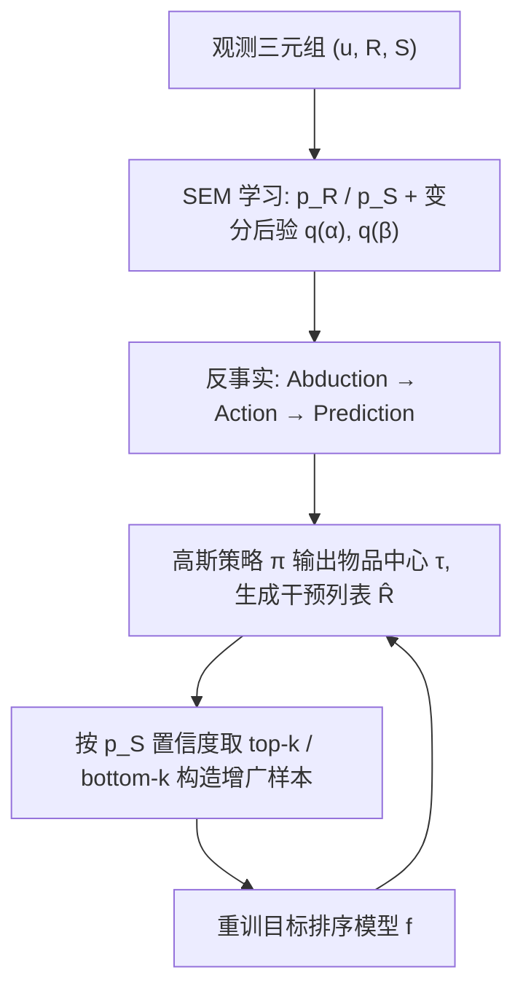

# Top-N Recommendation with Counterfactual User Preference Simulation (基于反事实用户偏好模拟的 Top-N 推荐)

- **会议/期刊**: CIKM 2021
- **作者与机构**: Mengyue Yang, Quanyu Dai, Zhenhua Dong, Xu Chen, Xiuqiang He, Jun Wang（UCL / 华为诺亚方舟实验室 / 中国人民大学高瓴人工智能学院）
- **推荐链路定位**: 精排（Top-N 排序模型的训练数据增广框架）
- **研究方向**: 去偏公平、可信隐私与工业架构 / 冷启动与长尾推荐
- **论文原文**: [https://arxiv.org/abs/2109.02444v2](https://arxiv.org/abs/2109.02444v2)
- **开源代码**: 暂未开源

## TL;DR (1分钟核心速览)

针对 Top-N 推荐日志极度稀疏、喂不饱日益加深的神经排序网络的痛点，本文把推荐过程改写为 Pearl 结构因果模型（$U\to R\to S$），用变分推断学出一个可微"用户模拟器"，再通过反事实干预（换一份推荐列表$R$）合成从未记录过的排序样本；并以目标模型损失为奖励训练高斯策略挑选"最难样本"，理论上给出样本需求与模拟器噪声$\zeta$的$1/(1-2\zeta)^2$ 关系以裁剪噪声。Leave-One-Out + HR/NDCG@10 协议下，MIND-small 上 CPR-LightGCN 的 NDCG@10 相对提升 10.4%，冷门物品桶（<5 交互）HR@10 提升 151.7%。

## Background & Motivation (背景与核心矛盾)

- **主流范式**: 排序推荐以 pairwise BPR 或 pointwise CE 为目标，性能提升路径几乎全靠加深架构——从 MF 到 NeuMF、NGCF、LightGCN。
- **前人局限**: ①真实场景用户只接触极少数物品，交互稀疏且曝光极不平衡，重参数模型在少量样本上严重欠拟合；②已有因果推荐工作（IPS 重加权、无偏嵌入学习、知识蒸馏去偏）走 Rubin 潜在结果框架，只**调整已有样本的权重**，并未**增加样本**，无法解决"总量不足"这一根本矛盾。
- **核心洞察 (Key Insight)**: 推荐日志本质是"系统给出列表 $R$、用户在$R$内做出选择$S$"这一生成过程的产物。若能显式建模$U,R,S$ 之间的结构方程，就能回答反事实问题——"若当初推的是另一份列表，用户会选什么"——并在**保持同一生成环境**（同一 exogenous 分布）的前提下批量造数据，使合成样本与观测样本天然兼容。
- **本文切入点**: 以 SCM + "abduction–action–prediction" 三步骤把模拟器当作数据源，用策略学习定位高价值干预，并用理论导出的置信度裁剪抑制模拟器误差。

## Method (核心方法设计)

### 1. 整体框架 (Overall Architecture)

框架由**推荐模拟器**与**目标排序模型** $f$两部分构成：先用观测三元组$(u,\boldsymbol{r},\boldsymbol{s})$学习随机结构方程$p_R$（系统曝光模型）与$p_S$（用户响应模型），同时用变分分布$q_{\boldsymbol{\phi}}(\boldsymbol{\alpha}),q_{\boldsymbol{\phi}}(\boldsymbol{\beta})$近似 exogenous 变量的后验； abduction 阶段采样$\hat{\boldsymbol{\beta}}$复现该用户的隐含环境，action 阶段主动改写输入列表$\hat{\boldsymbol{r}}$，prediction 阶段按$p_S$解码出新的正反馈集合$\hat{\boldsymbol{s}}$，与$\hat{\boldsymbol{r}}\setminus\hat{\boldsymbol{s}}$组成新样本对；随后由高斯策略$\pi$以$f$的损失为奖励搜索"更难的干预列表"，最后用增广数据重训$f$。整个闭环不修改$f$ 的任何结构，因此对 BPR/GMF/MLP/NeuMF/LightGCN 即插即用。

### 2. 关键设计拆解 (Key Designs)

1. **双嵌入随机 SEM 模拟器（把曝光与响应解耦）**：若直接对 $K$元列表建模，候选空间为$C_{|\mathcal{I}|}^{K}$，不可学。作者把$p_R$因子化为逐位 softmax，并对曝光与响应使用**两套独立嵌入**$(\boldsymbol{P},\boldsymbol{Q})$与$(\boldsymbol{X},\boldsymbol{Y})$，分别刻画"系统想推什么"和"用户会点什么"：
$p_S(\hat{r}_k|U=\hat{u},R=\hat{r},\hat{\boldsymbol{\beta}})=\frac{\exp(\boldsymbol{X}_{\hat{u}}^{\top}\boldsymbol{Y}_{\hat{r}_k}+\boldsymbol{w}_{S,k}\hat{\beta}_k)}{\sum_{j=1}^{K}\exp(\boldsymbol{X}_{\hat{u}}^{\top}\boldsymbol{Y}_{\hat{r}_j}+\boldsymbol{w}_{S,j}\hat{\beta}_j)}$。
外生噪声 $\boldsymbol{\alpha},\boldsymbol{\beta}\sim\mathcal{N}(0,\boldsymbol{I})$充当"时段、心情、系统状态"等不可观测条件，使同一$(u,R)$也能产生不同反馈，避免模拟器退化为确定性打分器。$p_R$因$|\mathcal{I}|$过大采用负采样目标训练，$p_S$因列表长度$K$很小直接精确 softmax；$\boldsymbol{\beta}$后验用 ELBO$\mathbb{E}_{q}[\log p(\boldsymbol{\beta},\mathcal{O})]-\mathbb{E}_{q}[\log q_{\boldsymbol{\phi}}(\boldsymbol{\beta})]$ 做变分近似，从而可重参数化采样。
2. **学习式干预（用目标模型 loss 当奖励挑难样本）**：随机改写列表命中高价值样本的概率极低。作者训练两层 MLP 高斯策略 $\pi(\hat{\boldsymbol{\tau}}_t|\hat{u},\boldsymbol{\theta})$输出连续"物品中心"，再按$(\hat{\boldsymbol{\tau}}_t^{\top}\boldsymbol{Q}_k+\boldsymbol{w}_{R,k}\alpha_k)$取最近$K$ 个物品还原离散列表，奖励即目标模型在该批样本上的损失：
$\mathcal{L}_{\text{Agent}}(\boldsymbol{\theta})=\mathbb{E}_{\hat{\boldsymbol{\tau}}_t\sim\pi(\cdot|\hat{u},\boldsymbol{\theta})}\Big[\sum_{t=1}^{T}\mathcal{L}_{f}\big(C(\hat{\boldsymbol{\tau}}_t)\big)\Big]$。
直觉是：损失越大 ≡ 正负物品倾向越模糊（$\eta\to 1/2$），样本越"难"、信息量越大；连续中心 + 离散还原的写法绕开了组合动作空间的不可导问题。
3. **噪声控制与训练目标**：模拟器不完美时，作者假设它以概率 $\zeta$生成错误排序，在 PAC 框架下推出：当样本量$N>\frac{2\log(2|\mathcal{F}|/\delta)}{\epsilon^{2}(1-2\zeta)^{2}}$时泛化误差小于$\epsilon$（概率$1-\delta$）。$\zeta\to 0.5$时所需样本趋于无穷——即模拟器越差越该少信它。据此提出启发式裁剪：只保留$p_S$置信度最高的 top-$k$与最低的 bottom-$k$物品构成对，$k$ 成为"样本量 vs 噪声"的旋钮。目标模型仍用原始 BPR 或 CE 损失在"观测集 + 增广集"上重训；推理阶段与基线完全一致，无额外在线开销。

## Experimental Setup & Evaluation Protocol (实验设置与评估协议)

- **数据集与预处理**:

| 数据集 | #Users | #Items | #Interactions | 稀疏度/密度 | 特征/场景说明 |
| :--- | :---: | :---: | :---: | :---: | :--- |
| Synthetic | 600 | 300 | 15,000（25 张曝光列表×5 物品/人） | 8.3% | 高斯隐向量 + 线性/非线性响应函数，可调噪声 $N_y$ |
| MIND-small | 50,000 | 20,288 | 234,468（156,965 张曝光列表） | 0.023% | 微软新闻真实曝光日志，含推荐列表结构 |

- **数据划分与防穿越 (Splitting Strategy)**: 遵循 BPR/NeuMF 传统，采用 `Leave-One-Out`（每用户留最后一次交互为测试集，倒数第二次为验证集）。冷启动分析额外按训练集交互数将测试物品切为 Low(<5) / Middle(5–15) / High(>15) 三个桶。
- **排名评测协议 (Ranking Protocol)**: 单正样本 + 全物品打分排序，报 HR@10 与 NDCG@10（相比 BPR 系论文的 @20 设定更严格）。训练负采样来自全物品集或曝光列表内未点击项。
- **对比基线与超参设置**: 基线含非个性化 ItemPop、ItemKNN、去噪自编码器 CDAE、BPR、神经类 GMF/MLP/NeuMF、图模型 LightGCN；并给出随机干预变体 `CPR-*-r` 作为消融锚点。嵌入维度网格 $\{32,\dots,512\}$、批大小$\{256,\dots,2048\}$、学习率$\{5\!\times\!10^{-3},2\!\times\!10^{-3},10^{-3}\}$，模拟器学习率固定$10^{-3}$，列表长度$|\boldsymbol{R}|=5$，裁剪参数$k\in\{1,2,3\}$，策略网络隐层$\{16,32,64\}$。

## Key Experimental Results (实验关键数据)

### 1. 主实验对比 (Main Results)

MIND-small 真实数据（`Full-Ranking`，@10）：

| Model | HR@10 | NDCG@10 | 相对骨干提升 |
| :--- | :---: | :---: | :---: |
| ItemPop | 0.3374 | 0.1608 | — |
| ItemKNN | 0.2403 | 0.1299 | — |
| CDAE | 0.3403 | 0.1637 | — |
| BPR | 0.3440 | 0.1685 | — |
| GMF | 0.3453 | 0.1651 | — |
| MLP | 0.3469 | 0.1662 | — |
| NeuMF | 0.3381 | 0.1630 | — |
| LightGCN | 0.3451 | 0.1658 | — |
| CPR-BPR | 0.3526 | 0.1810 | +2.50% / +7.41% |
| CPR-NeuMF | 0.3512 | 0.1755 | +3.87% / +7.66% |
| **CPR-LightGCN** | **0.3688** | **0.1830** | **+6.86% / +10.40%** |

合成数据上，框架平均带来 **+10.08% HR@10 / +11.17% NDCG@10**；最强增益出现在 CPR-NeuMF（线性 $d{=}32$：HR 0.1203→0.1667，**+38.5%**；NDCG 0.0598→0.0835，**+39.6%**）。

### 2. 消融实验 (Ablation Study)

| 消融维度 | 设置 | 合成 HR@10 | 合成 NDCG@10 | MIND HR@10 | MIND NDCG@10 |
| :--- | :--- | :---: | :---: | :---: | :---: |
| LightGCN 骨干 | 原始 | 0.1503 | 0.0725 | 0.3451 | 0.1658 |
| | + 随机干预 (CPR-`r`) | 0.1600 | 0.0834 | 0.3521 | 0.1719 |
| | + 学习式干预 | **0.1677** | **0.0879** | **0.3688** | **0.1830** |
| NeuMF 骨干 | 原始 | 0.1524 | 0.0758 | 0.3381 | 0.1630 |
| | + 随机干预 (CPR-`r`) | 0.1731 | 0.0937 | 0.3466 | 0.1662 |
| | + 学习式干预 | **0.1851** | **0.0963** | **0.3512** | **0.1755** |
| 裁剪 $k$（噪声$N_y\sim\mathcal{N}(0,0.2)$） |$k{=}1$/$2$/$3$ | 0.3591 / 0.3609 / 0.3580 | **0.2011**(k=2) | — | — |
| 裁剪 $k$（无噪声$N_y{=}0$） |$k{=}1$/$2$/$3$ | 0.4024 / 0.3936 / 0.3877 | **0.2268**(k=1) | — | — |

冷度分桶（MIND-small，HR@10 / NDCG@10）：

| Bucket | BPR | CPR-BPR | LightGCN | CPR-LightGCN |
| :--- | :---: | :---: | :---: | :---: |
| Low (<5) | 0.0367 / 0.0113 | 0.0380 / 0.0121 | 0.0172 / 0.0051 | **0.0433 / 0.0134** (+151.7% / +162.8%) |
| Middle (5–15) | 0.4165 / 0.1426 | 0.4494 / 0.1602 | 0.3385 / 0.1061 | **0.4769 / 0.1601** (+40.9% / +50.9%) |
| High (>15) | 0.8966 / 0.4937 | 0.8930 / 0.5027 | **0.9171 / 0.4781** | 0.9115 / 0.4860 (−0.61% / +1.65%) |

### 3. 关键实验发现 (Key Findings)

1. **增益随骨干容量放大，浅层模型反而被拖累**：合成数据上 NeuMF 拿到 +38.5%/+39.6%，LightGCN 拿到 +22.9%/+38.2%，而 GMF 在 $d{=}16$ 线性设定下 NDCG 反而 −6.5%。这说明反事实增广缓解的正是"深层网络的样本饥饿"，参数量不足的 MF 系无法消化这份额外信号。
2. **学习式干预显著优于随机干预，且在小样本真实集上差距更大**：MIND 上 CPR-LightGCN 的 HR@10 为 0.3688 vs 随机 0.3521、NDCG 0.1830 vs 0.1719；合成 NeuMF 上 0.1851 vs 0.1731。印证"高损失 = 高信息量"的定理 1 直觉——干预列表的选择质量比干预次数更关键。
3. **收益高度集中在冷门物品，热物品出现零/负迁移**：Low 桶 HR@10 从 0.0172 跃至 0.0433（+151.7%），Middle 桶 +40.9%，而 High 桶 HR@10 反而 −0.61%。同时裁剪参数 $k$需随数据噪声自适应：无噪声时$k{=}1$最优（HR 0.4024），$N_y\sim\mathcal{N}(0,0.2)$时$k{=}2$才最优（NDCG 0.2011），验证了定理 2 中"$\zeta$ 越大越该少信生成样本"的预测。

## Highlights & Limitations (亮点、对比与审稿批判)

- **与代表作对比 (vs. Prior Work)**: 相比 IPS/重加权类因果去偏工作（改损失权重、依赖倾向分估计），本文走 Pearl SCM 路线**改样本集合本身**；相比 SGL 类图/序列对比增广（在表征空间扰动、不改标签），本文在"列表级干预"这一语义空间生成标签一致的新样本，二者可叠加；相比 TIGER 类生成式检索，本文的生成器只服务离线训练、不改推理链路，落地风险更低。
- **可迁移亮点**: ①"以目标模型损失为 reward 的策略式难样本生成"可直接迁移到 CTR 精排与多任务学习的样本增广；②top-$k$/bottom-$k$ 置信度裁剪是一个模型无关的通用生成数据过滤器，可套用于任何合成数据训练流水线。
- **审稿级局限批判**: ①三阶段流水线（模拟器预训练 + 策略训练 + 目标模型重训）离线开销显著，且 $p_R$的 softmax 与策略的最近邻还原均需对全物品打分，$|\mathcal{I}|$上百万时成本未评估；②MIND-small 仅 23 万交互且增益（2%–10%）远小于合成数据，论文未给出显著性检验与多随机种子方差，难以判断真实场景稳定性；③$\zeta$与$k$仍靠网格搜索，缺少对模拟器误差的自适应估计，理论结论未落到"自动定$k$"的算法上。

## Rating (四维评分)

- **方法创新性 (Novelty)**: ⭐⭐⭐⭐ （首次把 Pearl 反事实三步骤搬到 Top-N 排序的数据增广，并配 PAC 样本复杂度刻画"生成器越差、样本需求越大"的定量关系）
- **评估协议与实验扎实度 (Protocol & Experiments)**: ⭐⭐⭐⭐ （合成 + 真实双轨验证、含随机干预消融与冷度分桶，但真实集偏小且缺少显著性检验与方差报告）
- **写作与数学规范度 (Clarity & Rigor)**: ⭐⭐⭐⭐ （SCM、变分后验与两个定理推导链条完整、附录给出 Hoeffding 证明；$p_R$ 因子化忽略列表组合效应的近似略显轻描淡写）
- **工业落地与复现价值 (Industrial & Practical Value)**: ⭐⭐⭐ （推理零开销、框架即插即用是最大卖点，但三阶段离线训练与全库 softmax 成本高，且未开源代码复现门槛较高）

