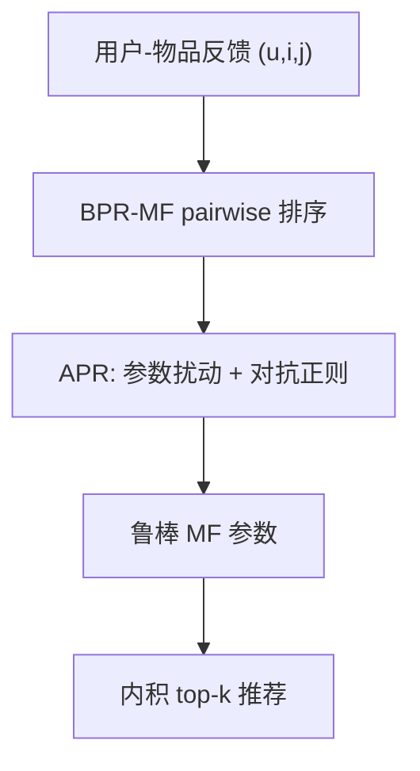

# Understanding the Effects of Adversarial Personalized Ranking Optimization Method on Recommendation Quality（对抗个性化排序优化方法对推荐质量影响的理解）

- **会议/期刊**: AdvML@KDD 2021（论文标注；目标目录标识：CIKM 2021）
- **作者与机构**: Vito Walter Anelli, Yashar Deldjoo, Tommaso Di Noia, Felice Antonio Merra；Polytechnic University of Bari, Italy
- **推荐链路定位**: 精排 / 排序优化（pairwise top-k）
- **研究方向**: 去偏公平、可信隐私与工业架构 / 协同过滤与双塔召回
- **论文原文**: [论文原文链接](https://arxiv.org/abs/2107.13876v1)
- **开源代码**: 暂未开源（论文称代码与数据将公开，但未给出仓库）

## TL;DR (1分钟核心速览)

本文追问 APR 在提升 BPR 准确率与鲁棒性时，是否牺牲新颖性、覆盖度并放大流行度偏差。作者用梯度幅值与全局正/负更新建模，证明尾部分布下 APR 对短头物品更新更强，呈“高脚杯”现象。ML100K/Amazon 时序 Leave-One-Out、top-50 全库排序下，APR-MF 的 nDCG +3.15%/+4.63%，但 Amazon 新颖性 -6.00%、覆盖度 -8.85%、ARP +23.18%。

## Background & Motivation (背景与核心矛盾)

- **主流范式**: BPR 用 $(u,i,j)$ 三元组做 pairwise 排序，是 MF 等模型的主流优化框架；APR 在其上加入对抗扰动训练，以提升鲁棒性并常被报告能提升准确率。
- **前人局限**: APR 的评估几乎只看 accuracy / robustness，忽视 novelty、coverage 与 popularity bias；而 BPR 本身已被发现会强化流行度偏差、压缩长尾。
- **核心洞察 (Key Insight)**: APR 的对抗梯度幅值缓解了 BPR 梯度消失，但也让高频短头物品获得更多、更强的正更新；负样本均匀采样无法抵消这种不对称。
- **本文切入点**: 对 BPR/APR 的梯度更新建模，定义全局正/负更新，再用 MF 在真实数据上验证 beyond-accuracy 代价。

## Method (核心方法设计)

### 1. 整体框架 (Overall Architecture)

输入为用户-物品反馈，MF 以 $d=64$隐向量打分；BPR 用正/负物品对做 pairwise 排序。APR 在 BPR 预训练后，对参数施加$L_2$约束内的最坏扰动$\Delta_{\mathrm{adv}}$，最小化原损失与扰动损失之和，从而同时优化准确性与鲁棒性。推理仍为内积 top-k 排序，额外开销主要在训练期的扰动梯度计算，不在线上打分。

### 2. 关键设计拆解 (Key Designs)

1. **梯度幅值分解（BPR vs. APR）**：BPR 更新由 $\omega_{uij}=1-\sigma(\hat{s}_{uij}(\boldsymbol{\Theta}))$缩放；APR 多一项$\omega^{adv}_{uij}=1-\sigma(\hat{s}_{uij}(\boldsymbol{\Theta}+\Delta_{\mathrm{adv}}))$，更新为$\nabla_{\boldsymbol{\Theta}}\mathcal{L}_{\mathrm{APR}}=\omega_{uij}\nabla_{\boldsymbol{\Theta}}\hat{s}_{uij}(\boldsymbol{\Theta})+\alpha\omega^{adv}_{uij}\nabla_{\boldsymbol{\Theta}}\hat{s}_{uij}(\boldsymbol{\Theta}+\Delta_{\mathrm{adv}})$。前者会梯度消失，后者持续提供较大更新，因此 APR 更稳，但也更强地拟合高频正样本。

<figure class="paper-figure" markdown="span">
  ![图1：如\[29\]所示，DF中(𝑢,𝑖,𝑗)三元组的梯度幅值≤{0.01, 0.1, 0.5}的概率图。](../../../../assets/papers/2107.13876v1/figure_1.png)<figcaption>图1：如[29]所示，DF中(𝑢,𝑖,𝑗)三元组的梯度幅值≤{0.01, 0.1, 0.5}的概率图。</figcaption>
</figure>
图 1：BPR 与 APR 的小梯度三元组概率；APR 缓解 BPR 梯度消失。

2. **全局正/负更新与偏差放大**：尾部数据满足 $p(i\in I_{SH}|u)\ge p(i\in I_{LT}|u)$，而负样本均匀采样使$p(j\in I_{SH}|u)=p(j\in I_{LT}|u)=1/|I|$。定义短头正更新$\Omega^{+}(I_{SH}|D_F(t))=\sum_{(u,i,j)\in D_F(t),i\in I_{SH}}(\omega_{uij}(t)+\omega^{adv}_{uij}(t))$，长尾同理。APR 的额外对抗项使短头获得远多于长尾的正更新，净效果偏向热门物品，形成“高脚杯”三段：BPR 基座、BPR 梯度消失的杯柄、APR 放大的杯腹。

3. **训练目标、负采样与推理效率**：总损失为 $\mathcal{L}_{\mathrm{APR}}(\boldsymbol{\Theta})=\mathcal{L}_{\mathrm{BPR}}(\boldsymbol{\Theta})+\alpha\mathcal{L}_{\mathrm{BPR}}(\boldsymbol{\Theta}+\Delta_{\mathrm{adv}})$，其中$\Delta_{\mathrm{adv}}=\epsilon\Gamma/\|\Gamma\|$，$\Gamma=\partial\mathcal{L}_{\mathrm{BPR}}(\hat{\boldsymbol{\Theta}}+\Delta)/\partial\Delta$。训练采用均匀负采样；推理为标准 MF 内积排序，无额外候选生成开销，但训练需额外对抗梯度。

## Experimental Setup & Evaluation Protocol (实验设置与评估协议)

- **数据集与预处理**:

| 数据集 | #Users | #Items | #Interactions | 稀疏度/密度 | 特征/场景说明 |
| :--- | :---: | :---: | :---: | :---: | :--- |
| ML100K | 943 | 1,682 | 100,000 | 6.31% | 电影评分；$p(I_{SH})=0.6452>p(I_{LT})=0.3548$ |
| Amazon | 3,915 | 2,549 | 77,328 | 0.77% | 电商评分；$p(I_{SH})=0.5747>p(I_{LT})=0.4253$ |

- **数据划分与防穿越**: 采用时序 `Leave-One-Out`；每个用户最后交互作测试，之前按时间划分训练/验证。
- **排名评测协议**: top-50 全库未交互物品排序（`Full-Ranking`）；训练负采样为均匀采样。指标含 Rec/Prec/nDCG、Nov、Cov%、ARP、APLT、ACLT。
- **对比基线与超参设置**: 原文为 5 页短文，主表仅对比 BPR-MF 与 APR-MF，未提供 5–8 个外部 SOTA，故不虚构基线；显著性用 paired t-test，$p\le0.05$。MF 维度$f=64$，$T_{\mathrm{BPR}}=100$、$T_{\mathrm{APR}}=200$；$\eta\in\{0.005,0.01,0.05\}$，$\epsilon\in\{0.001,0.01,0.1,1.0\}$，$\alpha\in\{0.001,0.01,0.1,1.0,10.0\}$，以 Rec@50 验证。

## Key Experimental Results (实验关键数据)

### 1. 主实验对比 (Main Results)

表 1：top-50 结果；`*` 表示相对 BPR-MF 在 $p\le0.05$ 下显著。ARP 越高、APLT/ACLT 越低表示长尾偏差越严重（按原文结论解读）。

| 数据集 | 模型 | Rec@50 | Prec@50 | nDCG@50 | Nov | Cov% | ARP | APLT | ACLT |
| :--- | :--- | :---: | :---: | :---: | :---: | :---: | :---: | :---: | :---: |
| ML100K | BPR-MF | 0.3871 | 0.0077 | 0.1222 | **2.7653** | **71.22** | **176.64** | **0.2890** | **14.4486** |
| ML100K | APR-MF | **0.3966** | **0.0079** | **0.1260*** | 2.7577* | 71.22* | 177.33* | 0.2841* | 14.2068* |
| ML100K | R.V. vs BPR | +2.47% | +2.47% | +3.15% | -0.27% | 0.00% | +0.39% | -1.67% | -1.67% |
| Amazon | BPR-MF | 0.2077 | 0.0042 | 0.0656 | **6.0431** | **99.37** | **106.59** | **0.3541** | **17.7055** |
| Amazon | APR-MF | **0.2130** | **0.0043** | **0.0687*** | 5.6805* | 90.58* | 131.30* | 0.2829* | 14.1471* |
| Amazon | R.V. vs BPR | +2.58% | +2.58% | +4.63% | -6.00% | -8.85% | +23.18% | -20.10% | -20.10% |

### 2. 消融实验 (Ablation Study)

表 2：按目标函数拆解，$\alpha=0$ 即退回 BPR-MF，等价于移除对抗正则项。

| 变体 | ML100K nDCG@50 | ML100K Nov | ML100K Cov% | Amazon nDCG@50 | Amazon Nov | Amazon Cov% | Amazon ARP |
| :--- | :---: | :---: | :---: | :---: | :---: | :---: | :---: |
| w/o 对抗正则（$\alpha=0$，BPR-MF） | 0.1222 | **2.7653** | **71.22** | 0.0656 | **6.0431** | **99.37** | **106.59** |
| Full APR-MF | **0.1260** | 2.7577 | 71.22 | **0.0687** | 5.6805 | 90.58 | 131.30 |
| Δ | +3.15% | -0.27% | 0.00% | +4.63% | -6.00% | -8.85% | +23.18% |

### 3. 关键实验发现 (Key Findings)

- **准确率与 beyond-accuracy 存在权衡**：APR-MF 在 ML100K/Amazon 上 nDCG 分别提升 +3.15%/+4.63%，但 Amazon 的 Nov 降 -6.00%、Cov 降 -8.85%，ML100K 的 Nov 也降 -0.27%，说明“准确率免费提升”不成立。
- **APR 比 BPR 更放大流行度偏差**：Amazon 的 ARP 升 +23.18%，APLT/ACLT 各降 -20.10%；ML100K 虽较轻，ARP 仍升 +0.39%，APLT/ACLT 各降 -1.67%。数据越稀疏（Amazon 密度仅 0.77%），偏差放大越明显。
- **机制归因指向短头正更新不对称**：图 1 中 BPR 在 Amazon 超 85%、ML100K 超 65% 的三元组上 $\omega<0.01$，APR 的$\omega^{adv}$ 抑制了这种消失；但额外正更新主要落在短头正样本上，形成“高脚杯”杯腹，最终推高热门物品曝光。

## Highlights & Limitations (亮点、对比与审稿批判)

- **与代表作对比**: He et al. 的 APR 主要证明鲁棒性与 accuracy 收益；本文不提出新模型，而是揭示其 beyond-accuracy 代价。相比 BPR 偏差研究，本文进一步指出对抗正则会放大 BPR 的短头偏好，而非仅继承。
- **可迁移亮点**: 用 $\Omega^{+}/\Omega^{-}$ 监控训练期正/负更新在短头与长尾上的分布，可作为对抗训练、重排或去偏正则的通用诊断工具；评估应同时报告 accuracy、Nov/Cov 与 ARP/APLT/ACLT。
- **审稿级局限批判**: 实验仅用 MF 与两个中小规模数据集，缺少外部 SOTA、线上 A/B 与真实大规模验证；论文只诊断问题，未给出缓解策略。APR 需额外对抗梯度，$\epsilon,\alpha$ 网格搜索成本高，且代码仓库未实际给出，复现性仍受限。

## Rating (四维评分)

- **方法创新性 (Novelty)**: ⭐⭐⭐（诊断性理论与实证贡献扎实，但非新推荐算法）
- **评估协议与实验扎实度 (Protocol & Experiments)**: ⭐⭐⭐（时序 LOO、显著性检验与偏差指标完整，但仅 2 数据集、2 对照）
- **写作与数学规范度 (Clarity & Rigor)**: ⭐⭐⭐⭐（5 页内公式链清楚，“高脚杯”现象直观）
- **工业落地与复现价值 (Industrial & Practical Value)**: ⭐⭐⭐（对对抗训练上线有警示价值，但缺缓解方案与开源实现）

